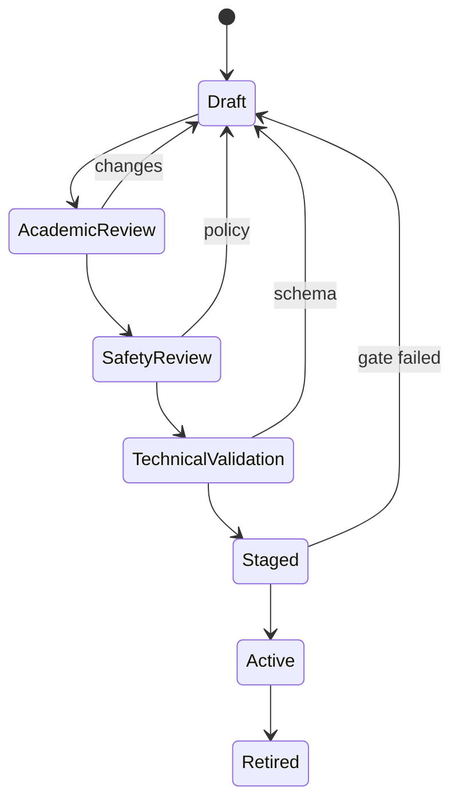

# Curriculum Catalog — English & Chinese 90 ngày

## 1. Document control

| Thuộc tính | Giá trị |
|---|---|
| Document ID | LP-CURR-001 |
| Content type | Production curriculum specification |
| Phiên bản | 1.0.0 |
| Trạng thái | Baseline để triển khai; thay đổi phải qua review |
| Ngày hiệu lực | 2026-08-15 |
| Owner | Head of Learning |
| Approvers | Product Owner, Academic Lead, AI Safety Lead |
| Ngôn ngữ | English (`en`), Mandarin Simplified (`zh-CN`) |
| Phạm vi | Ngày 1–90, Level 1–7, nghe–đọc–nói |
| Review cadence | Hằng quý hoặc khi rubric/model/policy đổi |

### 1.1 Mục đích

Catalog này khóa ID ổn định, lesson inventory, prerequisite, coverage và checkpoint.
Catalog là hợp đồng nội dung có thể nhập vào database.
Catalog không tự chứng nhận Level.
Level chỉ được xác nhận khi đủ bằng chứng theo acceptance gate.
Ngày học và streak không phải bằng chứng năng lực.

### 1.2 Quy tắc kiểm soát thay đổi

- MAJOR đổi ý nghĩa ID, Level hoặc rubric lõi.
- MINOR thêm nội dung tương thích.
- PATCH sửa metadata không đổi hành vi.
- ID đã phát hành không được tái sử dụng.
- Nội dung rút khỏi sản phẩm mang trạng thái `retired`, không xóa lịch sử.
- Thay đổi điểm số cần Academic Lead và AI Safety Lead phê duyệt.
- Release phải có migration note và rollback target.
- Không lưu PII hay API key trong payload nội dung.

## 2. Triết lý và chuẩn Level

- Comprehensible input đi trước controlled output.
- Mỗi ngày có nghe, đọc, nói và retrieval review.
- AI đưa phản hồi; rubric và gate kiểm soát quyết định.
- Phản hồi ưu tiên lỗi có tác động lớn nhất.
- English chấp nhận nhiều accent, chấm intelligibility.
- zh-CN lưu Hanzi giản thể, Pinyin dấu thanh và nghĩa.
- Nội dung cá nhân hóa không được đổi objective canonical.
- Speaking Level phải dựa trên audio thật, không dựa transcript tự khai.

| Level | Ngày | Năng lực đầu ra |
|---|---:|---|
| 1 | 1–10 | Câu/cụm rất quen thuộc |
| 2 | 11–22 | Giao dịch và sinh hoạt quen thuộc |
| 3 | 23–35 | Kể và mô tả có liên kết |
| 4 | 36–49 | Tóm tắt, suy luận, tương tác độc lập |
| 5 | 50–63 | Lập luận có dẫn chứng |
| 6 | 64–77 | Giao tiếp học thuật/nghề nghiệp |
| 7 | 78–90 | Tổng hợp, phản biện, ứng đáp tự nhiên |

Mốc ngày là nhịp nội dung, không phải bảo đảm đạt Level.
Người học có thể nhận remedial hoặc extension.
Không tăng Level nếu một kỹ năng dưới sàn.

## 3. Stable ID contract

- Unit EN: `EN-L{level:02}-D{day:03}-U01`.
- Unit Chinese: `ZH-CN-L{level:02}-D{day:03}-U01`.
- Listening: `{unit_id}-LIS01`.
- Reading: `{unit_id}-REA01`.
- Speaking: `{unit_id}-SPE01`.
- Review: `{unit_id}-REV01`.
- Rubric: `RB-{language}-L{level:02}-V01`.
- Checkpoint: `CP-{language}-D{day:03}-V01`.
- Asset: `AST-{language}-{modality}-{hash_prefix}`.

### 3.1 ID invariants

- ID là khóa kỹ thuật, không dịch.
- Language chỉ nhận `EN` hoặc `ZH-CN`.
- Day có ba chữ số; Level có hai chữ số.
- Một lesson thuộc đúng một unit canonical.
- Biến thể dễ/khó dùng revision, không ghi đè ID.
- Event gửi unit_id, lesson_id và content_version.
- Kết quả checkpoint gửi rubric_version.
- Server từ chối ID ngoài catalog release active.

## 4. Lesson inventory contract

Mỗi unit có đúng bốn lesson canonical.

| Hậu tố | Kỹ năng | Hoạt động | Bằng chứng |
|---|---|---|---|
| LIS01 | Listening | gist → detail → shadow | đáp án, replay, confidence |
| REA01 | Reading | skim → scan → infer | đáp án, highlight, summary |
| SPE01 | Speaking | prepare → record → retry | audio, ASR, dimension scores |
| REV01 | Review | retrieve → correct | score delta, remaining errors |

### 4.1 English constraints

- Transcript chuẩn và accent metadata bắt buộc.
- Audio tăng từ 90–110 WPM lên 150–180 WPM.
- Reading tăng từ 60–100 lên 450–600 từ.
- Speaking tăng từ 15–30 giây lên 4–5 phút.
- Chấm task, control, fluency, intelligibility, stress/rhythm.
- Không trừ điểm chỉ vì accent không bản ngữ.

### 4.2 zh-CN constraints

- Có Hanzi giản thể, Hanyu Pinyin có dấu và nghĩa.
- Audio có syllables_per_minute và speaker region.
- Level 1–2 hiện Pinyin; Level 3 giảm; Level 4+ mặc định ẩn.
- Reading tăng từ 30–60 lên 350–500 Hanzi.
- Speaking tăng từ 10–20 giây lên 3–5 phút.
- Chấm âm đầu, vận mẫu, thanh điệu, biến điệu và intelligibility.

## 5. Prerequisite graph

```mermaid
flowchart LR
 P["Placement evidence"] --> L1["L1 D001–D010"] --> G1["Gate D010"]
 G1 --> L2["L2 D011–D022"] --> G2["Gate D022"]
 G2 --> L3["L3 D023–D035"] --> G3["Gate D035"]
 G3 --> L4["L4 D036–D049"] --> G4["Gate D049"]
 G4 --> L5["L5 D050–D063"] --> G5["Gate D063"]
 G5 --> L6["L6 D064–D077"] --> G6["Gate D077"]
 G6 --> L7["L7 D078–D090"] --> G7["Verified final"]
```

- Ngày N phụ thuộc REV01 ngày N−1 cùng ngôn ngữ.
- Ngày đầu Level phụ thuộc gate trước hoặc diagnostic exemption.
- Trượt gate tạo remedial, không khóa toàn app.
- Extension không thay checkpoint canonical.
- EN và zh-CN học song song nhưng evidence không chuyển chéo.
- Bỏ unit cần diagnostic lưu assessor, version và confidence.
- Prerequisite được kiểm tra server-side.
- Graph release không được có cycle hoặc orphan.

## 6. Objective → exercise → rubric → checkpoint

| Bước | Hợp đồng |
|---|---|
| Objective | hành vi quan sát được + ngữ cảnh + ngưỡng |
| Listening | gist, detail, inference, shadow |
| Reading | main idea, evidence, vocabulary, summary |
| Speaking | task, control, fluency, intelligibility |
| Rubric | dimension 0–4 với anchor |
| Checkpoint | item mới, điều kiện hợp lệ |
| Decision | pass, remedial, retry-invalid, extension |
| Evidence | artifact có retention class |

Trọng số: Listening 30%, Reading 35%, Speaking 35%.
Điểm tổng không bù kỹ năng dưới sàn.
AI không được tự sửa trọng số hay pass gate.

## 7. Daily catalog

### Ngày 001 — Level 1
- **EN unit:** `EN-L01-D001-U01` — Chào hỏi và giới thiệu; objective: tạo câu mẫu ngắn đúng ý.
- **EN lessons:** `EN-L01-D001-U01-LIS01`, `EN-L01-D001-U01-REA01`, `EN-L01-D001-U01-SPE01`, `EN-L01-D001-U01-REV01`.
- **zh-CN unit:** `ZH-CN-L01-D001-U01` — 问候与自我介绍; objective: tạo câu mẫu ngắn đúng ý.
- **zh-CN lessons:** `ZH-CN-L01-D001-U01-LIS01`, `ZH-CN-L01-D001-U01-REA01`, `ZH-CN-L01-D001-U01-SPE01`, `ZH-CN-L01-D001-U01-REV01`.
- **Flow:** nghe gist/detail → đọc evidence/inference → nói task → retrieval correction.
- **Rubric:** `RB-EN-L01-V01`, `RB-ZH-CN-L01-V01`; sàn từng kỹ năng 60/100.
- **Prerequisite:** Placement evidence hợp lệ.
- **Evidence:** answer events + reading trace + audio thật + ASR confidence + dimension scores.
- **Checkpoint:** formative evidence; không xác nhận Level.

### Ngày 002 — Level 1
- **EN unit:** `EN-L01-D002-U01` — Thông tin cá nhân; objective: tạo câu mẫu ngắn đúng ý.
- **EN lessons:** `EN-L01-D002-U01-LIS01`, `EN-L01-D002-U01-REA01`, `EN-L01-D002-U01-SPE01`, `EN-L01-D002-U01-REV01`.
- **zh-CN unit:** `ZH-CN-L01-D002-U01` — 个人信息; objective: tạo câu mẫu ngắn đúng ý.
- **zh-CN lessons:** `ZH-CN-L01-D002-U01-LIS01`, `ZH-CN-L01-D002-U01-REA01`, `ZH-CN-L01-D002-U01-SPE01`, `ZH-CN-L01-D002-U01-REV01`.
- **Flow:** nghe gist/detail → đọc evidence/inference → nói task → retrieval correction.
- **Rubric:** `RB-EN-L01-V01`, `RB-ZH-CN-L01-V01`; sàn từng kỹ năng 60/100.
- **Prerequisite:** EN/ZH-CN Level 01 Day 001 REV01.
- **Evidence:** answer events + reading trace + audio thật + ASR confidence + dimension scores.
- **Checkpoint:** formative evidence; không xác nhận Level.

### Ngày 003 — Level 1
- **EN unit:** `EN-L01-D003-U01` — Số và tuổi; objective: tạo câu mẫu ngắn đúng ý.
- **EN lessons:** `EN-L01-D003-U01-LIS01`, `EN-L01-D003-U01-REA01`, `EN-L01-D003-U01-SPE01`, `EN-L01-D003-U01-REV01`.
- **zh-CN unit:** `ZH-CN-L01-D003-U01` — 数字与年龄; objective: tạo câu mẫu ngắn đúng ý.
- **zh-CN lessons:** `ZH-CN-L01-D003-U01-LIS01`, `ZH-CN-L01-D003-U01-REA01`, `ZH-CN-L01-D003-U01-SPE01`, `ZH-CN-L01-D003-U01-REV01`.
- **Flow:** nghe gist/detail → đọc evidence/inference → nói task → retrieval correction.
- **Rubric:** `RB-EN-L01-V01`, `RB-ZH-CN-L01-V01`; sàn từng kỹ năng 60/100.
- **Prerequisite:** EN/ZH-CN Level 01 Day 002 REV01.
- **Evidence:** answer events + reading trace + audio thật + ASR confidence + dimension scores.
- **Checkpoint:** formative evidence; không xác nhận Level.

### Ngày 004 — Level 1
- **EN unit:** `EN-L01-D004-U01` — Quốc gia và ngôn ngữ; objective: tạo câu mẫu ngắn đúng ý.
- **EN lessons:** `EN-L01-D004-U01-LIS01`, `EN-L01-D004-U01-REA01`, `EN-L01-D004-U01-SPE01`, `EN-L01-D004-U01-REV01`.
- **zh-CN unit:** `ZH-CN-L01-D004-U01` — 国家与语言; objective: tạo câu mẫu ngắn đúng ý.
- **zh-CN lessons:** `ZH-CN-L01-D004-U01-LIS01`, `ZH-CN-L01-D004-U01-REA01`, `ZH-CN-L01-D004-U01-SPE01`, `ZH-CN-L01-D004-U01-REV01`.
- **Flow:** nghe gist/detail → đọc evidence/inference → nói task → retrieval correction.
- **Rubric:** `RB-EN-L01-V01`, `RB-ZH-CN-L01-V01`; sàn từng kỹ năng 60/100.
- **Prerequisite:** EN/ZH-CN Level 01 Day 003 REV01.
- **Evidence:** answer events + reading trace + audio thật + ASR confidence + dimension scores.
- **Checkpoint:** formative evidence; không xác nhận Level.

### Ngày 005 — Level 1
- **EN unit:** `EN-L01-D005-U01` — Gia đình gần; objective: tạo câu mẫu ngắn đúng ý.
- **EN lessons:** `EN-L01-D005-U01-LIS01`, `EN-L01-D005-U01-REA01`, `EN-L01-D005-U01-SPE01`, `EN-L01-D005-U01-REV01`.
- **zh-CN unit:** `ZH-CN-L01-D005-U01` — 家庭成员; objective: tạo câu mẫu ngắn đúng ý.
- **zh-CN lessons:** `ZH-CN-L01-D005-U01-LIS01`, `ZH-CN-L01-D005-U01-REA01`, `ZH-CN-L01-D005-U01-SPE01`, `ZH-CN-L01-D005-U01-REV01`.
- **Flow:** nghe gist/detail → đọc evidence/inference → nói task → retrieval correction.
- **Rubric:** `RB-EN-L01-V01`, `RB-ZH-CN-L01-V01`; sàn từng kỹ năng 60/100.
- **Prerequisite:** EN/ZH-CN Level 01 Day 004 REV01.
- **Evidence:** answer events + reading trace + audio thật + ASR confidence + dimension scores.
- **Checkpoint:** formative evidence; không xác nhận Level.

### Ngày 006 — Level 1
- **EN unit:** `EN-L01-D006-U01` — Đồ vật hằng ngày; objective: tạo câu mẫu ngắn đúng ý.
- **EN lessons:** `EN-L01-D006-U01-LIS01`, `EN-L01-D006-U01-REA01`, `EN-L01-D006-U01-SPE01`, `EN-L01-D006-U01-REV01`.
- **zh-CN unit:** `ZH-CN-L01-D006-U01` — 日常物品; objective: tạo câu mẫu ngắn đúng ý.
- **zh-CN lessons:** `ZH-CN-L01-D006-U01-LIS01`, `ZH-CN-L01-D006-U01-REA01`, `ZH-CN-L01-D006-U01-SPE01`, `ZH-CN-L01-D006-U01-REV01`.
- **Flow:** nghe gist/detail → đọc evidence/inference → nói task → retrieval correction.
- **Rubric:** `RB-EN-L01-V01`, `RB-ZH-CN-L01-V01`; sàn từng kỹ năng 60/100.
- **Prerequisite:** EN/ZH-CN Level 01 Day 005 REV01.
- **Evidence:** answer events + reading trace + audio thật + ASR confidence + dimension scores.
- **Checkpoint:** formative evidence; không xác nhận Level.

### Ngày 007 — Level 1
- **EN unit:** `EN-L01-D007-U01` — Màu sắc và mô tả; objective: tạo câu mẫu ngắn đúng ý.
- **EN lessons:** `EN-L01-D007-U01-LIS01`, `EN-L01-D007-U01-REA01`, `EN-L01-D007-U01-SPE01`, `EN-L01-D007-U01-REV01`.
- **zh-CN unit:** `ZH-CN-L01-D007-U01` — 颜色与描述; objective: tạo câu mẫu ngắn đúng ý.
- **zh-CN lessons:** `ZH-CN-L01-D007-U01-LIS01`, `ZH-CN-L01-D007-U01-REA01`, `ZH-CN-L01-D007-U01-SPE01`, `ZH-CN-L01-D007-U01-REV01`.
- **Flow:** nghe gist/detail → đọc evidence/inference → nói task → retrieval correction.
- **Rubric:** `RB-EN-L01-V01`, `RB-ZH-CN-L01-V01`; sàn từng kỹ năng 60/100.
- **Prerequisite:** EN/ZH-CN Level 01 Day 006 REV01.
- **Evidence:** answer events + reading trace + audio thật + ASR confidence + dimension scores.
- **Checkpoint:** `CP-EN-D007-V01` và `CP-ZH-CN-D007-V01`; quyết định theo gate.

### Ngày 008 — Level 1
- **EN unit:** `EN-L01-D008-U01` — Thời gian cơ bản; objective: tạo câu mẫu ngắn đúng ý.
- **EN lessons:** `EN-L01-D008-U01-LIS01`, `EN-L01-D008-U01-REA01`, `EN-L01-D008-U01-SPE01`, `EN-L01-D008-U01-REV01`.
- **zh-CN unit:** `ZH-CN-L01-D008-U01` — 基本时间; objective: tạo câu mẫu ngắn đúng ý.
- **zh-CN lessons:** `ZH-CN-L01-D008-U01-LIS01`, `ZH-CN-L01-D008-U01-REA01`, `ZH-CN-L01-D008-U01-SPE01`, `ZH-CN-L01-D008-U01-REV01`.
- **Flow:** nghe gist/detail → đọc evidence/inference → nói task → retrieval correction.
- **Rubric:** `RB-EN-L01-V01`, `RB-ZH-CN-L01-V01`; sàn từng kỹ năng 60/100.
- **Prerequisite:** EN/ZH-CN Level 01 Day 007 REV01.
- **Evidence:** answer events + reading trace + audio thật + ASR confidence + dimension scores.
- **Checkpoint:** formative evidence; không xác nhận Level.

### Ngày 009 — Level 1
- **EN unit:** `EN-L01-D009-U01` — Lịch sinh hoạt; objective: tạo câu mẫu ngắn đúng ý.
- **EN lessons:** `EN-L01-D009-U01-LIS01`, `EN-L01-D009-U01-REA01`, `EN-L01-D009-U01-SPE01`, `EN-L01-D009-U01-REV01`.
- **zh-CN unit:** `ZH-CN-L01-D009-U01` — 日常作息; objective: tạo câu mẫu ngắn đúng ý.
- **zh-CN lessons:** `ZH-CN-L01-D009-U01-LIS01`, `ZH-CN-L01-D009-U01-REA01`, `ZH-CN-L01-D009-U01-SPE01`, `ZH-CN-L01-D009-U01-REV01`.
- **Flow:** nghe gist/detail → đọc evidence/inference → nói task → retrieval correction.
- **Rubric:** `RB-EN-L01-V01`, `RB-ZH-CN-L01-V01`; sàn từng kỹ năng 60/100.
- **Prerequisite:** EN/ZH-CN Level 01 Day 008 REV01.
- **Evidence:** answer events + reading trace + audio thật + ASR confidence + dimension scores.
- **Checkpoint:** formative evidence; không xác nhận Level.

### Ngày 010 — Level 1
- **EN unit:** `EN-L01-D010-U01` — Checkpoint nền tảng; objective: tạo câu mẫu ngắn đúng ý.
- **EN lessons:** `EN-L01-D010-U01-LIS01`, `EN-L01-D010-U01-REA01`, `EN-L01-D010-U01-SPE01`, `EN-L01-D010-U01-REV01`.
- **zh-CN unit:** `ZH-CN-L01-D010-U01` — 基础检查点; objective: tạo câu mẫu ngắn đúng ý.
- **zh-CN lessons:** `ZH-CN-L01-D010-U01-LIS01`, `ZH-CN-L01-D010-U01-REA01`, `ZH-CN-L01-D010-U01-SPE01`, `ZH-CN-L01-D010-U01-REV01`.
- **Flow:** nghe gist/detail → đọc evidence/inference → nói task → retrieval correction.
- **Rubric:** `RB-EN-L01-V01`, `RB-ZH-CN-L01-V01`; sàn từng kỹ năng 60/100.
- **Prerequisite:** EN/ZH-CN Level 01 Day 009 REV01.
- **Evidence:** answer events + reading trace + audio thật + ASR confidence + dimension scores.
- **Checkpoint:** `CP-EN-D010-V01` và `CP-ZH-CN-D010-V01`; quyết định theo gate.

### Ngày 011 — Level 2
- **EN unit:** `EN-L02-D011-U01` — Nhà và phòng; objective: xử lý tình huống quen thuộc.
- **EN lessons:** `EN-L02-D011-U01-LIS01`, `EN-L02-D011-U01-REA01`, `EN-L02-D011-U01-SPE01`, `EN-L02-D011-U01-REV01`.
- **zh-CN unit:** `ZH-CN-L02-D011-U01` — 家与房间; objective: xử lý tình huống quen thuộc.
- **zh-CN lessons:** `ZH-CN-L02-D011-U01-LIS01`, `ZH-CN-L02-D011-U01-REA01`, `ZH-CN-L02-D011-U01-SPE01`, `ZH-CN-L02-D011-U01-REV01`.
- **Flow:** nghe gist/detail → đọc evidence/inference → nói task → retrieval correction.
- **Rubric:** `RB-EN-L02-V01`, `RB-ZH-CN-L02-V01`; sàn từng kỹ năng 60/100.
- **Prerequisite:** Gate Level 1 hoặc diagnostic exemption.
- **Evidence:** answer events + reading trace + audio thật + ASR confidence + dimension scores.
- **Checkpoint:** formative evidence; không xác nhận Level.

### Ngày 012 — Level 2
- **EN unit:** `EN-L02-D012-U01` — Đồ ăn thức uống; objective: xử lý tình huống quen thuộc.
- **EN lessons:** `EN-L02-D012-U01-LIS01`, `EN-L02-D012-U01-REA01`, `EN-L02-D012-U01-SPE01`, `EN-L02-D012-U01-REV01`.
- **zh-CN unit:** `ZH-CN-L02-D012-U01` — 食物和饮料; objective: xử lý tình huống quen thuộc.
- **zh-CN lessons:** `ZH-CN-L02-D012-U01-LIS01`, `ZH-CN-L02-D012-U01-REA01`, `ZH-CN-L02-D012-U01-SPE01`, `ZH-CN-L02-D012-U01-REV01`.
- **Flow:** nghe gist/detail → đọc evidence/inference → nói task → retrieval correction.
- **Rubric:** `RB-EN-L02-V01`, `RB-ZH-CN-L02-V01`; sàn từng kỹ năng 60/100.
- **Prerequisite:** EN/ZH-CN Level 02 Day 011 REV01.
- **Evidence:** answer events + reading trace + audio thật + ASR confidence + dimension scores.
- **Checkpoint:** formative evidence; không xác nhận Level.

### Ngày 013 — Level 2
- **EN unit:** `EN-L02-D013-U01` — Gọi món; objective: xử lý tình huống quen thuộc.
- **EN lessons:** `EN-L02-D013-U01-LIS01`, `EN-L02-D013-U01-REA01`, `EN-L02-D013-U01-SPE01`, `EN-L02-D013-U01-REV01`.
- **zh-CN unit:** `ZH-CN-L02-D013-U01` — 餐厅点餐; objective: xử lý tình huống quen thuộc.
- **zh-CN lessons:** `ZH-CN-L02-D013-U01-LIS01`, `ZH-CN-L02-D013-U01-REA01`, `ZH-CN-L02-D013-U01-SPE01`, `ZH-CN-L02-D013-U01-REV01`.
- **Flow:** nghe gist/detail → đọc evidence/inference → nói task → retrieval correction.
- **Rubric:** `RB-EN-L02-V01`, `RB-ZH-CN-L02-V01`; sàn từng kỹ năng 60/100.
- **Prerequisite:** EN/ZH-CN Level 02 Day 012 REV01.
- **Evidence:** answer events + reading trace + audio thật + ASR confidence + dimension scores.
- **Checkpoint:** formative evidence; không xác nhận Level.

### Ngày 014 — Level 2
- **EN unit:** `EN-L02-D014-U01` — Mua sắm cơ bản; objective: xử lý tình huống quen thuộc.
- **EN lessons:** `EN-L02-D014-U01-LIS01`, `EN-L02-D014-U01-REA01`, `EN-L02-D014-U01-SPE01`, `EN-L02-D014-U01-REV01`.
- **zh-CN unit:** `ZH-CN-L02-D014-U01` — 基础购物; objective: xử lý tình huống quen thuộc.
- **zh-CN lessons:** `ZH-CN-L02-D014-U01-LIS01`, `ZH-CN-L02-D014-U01-REA01`, `ZH-CN-L02-D014-U01-SPE01`, `ZH-CN-L02-D014-U01-REV01`.
- **Flow:** nghe gist/detail → đọc evidence/inference → nói task → retrieval correction.
- **Rubric:** `RB-EN-L02-V01`, `RB-ZH-CN-L02-V01`; sàn từng kỹ năng 60/100.
- **Prerequisite:** EN/ZH-CN Level 02 Day 013 REV01.
- **Evidence:** answer events + reading trace + audio thật + ASR confidence + dimension scores.
- **Checkpoint:** `CP-EN-D014-V01` và `CP-ZH-CN-D014-V01`; quyết định theo gate.

### Ngày 015 — Level 2
- **EN unit:** `EN-L02-D015-U01` — Chỉ đường; objective: xử lý tình huống quen thuộc.
- **EN lessons:** `EN-L02-D015-U01-LIS01`, `EN-L02-D015-U01-REA01`, `EN-L02-D015-U01-SPE01`, `EN-L02-D015-U01-REV01`.
- **zh-CN unit:** `ZH-CN-L02-D015-U01` — 问路; objective: xử lý tình huống quen thuộc.
- **zh-CN lessons:** `ZH-CN-L02-D015-U01-LIS01`, `ZH-CN-L02-D015-U01-REA01`, `ZH-CN-L02-D015-U01-SPE01`, `ZH-CN-L02-D015-U01-REV01`.
- **Flow:** nghe gist/detail → đọc evidence/inference → nói task → retrieval correction.
- **Rubric:** `RB-EN-L02-V01`, `RB-ZH-CN-L02-V01`; sàn từng kỹ năng 60/100.
- **Prerequisite:** EN/ZH-CN Level 02 Day 014 REV01.
- **Evidence:** answer events + reading trace + audio thật + ASR confidence + dimension scores.
- **Checkpoint:** formative evidence; không xác nhận Level.

### Ngày 016 — Level 2
- **EN unit:** `EN-L02-D016-U01` — Phương tiện đi lại; objective: xử lý tình huống quen thuộc.
- **EN lessons:** `EN-L02-D016-U01-LIS01`, `EN-L02-D016-U01-REA01`, `EN-L02-D016-U01-SPE01`, `EN-L02-D016-U01-REV01`.
- **zh-CN unit:** `ZH-CN-L02-D016-U01` — 交通出行; objective: xử lý tình huống quen thuộc.
- **zh-CN lessons:** `ZH-CN-L02-D016-U01-LIS01`, `ZH-CN-L02-D016-U01-REA01`, `ZH-CN-L02-D016-U01-SPE01`, `ZH-CN-L02-D016-U01-REV01`.
- **Flow:** nghe gist/detail → đọc evidence/inference → nói task → retrieval correction.
- **Rubric:** `RB-EN-L02-V01`, `RB-ZH-CN-L02-V01`; sàn từng kỹ năng 60/100.
- **Prerequisite:** EN/ZH-CN Level 02 Day 015 REV01.
- **Evidence:** answer events + reading trace + audio thật + ASR confidence + dimension scores.
- **Checkpoint:** formative evidence; không xác nhận Level.

### Ngày 017 — Level 2
- **EN unit:** `EN-L02-D017-U01` — Thời tiết; objective: xử lý tình huống quen thuộc.
- **EN lessons:** `EN-L02-D017-U01-LIS01`, `EN-L02-D017-U01-REA01`, `EN-L02-D017-U01-SPE01`, `EN-L02-D017-U01-REV01`.
- **zh-CN unit:** `ZH-CN-L02-D017-U01` — 天气; objective: xử lý tình huống quen thuộc.
- **zh-CN lessons:** `ZH-CN-L02-D017-U01-LIS01`, `ZH-CN-L02-D017-U01-REA01`, `ZH-CN-L02-D017-U01-SPE01`, `ZH-CN-L02-D017-U01-REV01`.
- **Flow:** nghe gist/detail → đọc evidence/inference → nói task → retrieval correction.
- **Rubric:** `RB-EN-L02-V01`, `RB-ZH-CN-L02-V01`; sàn từng kỹ năng 60/100.
- **Prerequisite:** EN/ZH-CN Level 02 Day 016 REV01.
- **Evidence:** answer events + reading trace + audio thật + ASR confidence + dimension scores.
- **Checkpoint:** formative evidence; không xác nhận Level.

### Ngày 018 — Level 2
- **EN unit:** `EN-L02-D018-U01` — Sở thích; objective: xử lý tình huống quen thuộc.
- **EN lessons:** `EN-L02-D018-U01-LIS01`, `EN-L02-D018-U01-REA01`, `EN-L02-D018-U01-SPE01`, `EN-L02-D018-U01-REV01`.
- **zh-CN unit:** `ZH-CN-L02-D018-U01` — 兴趣爱好; objective: xử lý tình huống quen thuộc.
- **zh-CN lessons:** `ZH-CN-L02-D018-U01-LIS01`, `ZH-CN-L02-D018-U01-REA01`, `ZH-CN-L02-D018-U01-SPE01`, `ZH-CN-L02-D018-U01-REV01`.
- **Flow:** nghe gist/detail → đọc evidence/inference → nói task → retrieval correction.
- **Rubric:** `RB-EN-L02-V01`, `RB-ZH-CN-L02-V01`; sàn từng kỹ năng 60/100.
- **Prerequisite:** EN/ZH-CN Level 02 Day 017 REV01.
- **Evidence:** answer events + reading trace + audio thật + ASR confidence + dimension scores.
- **Checkpoint:** formative evidence; không xác nhận Level.

### Ngày 019 — Level 2
- **EN unit:** `EN-L02-D019-U01` — Khả năng với can/can't; objective: xử lý tình huống quen thuộc.
- **EN lessons:** `EN-L02-D019-U01-LIS01`, `EN-L02-D019-U01-REA01`, `EN-L02-D019-U01-SPE01`, `EN-L02-D019-U01-REV01`.
- **zh-CN unit:** `ZH-CN-L02-D019-U01` — 会与不会; objective: xử lý tình huống quen thuộc.
- **zh-CN lessons:** `ZH-CN-L02-D019-U01-LIS01`, `ZH-CN-L02-D019-U01-REA01`, `ZH-CN-L02-D019-U01-SPE01`, `ZH-CN-L02-D019-U01-REV01`.
- **Flow:** nghe gist/detail → đọc evidence/inference → nói task → retrieval correction.
- **Rubric:** `RB-EN-L02-V01`, `RB-ZH-CN-L02-V01`; sàn từng kỹ năng 60/100.
- **Prerequisite:** EN/ZH-CN Level 02 Day 018 REV01.
- **Evidence:** answer events + reading trace + audio thật + ASR confidence + dimension scores.
- **Checkpoint:** formative evidence; không xác nhận Level.

### Ngày 020 — Level 2
- **EN unit:** `EN-L02-D020-U01` — Kế hoạch cuối tuần; objective: xử lý tình huống quen thuộc.
- **EN lessons:** `EN-L02-D020-U01-LIS01`, `EN-L02-D020-U01-REA01`, `EN-L02-D020-U01-SPE01`, `EN-L02-D020-U01-REV01`.
- **zh-CN unit:** `ZH-CN-L02-D020-U01` — 周末计划; objective: xử lý tình huống quen thuộc.
- **zh-CN lessons:** `ZH-CN-L02-D020-U01-LIS01`, `ZH-CN-L02-D020-U01-REA01`, `ZH-CN-L02-D020-U01-SPE01`, `ZH-CN-L02-D020-U01-REV01`.
- **Flow:** nghe gist/detail → đọc evidence/inference → nói task → retrieval correction.
- **Rubric:** `RB-EN-L02-V01`, `RB-ZH-CN-L02-V01`; sàn từng kỹ năng 60/100.
- **Prerequisite:** EN/ZH-CN Level 02 Day 019 REV01.
- **Evidence:** answer events + reading trace + audio thật + ASR confidence + dimension scores.
- **Checkpoint:** formative evidence; không xác nhận Level.

### Ngày 021 — Level 2
- **EN unit:** `EN-L02-D021-U01` — Quá khứ đơn cơ bản; objective: xử lý tình huống quen thuộc.
- **EN lessons:** `EN-L02-D021-U01-LIS01`, `EN-L02-D021-U01-REA01`, `EN-L02-D021-U01-SPE01`, `EN-L02-D021-U01-REV01`.
- **zh-CN unit:** `ZH-CN-L02-D021-U01` — 基本过去表达; objective: xử lý tình huống quen thuộc.
- **zh-CN lessons:** `ZH-CN-L02-D021-U01-LIS01`, `ZH-CN-L02-D021-U01-REA01`, `ZH-CN-L02-D021-U01-SPE01`, `ZH-CN-L02-D021-U01-REV01`.
- **Flow:** nghe gist/detail → đọc evidence/inference → nói task → retrieval correction.
- **Rubric:** `RB-EN-L02-V01`, `RB-ZH-CN-L02-V01`; sàn từng kỹ năng 60/100.
- **Prerequisite:** EN/ZH-CN Level 02 Day 020 REV01.
- **Evidence:** answer events + reading trace + audio thật + ASR confidence + dimension scores.
- **Checkpoint:** formative evidence; không xác nhận Level.

### Ngày 022 — Level 2
- **EN unit:** `EN-L02-D022-U01` — Kể một ngày đã qua; objective: xử lý tình huống quen thuộc.
- **EN lessons:** `EN-L02-D022-U01-LIS01`, `EN-L02-D022-U01-REA01`, `EN-L02-D022-U01-SPE01`, `EN-L02-D022-U01-REV01`.
- **zh-CN unit:** `ZH-CN-L02-D022-U01` — 讲述昨天; objective: xử lý tình huống quen thuộc.
- **zh-CN lessons:** `ZH-CN-L02-D022-U01-LIS01`, `ZH-CN-L02-D022-U01-REA01`, `ZH-CN-L02-D022-U01-SPE01`, `ZH-CN-L02-D022-U01-REV01`.
- **Flow:** nghe gist/detail → đọc evidence/inference → nói task → retrieval correction.
- **Rubric:** `RB-EN-L02-V01`, `RB-ZH-CN-L02-V01`; sàn từng kỹ năng 60/100.
- **Prerequisite:** EN/ZH-CN Level 02 Day 021 REV01.
- **Evidence:** answer events + reading trace + audio thật + ASR confidence + dimension scores.
- **Checkpoint:** `CP-EN-D022-V01` và `CP-ZH-CN-D022-V01`; quyết định theo gate.

### Ngày 023 — Level 3
- **EN unit:** `EN-L03-D023-U01` — Sức khỏe cơ bản; objective: kể và giải thích có liên kết.
- **EN lessons:** `EN-L03-D023-U01-LIS01`, `EN-L03-D023-U01-REA01`, `EN-L03-D023-U01-SPE01`, `EN-L03-D023-U01-REV01`.
- **zh-CN unit:** `ZH-CN-L03-D023-U01` — 基础健康; objective: kể và giải thích có liên kết.
- **zh-CN lessons:** `ZH-CN-L03-D023-U01-LIS01`, `ZH-CN-L03-D023-U01-REA01`, `ZH-CN-L03-D023-U01-SPE01`, `ZH-CN-L03-D023-U01-REV01`.
- **Flow:** nghe gist/detail → đọc evidence/inference → nói task → retrieval correction.
- **Rubric:** `RB-EN-L03-V01`, `RB-ZH-CN-L03-V01`; sàn từng kỹ năng 65/100.
- **Prerequisite:** Gate Level 2 hoặc diagnostic exemption.
- **Evidence:** answer events + reading trace + audio thật + ASR confidence + dimension scores.
- **Checkpoint:** formative evidence; không xác nhận Level.

### Ngày 024 — Level 3
- **EN unit:** `EN-L03-D024-U01` — Đặt lịch hẹn; objective: kể và giải thích có liên kết.
- **EN lessons:** `EN-L03-D024-U01-LIS01`, `EN-L03-D024-U01-REA01`, `EN-L03-D024-U01-SPE01`, `EN-L03-D024-U01-REV01`.
- **zh-CN unit:** `ZH-CN-L03-D024-U01` — 预约; objective: kể và giải thích có liên kết.
- **zh-CN lessons:** `ZH-CN-L03-D024-U01-LIS01`, `ZH-CN-L03-D024-U01-REA01`, `ZH-CN-L03-D024-U01-SPE01`, `ZH-CN-L03-D024-U01-REV01`.
- **Flow:** nghe gist/detail → đọc evidence/inference → nói task → retrieval correction.
- **Rubric:** `RB-EN-L03-V01`, `RB-ZH-CN-L03-V01`; sàn từng kỹ năng 65/100.
- **Prerequisite:** EN/ZH-CN Level 03 Day 023 REV01.
- **Evidence:** answer events + reading trace + audio thật + ASR confidence + dimension scores.
- **Checkpoint:** formative evidence; không xác nhận Level.

### Ngày 025 — Level 3
- **EN unit:** `EN-L03-D025-U01` — Checkpoint sinh tồn; objective: kể và giải thích có liên kết.
- **EN lessons:** `EN-L03-D025-U01-LIS01`, `EN-L03-D025-U01-REA01`, `EN-L03-D025-U01-SPE01`, `EN-L03-D025-U01-REV01`.
- **zh-CN unit:** `ZH-CN-L03-D025-U01` — 生存沟通检查点; objective: kể và giải thích có liên kết.
- **zh-CN lessons:** `ZH-CN-L03-D025-U01-LIS01`, `ZH-CN-L03-D025-U01-REA01`, `ZH-CN-L03-D025-U01-SPE01`, `ZH-CN-L03-D025-U01-REV01`.
- **Flow:** nghe gist/detail → đọc evidence/inference → nói task → retrieval correction.
- **Rubric:** `RB-EN-L03-V01`, `RB-ZH-CN-L03-V01`; sàn từng kỹ năng 65/100.
- **Prerequisite:** EN/ZH-CN Level 03 Day 024 REV01.
- **Evidence:** answer events + reading trace + audio thật + ASR confidence + dimension scores.
- **Checkpoint:** formative evidence; không xác nhận Level.

### Ngày 026 — Level 3
- **EN unit:** `EN-L03-D026-U01` — Công việc và nghề nghiệp; objective: kể và giải thích có liên kết.
- **EN lessons:** `EN-L03-D026-U01-LIS01`, `EN-L03-D026-U01-REA01`, `EN-L03-D026-U01-SPE01`, `EN-L03-D026-U01-REV01`.
- **zh-CN unit:** `ZH-CN-L03-D026-U01` — 工作与职业; objective: kể và giải thích có liên kết.
- **zh-CN lessons:** `ZH-CN-L03-D026-U01-LIS01`, `ZH-CN-L03-D026-U01-REA01`, `ZH-CN-L03-D026-U01-SPE01`, `ZH-CN-L03-D026-U01-REV01`.
- **Flow:** nghe gist/detail → đọc evidence/inference → nói task → retrieval correction.
- **Rubric:** `RB-EN-L03-V01`, `RB-ZH-CN-L03-V01`; sàn từng kỹ năng 65/100.
- **Prerequisite:** EN/ZH-CN Level 03 Day 025 REV01.
- **Evidence:** answer events + reading trace + audio thật + ASR confidence + dimension scores.
- **Checkpoint:** formative evidence; không xác nhận Level.

### Ngày 027 — Level 3
- **EN unit:** `EN-L03-D027-U01` — Nhiệm vụ nơi làm việc; objective: kể và giải thích có liên kết.
- **EN lessons:** `EN-L03-D027-U01-LIS01`, `EN-L03-D027-U01-REA01`, `EN-L03-D027-U01-SPE01`, `EN-L03-D027-U01-REV01`.
- **zh-CN unit:** `ZH-CN-L03-D027-U01` — 工作任务; objective: kể và giải thích có liên kết.
- **zh-CN lessons:** `ZH-CN-L03-D027-U01-LIS01`, `ZH-CN-L03-D027-U01-REA01`, `ZH-CN-L03-D027-U01-SPE01`, `ZH-CN-L03-D027-U01-REV01`.
- **Flow:** nghe gist/detail → đọc evidence/inference → nói task → retrieval correction.
- **Rubric:** `RB-EN-L03-V01`, `RB-ZH-CN-L03-V01`; sàn từng kỹ năng 65/100.
- **Prerequisite:** EN/ZH-CN Level 03 Day 026 REV01.
- **Evidence:** answer events + reading trace + audio thật + ASR confidence + dimension scores.
- **Checkpoint:** formative evidence; không xác nhận Level.

### Ngày 028 — Level 3
- **EN unit:** `EN-L03-D028-U01` — Email ngắn; objective: kể và giải thích có liên kết.
- **EN lessons:** `EN-L03-D028-U01-LIS01`, `EN-L03-D028-U01-REA01`, `EN-L03-D028-U01-SPE01`, `EN-L03-D028-U01-REV01`.
- **zh-CN unit:** `ZH-CN-L03-D028-U01` — 简短消息; objective: kể và giải thích có liên kết.
- **zh-CN lessons:** `ZH-CN-L03-D028-U01-LIS01`, `ZH-CN-L03-D028-U01-REA01`, `ZH-CN-L03-D028-U01-SPE01`, `ZH-CN-L03-D028-U01-REV01`.
- **Flow:** nghe gist/detail → đọc evidence/inference → nói task → retrieval correction.
- **Rubric:** `RB-EN-L03-V01`, `RB-ZH-CN-L03-V01`; sàn từng kỹ năng 65/100.
- **Prerequisite:** EN/ZH-CN Level 03 Day 027 REV01.
- **Evidence:** answer events + reading trace + audio thật + ASR confidence + dimension scores.
- **Checkpoint:** formative evidence; không xác nhận Level.

### Ngày 029 — Level 3
- **EN unit:** `EN-L03-D029-U01` — Cuộc gọi công việc; objective: kể và giải thích có liên kết.
- **EN lessons:** `EN-L03-D029-U01-LIS01`, `EN-L03-D029-U01-REA01`, `EN-L03-D029-U01-SPE01`, `EN-L03-D029-U01-REV01`.
- **zh-CN unit:** `ZH-CN-L03-D029-U01` — 工作电话; objective: kể và giải thích có liên kết.
- **zh-CN lessons:** `ZH-CN-L03-D029-U01-LIS01`, `ZH-CN-L03-D029-U01-REA01`, `ZH-CN-L03-D029-U01-SPE01`, `ZH-CN-L03-D029-U01-REV01`.
- **Flow:** nghe gist/detail → đọc evidence/inference → nói task → retrieval correction.
- **Rubric:** `RB-EN-L03-V01`, `RB-ZH-CN-L03-V01`; sàn từng kỹ năng 65/100.
- **Prerequisite:** EN/ZH-CN Level 03 Day 028 REV01.
- **Evidence:** answer events + reading trace + audio thật + ASR confidence + dimension scores.
- **Checkpoint:** formative evidence; không xác nhận Level.

### Ngày 030 — Level 3
- **EN unit:** `EN-L03-D030-U01` — So sánh lựa chọn; objective: kể và giải thích có liên kết.
- **EN lessons:** `EN-L03-D030-U01-LIS01`, `EN-L03-D030-U01-REA01`, `EN-L03-D030-U01-SPE01`, `EN-L03-D030-U01-REV01`.
- **zh-CN unit:** `ZH-CN-L03-D030-U01` — 比较选择; objective: kể và giải thích có liên kết.
- **zh-CN lessons:** `ZH-CN-L03-D030-U01-LIS01`, `ZH-CN-L03-D030-U01-REA01`, `ZH-CN-L03-D030-U01-SPE01`, `ZH-CN-L03-D030-U01-REV01`.
- **Flow:** nghe gist/detail → đọc evidence/inference → nói task → retrieval correction.
- **Rubric:** `RB-EN-L03-V01`, `RB-ZH-CN-L03-V01`; sàn từng kỹ năng 65/100.
- **Prerequisite:** EN/ZH-CN Level 03 Day 029 REV01.
- **Evidence:** answer events + reading trace + audio thật + ASR confidence + dimension scores.
- **Checkpoint:** `CP-EN-D030-V01` và `CP-ZH-CN-D030-V01`; quyết định theo gate.

### Ngày 031 — Level 3
- **EN unit:** `EN-L03-D031-U01` — Đưa ý kiến; objective: kể và giải thích có liên kết.
- **EN lessons:** `EN-L03-D031-U01-LIS01`, `EN-L03-D031-U01-REA01`, `EN-L03-D031-U01-SPE01`, `EN-L03-D031-U01-REV01`.
- **zh-CN unit:** `ZH-CN-L03-D031-U01` — 表达意见; objective: kể và giải thích có liên kết.
- **zh-CN lessons:** `ZH-CN-L03-D031-U01-LIS01`, `ZH-CN-L03-D031-U01-REA01`, `ZH-CN-L03-D031-U01-SPE01`, `ZH-CN-L03-D031-U01-REV01`.
- **Flow:** nghe gist/detail → đọc evidence/inference → nói task → retrieval correction.
- **Rubric:** `RB-EN-L03-V01`, `RB-ZH-CN-L03-V01`; sàn từng kỹ năng 65/100.
- **Prerequisite:** EN/ZH-CN Level 03 Day 030 REV01.
- **Evidence:** answer events + reading trace + audio thật + ASR confidence + dimension scores.
- **Checkpoint:** formative evidence; không xác nhận Level.

### Ngày 032 — Level 3
- **EN unit:** `EN-L03-D032-U01` — Đồng ý và phản biện; objective: kể và giải thích có liên kết.
- **EN lessons:** `EN-L03-D032-U01-LIS01`, `EN-L03-D032-U01-REA01`, `EN-L03-D032-U01-SPE01`, `EN-L03-D032-U01-REV01`.
- **zh-CN unit:** `ZH-CN-L03-D032-U01` — 同意与不同意; objective: kể và giải thích có liên kết.
- **zh-CN lessons:** `ZH-CN-L03-D032-U01-LIS01`, `ZH-CN-L03-D032-U01-REA01`, `ZH-CN-L03-D032-U01-SPE01`, `ZH-CN-L03-D032-U01-REV01`.
- **Flow:** nghe gist/detail → đọc evidence/inference → nói task → retrieval correction.
- **Rubric:** `RB-EN-L03-V01`, `RB-ZH-CN-L03-V01`; sàn từng kỹ năng 65/100.
- **Prerequisite:** EN/ZH-CN Level 03 Day 031 REV01.
- **Evidence:** answer events + reading trace + audio thật + ASR confidence + dimension scores.
- **Checkpoint:** formative evidence; không xác nhận Level.

### Ngày 033 — Level 3
- **EN unit:** `EN-L03-D033-U01` — Kể trải nghiệm; objective: kể và giải thích có liên kết.
- **EN lessons:** `EN-L03-D033-U01-LIS01`, `EN-L03-D033-U01-REA01`, `EN-L03-D033-U01-SPE01`, `EN-L03-D033-U01-REV01`.
- **zh-CN unit:** `ZH-CN-L03-D033-U01` — 讲述经历; objective: kể và giải thích có liên kết.
- **zh-CN lessons:** `ZH-CN-L03-D033-U01-LIS01`, `ZH-CN-L03-D033-U01-REA01`, `ZH-CN-L03-D033-U01-SPE01`, `ZH-CN-L03-D033-U01-REV01`.
- **Flow:** nghe gist/detail → đọc evidence/inference → nói task → retrieval correction.
- **Rubric:** `RB-EN-L03-V01`, `RB-ZH-CN-L03-V01`; sàn từng kỹ năng 65/100.
- **Prerequisite:** EN/ZH-CN Level 03 Day 032 REV01.
- **Evidence:** answer events + reading trace + audio thật + ASR confidence + dimension scores.
- **Checkpoint:** formative evidence; không xác nhận Level.

### Ngày 034 — Level 3
- **EN unit:** `EN-L03-D034-U01` — Du lịch và khách sạn; objective: kể và giải thích có liên kết.
- **EN lessons:** `EN-L03-D034-U01-LIS01`, `EN-L03-D034-U01-REA01`, `EN-L03-D034-U01-SPE01`, `EN-L03-D034-U01-REV01`.
- **zh-CN unit:** `ZH-CN-L03-D034-U01` — 旅行与酒店; objective: kể và giải thích có liên kết.
- **zh-CN lessons:** `ZH-CN-L03-D034-U01-LIS01`, `ZH-CN-L03-D034-U01-REA01`, `ZH-CN-L03-D034-U01-SPE01`, `ZH-CN-L03-D034-U01-REV01`.
- **Flow:** nghe gist/detail → đọc evidence/inference → nói task → retrieval correction.
- **Rubric:** `RB-EN-L03-V01`, `RB-ZH-CN-L03-V01`; sàn từng kỹ năng 65/100.
- **Prerequisite:** EN/ZH-CN Level 03 Day 033 REV01.
- **Evidence:** answer events + reading trace + audio thật + ASR confidence + dimension scores.
- **Checkpoint:** formative evidence; không xác nhận Level.

### Ngày 035 — Level 3
- **EN unit:** `EN-L03-D035-U01` — Checkpoint giao tiếp; objective: kể và giải thích có liên kết.
- **EN lessons:** `EN-L03-D035-U01-LIS01`, `EN-L03-D035-U01-REA01`, `EN-L03-D035-U01-SPE01`, `EN-L03-D035-U01-REV01`.
- **zh-CN unit:** `ZH-CN-L03-D035-U01` — 沟通检查点; objective: kể và giải thích có liên kết.
- **zh-CN lessons:** `ZH-CN-L03-D035-U01-LIS01`, `ZH-CN-L03-D035-U01-REA01`, `ZH-CN-L03-D035-U01-SPE01`, `ZH-CN-L03-D035-U01-REV01`.
- **Flow:** nghe gist/detail → đọc evidence/inference → nói task → retrieval correction.
- **Rubric:** `RB-EN-L03-V01`, `RB-ZH-CN-L03-V01`; sàn từng kỹ năng 65/100.
- **Prerequisite:** EN/ZH-CN Level 03 Day 034 REV01.
- **Evidence:** answer events + reading trace + audio thật + ASR confidence + dimension scores.
- **Checkpoint:** `CP-EN-D035-V01` và `CP-ZH-CN-D035-V01`; quyết định theo gate.

### Ngày 036 — Level 4
- **EN unit:** `EN-L04-D036-U01` — Tin tức ngắn; objective: tóm tắt và suy luận độc lập.
- **EN lessons:** `EN-L04-D036-U01-LIS01`, `EN-L04-D036-U01-REA01`, `EN-L04-D036-U01-SPE01`, `EN-L04-D036-U01-REV01`.
- **zh-CN unit:** `ZH-CN-L04-D036-U01` — 简短新闻; objective: tóm tắt và suy luận độc lập.
- **zh-CN lessons:** `ZH-CN-L04-D036-U01-LIS01`, `ZH-CN-L04-D036-U01-REA01`, `ZH-CN-L04-D036-U01-SPE01`, `ZH-CN-L04-D036-U01-REV01`.
- **Flow:** nghe gist/detail → đọc evidence/inference → nói task → retrieval correction.
- **Rubric:** `RB-EN-L04-V01`, `RB-ZH-CN-L04-V01`; sàn từng kỹ năng 65/100.
- **Prerequisite:** Gate Level 3 hoặc diagnostic exemption.
- **Evidence:** answer events + reading trace + audio thật + ASR confidence + dimension scores.
- **Checkpoint:** formative evidence; không xác nhận Level.

### Ngày 037 — Level 4
- **EN unit:** `EN-L04-D037-U01` — Nguyên nhân và kết quả; objective: tóm tắt và suy luận độc lập.
- **EN lessons:** `EN-L04-D037-U01-LIS01`, `EN-L04-D037-U01-REA01`, `EN-L04-D037-U01-SPE01`, `EN-L04-D037-U01-REV01`.
- **zh-CN unit:** `ZH-CN-L04-D037-U01` — 原因和结果; objective: tóm tắt và suy luận độc lập.
- **zh-CN lessons:** `ZH-CN-L04-D037-U01-LIS01`, `ZH-CN-L04-D037-U01-REA01`, `ZH-CN-L04-D037-U01-SPE01`, `ZH-CN-L04-D037-U01-REV01`.
- **Flow:** nghe gist/detail → đọc evidence/inference → nói task → retrieval correction.
- **Rubric:** `RB-EN-L04-V01`, `RB-ZH-CN-L04-V01`; sàn từng kỹ năng 65/100.
- **Prerequisite:** EN/ZH-CN Level 04 Day 036 REV01.
- **Evidence:** answer events + reading trace + audio thật + ASR confidence + dimension scores.
- **Checkpoint:** formative evidence; không xác nhận Level.

### Ngày 038 — Level 4
- **EN unit:** `EN-L04-D038-U01` — Mô tả quy trình; objective: tóm tắt và suy luận độc lập.
- **EN lessons:** `EN-L04-D038-U01-LIS01`, `EN-L04-D038-U01-REA01`, `EN-L04-D038-U01-SPE01`, `EN-L04-D038-U01-REV01`.
- **zh-CN unit:** `ZH-CN-L04-D038-U01` — 描述流程; objective: tóm tắt và suy luận độc lập.
- **zh-CN lessons:** `ZH-CN-L04-D038-U01-LIS01`, `ZH-CN-L04-D038-U01-REA01`, `ZH-CN-L04-D038-U01-SPE01`, `ZH-CN-L04-D038-U01-REV01`.
- **Flow:** nghe gist/detail → đọc evidence/inference → nói task → retrieval correction.
- **Rubric:** `RB-EN-L04-V01`, `RB-ZH-CN-L04-V01`; sàn từng kỹ năng 65/100.
- **Prerequisite:** EN/ZH-CN Level 04 Day 037 REV01.
- **Evidence:** answer events + reading trace + audio thật + ASR confidence + dimension scores.
- **Checkpoint:** formative evidence; không xác nhận Level.

### Ngày 039 — Level 4
- **EN unit:** `EN-L04-D039-U01` — Giải quyết vấn đề; objective: tóm tắt và suy luận độc lập.
- **EN lessons:** `EN-L04-D039-U01-LIS01`, `EN-L04-D039-U01-REA01`, `EN-L04-D039-U01-SPE01`, `EN-L04-D039-U01-REV01`.
- **zh-CN unit:** `ZH-CN-L04-D039-U01` — 解决问题; objective: tóm tắt và suy luận độc lập.
- **zh-CN lessons:** `ZH-CN-L04-D039-U01-LIS01`, `ZH-CN-L04-D039-U01-REA01`, `ZH-CN-L04-D039-U01-SPE01`, `ZH-CN-L04-D039-U01-REV01`.
- **Flow:** nghe gist/detail → đọc evidence/inference → nói task → retrieval correction.
- **Rubric:** `RB-EN-L04-V01`, `RB-ZH-CN-L04-V01`; sàn từng kỹ năng 65/100.
- **Prerequisite:** EN/ZH-CN Level 04 Day 038 REV01.
- **Evidence:** answer events + reading trace + audio thật + ASR confidence + dimension scores.
- **Checkpoint:** formative evidence; không xác nhận Level.

### Ngày 040 — Level 4
- **EN unit:** `EN-L04-D040-U01` — Yêu cầu lịch sự; objective: tóm tắt và suy luận độc lập.
- **EN lessons:** `EN-L04-D040-U01-LIS01`, `EN-L04-D040-U01-REA01`, `EN-L04-D040-U01-SPE01`, `EN-L04-D040-U01-REV01`.
- **zh-CN unit:** `ZH-CN-L04-D040-U01` — 礼貌请求; objective: tóm tắt và suy luận độc lập.
- **zh-CN lessons:** `ZH-CN-L04-D040-U01-LIS01`, `ZH-CN-L04-D040-U01-REA01`, `ZH-CN-L04-D040-U01-SPE01`, `ZH-CN-L04-D040-U01-REV01`.
- **Flow:** nghe gist/detail → đọc evidence/inference → nói task → retrieval correction.
- **Rubric:** `RB-EN-L04-V01`, `RB-ZH-CN-L04-V01`; sàn từng kỹ năng 65/100.
- **Prerequisite:** EN/ZH-CN Level 04 Day 039 REV01.
- **Evidence:** answer events + reading trace + audio thật + ASR confidence + dimension scores.
- **Checkpoint:** formative evidence; không xác nhận Level.

### Ngày 041 — Level 4
- **EN unit:** `EN-L04-D041-U01` — Thuyết trình một phút; objective: tóm tắt và suy luận độc lập.
- **EN lessons:** `EN-L04-D041-U01-LIS01`, `EN-L04-D041-U01-REA01`, `EN-L04-D041-U01-SPE01`, `EN-L04-D041-U01-REV01`.
- **zh-CN unit:** `ZH-CN-L04-D041-U01` — 一分钟表达; objective: tóm tắt và suy luận độc lập.
- **zh-CN lessons:** `ZH-CN-L04-D041-U01-LIS01`, `ZH-CN-L04-D041-U01-REA01`, `ZH-CN-L04-D041-U01-SPE01`, `ZH-CN-L04-D041-U01-REV01`.
- **Flow:** nghe gist/detail → đọc evidence/inference → nói task → retrieval correction.
- **Rubric:** `RB-EN-L04-V01`, `RB-ZH-CN-L04-V01`; sàn từng kỹ năng 65/100.
- **Prerequisite:** EN/ZH-CN Level 04 Day 040 REV01.
- **Evidence:** answer events + reading trace + audio thật + ASR confidence + dimension scores.
- **Checkpoint:** formative evidence; không xác nhận Level.

### Ngày 042 — Level 4
- **EN unit:** `EN-L04-D042-U01` — Tóm tắt đoạn đọc; objective: tóm tắt và suy luận độc lập.
- **EN lessons:** `EN-L04-D042-U01-LIS01`, `EN-L04-D042-U01-REA01`, `EN-L04-D042-U01-SPE01`, `EN-L04-D042-U01-REV01`.
- **zh-CN unit:** `ZH-CN-L04-D042-U01` — 概括短文; objective: tóm tắt và suy luận độc lập.
- **zh-CN lessons:** `ZH-CN-L04-D042-U01-LIS01`, `ZH-CN-L04-D042-U01-REA01`, `ZH-CN-L04-D042-U01-SPE01`, `ZH-CN-L04-D042-U01-REV01`.
- **Flow:** nghe gist/detail → đọc evidence/inference → nói task → retrieval correction.
- **Rubric:** `RB-EN-L04-V01`, `RB-ZH-CN-L04-V01`; sàn từng kỹ năng 65/100.
- **Prerequisite:** EN/ZH-CN Level 04 Day 041 REV01.
- **Evidence:** answer events + reading trace + audio thật + ASR confidence + dimension scores.
- **Checkpoint:** formative evidence; không xác nhận Level.

### Ngày 043 — Level 4
- **EN unit:** `EN-L04-D043-U01` — Nghe lấy ý chính; objective: tóm tắt và suy luận độc lập.
- **EN lessons:** `EN-L04-D043-U01-LIS01`, `EN-L04-D043-U01-REA01`, `EN-L04-D043-U01-SPE01`, `EN-L04-D043-U01-REV01`.
- **zh-CN unit:** `ZH-CN-L04-D043-U01` — 听主旨; objective: tóm tắt và suy luận độc lập.
- **zh-CN lessons:** `ZH-CN-L04-D043-U01-LIS01`, `ZH-CN-L04-D043-U01-REA01`, `ZH-CN-L04-D043-U01-SPE01`, `ZH-CN-L04-D043-U01-REV01`.
- **Flow:** nghe gist/detail → đọc evidence/inference → nói task → retrieval correction.
- **Rubric:** `RB-EN-L04-V01`, `RB-ZH-CN-L04-V01`; sàn từng kỹ năng 65/100.
- **Prerequisite:** EN/ZH-CN Level 04 Day 042 REV01.
- **Evidence:** answer events + reading trace + audio thật + ASR confidence + dimension scores.
- **Checkpoint:** formative evidence; không xác nhận Level.

### Ngày 044 — Level 4
- **EN unit:** `EN-L04-D044-U01` — Nghe lấy chi tiết; objective: tóm tắt và suy luận độc lập.
- **EN lessons:** `EN-L04-D044-U01-LIS01`, `EN-L04-D044-U01-REA01`, `EN-L04-D044-U01-SPE01`, `EN-L04-D044-U01-REV01`.
- **zh-CN unit:** `ZH-CN-L04-D044-U01` — 听细节; objective: tóm tắt và suy luận độc lập.
- **zh-CN lessons:** `ZH-CN-L04-D044-U01-LIS01`, `ZH-CN-L04-D044-U01-REA01`, `ZH-CN-L04-D044-U01-SPE01`, `ZH-CN-L04-D044-U01-REV01`.
- **Flow:** nghe gist/detail → đọc evidence/inference → nói task → retrieval correction.
- **Rubric:** `RB-EN-L04-V01`, `RB-ZH-CN-L04-V01`; sàn từng kỹ năng 65/100.
- **Prerequisite:** EN/ZH-CN Level 04 Day 043 REV01.
- **Evidence:** answer events + reading trace + audio thật + ASR confidence + dimension scores.
- **Checkpoint:** formative evidence; không xác nhận Level.

### Ngày 045 — Level 4
- **EN unit:** `EN-L04-D045-U01` — Suy luận ngữ cảnh; objective: tóm tắt và suy luận độc lập.
- **EN lessons:** `EN-L04-D045-U01-LIS01`, `EN-L04-D045-U01-REA01`, `EN-L04-D045-U01-SPE01`, `EN-L04-D045-U01-REV01`.
- **zh-CN unit:** `ZH-CN-L04-D045-U01` — 语境推断; objective: tóm tắt và suy luận độc lập.
- **zh-CN lessons:** `ZH-CN-L04-D045-U01-LIS01`, `ZH-CN-L04-D045-U01-REA01`, `ZH-CN-L04-D045-U01-SPE01`, `ZH-CN-L04-D045-U01-REV01`.
- **Flow:** nghe gist/detail → đọc evidence/inference → nói task → retrieval correction.
- **Rubric:** `RB-EN-L04-V01`, `RB-ZH-CN-L04-V01`; sàn từng kỹ năng 65/100.
- **Prerequisite:** EN/ZH-CN Level 04 Day 044 REV01.
- **Evidence:** answer events + reading trace + audio thật + ASR confidence + dimension scores.
- **Checkpoint:** `CP-EN-D045-V01` và `CP-ZH-CN-D045-V01`; quyết định theo gate.

### Ngày 046 — Level 4
- **EN unit:** `EN-L04-D046-U01` — Đàm phán đơn giản; objective: tóm tắt và suy luận độc lập.
- **EN lessons:** `EN-L04-D046-U01-LIS01`, `EN-L04-D046-U01-REA01`, `EN-L04-D046-U01-SPE01`, `EN-L04-D046-U01-REV01`.
- **zh-CN unit:** `ZH-CN-L04-D046-U01` — 简单协商; objective: tóm tắt và suy luận độc lập.
- **zh-CN lessons:** `ZH-CN-L04-D046-U01-LIS01`, `ZH-CN-L04-D046-U01-REA01`, `ZH-CN-L04-D046-U01-SPE01`, `ZH-CN-L04-D046-U01-REV01`.
- **Flow:** nghe gist/detail → đọc evidence/inference → nói task → retrieval correction.
- **Rubric:** `RB-EN-L04-V01`, `RB-ZH-CN-L04-V01`; sàn từng kỹ năng 65/100.
- **Prerequisite:** EN/ZH-CN Level 04 Day 045 REV01.
- **Evidence:** answer events + reading trace + audio thật + ASR confidence + dimension scores.
- **Checkpoint:** formative evidence; không xác nhận Level.

### Ngày 047 — Level 4
- **EN unit:** `EN-L04-D047-U01` — Phản hồi xây dựng; objective: tóm tắt và suy luận độc lập.
- **EN lessons:** `EN-L04-D047-U01-LIS01`, `EN-L04-D047-U01-REA01`, `EN-L04-D047-U01-SPE01`, `EN-L04-D047-U01-REV01`.
- **zh-CN unit:** `ZH-CN-L04-D047-U01` — 建设性反馈; objective: tóm tắt và suy luận độc lập.
- **zh-CN lessons:** `ZH-CN-L04-D047-U01-LIS01`, `ZH-CN-L04-D047-U01-REA01`, `ZH-CN-L04-D047-U01-SPE01`, `ZH-CN-L04-D047-U01-REV01`.
- **Flow:** nghe gist/detail → đọc evidence/inference → nói task → retrieval correction.
- **Rubric:** `RB-EN-L04-V01`, `RB-ZH-CN-L04-V01`; sàn từng kỹ năng 65/100.
- **Prerequisite:** EN/ZH-CN Level 04 Day 046 REV01.
- **Evidence:** answer events + reading trace + audio thật + ASR confidence + dimension scores.
- **Checkpoint:** formative evidence; không xác nhận Level.

### Ngày 048 — Level 4
- **EN unit:** `EN-L04-D048-U01` — Phỏng vấn hành vi; objective: tóm tắt và suy luận độc lập.
- **EN lessons:** `EN-L04-D048-U01-LIS01`, `EN-L04-D048-U01-REA01`, `EN-L04-D048-U01-SPE01`, `EN-L04-D048-U01-REV01`.
- **zh-CN unit:** `ZH-CN-L04-D048-U01` — 行为面试; objective: tóm tắt và suy luận độc lập.
- **zh-CN lessons:** `ZH-CN-L04-D048-U01-LIS01`, `ZH-CN-L04-D048-U01-REA01`, `ZH-CN-L04-D048-U01-SPE01`, `ZH-CN-L04-D048-U01-REV01`.
- **Flow:** nghe gist/detail → đọc evidence/inference → nói task → retrieval correction.
- **Rubric:** `RB-EN-L04-V01`, `RB-ZH-CN-L04-V01`; sàn từng kỹ năng 65/100.
- **Prerequisite:** EN/ZH-CN Level 04 Day 047 REV01.
- **Evidence:** answer events + reading trace + audio thật + ASR confidence + dimension scores.
- **Checkpoint:** formative evidence; không xác nhận Level.

### Ngày 049 — Level 4
- **EN unit:** `EN-L04-D049-U01` — Viết và nói lập luận; objective: tóm tắt và suy luận độc lập.
- **EN lessons:** `EN-L04-D049-U01-LIS01`, `EN-L04-D049-U01-REA01`, `EN-L04-D049-U01-SPE01`, `EN-L04-D049-U01-REV01`.
- **zh-CN unit:** `ZH-CN-L04-D049-U01` — 观点论证; objective: tóm tắt và suy luận độc lập.
- **zh-CN lessons:** `ZH-CN-L04-D049-U01-LIS01`, `ZH-CN-L04-D049-U01-REA01`, `ZH-CN-L04-D049-U01-SPE01`, `ZH-CN-L04-D049-U01-REV01`.
- **Flow:** nghe gist/detail → đọc evidence/inference → nói task → retrieval correction.
- **Rubric:** `RB-EN-L04-V01`, `RB-ZH-CN-L04-V01`; sàn từng kỹ năng 65/100.
- **Prerequisite:** EN/ZH-CN Level 04 Day 048 REV01.
- **Evidence:** answer events + reading trace + audio thật + ASR confidence + dimension scores.
- **Checkpoint:** `CP-EN-D049-V01` và `CP-ZH-CN-D049-V01`; quyết định theo gate.

### Ngày 050 — Level 5
- **EN unit:** `EN-L05-D050-U01` — Checkpoint trung cấp; objective: lập luận có dẫn chứng.
- **EN lessons:** `EN-L05-D050-U01-LIS01`, `EN-L05-D050-U01-REA01`, `EN-L05-D050-U01-SPE01`, `EN-L05-D050-U01-REV01`.
- **zh-CN unit:** `ZH-CN-L05-D050-U01` — 中级检查点; objective: lập luận có dẫn chứng.
- **zh-CN lessons:** `ZH-CN-L05-D050-U01-LIS01`, `ZH-CN-L05-D050-U01-REA01`, `ZH-CN-L05-D050-U01-SPE01`, `ZH-CN-L05-D050-U01-REV01`.
- **Flow:** nghe gist/detail → đọc evidence/inference → nói task → retrieval correction.
- **Rubric:** `RB-EN-L05-V01`, `RB-ZH-CN-L05-V01`; sàn từng kỹ năng 70/100.
- **Prerequisite:** Gate Level 4 hoặc diagnostic exemption.
- **Evidence:** answer events + reading trace + audio thật + ASR confidence + dimension scores.
- **Checkpoint:** formative evidence; không xác nhận Level.

### Ngày 051 — Level 5
- **EN unit:** `EN-L05-D051-U01` — Chủ đề giáo dục; objective: lập luận có dẫn chứng.
- **EN lessons:** `EN-L05-D051-U01-LIS01`, `EN-L05-D051-U01-REA01`, `EN-L05-D051-U01-SPE01`, `EN-L05-D051-U01-REV01`.
- **zh-CN unit:** `ZH-CN-L05-D051-U01` — 教育话题; objective: lập luận có dẫn chứng.
- **zh-CN lessons:** `ZH-CN-L05-D051-U01-LIS01`, `ZH-CN-L05-D051-U01-REA01`, `ZH-CN-L05-D051-U01-SPE01`, `ZH-CN-L05-D051-U01-REV01`.
- **Flow:** nghe gist/detail → đọc evidence/inference → nói task → retrieval correction.
- **Rubric:** `RB-EN-L05-V01`, `RB-ZH-CN-L05-V01`; sàn từng kỹ năng 70/100.
- **Prerequisite:** EN/ZH-CN Level 05 Day 050 REV01.
- **Evidence:** answer events + reading trace + audio thật + ASR confidence + dimension scores.
- **Checkpoint:** formative evidence; không xác nhận Level.

### Ngày 052 — Level 5
- **EN unit:** `EN-L05-D052-U01` — Công nghệ đời sống; objective: lập luận có dẫn chứng.
- **EN lessons:** `EN-L05-D052-U01-LIS01`, `EN-L05-D052-U01-REA01`, `EN-L05-D052-U01-SPE01`, `EN-L05-D052-U01-REV01`.
- **zh-CN unit:** `ZH-CN-L05-D052-U01` — 生活科技; objective: lập luận có dẫn chứng.
- **zh-CN lessons:** `ZH-CN-L05-D052-U01-LIS01`, `ZH-CN-L05-D052-U01-REA01`, `ZH-CN-L05-D052-U01-SPE01`, `ZH-CN-L05-D052-U01-REV01`.
- **Flow:** nghe gist/detail → đọc evidence/inference → nói task → retrieval correction.
- **Rubric:** `RB-EN-L05-V01`, `RB-ZH-CN-L05-V01`; sàn từng kỹ năng 70/100.
- **Prerequisite:** EN/ZH-CN Level 05 Day 051 REV01.
- **Evidence:** answer events + reading trace + audio thật + ASR confidence + dimension scores.
- **Checkpoint:** formative evidence; không xác nhận Level.

### Ngày 053 — Level 5
- **EN unit:** `EN-L05-D053-U01` — Môi trường; objective: lập luận có dẫn chứng.
- **EN lessons:** `EN-L05-D053-U01-LIS01`, `EN-L05-D053-U01-REA01`, `EN-L05-D053-U01-SPE01`, `EN-L05-D053-U01-REV01`.
- **zh-CN unit:** `ZH-CN-L05-D053-U01` — 环境; objective: lập luận có dẫn chứng.
- **zh-CN lessons:** `ZH-CN-L05-D053-U01-LIS01`, `ZH-CN-L05-D053-U01-REA01`, `ZH-CN-L05-D053-U01-SPE01`, `ZH-CN-L05-D053-U01-REV01`.
- **Flow:** nghe gist/detail → đọc evidence/inference → nói task → retrieval correction.
- **Rubric:** `RB-EN-L05-V01`, `RB-ZH-CN-L05-V01`; sàn từng kỹ năng 70/100.
- **Prerequisite:** EN/ZH-CN Level 05 Day 052 REV01.
- **Evidence:** answer events + reading trace + audio thật + ASR confidence + dimension scores.
- **Checkpoint:** formative evidence; không xác nhận Level.

### Ngày 054 — Level 5
- **EN unit:** `EN-L05-D054-U01` — Sức khỏe cộng đồng; objective: lập luận có dẫn chứng.
- **EN lessons:** `EN-L05-D054-U01-LIS01`, `EN-L05-D054-U01-REA01`, `EN-L05-D054-U01-SPE01`, `EN-L05-D054-U01-REV01`.
- **zh-CN unit:** `ZH-CN-L05-D054-U01` — 公共健康; objective: lập luận có dẫn chứng.
- **zh-CN lessons:** `ZH-CN-L05-D054-U01-LIS01`, `ZH-CN-L05-D054-U01-REA01`, `ZH-CN-L05-D054-U01-SPE01`, `ZH-CN-L05-D054-U01-REV01`.
- **Flow:** nghe gist/detail → đọc evidence/inference → nói task → retrieval correction.
- **Rubric:** `RB-EN-L05-V01`, `RB-ZH-CN-L05-V01`; sàn từng kỹ năng 70/100.
- **Prerequisite:** EN/ZH-CN Level 05 Day 053 REV01.
- **Evidence:** answer events + reading trace + audio thật + ASR confidence + dimension scores.
- **Checkpoint:** formative evidence; không xác nhận Level.

### Ngày 055 — Level 5
- **EN unit:** `EN-L05-D055-U01` — Văn hóa và khác biệt; objective: lập luận có dẫn chứng.
- **EN lessons:** `EN-L05-D055-U01-LIS01`, `EN-L05-D055-U01-REA01`, `EN-L05-D055-U01-SPE01`, `EN-L05-D055-U01-REV01`.
- **zh-CN unit:** `ZH-CN-L05-D055-U01` — 文化差异; objective: lập luận có dẫn chứng.
- **zh-CN lessons:** `ZH-CN-L05-D055-U01-LIS01`, `ZH-CN-L05-D055-U01-REA01`, `ZH-CN-L05-D055-U01-SPE01`, `ZH-CN-L05-D055-U01-REV01`.
- **Flow:** nghe gist/detail → đọc evidence/inference → nói task → retrieval correction.
- **Rubric:** `RB-EN-L05-V01`, `RB-ZH-CN-L05-V01`; sàn từng kỹ năng 70/100.
- **Prerequisite:** EN/ZH-CN Level 05 Day 054 REV01.
- **Evidence:** answer events + reading trace + audio thật + ASR confidence + dimension scores.
- **Checkpoint:** formative evidence; không xác nhận Level.

### Ngày 056 — Level 5
- **EN unit:** `EN-L05-D056-U01` — Collocation học thuật; objective: lập luận có dẫn chứng.
- **EN lessons:** `EN-L05-D056-U01-LIS01`, `EN-L05-D056-U01-REA01`, `EN-L05-D056-U01-SPE01`, `EN-L05-D056-U01-REV01`.
- **zh-CN unit:** `ZH-CN-L05-D056-U01` — 常用搭配; objective: lập luận có dẫn chứng.
- **zh-CN lessons:** `ZH-CN-L05-D056-U01-LIS01`, `ZH-CN-L05-D056-U01-REA01`, `ZH-CN-L05-D056-U01-SPE01`, `ZH-CN-L05-D056-U01-REV01`.
- **Flow:** nghe gist/detail → đọc evidence/inference → nói task → retrieval correction.
- **Rubric:** `RB-EN-L05-V01`, `RB-ZH-CN-L05-V01`; sàn từng kỹ năng 70/100.
- **Prerequisite:** EN/ZH-CN Level 05 Day 055 REV01.
- **Evidence:** answer events + reading trace + audio thật + ASR confidence + dimension scores.
- **Checkpoint:** formative evidence; không xác nhận Level.

### Ngày 057 — Level 5
- **EN unit:** `EN-L05-D057-U01` — Paraphrase; objective: lập luận có dẫn chứng.
- **EN lessons:** `EN-L05-D057-U01-LIS01`, `EN-L05-D057-U01-REA01`, `EN-L05-D057-U01-SPE01`, `EN-L05-D057-U01-REV01`.
- **zh-CN unit:** `ZH-CN-L05-D057-U01` — 换一种说法; objective: lập luận có dẫn chứng.
- **zh-CN lessons:** `ZH-CN-L05-D057-U01-LIS01`, `ZH-CN-L05-D057-U01-REA01`, `ZH-CN-L05-D057-U01-SPE01`, `ZH-CN-L05-D057-U01-REV01`.
- **Flow:** nghe gist/detail → đọc evidence/inference → nói task → retrieval correction.
- **Rubric:** `RB-EN-L05-V01`, `RB-ZH-CN-L05-V01`; sàn từng kỹ năng 70/100.
- **Prerequisite:** EN/ZH-CN Level 05 Day 056 REV01.
- **Evidence:** answer events + reading trace + audio thật + ASR confidence + dimension scores.
- **Checkpoint:** formative evidence; không xác nhận Level.

### Ngày 058 — Level 5
- **EN unit:** `EN-L05-D058-U01` — Fact và opinion; objective: lập luận có dẫn chứng.
- **EN lessons:** `EN-L05-D058-U01-LIS01`, `EN-L05-D058-U01-REA01`, `EN-L05-D058-U01-SPE01`, `EN-L05-D058-U01-REV01`.
- **zh-CN unit:** `ZH-CN-L05-D058-U01` — 事实与观点; objective: lập luận có dẫn chứng.
- **zh-CN lessons:** `ZH-CN-L05-D058-U01-LIS01`, `ZH-CN-L05-D058-U01-REA01`, `ZH-CN-L05-D058-U01-SPE01`, `ZH-CN-L05-D058-U01-REV01`.
- **Flow:** nghe gist/detail → đọc evidence/inference → nói task → retrieval correction.
- **Rubric:** `RB-EN-L05-V01`, `RB-ZH-CN-L05-V01`; sàn từng kỹ năng 70/100.
- **Prerequisite:** EN/ZH-CN Level 05 Day 057 REV01.
- **Evidence:** answer events + reading trace + audio thật + ASR confidence + dimension scores.
- **Checkpoint:** formative evidence; không xác nhận Level.

### Ngày 059 — Level 5
- **EN unit:** `EN-L05-D059-U01` — Đọc biểu đồ; objective: lập luận có dẫn chứng.
- **EN lessons:** `EN-L05-D059-U01-LIS01`, `EN-L05-D059-U01-REA01`, `EN-L05-D059-U01-SPE01`, `EN-L05-D059-U01-REV01`.
- **zh-CN unit:** `ZH-CN-L05-D059-U01` — 读图表; objective: lập luận có dẫn chứng.
- **zh-CN lessons:** `ZH-CN-L05-D059-U01-LIS01`, `ZH-CN-L05-D059-U01-REA01`, `ZH-CN-L05-D059-U01-SPE01`, `ZH-CN-L05-D059-U01-REV01`.
- **Flow:** nghe gist/detail → đọc evidence/inference → nói task → retrieval correction.
- **Rubric:** `RB-EN-L05-V01`, `RB-ZH-CN-L05-V01`; sàn từng kỹ năng 70/100.
- **Prerequisite:** EN/ZH-CN Level 05 Day 058 REV01.
- **Evidence:** answer events + reading trace + audio thật + ASR confidence + dimension scores.
- **Checkpoint:** formative evidence; không xác nhận Level.

### Ngày 060 — Level 5
- **EN unit:** `EN-L05-D060-U01` — Nghe bài giảng ngắn; objective: lập luận có dẫn chứng.
- **EN lessons:** `EN-L05-D060-U01-LIS01`, `EN-L05-D060-U01-REA01`, `EN-L05-D060-U01-SPE01`, `EN-L05-D060-U01-REV01`.
- **zh-CN unit:** `ZH-CN-L05-D060-U01` — 听短讲座; objective: lập luận có dẫn chứng.
- **zh-CN lessons:** `ZH-CN-L05-D060-U01-LIS01`, `ZH-CN-L05-D060-U01-REA01`, `ZH-CN-L05-D060-U01-SPE01`, `ZH-CN-L05-D060-U01-REV01`.
- **Flow:** nghe gist/detail → đọc evidence/inference → nói task → retrieval correction.
- **Rubric:** `RB-EN-L05-V01`, `RB-ZH-CN-L05-V01`; sàn từng kỹ năng 70/100.
- **Prerequisite:** EN/ZH-CN Level 05 Day 059 REV01.
- **Evidence:** answer events + reading trace + audio thật + ASR confidence + dimension scores.
- **Checkpoint:** `CP-EN-D060-V01` và `CP-ZH-CN-D060-V01`; quyết định theo gate.

### Ngày 061 — Level 5
- **EN unit:** `EN-L05-D061-U01` — Thảo luận có dẫn chứng; objective: lập luận có dẫn chứng.
- **EN lessons:** `EN-L05-D061-U01-LIS01`, `EN-L05-D061-U01-REA01`, `EN-L05-D061-U01-SPE01`, `EN-L05-D061-U01-REV01`.
- **zh-CN unit:** `ZH-CN-L05-D061-U01` — 有证据讨论; objective: lập luận có dẫn chứng.
- **zh-CN lessons:** `ZH-CN-L05-D061-U01-LIS01`, `ZH-CN-L05-D061-U01-REA01`, `ZH-CN-L05-D061-U01-SPE01`, `ZH-CN-L05-D061-U01-REV01`.
- **Flow:** nghe gist/detail → đọc evidence/inference → nói task → retrieval correction.
- **Rubric:** `RB-EN-L05-V01`, `RB-ZH-CN-L05-V01`; sàn từng kỹ năng 70/100.
- **Prerequisite:** EN/ZH-CN Level 05 Day 060 REV01.
- **Evidence:** answer events + reading trace + audio thật + ASR confidence + dimension scores.
- **Checkpoint:** formative evidence; không xác nhận Level.

### Ngày 062 — Level 5
- **EN unit:** `EN-L05-D062-U01` — Xử lý câu hỏi bất ngờ; objective: lập luận có dẫn chứng.
- **EN lessons:** `EN-L05-D062-U01-LIS01`, `EN-L05-D062-U01-REA01`, `EN-L05-D062-U01-SPE01`, `EN-L05-D062-U01-REV01`.
- **zh-CN unit:** `ZH-CN-L05-D062-U01` — 应对意外问题; objective: lập luận có dẫn chứng.
- **zh-CN lessons:** `ZH-CN-L05-D062-U01-LIS01`, `ZH-CN-L05-D062-U01-REA01`, `ZH-CN-L05-D062-U01-SPE01`, `ZH-CN-L05-D062-U01-REV01`.
- **Flow:** nghe gist/detail → đọc evidence/inference → nói task → retrieval correction.
- **Rubric:** `RB-EN-L05-V01`, `RB-ZH-CN-L05-V01`; sàn từng kỹ năng 70/100.
- **Prerequisite:** EN/ZH-CN Level 05 Day 061 REV01.
- **Evidence:** answer events + reading trace + audio thật + ASR confidence + dimension scores.
- **Checkpoint:** formative evidence; không xác nhận Level.

### Ngày 063 — Level 5
- **EN unit:** `EN-L05-D063-U01` — Tóm tắt hai nguồn; objective: lập luận có dẫn chứng.
- **EN lessons:** `EN-L05-D063-U01-LIS01`, `EN-L05-D063-U01-REA01`, `EN-L05-D063-U01-SPE01`, `EN-L05-D063-U01-REV01`.
- **zh-CN unit:** `ZH-CN-L05-D063-U01` — 概括两个来源; objective: lập luận có dẫn chứng.
- **zh-CN lessons:** `ZH-CN-L05-D063-U01-LIS01`, `ZH-CN-L05-D063-U01-REA01`, `ZH-CN-L05-D063-U01-SPE01`, `ZH-CN-L05-D063-U01-REV01`.
- **Flow:** nghe gist/detail → đọc evidence/inference → nói task → retrieval correction.
- **Rubric:** `RB-EN-L05-V01`, `RB-ZH-CN-L05-V01`; sàn từng kỹ năng 70/100.
- **Prerequisite:** EN/ZH-CN Level 05 Day 062 REV01.
- **Evidence:** answer events + reading trace + audio thật + ASR confidence + dimension scores.
- **Checkpoint:** `CP-EN-D063-V01` và `CP-ZH-CN-D063-V01`; quyết định theo gate.

### Ngày 064 — Level 6
- **EN unit:** `EN-L06-D064-U01` — Phản biện quan điểm; objective: giao tiếp chuyên nghiệp có sắc thái.
- **EN lessons:** `EN-L06-D064-U01-LIS01`, `EN-L06-D064-U01-REA01`, `EN-L06-D064-U01-SPE01`, `EN-L06-D064-U01-REV01`.
- **zh-CN unit:** `ZH-CN-L06-D064-U01` — 反驳观点; objective: giao tiếp chuyên nghiệp có sắc thái.
- **zh-CN lessons:** `ZH-CN-L06-D064-U01-LIS01`, `ZH-CN-L06-D064-U01-REA01`, `ZH-CN-L06-D064-U01-SPE01`, `ZH-CN-L06-D064-U01-REV01`.
- **Flow:** nghe gist/detail → đọc evidence/inference → nói task → retrieval correction.
- **Rubric:** `RB-EN-L06-V01`, `RB-ZH-CN-L06-V01`; sàn từng kỹ năng 75/100.
- **Prerequisite:** Gate Level 5 hoặc diagnostic exemption.
- **Evidence:** answer events + reading trace + audio thật + ASR confidence + dimension scores.
- **Checkpoint:** formative evidence; không xác nhận Level.

### Ngày 065 — Level 6
- **EN unit:** `EN-L06-D065-U01` — Checkpoint độc lập; objective: giao tiếp chuyên nghiệp có sắc thái.
- **EN lessons:** `EN-L06-D065-U01-LIS01`, `EN-L06-D065-U01-REA01`, `EN-L06-D065-U01-SPE01`, `EN-L06-D065-U01-REV01`.
- **zh-CN unit:** `ZH-CN-L06-D065-U01` — 独立运用检查点; objective: giao tiếp chuyên nghiệp có sắc thái.
- **zh-CN lessons:** `ZH-CN-L06-D065-U01-LIS01`, `ZH-CN-L06-D065-U01-REA01`, `ZH-CN-L06-D065-U01-SPE01`, `ZH-CN-L06-D065-U01-REV01`.
- **Flow:** nghe gist/detail → đọc evidence/inference → nói task → retrieval correction.
- **Rubric:** `RB-EN-L06-V01`, `RB-ZH-CN-L06-V01`; sàn từng kỹ năng 75/100.
- **Prerequisite:** EN/ZH-CN Level 06 Day 064 REV01.
- **Evidence:** answer events + reading trace + audio thật + ASR confidence + dimension scores.
- **Checkpoint:** formative evidence; không xác nhận Level.

### Ngày 066 — Level 6
- **EN unit:** `EN-L06-D066-U01` — Business case; objective: giao tiếp chuyên nghiệp có sắc thái.
- **EN lessons:** `EN-L06-D066-U01-LIS01`, `EN-L06-D066-U01-REA01`, `EN-L06-D066-U01-SPE01`, `EN-L06-D066-U01-REV01`.
- **zh-CN unit:** `ZH-CN-L06-D066-U01` — 商业案例; objective: giao tiếp chuyên nghiệp có sắc thái.
- **zh-CN lessons:** `ZH-CN-L06-D066-U01-LIS01`, `ZH-CN-L06-D066-U01-REA01`, `ZH-CN-L06-D066-U01-SPE01`, `ZH-CN-L06-D066-U01-REV01`.
- **Flow:** nghe gist/detail → đọc evidence/inference → nói task → retrieval correction.
- **Rubric:** `RB-EN-L06-V01`, `RB-ZH-CN-L06-V01`; sàn từng kỹ năng 75/100.
- **Prerequisite:** EN/ZH-CN Level 06 Day 065 REV01.
- **Evidence:** answer events + reading trace + audio thật + ASR confidence + dimension scores.
- **Checkpoint:** formative evidence; không xác nhận Level.

### Ngày 067 — Level 6
- **EN unit:** `EN-L06-D067-U01` — Ưu tiên và trade-off; objective: giao tiếp chuyên nghiệp có sắc thái.
- **EN lessons:** `EN-L06-D067-U01-LIS01`, `EN-L06-D067-U01-REA01`, `EN-L06-D067-U01-SPE01`, `EN-L06-D067-U01-REV01`.
- **zh-CN unit:** `ZH-CN-L06-D067-U01` — 优先级与取舍; objective: giao tiếp chuyên nghiệp có sắc thái.
- **zh-CN lessons:** `ZH-CN-L06-D067-U01-LIS01`, `ZH-CN-L06-D067-U01-REA01`, `ZH-CN-L06-D067-U01-SPE01`, `ZH-CN-L06-D067-U01-REV01`.
- **Flow:** nghe gist/detail → đọc evidence/inference → nói task → retrieval correction.
- **Rubric:** `RB-EN-L06-V01`, `RB-ZH-CN-L06-V01`; sàn từng kỹ năng 75/100.
- **Prerequisite:** EN/ZH-CN Level 06 Day 066 REV01.
- **Evidence:** answer events + reading trace + audio thật + ASR confidence + dimension scores.
- **Checkpoint:** formative evidence; không xác nhận Level.

### Ngày 068 — Level 6
- **EN unit:** `EN-L06-D068-U01` — Rủi ro và phương án; objective: giao tiếp chuyên nghiệp có sắc thái.
- **EN lessons:** `EN-L06-D068-U01-LIS01`, `EN-L06-D068-U01-REA01`, `EN-L06-D068-U01-SPE01`, `EN-L06-D068-U01-REV01`.
- **zh-CN unit:** `ZH-CN-L06-D068-U01` — 风险与方案; objective: giao tiếp chuyên nghiệp có sắc thái.
- **zh-CN lessons:** `ZH-CN-L06-D068-U01-LIS01`, `ZH-CN-L06-D068-U01-REA01`, `ZH-CN-L06-D068-U01-SPE01`, `ZH-CN-L06-D068-U01-REV01`.
- **Flow:** nghe gist/detail → đọc evidence/inference → nói task → retrieval correction.
- **Rubric:** `RB-EN-L06-V01`, `RB-ZH-CN-L06-V01`; sàn từng kỹ năng 75/100.
- **Prerequisite:** EN/ZH-CN Level 06 Day 067 REV01.
- **Evidence:** answer events + reading trace + audio thật + ASR confidence + dimension scores.
- **Checkpoint:** formative evidence; không xác nhận Level.

### Ngày 069 — Level 6
- **EN unit:** `EN-L06-D069-U01` — Đề xuất chuyên nghiệp; objective: giao tiếp chuyên nghiệp có sắc thái.
- **EN lessons:** `EN-L06-D069-U01-LIS01`, `EN-L06-D069-U01-REA01`, `EN-L06-D069-U01-SPE01`, `EN-L06-D069-U01-REV01`.
- **zh-CN unit:** `ZH-CN-L06-D069-U01` — 专业提案; objective: giao tiếp chuyên nghiệp có sắc thái.
- **zh-CN lessons:** `ZH-CN-L06-D069-U01-LIS01`, `ZH-CN-L06-D069-U01-REA01`, `ZH-CN-L06-D069-U01-SPE01`, `ZH-CN-L06-D069-U01-REV01`.
- **Flow:** nghe gist/detail → đọc evidence/inference → nói task → retrieval correction.
- **Rubric:** `RB-EN-L06-V01`, `RB-ZH-CN-L06-V01`; sàn từng kỹ năng 75/100.
- **Prerequisite:** EN/ZH-CN Level 06 Day 068 REV01.
- **Evidence:** answer events + reading trace + audio thật + ASR confidence + dimension scores.
- **Checkpoint:** formative evidence; không xác nhận Level.

### Ngày 070 — Level 6
- **EN unit:** `EN-L06-D070-U01` — Họp và biên bản; objective: giao tiếp chuyên nghiệp có sắc thái.
- **EN lessons:** `EN-L06-D070-U01-LIS01`, `EN-L06-D070-U01-REA01`, `EN-L06-D070-U01-SPE01`, `EN-L06-D070-U01-REV01`.
- **zh-CN unit:** `ZH-CN-L06-D070-U01` — 会议与纪要; objective: giao tiếp chuyên nghiệp có sắc thái.
- **zh-CN lessons:** `ZH-CN-L06-D070-U01-LIS01`, `ZH-CN-L06-D070-U01-REA01`, `ZH-CN-L06-D070-U01-SPE01`, `ZH-CN-L06-D070-U01-REV01`.
- **Flow:** nghe gist/detail → đọc evidence/inference → nói task → retrieval correction.
- **Rubric:** `RB-EN-L06-V01`, `RB-ZH-CN-L06-V01`; sàn từng kỹ năng 75/100.
- **Prerequisite:** EN/ZH-CN Level 06 Day 069 REV01.
- **Evidence:** answer events + reading trace + audio thật + ASR confidence + dimension scores.
- **Checkpoint:** formative evidence; không xác nhận Level.

### Ngày 071 — Level 6
- **EN unit:** `EN-L06-D071-U01` — Nghe nhiều giọng; objective: giao tiếp chuyên nghiệp có sắc thái.
- **EN lessons:** `EN-L06-D071-U01-LIS01`, `EN-L06-D071-U01-REA01`, `EN-L06-D071-U01-SPE01`, `EN-L06-D071-U01-REV01`.
- **zh-CN unit:** `ZH-CN-L06-D071-U01` — 听不同口音; objective: giao tiếp chuyên nghiệp có sắc thái.
- **zh-CN lessons:** `ZH-CN-L06-D071-U01-LIS01`, `ZH-CN-L06-D071-U01-REA01`, `ZH-CN-L06-D071-U01-SPE01`, `ZH-CN-L06-D071-U01-REV01`.
- **Flow:** nghe gist/detail → đọc evidence/inference → nói task → retrieval correction.
- **Rubric:** `RB-EN-L06-V01`, `RB-ZH-CN-L06-V01`; sàn từng kỹ năng 75/100.
- **Prerequisite:** EN/ZH-CN Level 06 Day 070 REV01.
- **Evidence:** answer events + reading trace + audio thật + ASR confidence + dimension scores.
- **Checkpoint:** formative evidence; không xác nhận Level.

### Ngày 072 — Level 6
- **EN unit:** `EN-L06-D072-U01` — Thành ngữ theo ngữ cảnh; objective: giao tiếp chuyên nghiệp có sắc thái.
- **EN lessons:** `EN-L06-D072-U01-LIS01`, `EN-L06-D072-U01-REA01`, `EN-L06-D072-U01-SPE01`, `EN-L06-D072-U01-REV01`.
- **zh-CN unit:** `ZH-CN-L06-D072-U01` — 语境成语; objective: giao tiếp chuyên nghiệp có sắc thái.
- **zh-CN lessons:** `ZH-CN-L06-D072-U01-LIS01`, `ZH-CN-L06-D072-U01-REA01`, `ZH-CN-L06-D072-U01-SPE01`, `ZH-CN-L06-D072-U01-REV01`.
- **Flow:** nghe gist/detail → đọc evidence/inference → nói task → retrieval correction.
- **Rubric:** `RB-EN-L06-V01`, `RB-ZH-CN-L06-V01`; sàn từng kỹ năng 75/100.
- **Prerequisite:** EN/ZH-CN Level 06 Day 071 REV01.
- **Evidence:** answer events + reading trace + audio thật + ASR confidence + dimension scores.
- **Checkpoint:** formative evidence; không xác nhận Level.

### Ngày 073 — Level 6
- **EN unit:** `EN-L06-D073-U01` — Sắc thái và hàm ý; objective: giao tiếp chuyên nghiệp có sắc thái.
- **EN lessons:** `EN-L06-D073-U01-LIS01`, `EN-L06-D073-U01-REA01`, `EN-L06-D073-U01-SPE01`, `EN-L06-D073-U01-REV01`.
- **zh-CN unit:** `ZH-CN-L06-D073-U01` — 语气与含义; objective: giao tiếp chuyên nghiệp có sắc thái.
- **zh-CN lessons:** `ZH-CN-L06-D073-U01-LIS01`, `ZH-CN-L06-D073-U01-REA01`, `ZH-CN-L06-D073-U01-SPE01`, `ZH-CN-L06-D073-U01-REV01`.
- **Flow:** nghe gist/detail → đọc evidence/inference → nói task → retrieval correction.
- **Rubric:** `RB-EN-L06-V01`, `RB-ZH-CN-L06-V01`; sàn từng kỹ năng 75/100.
- **Prerequisite:** EN/ZH-CN Level 06 Day 072 REV01.
- **Evidence:** answer events + reading trace + audio thật + ASR confidence + dimension scores.
- **Checkpoint:** formative evidence; không xác nhận Level.

### Ngày 074 — Level 6
- **EN unit:** `EN-L06-D074-U01` — Đọc dài có cấu trúc; objective: giao tiếp chuyên nghiệp có sắc thái.
- **EN lessons:** `EN-L06-D074-U01-LIS01`, `EN-L06-D074-U01-REA01`, `EN-L06-D074-U01-SPE01`, `EN-L06-D074-U01-REV01`.
- **zh-CN unit:** `ZH-CN-L06-D074-U01` — 结构化长文; objective: giao tiếp chuyên nghiệp có sắc thái.
- **zh-CN lessons:** `ZH-CN-L06-D074-U01-LIS01`, `ZH-CN-L06-D074-U01-REA01`, `ZH-CN-L06-D074-U01-SPE01`, `ZH-CN-L06-D074-U01-REV01`.
- **Flow:** nghe gist/detail → đọc evidence/inference → nói task → retrieval correction.
- **Rubric:** `RB-EN-L06-V01`, `RB-ZH-CN-L06-V01`; sàn từng kỹ năng 75/100.
- **Prerequisite:** EN/ZH-CN Level 06 Day 073 REV01.
- **Evidence:** answer events + reading trace + audio thật + ASR confidence + dimension scores.
- **Checkpoint:** formative evidence; không xác nhận Level.

### Ngày 075 — Level 6
- **EN unit:** `EN-L06-D075-U01` — Nói ba phút; objective: giao tiếp chuyên nghiệp có sắc thái.
- **EN lessons:** `EN-L06-D075-U01-LIS01`, `EN-L06-D075-U01-REA01`, `EN-L06-D075-U01-SPE01`, `EN-L06-D075-U01-REV01`.
- **zh-CN unit:** `ZH-CN-L06-D075-U01` — 三分钟表达; objective: giao tiếp chuyên nghiệp có sắc thái.
- **zh-CN lessons:** `ZH-CN-L06-D075-U01-LIS01`, `ZH-CN-L06-D075-U01-REA01`, `ZH-CN-L06-D075-U01-SPE01`, `ZH-CN-L06-D075-U01-REV01`.
- **Flow:** nghe gist/detail → đọc evidence/inference → nói task → retrieval correction.
- **Rubric:** `RB-EN-L06-V01`, `RB-ZH-CN-L06-V01`; sàn từng kỹ năng 75/100.
- **Prerequisite:** EN/ZH-CN Level 06 Day 074 REV01.
- **Evidence:** answer events + reading trace + audio thật + ASR confidence + dimension scores.
- **Checkpoint:** `CP-EN-D075-V01` và `CP-ZH-CN-D075-V01`; quyết định theo gate.

### Ngày 076 — Level 6
- **EN unit:** `EN-L06-D076-U01` — Tranh luận hai phía; objective: giao tiếp chuyên nghiệp có sắc thái.
- **EN lessons:** `EN-L06-D076-U01-LIS01`, `EN-L06-D076-U01-REA01`, `EN-L06-D076-U01-SPE01`, `EN-L06-D076-U01-REV01`.
- **zh-CN unit:** `ZH-CN-L06-D076-U01` — 双边辩论; objective: giao tiếp chuyên nghiệp có sắc thái.
- **zh-CN lessons:** `ZH-CN-L06-D076-U01-LIS01`, `ZH-CN-L06-D076-U01-REA01`, `ZH-CN-L06-D076-U01-SPE01`, `ZH-CN-L06-D076-U01-REV01`.
- **Flow:** nghe gist/detail → đọc evidence/inference → nói task → retrieval correction.
- **Rubric:** `RB-EN-L06-V01`, `RB-ZH-CN-L06-V01`; sàn từng kỹ năng 75/100.
- **Prerequisite:** EN/ZH-CN Level 06 Day 075 REV01.
- **Evidence:** answer events + reading trace + audio thật + ASR confidence + dimension scores.
- **Checkpoint:** formative evidence; không xác nhận Level.

### Ngày 077 — Level 6
- **EN unit:** `EN-L06-D077-U01` — Tổng hợp đa nguồn; objective: giao tiếp chuyên nghiệp có sắc thái.
- **EN lessons:** `EN-L06-D077-U01-LIS01`, `EN-L06-D077-U01-REA01`, `EN-L06-D077-U01-SPE01`, `EN-L06-D077-U01-REV01`.
- **zh-CN unit:** `ZH-CN-L06-D077-U01` — 多源综合; objective: giao tiếp chuyên nghiệp có sắc thái.
- **zh-CN lessons:** `ZH-CN-L06-D077-U01-LIS01`, `ZH-CN-L06-D077-U01-REA01`, `ZH-CN-L06-D077-U01-SPE01`, `ZH-CN-L06-D077-U01-REV01`.
- **Flow:** nghe gist/detail → đọc evidence/inference → nói task → retrieval correction.
- **Rubric:** `RB-EN-L06-V01`, `RB-ZH-CN-L06-V01`; sàn từng kỹ năng 75/100.
- **Prerequisite:** EN/ZH-CN Level 06 Day 076 REV01.
- **Evidence:** answer events + reading trace + audio thật + ASR confidence + dimension scores.
- **Checkpoint:** `CP-EN-D077-V01` và `CP-ZH-CN-D077-V01`; quyết định theo gate.

### Ngày 078 — Level 7
- **EN unit:** `EN-L07-D078-U01` — Sửa lỗi phát âm cá nhân; objective: tổng hợp và phản biện tự nhiên.
- **EN lessons:** `EN-L07-D078-U01-LIS01`, `EN-L07-D078-U01-REA01`, `EN-L07-D078-U01-SPE01`, `EN-L07-D078-U01-REV01`.
- **zh-CN unit:** `ZH-CN-L07-D078-U01` — 个性化发音纠错; objective: tổng hợp và phản biện tự nhiên.
- **zh-CN lessons:** `ZH-CN-L07-D078-U01-LIS01`, `ZH-CN-L07-D078-U01-REA01`, `ZH-CN-L07-D078-U01-SPE01`, `ZH-CN-L07-D078-U01-REV01`.
- **Flow:** nghe gist/detail → đọc evidence/inference → nói task → retrieval correction.
- **Rubric:** `RB-EN-L07-V01`, `RB-ZH-CN-L07-V01`; sàn từng kỹ năng 80/100.
- **Prerequisite:** Gate Level 6 hoặc diagnostic exemption.
- **Evidence:** answer events + reading trace + audio thật + ASR confidence + dimension scores.
- **Checkpoint:** formative evidence; không xác nhận Level.

### Ngày 079 — Level 7
- **EN unit:** `EN-L07-D079-U01` — Fluency dưới áp lực; objective: tổng hợp và phản biện tự nhiên.
- **EN lessons:** `EN-L07-D079-U01-LIS01`, `EN-L07-D079-U01-REA01`, `EN-L07-D079-U01-SPE01`, `EN-L07-D079-U01-REV01`.
- **zh-CN unit:** `ZH-CN-L07-D079-U01` — 压力下流利表达; objective: tổng hợp và phản biện tự nhiên.
- **zh-CN lessons:** `ZH-CN-L07-D079-U01-LIS01`, `ZH-CN-L07-D079-U01-REA01`, `ZH-CN-L07-D079-U01-SPE01`, `ZH-CN-L07-D079-U01-REV01`.
- **Flow:** nghe gist/detail → đọc evidence/inference → nói task → retrieval correction.
- **Rubric:** `RB-EN-L07-V01`, `RB-ZH-CN-L07-V01`; sàn từng kỹ năng 80/100.
- **Prerequisite:** EN/ZH-CN Level 07 Day 078 REV01.
- **Evidence:** answer events + reading trace + audio thật + ASR confidence + dimension scores.
- **Checkpoint:** formative evidence; không xác nhận Level.

### Ngày 080 — Level 7
- **EN unit:** `EN-L07-D080-U01` — Checkpoint nâng cao; objective: tổng hợp và phản biện tự nhiên.
- **EN lessons:** `EN-L07-D080-U01-LIS01`, `EN-L07-D080-U01-REA01`, `EN-L07-D080-U01-SPE01`, `EN-L07-D080-U01-REV01`.
- **zh-CN unit:** `ZH-CN-L07-D080-U01` — 高级检查点; objective: tổng hợp và phản biện tự nhiên.
- **zh-CN lessons:** `ZH-CN-L07-D080-U01-LIS01`, `ZH-CN-L07-D080-U01-REA01`, `ZH-CN-L07-D080-U01-SPE01`, `ZH-CN-L07-D080-U01-REV01`.
- **Flow:** nghe gist/detail → đọc evidence/inference → nói task → retrieval correction.
- **Rubric:** `RB-EN-L07-V01`, `RB-ZH-CN-L07-V01`; sàn từng kỹ năng 80/100.
- **Prerequisite:** EN/ZH-CN Level 07 Day 079 REV01.
- **Evidence:** answer events + reading trace + audio thật + ASR confidence + dimension scores.
- **Checkpoint:** formative evidence; không xác nhận Level.

### Ngày 081 — Level 7
- **EN unit:** `EN-L07-D081-U01` — Chủ đề xã hội phức hợp; objective: tổng hợp và phản biện tự nhiên.
- **EN lessons:** `EN-L07-D081-U01-LIS01`, `EN-L07-D081-U01-REA01`, `EN-L07-D081-U01-SPE01`, `EN-L07-D081-U01-REV01`.
- **zh-CN unit:** `ZH-CN-L07-D081-U01` — 复杂社会议题; objective: tổng hợp và phản biện tự nhiên.
- **zh-CN lessons:** `ZH-CN-L07-D081-U01-LIS01`, `ZH-CN-L07-D081-U01-REA01`, `ZH-CN-L07-D081-U01-SPE01`, `ZH-CN-L07-D081-U01-REV01`.
- **Flow:** nghe gist/detail → đọc evidence/inference → nói task → retrieval correction.
- **Rubric:** `RB-EN-L07-V01`, `RB-ZH-CN-L07-V01`; sàn từng kỹ năng 80/100.
- **Prerequisite:** EN/ZH-CN Level 07 Day 080 REV01.
- **Evidence:** answer events + reading trace + audio thật + ASR confidence + dimension scores.
- **Checkpoint:** formative evidence; không xác nhận Level.

### Ngày 082 — Level 7
- **EN unit:** `EN-L07-D082-U01` — Đạo đức AI; objective: tổng hợp và phản biện tự nhiên.
- **EN lessons:** `EN-L07-D082-U01-LIS01`, `EN-L07-D082-U01-REA01`, `EN-L07-D082-U01-SPE01`, `EN-L07-D082-U01-REV01`.
- **zh-CN unit:** `ZH-CN-L07-D082-U01` — 人工智能伦理; objective: tổng hợp và phản biện tự nhiên.
- **zh-CN lessons:** `ZH-CN-L07-D082-U01-LIS01`, `ZH-CN-L07-D082-U01-REA01`, `ZH-CN-L07-D082-U01-SPE01`, `ZH-CN-L07-D082-U01-REV01`.
- **Flow:** nghe gist/detail → đọc evidence/inference → nói task → retrieval correction.
- **Rubric:** `RB-EN-L07-V01`, `RB-ZH-CN-L07-V01`; sàn từng kỹ năng 80/100.
- **Prerequisite:** EN/ZH-CN Level 07 Day 081 REV01.
- **Evidence:** answer events + reading trace + audio thật + ASR confidence + dimension scores.
- **Checkpoint:** formative evidence; không xác nhận Level.

### Ngày 083 — Level 7
- **EN unit:** `EN-L07-D083-U01` — Kinh tế và hành vi; objective: tổng hợp và phản biện tự nhiên.
- **EN lessons:** `EN-L07-D083-U01-LIS01`, `EN-L07-D083-U01-REA01`, `EN-L07-D083-U01-SPE01`, `EN-L07-D083-U01-REV01`.
- **zh-CN unit:** `ZH-CN-L07-D083-U01` — 经济与行为; objective: tổng hợp và phản biện tự nhiên.
- **zh-CN lessons:** `ZH-CN-L07-D083-U01-LIS01`, `ZH-CN-L07-D083-U01-REA01`, `ZH-CN-L07-D083-U01-SPE01`, `ZH-CN-L07-D083-U01-REV01`.
- **Flow:** nghe gist/detail → đọc evidence/inference → nói task → retrieval correction.
- **Rubric:** `RB-EN-L07-V01`, `RB-ZH-CN-L07-V01`; sàn từng kỹ năng 80/100.
- **Prerequisite:** EN/ZH-CN Level 07 Day 082 REV01.
- **Evidence:** answer events + reading trace + audio thật + ASR confidence + dimension scores.
- **Checkpoint:** formative evidence; không xác nhận Level.

### Ngày 084 — Level 7
- **EN unit:** `EN-L07-D084-U01` — Lãnh đạo và ảnh hưởng; objective: tổng hợp và phản biện tự nhiên.
- **EN lessons:** `EN-L07-D084-U01-LIS01`, `EN-L07-D084-U01-REA01`, `EN-L07-D084-U01-SPE01`, `EN-L07-D084-U01-REV01`.
- **zh-CN unit:** `ZH-CN-L07-D084-U01` — 领导力与影响; objective: tổng hợp và phản biện tự nhiên.
- **zh-CN lessons:** `ZH-CN-L07-D084-U01-LIS01`, `ZH-CN-L07-D084-U01-REA01`, `ZH-CN-L07-D084-U01-SPE01`, `ZH-CN-L07-D084-U01-REV01`.
- **Flow:** nghe gist/detail → đọc evidence/inference → nói task → retrieval correction.
- **Rubric:** `RB-EN-L07-V01`, `RB-ZH-CN-L07-V01`; sàn từng kỹ năng 80/100.
- **Prerequisite:** EN/ZH-CN Level 07 Day 083 REV01.
- **Evidence:** answer events + reading trace + audio thật + ASR confidence + dimension scores.
- **Checkpoint:** formative evidence; không xác nhận Level.

### Ngày 085 — Level 7
- **EN unit:** `EN-L07-D085-U01` — Kể chuyện thuyết phục; objective: tổng hợp và phản biện tự nhiên.
- **EN lessons:** `EN-L07-D085-U01-LIS01`, `EN-L07-D085-U01-REA01`, `EN-L07-D085-U01-SPE01`, `EN-L07-D085-U01-REV01`.
- **zh-CN unit:** `ZH-CN-L07-D085-U01` — 有说服力的故事; objective: tổng hợp và phản biện tự nhiên.
- **zh-CN lessons:** `ZH-CN-L07-D085-U01-LIS01`, `ZH-CN-L07-D085-U01-REA01`, `ZH-CN-L07-D085-U01-SPE01`, `ZH-CN-L07-D085-U01-REV01`.
- **Flow:** nghe gist/detail → đọc evidence/inference → nói task → retrieval correction.
- **Rubric:** `RB-EN-L07-V01`, `RB-ZH-CN-L07-V01`; sàn từng kỹ năng 80/100.
- **Prerequisite:** EN/ZH-CN Level 07 Day 084 REV01.
- **Evidence:** answer events + reading trace + audio thật + ASR confidence + dimension scores.
- **Checkpoint:** formative evidence; không xác nhận Level.

### Ngày 086 — Level 7
- **EN unit:** `EN-L07-D086-U01` — Ôn lỗ hổng nghe; objective: tổng hợp và phản biện tự nhiên.
- **EN lessons:** `EN-L07-D086-U01-LIS01`, `EN-L07-D086-U01-REA01`, `EN-L07-D086-U01-SPE01`, `EN-L07-D086-U01-REV01`.
- **zh-CN unit:** `ZH-CN-L07-D086-U01` — 听力弱项复习; objective: tổng hợp và phản biện tự nhiên.
- **zh-CN lessons:** `ZH-CN-L07-D086-U01-LIS01`, `ZH-CN-L07-D086-U01-REA01`, `ZH-CN-L07-D086-U01-SPE01`, `ZH-CN-L07-D086-U01-REV01`.
- **Flow:** nghe gist/detail → đọc evidence/inference → nói task → retrieval correction.
- **Rubric:** `RB-EN-L07-V01`, `RB-ZH-CN-L07-V01`; sàn từng kỹ năng 80/100.
- **Prerequisite:** EN/ZH-CN Level 07 Day 085 REV01.
- **Evidence:** answer events + reading trace + audio thật + ASR confidence + dimension scores.
- **Checkpoint:** formative evidence; không xác nhận Level.

### Ngày 087 — Level 7
- **EN unit:** `EN-L07-D087-U01` — Ôn lỗ hổng đọc; objective: tổng hợp và phản biện tự nhiên.
- **EN lessons:** `EN-L07-D087-U01-LIS01`, `EN-L07-D087-U01-REA01`, `EN-L07-D087-U01-SPE01`, `EN-L07-D087-U01-REV01`.
- **zh-CN unit:** `ZH-CN-L07-D087-U01` — 阅读弱项复习; objective: tổng hợp và phản biện tự nhiên.
- **zh-CN lessons:** `ZH-CN-L07-D087-U01-LIS01`, `ZH-CN-L07-D087-U01-REA01`, `ZH-CN-L07-D087-U01-SPE01`, `ZH-CN-L07-D087-U01-REV01`.
- **Flow:** nghe gist/detail → đọc evidence/inference → nói task → retrieval correction.
- **Rubric:** `RB-EN-L07-V01`, `RB-ZH-CN-L07-V01`; sàn từng kỹ năng 80/100.
- **Prerequisite:** EN/ZH-CN Level 07 Day 086 REV01.
- **Evidence:** answer events + reading trace + audio thật + ASR confidence + dimension scores.
- **Checkpoint:** formative evidence; không xác nhận Level.

### Ngày 088 — Level 7
- **EN unit:** `EN-L07-D088-U01` — Ôn lỗ hổng nói; objective: tổng hợp và phản biện tự nhiên.
- **EN lessons:** `EN-L07-D088-U01-LIS01`, `EN-L07-D088-U01-REA01`, `EN-L07-D088-U01-SPE01`, `EN-L07-D088-U01-REV01`.
- **zh-CN unit:** `ZH-CN-L07-D088-U01` — 口语弱项复习; objective: tổng hợp và phản biện tự nhiên.
- **zh-CN lessons:** `ZH-CN-L07-D088-U01-LIS01`, `ZH-CN-L07-D088-U01-REA01`, `ZH-CN-L07-D088-U01-SPE01`, `ZH-CN-L07-D088-U01-REV01`.
- **Flow:** nghe gist/detail → đọc evidence/inference → nói task → retrieval correction.
- **Rubric:** `RB-EN-L07-V01`, `RB-ZH-CN-L07-V01`; sàn từng kỹ năng 80/100.
- **Prerequisite:** EN/ZH-CN Level 07 Day 087 REV01.
- **Evidence:** answer events + reading trace + audio thật + ASR confidence + dimension scores.
- **Checkpoint:** formative evidence; không xác nhận Level.

### Ngày 089 — Level 7
- **EN unit:** `EN-L07-D089-U01` — Thi thử tích hợp; objective: tổng hợp và phản biện tự nhiên.
- **EN lessons:** `EN-L07-D089-U01-LIS01`, `EN-L07-D089-U01-REA01`, `EN-L07-D089-U01-SPE01`, `EN-L07-D089-U01-REV01`.
- **zh-CN unit:** `ZH-CN-L07-D089-U01` — 综合模拟考试; objective: tổng hợp và phản biện tự nhiên.
- **zh-CN lessons:** `ZH-CN-L07-D089-U01-LIS01`, `ZH-CN-L07-D089-U01-REA01`, `ZH-CN-L07-D089-U01-SPE01`, `ZH-CN-L07-D089-U01-REV01`.
- **Flow:** nghe gist/detail → đọc evidence/inference → nói task → retrieval correction.
- **Rubric:** `RB-EN-L07-V01`, `RB-ZH-CN-L07-V01`; sàn từng kỹ năng 80/100.
- **Prerequisite:** EN/ZH-CN Level 07 Day 088 REV01.
- **Evidence:** answer events + reading trace + audio thật + ASR confidence + dimension scores.
- **Checkpoint:** formative evidence; không xác nhận Level.

### Ngày 090 — Level 7
- **EN unit:** `EN-L07-D090-U01` — Đánh giá cuối kỳ; objective: tổng hợp và phản biện tự nhiên.
- **EN lessons:** `EN-L07-D090-U01-LIS01`, `EN-L07-D090-U01-REA01`, `EN-L07-D090-U01-SPE01`, `EN-L07-D090-U01-REV01`.
- **zh-CN unit:** `ZH-CN-L07-D090-U01` — 期末评估; objective: tổng hợp và phản biện tự nhiên.
- **zh-CN lessons:** `ZH-CN-L07-D090-U01-LIS01`, `ZH-CN-L07-D090-U01-REA01`, `ZH-CN-L07-D090-U01-SPE01`, `ZH-CN-L07-D090-U01-REV01`.
- **Flow:** nghe gist/detail → đọc evidence/inference → nói task → retrieval correction.
- **Rubric:** `RB-EN-L07-V01`, `RB-ZH-CN-L07-V01`; sàn từng kỹ năng 80/100.
- **Prerequisite:** EN/ZH-CN Level 07 Day 089 REV01.
- **Evidence:** answer events + reading trace + audio thật + ASR confidence + dimension scores.
- **Checkpoint:** `CP-EN-D090-V01` và `CP-ZH-CN-D090-V01`; quyết định theo gate.

## 8. Coverage matrix

| Level | Ngày | LIS | REA | SPE | REV |
|---|---:|---:|---:|---:|---:|
| 1 | 10 | 10 | 10 | 10 | 10 |
| 2 | 12 | 12 | 12 | 12 | 12 |
| 3 | 13 | 13 | 13 | 13 | 13 |
| 4 | 14 | 14 | 14 | 14 | 14 |
| 5 | 14 | 14 | 14 | 14 | 14 |
| 6 | 14 | 14 | 14 | 14 | 14 |
| 7 | 13 | 13 | 13 | 13 | 13 |
| Tổng/ngôn ngữ | 90 | 90 | 90 | 90 | 90 |

Mỗi ngôn ngữ có 360 lesson canonical.
Hai ngôn ngữ có 720 lesson canonical.
Mỗi ngày đủ nghe, đọc, nói và review.
Quiz từ vựng không thay thế speaking evidence.

### 8.1 Time budget

| Kỹ năng | 15 phút | 25 phút | 35 phút | 50 phút |
|---|---:|---:|---:|---:|
| Listening | 5 | 8 | 12 | 17 |
| Reading | 4 | 8 | 10 | 14 |
| Speaking | 5 | 7 | 10 | 14 |
| Review | 1 | 2 | 3 | 5 |

AI không lập kế hoạch vượt ngân sách.
Chỉ vượt khi người học chủ động chọn extension.
Checkpoint Day 90 không vượt 25 phút.

## 9. Checkpoint schedule

| Ngày | Loại | Hành động |
|---:|---|---|
| 7 | pulse | điều chỉnh, không xác nhận Level |
| 10 | Level 1 gate | vào Level 2 hoặc remedial |
| 14 | scored | theo dõi |
| 22 | Level 2 gate | vào Level 3 hoặc remedial |
| 30 | scored | theo dõi |
| 35 | Level 3 gate | vào Level 4 hoặc remedial |
| 45 | scored | theo dõi |
| 49 | Level 4 gate | vào Level 5 hoặc remedial |
| 60 | scored | theo dõi |
| 63 | Level 5 gate | vào Level 6 hoặc remedial |
| 75 | scored | theo dõi |
| 77 | Level 6 gate | vào Level 7 hoặc remedial |
| 90 | final verified | quyết định Level cuối |

Weekly review không đồng nghĩa scored checkpoint.
Mic hoặc mạng lỗi tạo `retry-invalid`, không tạo fail.

## 10. Acceptance gates

### 10.1 Unit publish gate

- ID đúng cú pháp và unique.
- Objective có hành vi, ngữ cảnh, ngưỡng.
- Đủ LIS01, REA01, SPE01, REV01.
- Audio rõ, không clipping, SNR tối thiểu 20 dB.
- Transcript khớp tối thiểu 99% token sau human review.
- Reading đúng Level.
- Speaking prompt tạo audio evidence.
- Answer key qua peer review.
- Không có PII thật hoặc nội dung severity cao.
- License và source asset kiểm toán được.
- EN accent hoặc zh-CN region metadata đầy đủ.
- Transcript và keyboard accessibility pass.
- Content QA và Academic QA pass.

### 10.2 Level gate

- Hoàn thành checkpoint canonical.
- Listening đạt sàn.
- Reading đạt sàn.
- Speaking đạt sàn.
- Không speaking dimension nào bằng 0 do thiếu evidence.
- Audio duration trong task limit ±20%.
- ASR confidence thấp chuyển assisted review.
- Level 4–7 có hai speaking observations độc lập.
- Không có integrity flag chưa xử lý.
- Kết quả lưu rubric version và release ID.
- Decision reason machine-readable.

### 10.3 Release gate

- Đủ 90 EN và 90 zh-CN unit.
- Đủ 720 canonical lessons.
- Graph có 0 cycle và 0 orphan.
- ID unique 100%.
- Checkpoint liên kết rubric 100%.
- Coverage khớp inventory 100%.
- Schema validation pass 100%.
- Academic QA sample pass tối thiểu 95%.
- Lỗi critical/high bằng 0.
- Rollback đã thử restore.
- Product Owner và Academic Lead ký.

### 10.4 Test oracle

| Kiểm tra | Pass |
|---|---|
| distinct ID / total ID | 100% |
| unit đủ bốn suffix | 100% |
| ngày đủ LIS/REA/SPE | 90/90 mỗi ngôn ngữ |
| cycle và orphan | 0 |
| transcript alignment | ≥99% |
| clipping / SNR | 0 / ≥20 dB |
| checkpoint có rubric | 100% |
| required metadata | 100% |
| accessibility critical | 0 |
| safety high/critical | 0 |

## 11. Remedial và extension

- `REM-LIS`: chunking, tốc độ chậm, controlled dictation.
- `REM-REA`: giảm độ dài, làm rõ structure/evidence.
- `REM-SPE`: model, shadow, substitution, free response.
- `REM-ZH-TONE`: tone pair, contour, sandhi.
- `REM-EN-RHYTHM`: stress group, linking, reduction.
- Sau ba vòng không tiến bộ, chuyển teacher review.
- Extension tăng tốc audio hoặc thêm nguồn.
- Extension không tự nâng Level.
- Extension vượt budget phải opt-in.

## 12. Content metadata

### 12.1 Unit fields

| Field | Contract |
|---|---|
| unit_id | stable unique string |
| language | en hoặc zh-CN |
| level | integer 1–7 |
| day | integer 1–90 |
| title | localized, không làm khóa |
| objective | behavior, context, threshold |
| prerequisites | ID tồn tại |
| lesson_ids | đúng bốn canonical IDs |
| rubric_id | active version |
| status | draft, review, active, retired |
| content_version | semver |
| effective_at | UTC timestamp |
| owner | team/role |
| tags | controlled vocabulary |

### 12.2 Lesson fields

| Field | Contract |
|---|---|
| lesson_id | stable unique string |
| unit_id | valid foreign key |
| modality | listening, reading, speaking, review |
| estimated_minutes | 1–25 |
| instructions | localized plain language |
| stimulus_asset_ids | licensed assets |
| answer_key_version | required nếu auto-score |
| scoring_policy | dimensions và threshold |
| accessibility | transcript, captions, labels |
| safety_labels | controlled vocabulary |
| revision | monotonically increasing |
| checksum | SHA-256 payload |

### 12.3 English metadata

- accent
- words_per_minute
- lexical_profile
- pronunciation_targets
- orthography
- transcript_locale

### 12.4 zh-CN metadata

- script: simplified
- pinyin_system: Hanyu Pinyin tone marks
- syllables_per_minute
- speaker_region
- hanzi_count
- tone_targets
- pinyin_visibility

## 13. Versioning và publishing

1. Author tạo immutable revision.
2. Validator kiểm tra schema, ID, graph và asset.
3. Academic reviewer kiểm tra objective và answer key.
4. Safety reviewer kiểm tra harm, bias, prompt injection.
5. Localization reviewer kiểm tra Vietnamese support.
6. Accessibility reviewer kiểm tra transcript và labels.
7. Staging chạy player và scoring contract tests.
8. Release manager đổi active content release.
9. Client cache theo release ID.
10. Rollback đổi pointer, không sửa payload cũ.

### 13.1 Compatibility

- Attempt lưu catalog version lúc bắt đầu.
- Server chấm bằng rubric gắn với attempt.
- PATCH không làm invalid attempt đang mở.
- MAJOR có migration và support window.
- Không gộp score khác rubric version nếu chưa normalize.
- Retired content vẫn đọc được cho audit.

## 14. Evidence contract

Event tối thiểu:

- `lesson_started`
- `stimulus_played`
- `answer_submitted`
- `recording_started`
- `recording_uploaded`
- `rubric_scored`
- `feedback_viewed`
- `lesson_completed`
- `checkpoint_decided`
- `remedial_assigned`

Mỗi event có event_id, occurred_at, pseudonymous user ID, language, unit_id, lesson_id, content_version.
Speaking event không chứa API key hoặc system prompt.
Audio dùng signed object reference, không nhúng analytics.
Consent và retention class đi cùng evidence.

Validity flags:

- `valid`
- `retry_invalid_audio`
- `review_low_asr_confidence`
- `review_integrity`
- `superseded`
- `voided`

## 15. Production checklist

### Academic

- [ ] 180 unit objectives reviewed.
- [ ] 720 canonical lessons inventoried.
- [ ] EN và zh-CN rubrics calibrated.
- [ ] Checkpoint dùng unseen items.
- [ ] Level không dựa streak.

### Content operations

- [ ] Asset licenses complete.
- [ ] Transcript và keys versioned.
- [ ] Required metadata 100%.
- [ ] Owner và review date present.
- [ ] Rollback release available.

### Engineering

- [ ] ID validator chạy CI.
- [ ] Graph validator pass.
- [ ] API từ chối unsupported version.
- [ ] Event có idempotency key.
- [ ] Signed audio URL đúng expiry.

### AI safety và accessibility

- [ ] Input được sanitize.
- [ ] Model output schema-validated.
- [ ] AI không tự đổi gate.
- [ ] Low-confidence có fallback.
- [ ] Audio có transcript.
- [ ] Keyboard và screen reader pass.

## 16. Definition of Done

Catalog sẵn sàng triển khai khi toàn bộ release gate pass.
Academic Lead phê duyệt rubric và Level mapping.
Product Owner phê duyệt phạm vi 90 ngày.
Engineering xác nhận import và rollback.
AI Safety xác nhận evaluation và fallback.
Không còn P0/P1 mở liên quan curriculum.
Release manifest lưu đầy đủ bằng chứng.

Tài liệu không cam kết chắc chắn đạt Level 7 trong 90 ngày.
Lộ trình 90 ngày là kế hoạch tăng tốc có đo lường và điều chỉnh.

