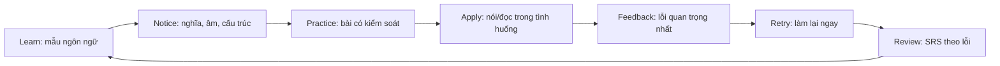
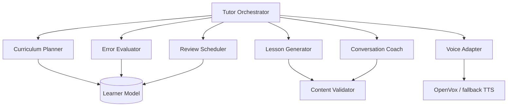
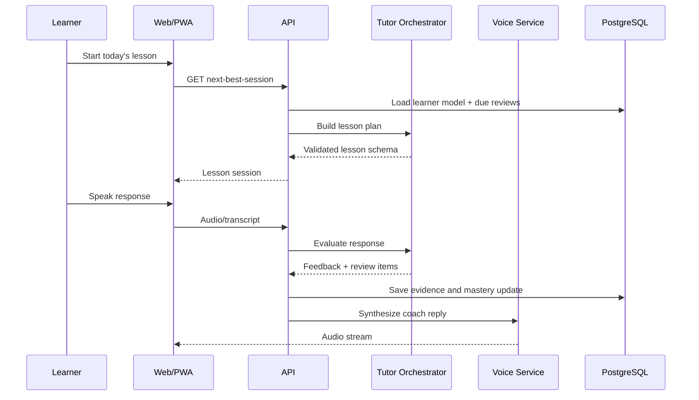
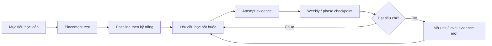

# LingoPilot — Full Product Design

> Phiên bản: 1.0  
> Ngày cập nhật: 2026-08-15  
> Trạng thái: Foundational product design; dùng `docs/README.md` để xử lý mâu thuẫn  
> Owner: Product Lead · Loại: Foundational product design  
> Phạm vi: Web/PWA học tiếng Anh và tiếng Trung, ưu tiên nghe–đọc–nói, AI tutor và OpenVox local voice

## 1. Executive summary

LingoPilot là một hệ thống học ngôn ngữ cá nhân hóa cho người Việt, kết hợp curriculum 90 ngày với AI tutor luôn sẵn sàng. Sản phẩm không cố trở thành một thư viện bài học khổng lồ ngay từ đầu; nó tối ưu một vòng lặp học có thể duy trì mỗi ngày:

```text
Chọn mục tiêu → Học mẫu → Nghe hiểu → Đọc trong ngữ cảnh
→ Nói thành tiếng → Nhận feedback → Ôn đúng lúc → Đo tiến bộ
```

Giá trị khác biệt:

- Một kế hoạch duy nhất cho cả tiếng Anh và tiếng Trung nhưng vẫn tôn trọng đặc thù từng ngôn ngữ.
- AI không chỉ chat; AI lập kế hoạch, tạo bài, điều phối hội thoại, phân tích lỗi và quyết định nội dung ôn.
- Giọng nói ưu tiên OpenVox local để giảm chi phí, tăng riêng tư và hỗ trợ English/中文.
- “Level 7 trong 90 ngày” được biến thành hệ thống checkpoint đo được, không phải lời hứa trình độ thiếu căn cứ.
- Người học luôn biết: hôm nay học gì, vì sao học, đã tiến bộ ở đâu và bước tiếp theo là gì.

## 2. Cách hiểu “tốt nhất từ các app top”

Không có app nào tốt nhất ở mọi mặt. Tài liệu này chọn các pattern mạnh nhất theo từng category, dựa trên nguồn chính thức cập nhật tại thời điểm nghiên cứu. LingoPilot học từ nguyên lý sản phẩm và learning science; không sao chép nhân vật, nội dung, trade dress hoặc giao diện độc quyền.

### 2.1 Benchmark theo category

| Sản phẩm | Thế mạnh được chọn | Cách LingoPilot áp dụng |
|---|---|---|
| Duolingo | Learning path, streak/XP, Practice Hub, mistake review, Roleplay/Video Call | Lộ trình rõ ràng, động lực nhẹ, Practice Hub theo điểm yếu, guided/unguided AI conversation |
| Speak | Voice-first, Learn → Practice → Apply, hội thoại latency thấp, curriculum có human QA | Mỗi bài bắt buộc tạo spoken output; voice pipeline tách ASR–LLM–TTS; nội dung AI phải qua schema và QA |
| ELSA Speak | Phân tích pronunciation, intonation, fluency, grammar, vocabulary | Score đa chiều, ưu tiên intelligibility, feedback có hành động sửa cụ thể |
| Busuu | CEFR placement, study plan, smart review, checkpoint, community correction | Onboarding theo mục tiêu/trình độ, kế hoạch theo deadline, review tự động, human feedback tùy chọn |
| HelloChinese | Speech recognition, handwriting, native videos, SRS, thiết kế riêng cho Mandarin | Tone/pinyin drill, nhận diện chữ, stroke order, native clips và review theo loại lỗi |
| LingQ | Comprehensible input, audio + transcript, import nội dung, từ vựng trong ngữ cảnh | Reader/listener đồng bộ, highlight từ, personal content import và vocabulary-in-context |
| Memrise | Learn–Hear–Use, native-speaker video, SRS, AI conversation | Vòng học từ/cụm → nghe nhiều giọng → dùng trong hội thoại; ôn ngay trước khi quên |

### 2.2 Bằng chứng feature benchmark

- Duolingo cung cấp Practice Hub cho nghe, nói, lỗi sai, từ vựng và nội dung immersion; Max thêm Roleplay/Video Call cùng feedback sau phiên. [Duolingo Practice Hub](https://blog.duolingo.com/guide-to-duolingo-practice-hub/), [Duolingo Max](https://blog.duolingo.com/duolingo-max/)
- Duolingo mô tả AI conversation bằng cấu trúc được kiểm soát theo level, mục đích và persona thay vì thả LLM hội thoại tự do. [Duolingo AI speaking design](https://blog.duolingo.com/ai-and-video-call/)
- Speak dùng vòng Learn → Practice → Apply và kiến trúc voice agent gồm ASR, LLM, TTS, lesson content, conversation history và analytics. [Speak voice agent platform](https://www.speak.com/blog/building-speaks-voice-agent-platform), [Speak curriculum design](https://www.speak.com/blog/how-speak-reinvents-language-learning)
- ELSA phân tích pronunciation, intonation, fluency, grammar và vocabulary, sau đó đưa feedback và bài tập cá nhân. [ELSA Speech Analyzer](https://elsaspeak.com/en/speech-analyzer), [ELSA methodology](https://elsaspeak.com/en/efficacy)
- Busuu tổ chức khóa học theo CEFR, có placement/checkpoint, smart vocabulary/grammar review, Study Plan và sửa bài từ cộng đồng. [Busuu courses](https://www.busuu.com/en/it-works/courses), [Busuu community](https://www.busuu.com/en-US/community/guidelines)
- HelloChinese kết hợp bite-sized curriculum, speech recognition, handwriting, native-speaker videos và spaced repetition cho Mandarin. [HelloChinese](https://www.hellochinese.cc/)
- LingQ kết hợp audio với transcript, comprehensible input, import nội dung, từ vựng trong ngữ cảnh và SRS. [LingQ English](https://www.lingq.com/en/learn-english-online/), [LingQ mobile features](https://www.lingq.com/en/ios-app/)
- Memrise tổ chức trải nghiệm theo Learn Words → Hear My Words → Use My Words, dùng native-speaker video, AI conversation và spaced repetition. [Memrise product changes](https://www.memrise.com/blog/changes-to-the-memrise-app), [Memrise learning science](https://www.memrise.com/about)

## 3. Product vision và positioning

### 3.1 Vision

Mỗi người học có một giáo viên ngôn ngữ hiểu mục tiêu, lịch sống, lỗi lặp lại và cách họ tiến bộ tốt nhất.

### 3.2 Product promise

Mở app là biết nên làm gì. Kết thúc phiên là biết mình vừa tiến bộ ở đâu.

### 3.3 Positioning

```text
Dành cho người Việt bận rộn muốn giao tiếp Anh–Trung,
LingoPilot là AI language coach theo lộ trình 90 ngày,
kết hợp bài học có cấu trúc với hội thoại và voice local,
khác với app chỉ game hóa flashcard hoặc chatbot không có curriculum.
```

### 3.4 North-star outcome

Số **Meaningful Practice Minutes** mỗi tuần: phút người học thực sự nghe có chủ đích, đọc hiểu, nói hoặc sửa lỗi. Không tính thời gian mở dashboard hay xem animation.

## 4. Người dùng mục tiêu

### 4.1 Primary persona — Người đi làm bận rộn

- 22–40 tuổi, tiếng Việt là ngôn ngữ chính.
- Có 20–40 phút mỗi ngày.
- Học English cho công việc và Chinese cho giao tiếp/kinh doanh/du lịch.
- Đã từng bỏ dở một hoặc nhiều app học ngôn ngữ.
- Muốn sửa lỗi nhưng ngại nói trước người thật.

### 4.2 Secondary persona — Người chuẩn bị thi hoặc phỏng vấn

- Cần English speaking/reading theo CEFR, IELTS/TOEIC hoặc công việc.
- Cần Chinese theo chủ đề HSK hoặc giao tiếp thực tế.
- Muốn rehearsal, score và lịch luyện cụ thể.

### 4.3 Jobs to be done

- “Khi chỉ có 15 phút, hãy đưa cho tôi đúng bài có tác động cao nhất.”
- “Khi tôi nói sai, hãy chỉ ra một lỗi quan trọng và cho tôi nói lại ngay.”
- “Khi tôi quên từ, hãy đưa nó trở lại trong đúng ngữ cảnh.”
- “Khi tôi mất động lực, hãy cho tôi thấy tiến bộ thật thay vì chỉ đếm streak.”
- “Khi tôi học hai ngôn ngữ, đừng để một ngôn ngữ chiếm hết thời gian của ngôn ngữ kia.”

## 5. Hệ thống level và mục tiêu 90 ngày

### 5.1 LingoPilot Level 1–7

Level là thang nội bộ để điều phối nội dung, không phải chứng chỉ CEFR/HSK.

| Level | Tên | Năng lực quan sát được |
|---:|---|---|
| 1 | Starter | Nhận biết âm/pinyin, lời chào và câu mẫu rất ngắn |
| 2 | Foundation | Tạo câu đơn về bản thân và nhu cầu cơ bản |
| 3 | Survival | Xử lý tình huống quen thuộc bằng câu ngắn |
| 4 | Everyday | Duy trì trao đổi 2–3 phút về chủ đề đời sống |
| 5 | Independent | Tóm tắt nội dung, giải thích ý kiến và tự sửa lỗi cơ bản |
| 6 | Confident | Hội thoại 7–10 phút, hiểu tốc độ gần tự nhiên ở chủ đề quen thuộc |
| 7 | Operational | Hoàn thành nhiệm vụ thực tế bằng ngôn ngữ đích với ít hỗ trợ |

### 5.2 Baseline và target

- Onboarding có placement ngắn cho từng ngôn ngữ.
- Người bắt đầu từ Level 1 không được hứa chắc đạt Level 7 trong 90 ngày.
- Hệ thống hiển thị hai chỉ số riêng: **90-day consistency** và **proficiency evidence**.
- Target hàng ngày mặc định: 35 phút, cho phép 15/25/35/50 phút.
- Tỷ lệ English/Chinese mặc định 50/50, cho phép 70/30 hoặc 30/70.

### 5.3 Evidence để tăng level

Một level chỉ tăng khi đủ cả bốn điều kiện:

1. Hoàn thành skill units bắt buộc.
2. Retention review đạt ngưỡng sau ít nhất 7 ngày.
3. Checkpoint nghe/đọc đạt ngưỡng.
4. Speaking checkpoint có transcript, feedback và một lượt nói lại.

Không tăng level chỉ từ XP hoặc số ngày streak.

## 6. Learning system

### 6.1 Vòng học chuẩn



### 6.2 Daily plan — 35 phút

| Block | Phút | Mục tiêu |
|---|---:|---|
| Listening | 12 | Retrieval ngắn, nghe gist → detail → transcript reveal |
| Reading | 10 | Graded text, phrase mining, comprehension |
| Speaking | 10 | Shadowing hoặc roleplay, feedback, retry |
| Review/reflection | 3 | Lưu ba cụm từ, chọn lỗi cần nhớ và xem next step |

### 6.3 Weekly rhythm

- Thứ 2–5: học mới + review ngắn.
- Thứ 6: scenario integration, dùng từ/cấu trúc cả tuần.
- Thứ 7: checkpoint nghe–đọc–nói.
- Chủ nhật: recovery day; review nhẹ, không phạt mất streak nếu đã đạt weekly goal.

### 6.4 Ba chặng 90 ngày

#### Ngày 1–30 — Foundation

- English: sound contrasts, stress, basic question patterns.
- Chinese: pinyin initials/finals, four tones, tone pairs, radicals cơ bản.
- Chủ đề: bản thân, lịch hằng ngày, số, thời gian, đồ ăn, địa điểm.
- Checkpoint: self-introduction 60 giây cho mỗi ngôn ngữ.

#### Ngày 31–60 — Expansion

- Listening dài hơn, transcript chỉ mở sau lượt nghe đầu.
- Đọc 150–300 từ; Chinese có pinyin toggle, không hiển thị mặc định sau khi quen.
- Roleplay đời sống và công việc.
- Checkpoint: nói 3 phút + tóm tắt bài đọc.

#### Ngày 61–90 — Operational confidence

- Hội thoại có follow-up bất ngờ nhưng vẫn trong level.
- Extensive input theo sở thích.
- Error portfolio và targeted repair.
- Checkpoint: hội thoại 10 phút + nhiệm vụ đọc/nghe tích hợp.

### 6.5 Spaced repetition

Mỗi learning item có trạng thái `new`, `learning`, `review`, `mastered`, `lapsed`.

Scheduler xét:

- Lần trả lời gần nhất và độ khó tự đánh giá.
- Dạng lỗi: nhận biết, hiểu nghĩa, phát âm, tone, sản xuất câu.
- Số lần gặp item trong ngữ cảnh khác nhau.
- Khoảng cách giữa các lượt ôn.
- Priority từ learning review hằng tuần và scored checkpoint theo lịch chuẩn.

Review ưu tiên phrase/sentence hơn isolated word. Một từ được xem là bền khi người học hiểu và dùng được trong ít nhất hai ngữ cảnh.

## 7. Information architecture

### 7.1 Navigation chính

1. **Today** — bài học hôm nay và next best action.
2. **Path** — curriculum, unit, checkpoint và level.
3. **Practice** — nghe, đọc, nói, lỗi sai, từ/cụm cần ôn.
4. **Coach** — hội thoại AI, hỏi đáp, micro-lesson.
5. **Library** — stories, native clips, imported content.
6. **Progress** — skill map, evidence, streak, weekly report.
7. **Profile** — mục tiêu, lịch, ngôn ngữ, voice, privacy.

### 7.2 Global states

- Offline/degraded: core content cache; AI/voice unavailable có thông báo rõ.
- OpenVox unavailable: fallback browser TTS, không chặn bài học.
- Microphone denied: cho phép typing hoặc self-record không chấm pronunciation.
- AI timeout: lưu draft/session, retry không mất dữ liệu.
- Low-confidence ASR: hỏi người học xác nhận transcript trước khi chấm.

## 8. Screen specifications

### 8.1 Onboarding

#### Mục tiêu

Tạo kế hoạch đầu tiên trong dưới 4 phút.

#### Các bước

1. Chọn English, Chinese hoặc cả hai.
2. Chọn mục tiêu: giao tiếp, công việc, du lịch, thi, đọc nội dung.
3. Chọn thời lượng/ngày và khung giờ.
4. Self-assessment + placement 5–8 phút/ngôn ngữ.
5. Microphone/voice test, cho phép skip.
6. Chọn tỷ lệ English/Chinese.
7. Xem kế hoạch tuần đầu và bắt đầu bài ngay.

#### Output

- `learning_profile`
- `placement_result`
- `study_plan`
- `day_1_session`

### 8.2 Today dashboard

#### Above the fold

- Day x/90, weekly goal và trạng thái hôm nay.
- Một CTA duy nhất: “Tiếp tục bài tốt nhất”.
- Time estimate và skill focus.

#### Secondary modules

- Momentum: meaningful minutes, streak, level evidence.
- Today stack: nghe, đọc, nói.
- AI Coach prompt.
- Items due for review.
- Weekly checkpoint countdown.

#### Quy tắc

- Không hiển thị quá ba task chính.
- XP là secondary; skill evidence là primary.
- Nếu bỏ lỡ ngày, tự reschedule; không tạo backlog vô hạn.

### 8.3 Learning Path

- Phase → Unit → Lesson → Checkpoint.
- Mỗi unit hiển thị “can-do outcome”, không chỉ tên grammar.
- Node states: locked, available, in progress, review due, mastered.
- Cho phép placement skip nhưng checkpoint vẫn bắt buộc.
- Side quests là optional challenge, không chặn path.

### 8.4 Practice Hub

Các lane:

- **Quick Review:** 3–5 phút.
- **Mistakes:** lỗi gần đây, nhóm theo pattern.
- **Listening:** minimal pairs, dictation, gist/detail.
- **Speaking:** shadowing, sentence build, free response.
- **Reading:** graded stories, sentence view, phrase mining.
- **Vocabulary:** SRS phrases, difficult items.
- **Checkpoint prep:** bài mô phỏng gần nhất.

Hệ thống luôn đề xuất một lane, nhưng người học được tự chọn lane khác.

### 8.5 Lesson player

#### Cấu trúc một lesson 10–15 phút

1. Outcome card: “Sau bài này bạn có thể…”
2. Input: câu/đoạn mẫu có audio.
3. Meaning check.
4. Form/notice: highlight pattern.
5. Controlled practice.
6. Listening without transcript.
7. Spoken output.
8. Feedback + retry.
9. Exit ticket.

#### Exercise primitives

- Select meaning.
- Arrange chunks.
- Dictation.
- Listen and choose.
- Read and answer.
- Shadow waveform.
- Record sentence.
- Open response.
- Roleplay turn.
- Error correction.
- Chinese character recognition/typing/handwriting.

### 8.6 AI Conversation room

#### Modes

- Guided: coach cho phrase và translation khi cần.
- Roleplay: nhà hàng, sân bay, phỏng vấn, họp, mua sắm.
- Free talk: người học chọn chủ đề.
- Challenge: không hint, giới hạn thời gian.
- Replay: làm lại conversation cũ sau feedback.

#### Session lifecycle

1. Goal + level + vocabulary targets.
2. Mic check và lựa chọn caption.
3. 4–12 turns tùy level.
4. Push-to-talk mặc định cho beginner.
5. End-of-call transcript.
6. Feedback: praise, top 2 fixes, better phrasing, retry.
7. Save mistakes to review queue.

### 8.7 Reader & Listener

- Audio waveform và transcript đồng bộ theo câu.
- Tốc độ 0.75×, 1×, 1.15×; loop câu.
- Tap từ/cụm để xem nghĩa, pronunciation, ví dụ và save.
- Pinyin toggle cho Chinese; translation reveal theo câu.
- Unknown-word density để gợi ý độ khó.
- Import URL/text/audio có attribution và kiểm tra quyền sử dụng.

### 8.8 Vocabulary & Error Notebook

- Tabs: Due, New, Difficult, Mistakes, Mastered.
- Mỗi item lưu phrase, context, audio, language và error type.
- Review hỗn hợp recognition + production.
- Error portfolio hiển thị pattern lặp lại, không làm người học xấu hổ.

### 8.9 Progress

- Skill radar: listening, reading, speaking, vocabulary, pronunciation/tone.
- Weekly meaningful minutes.
- Checkpoint history và evidence artifacts.
- Error trend: xuất hiện, sửa đúng, tái phạm.
- Level confidence interval; không hiển thị score giả chính xác.
- Báo cáo tuần: win, blocker, next focus.

## 9. Thiết kế riêng cho English

### 9.1 Pronunciation

- Phoneme contrasts phổ biến với người Việt.
- Word stress, sentence stress, linking và reduction.
- Mục tiêu là intelligibility, không ép accent bản ngữ.
- Feedback theo thứ tự: âm làm đổi nghĩa → stress → rhythm → polish.

### 9.2 Speaking dimensions

- Pronunciation.
- Intonation/prosody.
- Fluency: pause, filler, speed.
- Grammar accuracy.
- Vocabulary range và appropriateness.
- Task completion.

### 9.3 Content tracks

- Everyday English.
- Workplace English.
- Travel.
- Interview/presentation.
- IELTS-style speaking/reading ở giai đoạn mở rộng.

## 10. Thiết kế riêng cho Chinese

### 10.1 Pronunciation và tone

- Pinyin initials/finals.
- Tone identification và production.
- Tone pairs trước câu dài.
- Neutral tone và tone sandhi trong ngữ cảnh.
- Score tone tách khỏi ASR transcript; transcript đúng không có nghĩa tone đúng.

### 10.2 Characters

- Recognition trước, production sau.
- Radical/components và meaning cues.
- Stroke order cho bộ chữ thiết yếu.
- Typing pinyin → chọn đúng character.
- Handwriting optional, không chặn giao tiếp.

### 10.3 Reader behavior

- Hanzi là chính.
- Pinyin hidden by default sau Foundation.
- Word segmentation có thể bật/tắt.
- Tap phrase thay vì chỉ tap từng character.
- Simplified Chinese là mặc định; Traditional là future option.

## 11. AI tutor architecture

### 11.1 Multi-agent responsibilities



### 11.2 Orchestrator input

- Learner profile and target languages.
- Current phase/unit/lesson.
- Recent errors and due reviews.
- Session time budget.
- Device capability and voice availability.
- Safety/privacy preferences.

### 11.3 Structured outputs

Mọi AI output dùng JSON schema, ví dụ lesson:

```json
{
  "language": "en",
  "level": 3,
  "canDo": "Ask for and give simple directions",
  "targetPhrases": ["How do I get to…?"],
  "input": [{"text": "...", "translation": "..."}],
  "exercises": [],
  "checkpoint": {"type": "spoken_response", "rubricId": "..."}
}
```

### 11.4 Content guardrails

- Chỉ tạo nội dung trong can-do outcome và level cho phép.
- Không tự tạo giải thích grammar nếu validator không xác nhận rule.
- Không đánh giá pronunciation chỉ từ transcript.
- Không invent CEFR/HSK certification claims.
- Có nút report cho feedback hoặc nội dung sai.
- Golden lesson set được human-review để regression test prompt/model.

### 11.5 Feedback contract

```text
1. What worked — tối đa 1 câu.
2. Priority fix — một lỗi ảnh hưởng giao tiếp nhiều nhất.
3. Better version — câu sửa tự nhiên, đúng level.
4. Why — giải thích ngắn bằng tiếng Việt.
5. Retry prompt — yêu cầu nói lại ngay.
```

### 11.6 Learner memory

Chỉ lưu dữ liệu có ích cho học tập:

- Mục tiêu và chủ đề quan tâm.
- Phrases đã học.
- Error patterns.
- Preferred correction style.
- Conversation facts được người học đồng ý lưu.

Không lưu raw conversation/audio vô hạn. Có màn hình xem, export và xóa memory.

## 12. Voice architecture

### 12.1 Pipeline

```text
Microphone → VAD → ASR → transcript confidence
→ Tutor Orchestrator/LLM → response text
→ OpenVox model/language/voice discovery → WAV/stream
→ playback + transcript + analytics
```

### 12.2 OpenVox strategy

- Local default: `http://127.0.0.1:8000/v1`.
- Discover model IDs; không hardcode model không tồn tại.
- Warm model trước speech request đầu.
- Discover language và voice tương thích.
- English/Chinese có preferred voice riêng.
- Nếu trả `429`, backoff và retry một lần.
- Nếu unavailable, fallback browser Speech Synthesis và thông báo non-blocking.

### 12.3 Latency budgets

| Stage | Target p50 | Target p95 |
|---|---:|---:|
| VAD/end-of-turn | 250 ms | 500 ms |
| Partial ASR | 400 ms | 900 ms |
| Tutor first token | 700 ms | 1.8 s |
| TTS first audio | 500 ms | 1.5 s |
| Full guided turn | 1.5 s | 3.5 s |

### 12.4 Confidence handling

- ASR confidence thấp: hiển thị transcript confirmation.
- Pronunciation score thấp nhưng transcript đúng: đánh dấu cần phoneme/tone analysis riêng.
- Không chấm điểm nếu audio quá ngắn, clipping hoặc background noise cao.

## 13. Adaptive learning engine

### 13.1 Learner model

Theo dõi mastery theo `skill × language × modality`:

- Recognition mastery.
- Comprehension mastery.
- Production mastery.
- Pronunciation/tone mastery.
- Retention confidence.

### 13.2 Next-best-action score

```text
priority = due_review
         + checkpoint_gap
         + repeated_error
         + learner_goal_alignment
         + variety_bonus
         - fatigue_penalty
         - recent_repetition
```

### 13.3 Difficulty adaptation

- Hai câu đúng liên tiếp + confidence cao: giảm hint hoặc tăng complexity.
- Hai lỗi cùng pattern: chèn micro-explanation và controlled practice.
- ASR confidence thấp: không tự hạ level ngôn ngữ.
- Fatigue signal: chuyển từ free production sang guided practice.
- Weekly checkpoint điều chỉnh tuần tiếp theo, không thay curriculum mỗi câu.

## 14. Technical architecture

### 14.1 Recommended production stack

- **Web/PWA:** Next.js + TypeScript, responsive, installable.
- **API:** Node.js/TypeScript service; REST cho CRUD, WebSocket/WebRTC cho realtime voice.
- **Database:** PostgreSQL.
- **Queue/cache:** Redis + job queue cho content generation, scoring và reports.
- **Object storage:** S3-compatible cho audio được consent lưu.
- **AI:** provider adapter cho Responses/Realtime hoặc model tương đương.
- **Voice:** OpenVox adapter local; cloud TTS optional.
- **Observability:** structured logs, traces, product events, error monitoring.

MVP hiện tại có thể tiếp tục là vertical prototype; production migration nên làm theo module, không rewrite toàn bộ cùng lúc.

### 14.2 Service boundaries

- Identity/Profile Service.
- Curriculum Service.
- Lesson Service.
- Tutor/Conversation Service.
- Speech Service.
- Review Scheduler.
- Progress/Assessment Service.
- Content Moderation/QA Service.
- Notification Service.

### 14.3 Data flow



## 15. Core data model

### 15.1 Identity và profile

```text
users(id, email, locale, timezone, created_at)
learner_profiles(user_id, daily_minutes, correction_style, privacy_mode)
language_profiles(id, user_id, language, current_level, target_level, allocation_pct)
study_plans(id, language_profile_id, start_date, target_date, weekly_minutes)
```

### 15.2 Curriculum

```text
courses(id, language, version, status)
phases(id, course_id, sequence, can_do_outcomes)
units(id, phase_id, sequence, topic, level)
lessons(id, unit_id, sequence, lesson_type, schema_json, version)
skills(id, language, code, modality, prerequisite_ids)
lesson_skills(lesson_id, skill_id, weight)
```

### 15.3 Learning activity

```text
sessions(id, user_id, language, lesson_id, started_at, completed_at, meaningful_seconds)
attempts(id, session_id, exercise_id, response_json, result_json, created_at)
speech_attempts(id, attempt_id, audio_ref, transcript, asr_confidence, score_json, consent)
mistakes(id, user_id, language, skill_id, pattern, example, status, last_seen_at)
```

### 15.4 Review và progress

```text
learning_items(id, language, phrase, context, audio_ref, metadata_json)
user_items(user_id, item_id, state, stability, difficulty, due_at, last_result)
skill_mastery(user_id, skill_id, recognition, comprehension, production, retention)
checkpoints(id, user_id, language, level, rubric_id, result_json, completed_at)
daily_progress(user_id, date, meaningful_seconds, sessions, goal_met)
```

### 15.5 AI và governance

```text
ai_runs(id, user_id, purpose, model, prompt_version, latency_ms, result_status)
content_reports(id, user_id, content_ref, reason, status)
consents(user_id, consent_type, granted, version, updated_at)
learner_memories(id, user_id, language, category, value, expires_at)
```

## 16. API surface

Phần này là API surface khái niệm của bản thiết kế ban đầu. Tên route và schema chuẩn để triển khai nằm trong `docs/openapi.yaml`; catalog mở rộng nằm trong `docs/technical-architecture.md`.

### 16.1 Profile và plan

```http
POST /v1/onboarding/placement
PUT  /v1/profile
GET  /v1/study-plan
PUT  /v1/study-plan
GET  /v1/today
```

### 16.2 Lessons

```http
GET  /v1/path?language=en
POST /v1/sessions
GET  /v1/sessions/{id}
POST /v1/sessions/{id}/attempts
POST /v1/sessions/{id}/complete
```

### 16.3 Practice và review

```http
GET  /v1/practice/recommendation
GET  /v1/reviews/due
POST /v1/reviews/{itemId}/result
GET  /v1/mistakes
```

### 16.4 AI tutor

```http
POST /v1/tutor/message
POST /v1/tutor/lesson
POST /v1/tutor/conversations
POST /v1/tutor/conversations/{id}/turns
POST /v1/tutor/conversations/{id}/complete
```

### 16.5 Voice

```http
GET  /v1/voice/status
GET  /v1/voice/models
POST /v1/voice/speech
POST /v1/voice/transcribe
POST /v1/voice/analyze
```

### 16.6 Progress

```http
GET /v1/progress/weekly
GET /v1/progress/skills
GET /v1/progress/checkpoints
GET /v1/progress/evidence/{id}
```

## 17. Analytics và experimentation

### 17.1 Core events

- `onboarding_started/completed`
- `placement_completed`
- `today_session_started/completed`
- `exercise_attempted`
- `speech_recorded`
- `feedback_viewed`
- `retry_completed`
- `review_due/completed`
- `checkpoint_started/completed`
- `openvox_used/fallback`
- `ai_content_reported`

### 17.2 Funnel

```text
Install/open → onboarding → first lesson → first spoken output
→ day-2 return → week-1 checkpoint → day-30 checkpoint → day-90 completion
```

### 17.3 Product metrics

- Activation: hoàn thành first spoken output trong ngày đầu.
- D1/D7/D30 retention.
- Meaningful practice minutes/user/week.
- Speaking attempts/user/week.
- Retry-after-feedback rate.
- Weekly goal completion.
- Checkpoint pass/improvement rate.
- OpenVox success/fallback rate.

### 17.4 Learning quality metrics

- Retention after 7/30 days.
- Error recurrence rate.
- Comprehension accuracy by difficulty.
- Speech intelligibility improvement.
- Conversation task completion.
- Human/AI rubric agreement trên sampled sessions.

### 17.5 Experiment guardrails

Không ship A/B test tăng retention nếu:

- Meaningful practice minutes giảm.
- Tỷ lệ nói giảm.
- Người học bị đẩy vào bài quá dễ.
- AI error report tăng.
- Privacy consent hoặc accessibility bị suy giảm.

## 18. Gamification

### Nên dùng

- Streak có recovery day.
- XP cho effort có ý nghĩa.
- Weekly quest gắn với skill output.
- Milestone animation.
- Personal best và skill badges.
- Optional friend/accountability challenge.

### Không nên dùng

- Leaderboard bắt buộc.
- Phạt mạnh khi bỏ một ngày.
- XP farming từ bài quá dễ.
- Dark pattern mua streak freeze.
- Level tăng chỉ vì thời gian hoặc số click.

## 19. Community và human feedback

Community là Phase 3, sau khi có moderation:

- Người học gửi spoken/written exercise để nhận correction.
- Reviewer phải là native/advanced speaker có reputation.
- Correction có template: sửa, giải thích, encouragement.
- Report/block và giới hạn messaging.
- Không cho contact exchange mặc định.
- AI pre-screen toxicity/PII nhưng quyết định moderation quan trọng có human review.

## 20. Privacy, safety và trust

### 20.1 Data principles

- Data minimization.
- Explicit consent trước khi lưu raw audio.
- Transcript và learner memory có xem/xóa/export.
- API key chỉ ở server.
- Local voice mode không gửi text/audio ra cloud TTS.
- Retention policy riêng cho audio, transcript, analytics.

### 20.2 AI trust

- Hiển thị khi feedback do AI tạo.
- Report incorrect feedback ngay trong màn hình.
- Không chấm chứng chỉ chính thức.
- Prompt/model version được log để audit.
- Human-review golden set cho English và Chinese.

### 20.3 Minor safety

Nếu mở cho trẻ vị thành niên:

- Không open-ended community messaging mặc định.
- Topic filter theo tuổi.
- Parent/guardian consent phù hợp thị trường.
- Không dùng persuasive monetization nhắm vào trẻ em.

## 21. Accessibility và localization

- WCAG 2.2 AA cho web production.
- Keyboard navigation đầy đủ.
- Caption/transcript cho mọi audio.
- Không truyền đạt tone/score chỉ bằng màu.
- Font Hanzi đủ lớn và line-height rộng.
- Screen-reader label cho playback, record và waveform.
- UI tiếng Việt trước; English/Chinese là target content.
- Hỗ trợ reduced motion và high contrast.

## 22. Visual design system

### 22.1 Brand personality

Calm, intelligent, encouraging, premium nhưng không lạnh. Tránh mascot quá trẻ con vì primary persona là người đi làm.

### 22.2 UI principles

- Một hành động chính mỗi màn hình.
- Card hierarchy rõ, whitespace rộng.
- Purple là brand/action; blue cho English; warm coral cho Chinese; green cho success.
- Serif chỉ dùng cho editorial/headline; sans-serif cho task và data.
- Motion ngắn, có mục đích: success, progress, transition.

### 22.3 Core components

- App shell/navigation.
- Progress ring/bar.
- Lesson card.
- Skill chip.
- Audio player/waveform.
- Record button/state.
- Transcript with token highlights.
- Feedback card.
- Review card.
- Coach message bubble.
- Checkpoint result.

## 23. Monetization

### Free

- Daily core lesson.
- Basic review.
- Limited AI Coach turns.
- Browser/OpenVox local voice khi khả dụng.
- Core progress.

### Pro

- Unlimited AI conversation.
- Advanced speech feedback.
- Personalized lesson generation.
- Full reader/import tools.
- Detailed weekly reports.
- Offline content packs.

### Không khóa sau paywall

- Placement result cơ bản.
- Privacy controls và data deletion.
- Core curriculum progress.
- Accessibility features.
- Report AI error.

## 24. Delivery roadmap

### Phase 0 — Prototype hiện tại

- Dashboard và local progress.
- Practice room cơ bản.
- AI Coach/lesson adapter.
- OpenVox local TTS.
- Integration tests.

### Phase 1 — Product foundation, 4–6 tuần

- TypeScript production shell.
- Auth/profile/placement.
- PostgreSQL schema.
- Curriculum/path service.
- Session/attempt tracking.
- SRS review.
- Observability và consent.

### Phase 2 — Learning core, 6–8 tuần

- Full lesson player.
- Reader/listener.
- English pronunciation + Chinese tone drills.
- Checkpoints.
- Adaptive next-best-action.
- Weekly reports.

### Phase 3 — AI voice tutor, 6–8 tuần

- Realtime conversation.
- Structured feedback + retry.
- Error notebook.
- OpenVox streaming.
- AI content validator và golden-set evals.

### Phase 4 — Scale and community

- Cross-device sync/offline.
- Human corrections.
- Content import.
- Subscription.
- Admin moderation/content tools.

## 25. Release gates

### Alpha

- 30 ngày curriculum cho cả English và Chinese.
- Không mất progress khi refresh/restart.
- Lesson completion và review schedule đúng.
- Voice fallback hoạt động.
- Không có secret ở browser bundle.

### Beta

- 90 ngày curriculum đủ coverage.
- Placement và checkpoints có rubric.
- AI feedback đạt ngưỡng human-review.
- D7 retention và meaningful minutes được đo.
- Accessibility audit pass các flow chính.

### Public v1

- Auth, rate limit, backup, monitoring, incident runbook.
- Data export/delete và consent flow.
- Prompt/model regression suite.
- Load test voice/conversation.
- Privacy policy và terms được review pháp lý.

## 26. Acceptance criteria cho app hoàn chỉnh

### Functional

- Người dùng tạo tài khoản, chọn ngôn ngữ, làm placement và nhận study plan.
- Today luôn trả một next best session hợp lệ.
- Người dùng hoàn thành nghe, đọc, nói và review cho cả hai ngôn ngữ.
- English pronunciation và Chinese tone feedback không dựa chỉ vào transcript.
- AI conversation có guided/free modes, transcript, feedback và retry.
- Reader đồng bộ audio–text, lưu phrase và đưa phrase vào SRS.
- Progress sync nhiều thiết bị và checkpoint có evidence.
- OpenVox local và fallback voice đều hoạt động.

### Quality

- p95 page interaction dưới 200 ms cho thao tác local UI.
- p95 API CRUD dưới 500 ms, không tính model inference.
- Voice turn p95 dưới 3.5 giây trong điều kiện mục tiêu.
- Crash-free sessions trên 99.5%.
- Không có P0/P1 security issue mở.
- AI hallucination/error report dưới ngưỡng do product team xác định.

### Learning

- Mọi lesson có can-do outcome, target language, practice và exit ticket.
- Mọi feedback có correction và retry.
- Level tăng dựa trên evidence, không dựa chỉ vào XP.
- Có retention measurement sau 7 và 30 ngày.
- Curriculum có human review và versioning.

## 27. Những quyết định cần product owner chốt

1. “Level 7” sẽ giữ là thang nội bộ hay đổi tên để tránh nhầm với chứng chỉ?
2. Launch English trước, Chinese trước hay song song?
3. Phân bổ mặc định 50/50 có phù hợp với mục tiêu cá nhân?
4. Có lưu raw audio không, và retention bao lâu?
5. App local-first hay account/cloud-first ở V1?
6. Speech scoring dùng provider nào cho English phoneme và Chinese tone?
7. Community correction có nằm trong năm đầu không?
8. Monetization ưu tiên subscription cá nhân hay B2B/team?

## 28. Assessment, AI teacher và goal-control system

### 28.1 Mục tiêu

Hệ thống đánh giá không chỉ trả một con số. Nó tạo vòng điều khiển khép kín:



AI đóng vai giáo viên lập kế hoạch, giải thích và phản hồi. Scoring engine và rubric mới là nguồn quyết định điểm, điều kiện học lại và thăng level.

### 28.2 Các loại bài kiểm tra

| Loại | Thời điểm | Thời lượng | Mục đích | Ảnh hưởng |
|---|---|---:|---|---|
| Diagnostic placement | Onboarding, từng ngôn ngữ | 5–8 phút | Baseline nghe–đọc–nói, không tạo áp lực | Chọn điểm bắt đầu và tuần đầu |
| Scored checkpoint | Ngày 7, 14, 30, 45, 60, 75, 90 | 8–12 phút; phase tối đa 25 phút | Đo retention, transfer và lỗi lặp lại | Điều chỉnh kế hoạch; chỉ đổi Level khi đủ evidence |
| Weekly learning review | Các tuần không có scored checkpoint | 3–5 phút trong phiên học | Reflection, blocker và lỗi ưu tiên; không tạo comparative score | Điều chỉnh task tuần, không đổi Level |
| Phase checkpoint | Ngày 30, 60, 90 | 15–25 phút | Xác nhận can-do outcome theo chặng | Bằng chứng tăng level |
| Recovery test | Sau hai checkpoint chưa đạt | 5–8 phút | Chỉ đo skill gap cụ thể | Mở lại đường học chính |
| Challenge test | Theo yêu cầu người học | 10–15 phút | Thử vượt level, không bỏ qua nền tảng | Chỉ mở unit khi evidence đủ |

Checkpoint chuẩn của lộ trình chạy ở ngày **7, 14, 30, 45, 60, 75 và 90**. Nếu người học vắng, hệ thống reschedule thay vì tự tính là thất bại.

### 28.3 Blueprint và độ khó

Mỗi test lấy mẫu tối thiểu ba modality:

- Listening: gist, detail, số/thời gian, intent; transcript ẩn ở lượt đầu.
- Reading: meaning, inference, phrase/grammar in context.
- Speaking: controlled response và open response; luôn có retry ở checkpoint học tập.
- English bổ sung phoneme contrast, stress và intelligibility khi có audio analyzer.
- Chinese bổ sung tone pair, pinyin mapping, character recognition và comprehensibility khi có audio analyzer.

Placement dùng routing theo cụm: câu khởi động mức 2–3; hai câu đúng thì thử cụm cao hơn; hai câu sai thì hạ cụm. Phase checkpoint dùng đề cố định theo blueprint đã version hóa để so sánh trước–sau. Không để LLM tự phát minh answer key sau khi người học nộp bài.

### 28.4 Scoring và level evidence

Điểm tổng mặc định:

```text
overall = listening × 30% + reading × 35% + speaking × 35%
```

- Choice/dictation/reading có answer key xác định trước.
- Open response có rubric: task completion, range, accuracy, coherence.
- Pronunciation/tone là dimension riêng, chỉ chấm khi có audio đủ chất lượng.
- Transcript-only speaking score phải gắn nhãn `preliminary`.
- AI được viết feedback nhưng không được sửa điểm số deterministic.
- Điểm ngưỡng gợi ý: L1 `<25`, L2 `25–39`, L3 `40–54`, L4 `55–69`, L5 `70–81`, L6 `82–91`, L7 `>=92`.
- Production cần chuẩn hóa ngưỡng bằng dữ liệu pilot và human raters trước khi dùng cho quyết định quan trọng.

Tăng level vẫn phải đủ bốn bằng chứng ở mục 5.3. Một bài placement điểm cao có thể cho phép bắt đầu ở unit cao hơn nhưng không tự cấp chứng nhận hoàn thành lộ trình.

### 28.5 Yêu cầu học tự động

Sau mỗi test, Goal Controller tạo tối đa ba yêu cầu chính để dashboard không quá tải. Mỗi yêu cầu bắt buộc có:

```json
{
  "skill": "listening",
  "reason": "detail score 45%, thấp hơn target 75%",
  "task": "Nghe 2 đoạn hội thoại lịch hẹn và làm detail check",
  "minutes": 12,
  "successCriterion": ">=80% trong 2 lượt liên tiếp",
  "dueWindow": "before_next_checkpoint",
  "evidenceType": "exercise_attempt"
}
```

Quy tắc ưu tiên:

1. Skill dưới ngưỡng an toàn hoặc lỗi làm mất nghĩa.
2. Item sắp quên theo SRS.
3. Khoảng cách tới mục tiêu cá nhân và checkpoint gần nhất.
4. Cân bằng nghe–đọc–nói và fatigue.
5. Không giao quá ngân sách phút/ngày; task chưa xong được reschedule có giới hạn.

AI có thể diễn đạt nhiệm vụ, chọn chủ đề phù hợp sở thích và tạo ví dụ. Goal Controller phải kiểm tra tổng phút, prerequisite, rubric, content safety và tính khả thi trước khi publish.

### 28.6 Hợp đồng giáo viên AI

Provider adapter hỗ trợ `gemini`, `deepseek`, `openai` và `demo`. `AI_PROVIDER=auto` ưu tiên Gemini, rồi DeepSeek, rồi OpenAI theo key thực sự có trên server; khi provider đầu lỗi, request được thử provider còn lại. Response luôn kèm provider để quan sát chất lượng và chi phí.

System instruction bắt buộc giáo viên:

- Dạy đúng ngôn ngữ, level, can-do outcome và mục tiêu cá nhân.
- Ghi nhận một điểm tốt, sửa một lỗi ưu tiên, giải thích ngắn và yêu cầu retry.
- Chỉ đưa tối đa ba yêu cầu học có phút và tiêu chí thành công.
- Không tự thay đổi score/level, không tuyên bố chứng chỉ, không suy đoán phát âm từ transcript.
- Nếu evidence thiếu hoặc confidence thấp, yêu cầu thêm bài kiểm tra thay vì phán đoán.

Đầu ra lesson, assessment analysis và study requirements phải là JSON có schema, validation, timeout, retry có giới hạn và deterministic fallback. Prompt/model version được ghi trong `ai_runs` để regression test.

### 28.7 Provider và bảo mật key

- `GEMINI_API_KEY`, `DEEPSEEK_API_KEY`, `OPENAI_API_KEY` chỉ tồn tại trong environment/secret store của server.
- Browser chỉ gọi `/api/*`; status endpoint chỉ trả tên provider, không bao giờ trả key.
- Không log Authorization header, prompt có dữ liệu nhạy cảm, raw audio hoặc response riêng tư.
- Production phải có auth, per-user rate limit, request size limit, timeout, circuit breaker và budget cap theo provider.
- Gemini dùng Generate Content với system instruction/structured JSON. DeepSeek dùng Chat Completions với `response_format: {"type":"json_object"}` cho output có cấu trúc.
- API/model là cấu hình thay đổi được, không hardcode key và không phụ thuộc một provider duy nhất.

Nguồn tích hợp chính thức: [Gemini text generation](https://ai.google.dev/gemini-api/docs/text-generation), [Gemini API keys](https://ai.google.dev/gemini-api/docs/generate-content/api-key), [DeepSeek Chat Completion](https://api-docs.deepseek.com/api/create-chat-completion), [DeepSeek JSON Output](https://api-docs.deepseek.com/guides/json_mode).

### 28.8 API và dữ liệu bổ sung

```http
GET  /v1/ai/status
POST /v1/assessments
GET  /v1/assessments/{id}
POST /v1/assessments/{id}/attempts
POST /v1/assessments/{id}/submit
GET  /v1/requirements/active
POST /v1/requirements/{id}/evidence
```

```text
assessment_definitions(id, language, kind, blueprint_version, rubric_version, status)
assessment_items(id, definition_id, skill_id, modality, difficulty, content_json, answer_key_ref)
assessment_runs(id, user_id, definition_id, started_at, submitted_at, score_json, evidence_status)
assessment_attempts(id, run_id, item_id, response_json, deterministic_score, ai_feedback_json)
learning_requirements(id, user_id, source_run_id, skill_id, reason, task_json, target, status, due_window)
requirement_evidence(id, requirement_id, attempt_id, measured_value, accepted_at)
```

Prototype hiện tại ánh xạ thành `POST /api/assessment/start`, `POST /api/assessment/submit` và `GET /api/ai/status`; trạng thái gần nhất lưu localStorage. Production chuyển sang schema trên để chống sửa điểm phía client và đồng bộ nhiều thiết bị.

### 28.9 Acceptance criteria riêng

- Có placement riêng cho English và Chinese; response start không lộ answer key.
- Có weekly/phase checkpoint và lịch checkpoint hiển thị cho người học.
- Kết quả tách điểm nghe, đọc, nói; transcript-only được mô tả là sơ bộ.
- Sau submit luôn có tối đa ba yêu cầu gồm thời lượng và tiêu chí thành công, kể cả khi mọi AI provider unavailable.
- Provider có thể đổi bằng environment mà không sửa client.
- API key không xuất hiện trong HTML, JavaScript client, status response hoặc log.
- AI outage không làm mất câu trả lời; retry không tạo hai assessment run production.
- Level không tăng chỉ vì LLM đề xuất hoặc XP/streak tăng.
- Golden test set kiểm tra scoring, JSON schema, prompt regression và provider fallback.

## 29. Source index

- [Duolingo Practice Hub](https://blog.duolingo.com/guide-to-duolingo-practice-hub/)
- [Duolingo Max: Roleplay and Video Call](https://blog.duolingo.com/duolingo-max/)
- [Duolingo adaptive lessons](https://blog.duolingo.com/keeping-you-at-the-frontier-of-learning-with-adaptive-lessons/)
- [Speak voice agent platform](https://www.speak.com/blog/building-speaks-voice-agent-platform)
- [Speak curriculum design](https://www.speak.com/blog/how-speak-reinvents-language-learning)
- [ELSA Speech Analyzer](https://elsaspeak.com/en/speech-analyzer)
- [ELSA methodology](https://elsaspeak.com/en/efficacy)
- [Busuu course system](https://www.busuu.com/en/it-works/courses)
- [Busuu methodology](https://www.busuu.com/en/it-works/busuu-methodology)
- [HelloChinese](https://www.hellochinese.cc/)
- [LingQ product](https://www.lingq.com/en/learn-english-online/)
- [Memrise product direction](https://www.memrise.com/blog/changes-to-the-memrise-app)
- [Memrise learning science](https://www.memrise.com/about)
