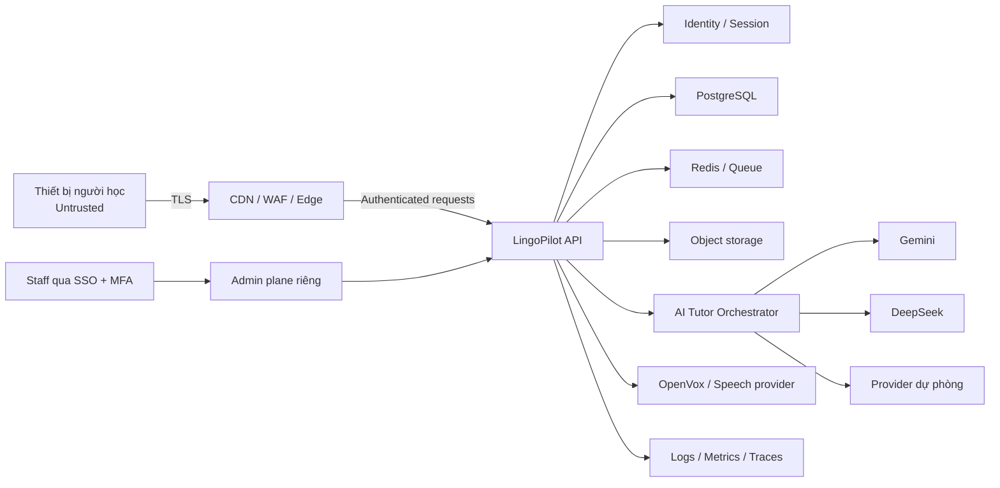

# LingoPilot — Security, Privacy, SRE & QA Production Operations

> Phiên bản: 1.0 · Loại: Production operations specification · Ngày hiệu lực/cập nhật: 2026-08-15  
> Trạng thái: thiết kế vận hành mục tiêu cho production  
> Phạm vi: webapp học tiếng Anh và tiếng Trung, AI Tutor, assessment, voice/OpenVox  
> Chủ sở hữu tài liệu: Security, Privacy, SRE & QA Lead  
> Chu kỳ rà soát: mỗi quý, sau sự cố SEV-1/SEV-2, hoặc trước thay đổi kiến trúc lớn

## 1. Mục đích và nguyên tắc sử dụng

Tài liệu này định nghĩa các kiểm soát bắt buộc để đưa LingoPilot từ prototype hiện tại thành dịch vụ production có thể vận hành, phục hồi và kiểm chứng. Đây là tiêu chuẩn thiết kế và runbook cấp sản phẩm; nó không phải bằng chứng rằng mọi kiểm soát đã được triển khai.

Không được dùng tài liệu này để tuyên bố LingoPilot tuân thủ GDPR, CCPA/CPRA, COPPA, ISO 27001, SOC 2, PCI DSS, Luật An ninh mạng Việt Nam, Nghị định 13/2023/NĐ-CP, [Luật Bảo vệ dữ liệu cá nhân 91/2025/QH15](https://vanban.chinhphu.vn/?docid=214590&pageid=27160) hoặc bất kỳ chuẩn/pháp luật nào khi chưa có đánh giá pháp lý và audit độc lập phù hợp.

Nguyên tắc vận hành:

- An toàn và quyền riêng tư là release gate, không phải công việc hậu kiểm.
- Thu thập ít nhất, giữ trong thời gian ngắn nhất, cấp quyền tối thiểu.
- Không để AI tự quyết định level, chứng chỉ, hình phạt hoặc quyền truy cập.
- Mọi quyết định học tập quan trọng phải truy được rubric, dữ liệu đầu vào và phiên bản model/prompt.
- Có đường lui an toàn khi AI, voice hoặc vendor không khả dụng.
- Chỉ công bố SLO, tính năng và compliance dựa trên bằng chứng đo được.
- Mọi sự cố và lỗi lặp lại phải tạo hành động phòng ngừa có chủ sở hữu và hạn xử lý.

## 2. Hiện trạng và ranh giới tài liệu

### 2.1 Hiện trạng đã xác minh trong repo

Prototype hiện tại gồm:

- Node.js HTTP server trong `server.mjs`, phục vụ static assets và API cùng tiến trình.
- API coach, lesson, assessment và voice không có authentication hoặc authorization.
- Assessment bank và scoring deterministic nằm trong memory của server; AI chỉ tạo phân tích/kế hoạch.
- Gemini, DeepSeek và OpenAI được gọi trực tiếp từ backend qua API key trong biến môi trường.
- OpenVox mặc định chạy local tại `127.0.0.1:8000/v1`; Docker có thể truy cập host qua `host.docker.internal`.
- Tiến độ và assessment gần nhất được lưu trong `localStorage`; chưa có tài khoản, database hoặc đồng bộ đa thiết bị.
- Docker chạy ứng dụng bằng non-root user và có healthcheck cơ bản.
- Test hiện tại kiểm tra syntax, happy path API, không lộ answer key và tích hợp OpenVox tùy chọn.

### 2.2 Khoảng trống production bắt buộc đóng

Không được public launch khi chưa có bằng chứng cho các mục sau:

- Identity, session security, RBAC/ABAC và tenant isolation nếu có tổ chức/trường học.
- TLS, security headers, CSRF protection, CORS allowlist và request body limits.
- Rate limit, bot/abuse controls, idempotency và quota theo user/provider.
- Database có migration, encryption, backup, restore test và audit trail.
- Secret manager, key rotation, environment separation và log redaction.
- Consent, privacy center, export/delete và retention automation.
- Content safety, reporting, escalation và human review.
- Production observability, on-call, alerting, incident command và status communication.
- CI/CD có security gates, signed artifact, canary/rollback và change record.
- Test automation, accessibility audit, performance/load/security test và AI evaluation gates.

### 2.3 Kiến trúc đích được giả định

Tài liệu áp dụng cho kiến trúc đích đã nêu trong product design:

- Web/PWA qua CDN/WAF và reverse proxy.
- API service Node.js/TypeScript.
- PostgreSQL cho dữ liệu nghiệp vụ.
- Redis/queue cho rate limit, job và cache.
- Object storage cho audio khi có consent.
- Adapter AI cho Gemini, DeepSeek và provider dự phòng.
- Speech adapter cho OpenVox local/private và dịch vụ cloud được phê duyệt.
- Hệ thống observability, feature flags, content moderation và admin console riêng.

## 3. Phân loại dữ liệu

| Mức | Ví dụ | Yêu cầu tối thiểu |
|---|---|---|
| Public | Nội dung marketing, curriculum đã xuất bản | Integrity, versioning, cache control |
| Internal | Prompt template, rubric chưa công bố, runbook, dashboard vận hành | SSO/MFA, least privilege, không public indexing |
| Confidential | Email, profile, tiến độ, transcript, learner memory, IP, support ticket | Mã hóa truyền/lưu, audit access, retention, export/delete |
| Highly sensitive | Raw voice/audio, dữ liệu trẻ vị thành niên, token/session, API key, backup chứa PII | Consent rõ ràng, access rất hạn chế, key management, không log, retention ngắn |

Password hash, refresh token, API key, private key và recovery code không bao giờ được trả về client hoặc ghi vào log. Raw audio được coi là dữ liệu nhạy cảm vì có thể chứa giọng nói, tên, nơi làm việc hoặc thông tin của người xung quanh; không được mặc định dùng cho định danh sinh trắc học.

## 4. Threat model

### 4.1 Tài sản cần bảo vệ

- Tài khoản, session và quyền của learner, reviewer, moderator, support, admin.
- Hồ sơ, mục tiêu, lịch sử học, assessment result, transcript và audio.
- Curriculum, answer key, rubric, prompt, learner model và level evidence.
- API keys, database credentials, signing keys, webhook secrets và backup.
- Tính đúng đắn của scoring, tiến độ, entitlement và subscription.
- Khả dụng của web/API/voice/AI và ngân sách vendor.
- Uy tín, niềm tin và sự an toàn tâm lý của người học.

### 4.2 Tác nhân đe dọa

- Người dùng vô tình gửi PII hoặc nội dung nhạy cảm cho AI Tutor.
- Người dùng gian lận bài test, dò answer key hoặc thao túng level.
- Bot tạo tài khoản, spam AI/voice, đốt quota hoặc scraping curriculum.
- Kẻ tấn công chiếm tài khoản, credential stuffing, phishing hoặc session theft.
- Người dùng ác ý prompt-inject để lấy system prompt, dữ liệu khác hoặc tạo nội dung nguy hiểm.
- Nhân viên/contractor có quyền quá mức hoặc truy cập không có mục đích.
- Dependency, container image hoặc CI runner bị compromise.
- Vendor AI/voice/analytics gặp breach, outage, thay đổi điều khoản hoặc hành vi model.
- Tenant/trường học truy cập chéo dữ liệu nếu triển khai B2B.

### 4.3 Trust boundaries



Mỗi mũi tên đi qua một trust boundary. Bắt buộc xác thực nguồn, validate schema, giới hạn kích thước/tần suất, áp timeout, redact dữ liệu và ghi audit event phù hợp. Không tin dữ liệu từ browser, model output, webhook, file import hoặc metadata từ object storage.

### 4.4 Các mối đe dọa và kiểm soát

| Threat | Tác động | Kiểm soát phòng ngừa | Phát hiện/ứng phó |
|---|---|---|---|
| Account takeover | Lộ dữ liệu, phá tiến độ | MFA cho staff, Argon2id, session rotation, rate limit, breached-password check | Login anomaly, revoke sessions, notify user |
| Broken access control/IDOR | Truy cập dữ liệu người khác | Server-side ownership check mọi object; UUID không thay authorization | Test authorization matrix, audit denied access |
| Prompt injection | Lộ prompt/dữ liệu, nội dung sai | Context isolation, tool allowlist, structured output, không đưa secret vào prompt | AI eval, report, kill switch theo provider/prompt |
| Assessment cheating | Level sai | Đề/rubric version hóa, randomization, signed attempt, server scoring | Statistical anomaly, retest, human review |
| XSS | Chiếm session, thay nội dung | Output encoding, CSP, không render model output bằng HTML, sanitize import | CSP report, SAST/DAST, incident response |
| CSRF | Mutation trái phép | SameSite cookie, CSRF token/origin check cho cookie-auth mutation | Audit mutation và origin anomaly |
| SSRF | Truy cập metadata/internal service | Không fetch URL tùy ý; URL allowlist; egress policy | Egress logs, deny cloud metadata ranges |
| Path traversal | Đọc file server | Static server chuẩn, normalized path, deny dotfiles, không map URL tùy ý | Security tests, file access alert |
| Resource exhaustion | Outage/chi phí | Body limit, concurrency cap, timeout, queue backpressure, quota | Saturation/cost alerts, shed load |
| Secret leakage | Chiếm vendor/account | Secret manager, masking, no client exposure, pre-commit scanning | Secret scanning, revoke/rotate runbook |
| Audio/PII leakage | Privacy harm | Explicit consent, short retention, encryption, private buckets | Access audit, DLP sampling, delete workflow |
| Supply-chain compromise | RCE/data theft | Lockfile, dependency scanning, SBOM, pinned digest, signed build | Runtime alerts, rapid patch/rollback |
| Insider misuse | Privacy/security harm | JIT access, approval, purpose-bound support access | Immutable audit log, quarterly review |

### 4.5 Security assumptions phải được kiểm chứng

- Production không dùng static file server tự viết làm internet edge.
- OpenVox không public trực tiếp; chỉ API service được phép gọi qua private network hoặc mTLS.
- Model provider không được dùng prompt/transcript/audio để training nếu hợp đồng và cấu hình chưa được phê duyệt.
- Analytics không nhận raw transcript, raw audio, email hoặc stable identifier không cần thiết.
- Admin plane tách khỏi learner plane, bắt buộc SSO + MFA và không dùng tài khoản chia sẻ.

Threat model phải được cập nhật khi thêm community, thanh toán, content import, B2B tenant, mobile app, biometrics hoặc vendor mới.

## 5. Authentication và session security

### 5.1 Learner authentication

- Ưu tiên passkey và OAuth/OIDC với provider uy tín; nếu có password, hash bằng Argon2id với tham số được benchmark định kỳ.
- Email verification trước thao tác nhạy cảm; không tiết lộ email đã tồn tại trong forgot-password flow.
- Access session ngắn hạn; refresh token rotation, reuse detection và revoke toàn bộ token chain khi bị tái sử dụng.
- Cookie phải `Secure`, `HttpOnly`, `SameSite=Lax` hoặc `Strict`, scope path/domain tối thiểu.
- Session ID đổi sau login, privilege change, password reset và account recovery.
- Người dùng xem và revoke các phiên đang hoạt động; đổi password/recovery phải thông báo qua kênh đã xác minh.
- Recovery code dùng một lần, hash khi lưu, có rate limit và audit.
- Không dùng localStorage để lưu access/refresh token. `localStorage` chỉ phù hợp dữ liệu prototype không nhạy cảm; production progress phải server-authoritative.

### 5.2 Staff authentication

- SSO qua IdP doanh nghiệp, MFA chống phishing, device posture nếu có.
- Không có local admin password trừ break-glass account được niêm phong, giám sát và test hàng quý.
- Tài khoản staff tự hết hạn khi hợp đồng kết thúc; offboarding tối đa 4 giờ cho privileged access.
- Production shell/database access là JIT, có ticket, thời hạn, lý do và audit.

### 5.3 Bot và credential abuse

- Rate limit theo IP, device signal, account và endpoint; tránh khóa nhầm mạng dùng chung.
- Progressive delay và risk-based challenge; CAPTCHA chỉ khi rủi ro cao và phải có phương án accessibility.
- Theo dõi credential stuffing, impossible travel, device churn và reset abuse.
- Không dùng câu hỏi bảo mật dựa trên thông tin cá nhân.

## 6. Authorization

### 6.1 Mô hình quyền

RBAC cơ sở dùng đúng canonical role của PRD/Architecture/OpenAPI và kết hợp ownership/tenant checks. Guardian là relationship/policy, Security/SRE là service/operational identity; cả hai không phải application role.

| Canonical role | Quyền chính | Cấm |
|---|---|---|
| Learner | Dữ liệu/progress và subscription self-service của chính mình | Xem learner khác, rubric bí mật, admin action |
| Content Editor | Nội dung/rubric draft và submit review | User PII, publish nội dung mình tạo, production deploy |
| Learning Reviewer | Review bài được gán và publish qua four-eyes workflow | Tìm kiếm hồ sơ, sửa draft thay tác giả, tải raw audio hàng loạt |
| Support | Metadata cần để xử lý ticket | Raw audio/transcript mặc định, refund, bulk export |
| Moderator | Report queue, action theo policy | Sửa điểm/level, xem billing secret |
| Billing Admin | Billing/refund/entitlement action có reason và audit | Learning content/audio, sửa ledger lịch sử |
| Auditor | Audit read-only đã giảm định danh | Mọi mutation |
| Admin | Membership/policy/provider config và emergency rollback đã phê duyệt | Tài khoản dùng chung, bypass audit, publish thường lệ thay Reviewer |

### 6.2 Yêu cầu thực thi

- Deny by default; server kiểm tra quyền trên mọi request và mọi row/object.
- Policy test bao phủ role × resource × action × tenant × ownership.
- Không dựa vào UI ẩn nút hoặc ID khó đoán.
- Mutation nhạy cảm cần re-authentication hoặc step-up MFA.
- Thay đổi role, export, delete, moderation và support impersonation phải có audit log bất biến.
- Support impersonation nếu được phép phải hiện banner, chỉ read-only mặc định, có consent/ticket và không tiết lộ secret.
- Service account có scope riêng, credential ngắn hạn và không login tương tác.

## 7. API và application security

### 7.1 Baseline API

- API version hóa; request/response validate bằng schema đóng, reject field lạ cho mutation nhạy cảm.
- Giới hạn body theo endpoint: JSON thông thường tối đa 64 KiB; transcript 32 KiB; upload audio theo duration/codec và tối đa được cấu hình.
- Timeout riêng: database 2 giây, internal service 3 giây, AI/voice theo SLO nhưng có hard deadline và cancellation.
- Retry chỉ với thao tác idempotent, exponential backoff + jitter; POST có idempotency key khi tạo session/payment/job.
- Không trả stack trace, provider error body, prompt, SQL hoặc internal host cho client.
- Error response có stable code và correlation ID; thông tin chi tiết chỉ ở log đã redact.
- CORS allowlist chính xác; không dùng wildcard với credential.
- CSRF protection cho mọi cookie-authenticated mutation, gồm logout, consent, export/delete, role và billing.
- Content type allowlist; MIME sniffing disabled; upload kiểm tra magic bytes và antivirus khi phù hợp.

### 7.2 HTTP và browser security

- TLS 1.2+; HSTS sau khi toàn bộ subdomain hỗ trợ HTTPS.
- CSP nonce/hash, `object-src 'none'`, `base-uri 'none'`, `frame-ancestors 'none'` trừ use case được duyệt.
- `X-Content-Type-Options: nosniff`, `Referrer-Policy`, `Permissions-Policy` tối thiểu cho microphone.
- Clickjacking protection, secure cache headers và no-store cho auth/assessment/privacy response.
- Model output luôn render bằng text hoặc sanitizer allowlist; cấm đưa trực tiếp vào `innerHTML`.
- Source map production không public nếu chứa source/comment nhạy cảm.

### 7.3 Assessment integrity

- Không gửi answer key, scoring threshold nội bộ hoặc full item bank xuống client.
- Assessment attempt có server-generated ID, expiry, question version, randomized order và tamper-evident submission.
- Scoring deterministic là nguồn điểm; AI chỉ giải thích và tạo yêu cầu trong schema.
- Level promotion cần evidence theo product design; high-stakes result cần retest hoặc human review.
- Không chấm phát âm/thanh điệu chỉ từ transcript; low-confidence ASR không được tính là lỗi ngôn ngữ.
- Theo dõi item exposure, response-time anomaly, answer copying và repeated perfect pattern; không tự kết luận gian lận chỉ từ một signal.

## 8. API keys và secrets

### 8.1 Quản lý secrets

- Production secret nằm trong managed secret manager/KMS, không ở `.env` trên máy cá nhân, image, Git, ticket, chat hoặc CI log.
- Mỗi environment, service và vendor dùng key riêng; không dùng key production ở dev/test.
- CI nhận credential ngắn hạn qua workload identity/OIDC; tránh static cloud key.
- Secret mount/injection ở runtime, quyền đọc chỉ service identity cần thiết.
- Key phải có owner, mục đích, environment, ngày tạo, rotation cadence và revoke procedure.
- Database, object storage và queue dùng IAM/service identity thay static key khi có thể.

### 8.2 Rotation và phản ứng khi lộ key

- Vendor/API key: rotate tối đa 90 ngày hoặc ngắn hơn theo risk; signing key có kế hoạch overlap và key ID.
- Rotate ngay khi nghi lộ, nhân sự rời nhóm, vendor breach hoặc audit phát hiện sai scope.
- Quy trình: chặn/thu hồi key → cấp key mới → deploy không downtime → xác minh traffic → điều tra phạm vi → thông báo theo yêu cầu.
- Secret scanner chạy pre-commit, pull request và lịch sử Git/container registry.
- Log pipeline redact `Authorization`, cookie, token, API key, signed URL và giá trị giống credential.

### 8.3 Provider-specific controls

- Gemini/DeepSeek/provider khác có budget cap, request quota, timeout, circuit breaker và kill switch độc lập.
- Không gửi user ID/email trực tiếp; dùng pseudonymous request ID nếu cần truy vết.
- Prompt phải loại bỏ secret và chỉ lấy learner context tối thiểu.
- `/api/ai/status` chỉ được trả capability chung; không trả key, account, quota chi tiết hoặc internal routing.
- OpenVox endpoint chỉ ở private network; nếu remote phải có TLS/mTLS, authentication và network allowlist.

## 9. Secure SDLC và supply chain

### 9.1 Quy trình thay đổi

Mỗi thay đổi production phải đi qua:

1. Issue có phạm vi, data/security impact và acceptance criteria.
2. Threat/privacy review nếu thêm dữ liệu, permission, vendor, AI tool, upload hoặc public endpoint.
3. Code review bởi người không phải tác giả; CODEOWNERS cho auth, privacy, infra, scoring và billing.
4. Automated checks: format/lint/type, unit/integration/E2E, SAST, dependency/license scan, secret scan và IaC/container scan.
5. Artifact build một lần, ký và promote cùng digest qua môi trường.
6. Staging verification với synthetic/non-production data.
7. Change approval theo risk, canary, quan sát và rollback criteria.

### 9.2 Dependency và artifact

- Commit lockfile; dùng version pin và review major update.
- Generate SBOM cho mỗi release; image base pin bằng digest và rebuild định kỳ để nhận security patch.
- Container chạy non-root, read-only filesystem khi có thể, drop Linux capabilities, limit CPU/memory/PID.
- CI runner ephemeral; protected branch, required review và signed release provenance.
- Critical/high vulnerability có exploitability review; không waive vô thời hạn. Exception cần owner, lý do, compensating control và expiry.
- Không chạy untrusted learner code hoặc model-generated code trong application process.

### 9.3 Security testing cadence

- SAST/dependency/secret scan mỗi pull request.
- DAST và authenticated API scan trên staging mỗi release candidate.
- Container/IaC scan mỗi build.
- External penetration test trước public launch và sau thay đổi lớn; retest finding đã sửa.
- Threat model review hàng quý và khi thêm trust boundary.
- Tabletop incident ít nhất 2 lần/năm, gồm breach audio/PII và vendor AI outage.

## 10. Privacy program

### 10.1 Data inventory và mục đích

| Data | Mục đích | Nơi lưu dự kiến | Bên nhận | Retention mặc định đề xuất |
|---|---|---|---|---|
| Email/account ID | Login, support, security notice | Identity/PostgreSQL | Email/IdP đã duyệt | Trong vòng đời account + 30 ngày grace |
| Profile, locale, timezone, goals | Cá nhân hóa kế hoạch | PostgreSQL | AI chỉ nhận field tối thiểu | Đến khi xóa account hoặc cập nhật |
| Progress, attempt, score | Dạy học, evidence, SRS | PostgreSQL | Nội bộ; AI khi cần | Account lifetime; aggregate giảm định danh lâu hơn nếu hợp pháp |
| Transcript | Feedback và lịch sử học | PostgreSQL/object store | AI/ASR được chọn | 90 ngày mặc định; user có thể xóa sớm |
| Raw audio | Phát âm, retry, QA nếu consent | Private object storage | Speech vendor/OpenVox | Không lưu mặc định; nếu bật: 30 ngày |
| Learner memory | Cá nhân hóa | PostgreSQL | Tutor orchestrator | 180 ngày hoặc đến khi user xóa |
| AI request/response | Debug, safety, quality | Store tách biệt đã redact | AI vendor | 30 ngày; sample QA lâu hơn chỉ khi consent/lawful basis |
| Product analytics | Cải thiện funnel/chất lượng | Analytics warehouse | Analytics vendor | 13 tháng hoặc ngắn hơn theo quyết định pháp lý |
| Security/audit logs | Phát hiện, điều tra, accountability | Log/SIEM | Security provider | 12 tháng nóng/lạnh theo risk và legal review |
| Support ticket | Hỗ trợ và tranh chấp | Support system | Support vendor | 24 tháng sau đóng ticket, cần legal review |
| Consent record | Chứng minh lựa chọn/version | PostgreSQL/audit store | Nội bộ | Account lifetime + thời hạn pháp lý được xác nhận |
| Backup | Phục hồi dịch vụ | Encrypted backup store | Cloud provider | 35 ngày rolling; delete aging được giải thích rõ |

Các retention trên là đề xuất sản phẩm, không phải kết luận pháp lý. Privacy/Legal phải phê duyệt theo thị trường launch, loại người dùng và hợp đồng vendor trước go-live.

### 10.2 Consent và transparency

- Tách Terms acceptance, Privacy notice, raw audio storage, model training/quality sampling, marketing và community sharing.
- Consent phải cụ thể, tự nguyện, dễ hiểu, version hóa, có timestamp và dễ rút lại như khi cấp.
- Không dùng dark pattern; từ chối không được làm mất chức năng cốt lõi nếu dữ liệu không cần thiết cho chức năng đó.
- Trước microphone: giải thích dữ liệu được capture, gửi đến đâu, có lưu hay không và cách xóa.
- Trong AI Tutor: hiển thị rõ nội dung do AI tạo, hạn chế và cách report.
- Nếu thay đổi mục đích xử lý hoặc vendor materially, đánh giá lại notice/consent trước rollout.

### 10.3 Privacy by default

- Raw audio storage off mặc định; dùng stream/ephemeral processing nếu có thể.
- Không dùng transcript/audio cho training hoặc human QA nếu chưa có lựa chọn riêng phù hợp.
- Analytics dùng event tối thiểu, không gửi free text hoặc raw prompt.
- Tắt ad tracking và cross-context behavioral profiling, đặc biệt với minor.
- Signed URL thời hạn ngắn; object storage private và deny public access ở cấp account/bucket.
- Dữ liệu dev/test là synthetic hoặc đã de-identify; cấm clone database production sang laptop.

### 10.4 Export, correction và delete

Privacy Center phải cho phép:

- Xem loại dữ liệu, consent, vendor category và retention đang áp dụng.
- Export ở định dạng máy đọc được: profile, plans, progress, attempts, scores, transcripts, learner memories và consent history.
- Sửa profile và challenge assessment/AI feedback; không sửa audit history nhưng có thể thêm correction record.
- Xóa transcript/audio riêng lẻ và xóa toàn bộ account.

Workflow delete:

1. Xác minh danh tính và chống account takeover; không yêu cầu nhiều dữ liệu hơn cần thiết.
2. Tạo deletion job có ID, phạm vi và trạng thái; revoke session/token sớm nếu xóa account.
3. Xóa hoặc anonymize trong primary DB, object storage, search index, cache, analytics mapping và vendor downstream.
4. Tombstone để ngăn dữ liệu quay lại từ event/retry; không chứa PII không cần thiết.
5. Backup hết hạn tự nhiên trong tối đa 35 ngày; nếu restore backup, chạy lại deletion ledger.
6. Gửi xác nhận hoàn tất hoặc lý do/ngoại lệ giữ lại đã được legal review.

Mục tiêu vận hành nội bộ: xác nhận yêu cầu trong 72 giờ và hoàn tất hệ thống chính trong 7 ngày; deadline pháp lý chính thức do Legal xác định cho từng jurisdiction.

### 10.5 Data subject request controls

- Queue có SLA, owner và escalation; identity verification tương xứng với risk.
- Export link một lần, hết hạn tối đa 24 giờ và audit download.
- Không export internal fraud signal, secret, dữ liệu người khác hoặc nội dung bị legal hold nếu luật cấm.
- Test export/delete tự động bằng canary account mỗi tháng.
- Báo cáo hàng tháng: số request, thời gian xử lý, lỗi, manual exception và overdue.

### 10.6 Data residency và cross-border

- Lập data-flow map theo region và vendor trước launch.
- Legal/Privacy quyết định lawful basis, transfer mechanism, localization và DPA/SCC tương ứng.
- Không hứa “dữ liệu không rời Việt Nam” hoặc “EU-only” nếu monitoring, email, AI, CDN hay support vendor còn truyền dữ liệu ra ngoài vùng.

## 11. Trẻ em và người chưa thành niên — quyết định sản phẩm bắt buộc

Độ tuổi tối thiểu và việc cho phép trẻ em dùng sản phẩm là quyết định Product + Legal, không được mặc định từ thiết kế kỹ thuật.

Trước public launch phải chọn và ghi rõ một trong hai hướng:

### Phương án A — Chỉ dành cho người đủ tuổi tự consent

- Age gate trung thực, Terms nêu độ tuổi tối thiểu theo thị trường.
- Không marketing có chủ đích tới trẻ dưới ngưỡng.
- Có quy trình đóng/xử lý account khi phát hiện user dưới tuổi.

### Phương án B — Hỗ trợ minor có giám hộ

- Verifiable parental/guardian consent theo yêu cầu pháp lý từng thị trường.
- Parent/guardian dashboard và quyền phải được Legal/Product xác định rõ; tránh giám sát quá mức làm tổn hại quyền riêng tư của trẻ.
- Không open messaging, location, contact exchange, targeted ads hoặc persuasive monetization mặc định.
- Topic/content filter theo nhóm tuổi, quiet hours, purchase approval và report/block dễ dùng.
- Thu thập tối thiểu; retention ngắn hơn; human reviewer được vetting phù hợp.
- Incident involving child safety có escalation chuyên biệt và nghĩa vụ báo cáo được Legal xác định.

Cho đến khi quyết định được phê duyệt, production phải vận hành theo Phương án A và không tự tuyên bố child-safe hoặc COPPA-compliant.

## 12. Abuse, content safety và AI governance

### 12.1 Phạm vi nguy cơ

- Harassment, hate, sexual content, self-harm, violence, illegal activity và grooming.
- PII do user nhập hoặc AI nhắc lại.
- Hallucination về ngôn ngữ, văn hóa, phát âm hoặc level.
- Prompt injection, jailbreak, system prompt extraction và data exfiltration.
- AI feedback gây nhục mạ, định kiến hoặc làm nản người học.
- Community spam, scam, contact exchange và impersonation.

### 12.2 Safety pipeline

```text
Input validation → PII/safety pre-check → context minimization
→ model call với policy + tool allowlist → schema validation
→ output safety/quality check → user controls/report → audit/sampling
```

- Block hoặc safe-complete nội dung nguy hiểm theo policy; không giả vờ cung cấp hỗ trợ chuyên môn y tế/pháp lý.
- Với self-harm/imminent danger, hiển thị hỗ trợ phù hợp vùng nhưng không tuyên bố app là dịch vụ khẩn cấp.
- PII detector là guardrail hỗ trợ, không phải đảm bảo tuyệt đối; cảnh báo user không chia sẻ bí mật.
- AI không có quyền đọc tùy ý database, gọi URL hoặc thực thi code. Tool call phải allowlist, authorization-aware và có per-tool quota.
- Output theo JSON schema; invalid output fallback sang nội dung deterministic hoặc yêu cầu thử lại.
- Không tự nâng level, chứng nhận, ban user hoặc quyết định minor safety chỉ từ model output.

### 12.3 Moderation và appeal

- Report taxonomy, severity, SLA và evidence handling rõ ràng.
- SEV safety hoặc suspected grooming chuyển ngay human review chuyên trách.
- Enforcement có lý do, thời hạn, audit và appeal channel.
- Moderator chỉ thấy dữ liệu tối thiểu; sensitive queue có enhanced access review.
- QA sampling phải giảm định danh; raw audio chỉ nghe khi có lawful basis/consent và need-to-know.

### 12.4 AI quality governance

- Model registry: provider, model ID, region, prompt version, safety settings, owner, approval date.
- Golden set tiếng Anh/Trung bao phủ level, accent, dialect, pinyin/tone, code-switching và lỗi phổ biến của người Việt.
- Human rubric đánh giá correctness, pedagogical value, safety, cultural sensitivity, actionability và consistency.
- Mọi model/prompt change chạy offline eval và canary; không auto-upgrade model alias ngoài change process.
- Kill switch theo provider, feature, language và user cohort; deterministic fallback phải được test.

## 13. Vendor risk management

Áp dụng cho AI, speech, cloud, CDN, email, analytics, error monitoring, support, payment và contractor.

### 13.1 Trước tích hợp

- Security/privacy questionnaire; kiến trúc, subprocessor, data region, encryption và access controls.
- DPA, confidentiality, breach notification, deletion/return, training use, retention và audit rights được Legal review.
- Đánh giá SLA, support, exit plan, rate limit, pricing, model lifecycle và business continuity.
- Xác minh cấu hình opt-out training/retention thay vì chỉ dựa marketing claim.
- Xác định data fields tối thiểu và cấm gửi dữ liệu không cần thiết.

### 13.2 Trong vận hành

- Inventory có owner, data class, risk tier, contract renewal, last review và fallback.
- Critical vendor review ít nhất hằng năm và khi có incident/major terms change.
- Theo dõi status, latency, errors, cost, model drift và subprocessor change.
- Vendor key và endpoint có kill switch; provider routing không làm vi phạm residency/consent.

### 13.3 Exit plan

- Export dữ liệu và cấu hình ở định dạng dùng được.
- Xóa dữ liệu tại vendor và lấy attestation khi hợp đồng cho phép.
- Chuyển provider không mất core learning evidence.
- Chạy tabletop “AI provider unavailable 72 giờ” và “speech vendor breach”.

## 14. Backup, restore và disaster recovery

### 14.1 Phạm vi backup

- PostgreSQL: point-in-time recovery + full backup.
- Object metadata và consented audio; không backup cache có thể tái tạo.
- Curriculum/rubric/prompt/config versioned trong source hoặc registry.
- Secret không backup chung với application data; KMS recovery theo quy trình riêng.
- Audit/deletion ledger được bảo vệ và phục hồi nhất quán.

### 14.2 Chính sách đề xuất

| Thành phần | RPO | RTO | Backup | Kiểm chứng |
|---|---:|---:|---|---|
| Identity/profile/progress | 5 phút | 60 phút | PITR + daily encrypted snapshot | Restore test hàng tháng |
| Assessment/level evidence | 5 phút | 60 phút | PITR + immutable snapshot | Reconcile checksum |
| Audio/transcript | 24 giờ | 24 giờ | Versioned/replicated nếu user consent lưu | Sample restore hàng quý |
| Curriculum/prompt/config | Mỗi release | 2 giờ | Git/artifact registry | Rebuild drill hàng quý |
| Logs/audit | 1 giờ | 8 giờ | Cross-account/immutable archive | Query test hàng quý |

RPO/RTO là mục tiêu sản phẩm đề xuất, phải được Product/SRE phê duyệt theo chi phí và đo bằng drill trước khi công bố.

### 14.3 Kiểm soát backup

- Mã hóa, account/project tách biệt, least privilege và delete protection.
- Không dùng cùng credential cho production write và backup delete.
- Backup monitor freshness, completeness và storage integrity; alert khi trễ hơn 2× lịch.
- Restore vào isolated environment bằng synthetic access; sanitize trước khi developer truy cập.
- Quarterly full DR drill; monthly database restore; ghi actual RPO/RTO và action item.
- Deletion ledger chạy lại sau restore để dữ liệu đã xóa không sống lại.

### 14.4 Kịch bản DR

1. Tuyên bố disaster và chỉ định Incident Commander.
2. Freeze deploy và thay đổi schema.
3. Xác định recovery point sạch, verify checksum và credential.
4. Restore infra/data tại region/account dự phòng.
5. Chạy migration/reconciliation, deletion ledger và smoke test.
6. Chuyển traffic theo canary; theo dõi error/data integrity.
7. Thông báo status; kết thúc khi SLO và integrity ổn định.
8. Postmortem, cập nhật RPO/RTO thực tế và backlog.

## 15. SLI, SLO và error budget

### 15.1 Định nghĩa SLI

- Web availability: request page shell hợp lệ / tổng request page shell hợp lệ từ synthetic + edge.
- API availability: request API hợp lệ trả non-5xx trong deadline / tổng request hợp lệ; loại trừ lỗi client 4xx được định nghĩa.
- API latency: p50/p95/p99 server duration theo endpoint class.
- Voice success: lượt voice trả audio phát được trong deadline / lượt voice hợp lệ.
- AI Tutor success: lượt trả response schema-valid, safety-pass trong deadline / lượt hợp lệ.
- Learning write durability: session/attempt acknowledged và có thể đọc lại / tổng write acknowledged.
- Assessment integrity: result truy được đúng rubric/item/prompt version / tổng result sampled.
- Privacy operation: export/delete hoàn tất đúng internal target / tổng request.

### 15.2 SLO khởi điểm cho public v1

| User journey | SLO 30 ngày | Deadline |
|---|---:|---:|
| Web shell availability | 99.9% | 3 giây |
| Authenticated CRUD API | 99.9% | p95 < 500 ms |
| Session/attempt write | 99.95% | p95 < 700 ms |
| Assessment start/submit không tính AI explanation | 99.9% | p95 < 1 giây |
| AI Tutor valid response | 99.5% | p95 < 8 giây |
| Voice turn end-to-end | 98.5% | p95 < 3.5 giây trong profile mạng mục tiêu |
| Export/delete internal completion | 99% | Trong target nội bộ đã nêu |

AI/voice degraded mode được coi là thành công chỉ khi user nhận fallback hữu ích và sự suy giảm được hiển thị; không được che outage bằng response rỗng.

AI schema-valid attempt SLO là 99,9% trước fallback. Tuy nhiên 100% response thực sự gửi tới client phải qua schema validation và safety policy; attempt không hợp lệ phải repair, dùng deterministic fallback hoặc fail-closed, tuyệt đối không chuyển raw output.

### 15.3 Error budget policy

- Budget tháng = 1 − SLO. Theo dõi burn rate cửa sổ 1 giờ, 6 giờ, 24 giờ và 7 ngày.
- Burn >14.4× trong 1 giờ và >6× trong 6 giờ: page on-call, xử lý như SEV-1/2 tùy impact.
- Burn >3× trong 24 giờ: dừng rollout risky, ưu tiên reliability.
- Dùng >50% budget trong nửa đầu kỳ: freeze feature ở service liên quan, cần SRE approval để tiếp tục.
- Hết budget: chỉ deploy security fix, rollback hoặc reliability work cho đến khi service ổn định hoặc exception được Product + SRE phê duyệt và ghi nhận.
- Không đổi định nghĩa SLI/SLO giữa kỳ để làm đẹp số liệu.

## 16. Monitoring, logging, tracing và alerting

### 16.1 Golden signals và business integrity

- Traffic, errors, latency, saturation theo service/endpoint/region/version.
- DB connections, replication lag, lock, slow query, storage growth.
- Queue depth/age, retry/dead-letter, cache hit và eviction.
- AI/provider latency, status, schema failure, safety block, fallback, token và cost.
- Voice startup/turn latency, model load, audio validity, OpenVox fallback.
- Auth success/failure, reset, session revoke và anomaly.
- Assessment completion, scoring failures, impossible level jump và item exposure.
- Privacy job backlog/failure và backup freshness/restore result.

### 16.2 Logging standard

Structured JSON tối thiểu:

```json
{
  "timestamp": "RFC3339",
  "severity": "INFO",
  "service": "tutor-api",
  "environment": "production",
  "release": "git-sha-or-image-digest",
  "request_id": "random-id",
  "trace_id": "trace-id",
  "route": "/v1/tutor/message",
  "status_code": 200,
  "duration_ms": 840,
  "user_ref": "rotating-pseudonymous-id",
  "provider": "gemini",
  "model": "approved-model-id",
  "prompt_version": "tutor-v12",
  "result": "success"
}
```

Không log password, token, cookie, API key, full email, raw prompt/transcript/audio, answer key, signed URL hoặc full request body. Debug logging ở production cần time-bound flag, approval, sampling và auto-expiry.

### 16.3 Alert design

- Alert phải actionable, có owner, severity, dashboard và runbook link.
- Page theo symptom/user impact hoặc fast burn; ticket theo capacity/cost/trend.
- Deduplicate và group theo incident; tránh page theo từng pod/container.
- Synthetic journey: landing → login → start lesson → submit attempt → read progress; tách synthetic AI/voice để không tạo dữ liệu thật.
- Alert test hàng quý; on-call acknowledgment và escalation được đo.

### 16.4 Alert khởi điểm

| Alert | Điều kiện | Mức | Hành động đầu tiên |
|---|---|---|---|
| API fast burn | 14.4×/1h và 6×/6h | Page | Stop rollout, xem recent changes/dependencies |
| Write integrity | Acknowledged write không đọc lại hoặc mismatch | SEV-1 | Freeze writes nếu cần, bảo toàn evidence |
| Auth anomaly | Failure/reset/token reuse vượt baseline | SEV-2 | Rate limit, inspect source, revoke affected chain |
| AI provider failure | >20% lỗi 5 phút hoặc schema fail >5% | SEV-2/3 | Circuit break và route fallback |
| Voice saturation | Queue age >30s hoặc p95 >6s 10 phút | SEV-2/3 | Shed optional work, cap concurrency |
| Backup stale | Không có backup thành công >2× lịch | SEV-2 | Kiểm tra job/storage/credential |
| Privacy job overdue | Job gần vượt target hoặc lỗi lặp | SEV-2 | Manual processing và root cause |
| Cost anomaly | Daily projected cost >120% budget | SEV-3 | Giảm quota/model tier, điều tra abuse |

## 17. Incident management

### 17.1 Severity

| Severity | Tiêu chí | Ack/IC | Update cadence |
|---|---|---:|---:|
| SEV-1 | Data breach nghiêm trọng; account takeover diện rộng; mất/corrupt learning evidence; toàn hệ thống down; child safety imminent | 5 phút / 10 phút | 30 phút |
| SEV-2 | Journey cốt lõi hỏng phần lớn; provider outage không fallback; privacy request blocked; security exploit có scope hạn chế | 15 phút / 30 phút | 60 phút |
| SEV-3 | Degradation có workaround; lỗi một cohort/region; cost anomaly | 4 giờ làm việc | Khi có thay đổi đáng kể |
| SEV-4 | Lỗi nhỏ, không impact đáng kể | Theo backlog | Theo ticket |

### 17.2 Vai trò sự cố

- Incident Commander: điều phối, quyết định severity và nguồn lực.
- Operations Lead: chẩn đoán/mitigation kỹ thuật.
- Security/Privacy Lead: containment, evidence, breach assessment và legal liaison.
- Communications Lead: status page, support script, stakeholder update.
- Scribe: timeline, quyết định, hypothesis và action item.

Người đang sửa lỗi không đồng thời làm IC trong SEV-1 nếu đủ nhân lực.

### 17.3 Quy trình chung

1. Detect và page; tạo incident channel/ticket, ghi timestamp.
2. Triage user/data/safety impact; đặt severity và IC.
3. Contain: stop deploy, disable feature/provider, revoke key, isolate service hoặc chuyển read-only.
4. Preserve evidence với chain of custody; không copy PII vào chat.
5. Mitigate và verify bằng user journey/metrics, không chỉ healthcheck.
6. Communicate theo cadence; chỉ nêu fact đã xác minh.
7. Recover dần, theo dõi regression và đóng incident.
8. Blameless postmortem: trong 5 ngày làm việc cho SEV-1/2; owner/due date cho action.

Legal/Privacy quyết định nghĩa vụ thông báo regulator/user theo facts và jurisdiction. Không đưa mốc pháp lý cố định vào runbook khi chưa được legal review.

## 18. Runbooks trọng yếu

### 18.1 AI provider outage hoặc chất lượng suy giảm

- Xác nhận scope theo provider/model/region/prompt version.
- Bật circuit breaker, route provider đã phê duyệt hoặc deterministic fallback.
- Giảm context/token và concurrency nếu quota/latency là nguyên nhân.
- Hiển thị degraded state; không giả response AI là bình thường.
- Chạy golden-set smoke trước khi bật provider/model trở lại.
- Reconcile job bị retry; không chấm/ghi level hai lần.

### 18.2 OpenVox/voice outage

- Kiểm tra health, model loaded, queue, CPU/RAM và audio format.
- Shed non-critical synthesis, giới hạn concurrency, ưu tiên active lesson.
- Fallback browser TTS/cloud provider chỉ theo consent/data routing đã duyệt.
- Nếu không có fallback, giữ text/transcript mode và không làm mất progress.
- Sau phục hồi, chạy WAV validity và English/Chinese pronunciation smoke.

### 18.3 Suspected API key leak

- Revoke/disable key ngay; không đợi xác định root cause hoàn chỉnh.
- Chuyển traffic sang key/provider sạch; kiểm tra quota/billing/usage log.
- Tìm nguồn lộ ở Git, image, CI, log, support và client bundle.
- Rotate credential liên quan, purge cache/artifact nếu cần.
- Security/Privacy đánh giá data access; Legal quyết định notification.

### 18.4 Account takeover

- Revoke toàn bộ session/token chain, reset credential và khóa mutation nhạy cảm.
- Bảo toàn login/audit evidence; xác minh thay đổi email, consent, export/delete.
- Thông báo người dùng qua kênh an toàn, cung cấp recovery có step-up verification.
- Tìm credential stuffing, session theft hoặc support abuse; áp block có thời hạn.

### 18.5 Data exposure hoặc privacy breach

- Dừng data flow gây lộ, thu hồi URL/token và cô lập bucket/query/vendor.
- Xác định data type, số người, minor status, geography, thời gian và khả năng truy cập.
- Không xóa log/evidence; hạn chế người xem incident data.
- Security + Privacy + Legal thực hiện breach assessment và communication.
- Xác minh delete/containment downstream, rotate secrets và postmortem.

### 18.6 Corrupt progress/assessment data

- Freeze writes hoặc feature flag scoring; không tự chạy repair không reversible.
- So sánh event/audit/checkpoint/rubric version và backup.
- Tạo script repair idempotent, dry-run, peer review và sample verify.
- Thông báo user nếu level/progress thay đổi; giữ correction trail.

### 18.7 Database outage

- Xác định connectivity, saturation, storage, lock, replication và recent migration.
- Chuyển read-only/degraded mode nếu integrity an toàn; không acknowledge write chưa durable.
- Failover theo runbook, kiểm tra RPO và replica freshness.
- Sau phục hồi chạy consistency, queue replay idempotent và user journey.

## 19. Deploy, rollback và change management

### 19.1 Môi trường

- Dev, test, staging và production tách account/project, network, key và dữ liệu.
- Staging giống topology production đủ để test nhưng dùng synthetic data/provider sandbox.
- Production chỉ deploy từ CI, không `ssh` sửa file hoặc `docker compose up` thủ công như quy trình chuẩn.
- Emergency shell access là JIT, audited và tự hết hạn.

### 19.2 Pipeline production

```text
PR gates → build immutable artifact + SBOM + signature
→ deploy staging → migration dry-run → E2E/DAST/eval/load smoke
→ approval → canary 1–5% → 25% → 100%
→ observe SLO/business/privacy signals → close change
```

- Artifact xác định bằng Git SHA và image digest; không dùng mutable `latest` để rollback.
- Database migration theo expand/contract, backward compatible ít nhất một release.
- Feature flag có owner, expiry, default-safe và audit; kill switch không phụ thuộc deploy.
- Deploy ngoài giờ chỉ khi on-call và dependency support sẵn sàng.

### 19.3 Rollback criteria

Auto-pause/rollback khi:

- SLO fast burn, crash/error tăng có ý nghĩa hoặc write integrity fail.
- Auth/authorization/security regression.
- Privacy data gửi sai vendor/region hoặc consent bypass.
- AI safety/correctness golden metrics vượt threshold đã phê duyệt.
- Cost/token/voice usage tăng bất thường do release.

Rollback gồm app, config, prompt/model và feature flag. Migration destructive không được đi cùng release đầu tiên; luôn có forward-fix hoặc restore plan đã diễn tập.

### 19.4 Change classes

| Loại | Ví dụ | Phê duyệt |
|---|---|---|
| Standard | Dependency patch đã test, content fix không đổi rubric | Peer review + CI |
| Normal | Feature/API/schema/prompt/model/vendor config | Owner + QA; Security/Privacy/SRE theo impact |
| Emergency | Active exploit, outage mitigation | IC/authorized approver; retrospective trong 1 ngày làm việc |

## 20. Capacity và cost controls

### 20.1 Capacity model

Theo dõi và forecast theo:

- DAU/MAU, peak concurrent sessions, requests/user/day.
- AI turns, input/output tokens, context size và retry rate.
- Voice seconds, concurrent synthesis/transcription, model warm time.
- Audio/transcript storage growth, egress và retention deletion rate.
- DB rows/write QPS, queue age, cache memory và analytics events.

Giữ headroom tối thiểu 30% cho API/DB và 50% cho voice/AI concurrency ở peak đã dự báo; xác minh bằng load test, không dựa chỉ autoscaling.

### 20.2 Guardrails chi phí

- Quota theo user/plan/IP/device và endpoint; burst + daily/monthly limit.
- Max prompt/context/output tokens; summarize learner memory; cache content an toàn.
- Model tier routing theo nhiệm vụ: model nhỏ cho classification/formatting, model mạnh chỉ khi rubric yêu cầu.
- Dedupe/idempotency để tránh double call; retry budget tối đa và circuit breaker.
- Budget theo provider/environment/team; alert 50/80/100% và anomaly dựa baseline.
- Hard cap/killswitch có degraded mode; không tạo hóa đơn không giới hạn để giữ non-critical feature.
- Cost per completed meaningful lesson là metric chính, không chỉ cost/request.

### 20.3 Load shedding

Ưu tiên theo thứ tự:

1. Auth, consent, delete/export status và durable progress write.
2. Active lesson/assessment deterministic path.
3. Voice/AI feedback đang diễn ra.
4. Lesson generation nền, reports và analytics.

Khi saturation: ngừng job nền → giảm model/context → queue bounded → trả retry-after/fallback → bảo vệ DB. Không drop acknowledged learning evidence.

## 21. QA strategy

### 21.1 Quality ownership

QA là trách nhiệm chung. Developer chịu unit/component; service owner chịu integration/contract; QA Lead chịu risk matrix/E2E/release evidence; Security/Privacy chịu control verification; Curriculum/Language Expert chịu pedagogical correctness; SRE chịu resilience/performance/operability.

Bug phải có severity, reproducibility, environment, release, evidence và owner. Flaky test không được bỏ qua lâu dài; quarantine cần ticket, expiry và coverage thay thế.

### 21.2 Test pyramid

| Lớp | Mục tiêu | Tần suất |
|---|---|---|
| Static | Lint, type, schema, SAST, secret/dependency/IaC scan | Mỗi PR |
| Unit | Scoring, level rules, SRS, validation, authorization policy | Mỗi PR |
| Component | UI state, form, audio controls, accessibility semantics | Mỗi PR |
| Integration | DB/queue/storage/provider adapter, auth/session, migrations | Mỗi PR/merge |
| Contract | AI/voice/email/analytics API và fallback | Mỗi merge + scheduled |
| E2E | Critical learner/privacy/admin journeys | Release candidate |
| Non-functional | Load, resilience, DAST, a11y, AI eval | Scheduled/release gate |
| Exploratory | Edge cases, language UX, device/audio behavior | Mỗi milestone |

### 21.3 Functional test matrix

| Journey | English | Chinese | Anonymous | Learner | Guardian | Staff |
|---|---:|---:|---:|---:|---:|---:|
| Signup/login/recovery/logout | N/A | N/A | ✓ | ✓ | ✓ | ✓ |
| Placement/start/submit/resume | ✓ | ✓ | Theo quyết định | ✓ | Theo policy | Read-only audit |
| Daily lesson nghe/đọc/nói | ✓ | ✓ | Demo giới hạn | ✓ | Không mặc định | Không |
| AI Tutor/fallback/report | ✓ | ✓ | Quota thấp | ✓ | Theo policy | Moderation |
| Voice consent/record/play/delete | ✓ | ✓ | Không lưu | ✓ | Minor policy | Need-to-know |
| Progress/checkpoint/level evidence | ✓ | ✓ | Local demo | ✓ | Theo policy | Read-only scoped |
| Export/delete/consent revoke | ✓ | ✓ | N/A | ✓ | Minor policy | Process/audit |
| Community/report/block/appeal | ✓ | ✓ | Không | Theo age policy | Theo policy | ✓ |

### 21.4 Browser và device matrix

Tier 1, test mỗi release:

- Chrome stable/current−1: Windows 11, macOS hiện hành, Android phổ biến.
- Safari stable/current−1: macOS và iOS/iPadOS.
- Edge stable/current−1: Windows 11.
- Firefox stable/current−1: desktop.

Thiết bị/lưới kiểm thử:

- Viewport 320 px đến desktop ultrawide; touch, keyboard, mouse.
- Microphone allowed/denied/revoked, no microphone, Bluetooth headset, device switch.
- Mạng offline, 3G/high latency, packet loss, reconnect và background/resume.
- Low-memory/mobile thermal condition; audio interruption bởi call/alarm.
- PWA install/update/cache invalidation nếu feature được ship.

Support policy và telemetry phải quyết định khi nào bỏ browser version; không tuyên bố hỗ trợ nếu chưa có coverage.

## 22. Accessibility testing

Mục tiêu thiết kế là WCAG 2.2 AA; chỉ công bố đạt sau audit phù hợp và remediation.

Automated scan không đủ. Mỗi release candidate cần manual test critical flow:

- Keyboard-only, focus order, visible focus, skip link, modal focus trap/return.
- Screen reader: VoiceOver/Safari và NVDA/Chrome tối thiểu.
- Zoom 200%/400%, reflow 320 CSS px, large text, orientation.
- Contrast, high contrast/forced colors, reduced motion.
- Audio có transcript/caption; visual cue không chỉ dựa màu hoặc âm thanh.
- Record/playback có accessible name, state và error announcement.
- Assessment có thời gian linh hoạt, pause và không phạt disability-related delay.
- Hanzi/pinyin/English token được đọc đúng hoặc có language attribute phù hợp.
- CAPTCHA có accessible alternative.

A11y defect chặn task cốt lõi là release blocker tương đương functional P1.

## 23. Performance và resilience testing

### 23.1 Web performance budgets

Trên mobile mid-tier và network profile đã công bố:

- LCP p75 ≤ 2.5 giây.
- INP p75 ≤ 200 ms.
- CLS p75 ≤ 0.1.
- Initial JS budget do frontend team định nghĩa và enforce trong CI.
- Audio start, assessment submit và route transition có user timing riêng.

Đo lab + Real User Monitoring; không dùng lab score đơn lẻ để tuyên bố trải nghiệm thật.

### 23.2 Load test scenarios

- Normal peak, 2× peak trong 30 phút và burst 5× trong 5 phút.
- Login storm, start-of-day lesson, simultaneous checkpoint day.
- AI provider slow/error/quota exhausted; OpenVox cold start và saturation.
- Queue backlog, DB failover, cache loss, object storage latency.
- Export/delete batch và retention jobs chạy cùng peak.

Pass khi SLO giữ hoặc degraded mode đúng, không mất/duplicate write, queue phục hồi và cost nằm trong guardrail.

### 23.3 Chaos/resilience

- Kill instance, network timeout, DNS failure, stale credential và provider 429/5xx.
- Không retry storm; circuit breaker mở/đóng đúng; idempotency giữ integrity.
- Tối thiểu quarterly game day trên staging production-like; production experiment chỉ khi blast radius và rollback được phê duyệt.

## 24. Security testing

Bao phủ tối thiểu:

- OWASP Top 10 web/API: injection, auth/session, access control, XSS, CSRF, SSRF, unsafe upload, deserialization và misconfiguration.
- BOLA/IDOR theo mọi resource ID; horizontal/vertical/tenant privilege escalation.
- Rate limit bypass, replay, race condition, idempotency và business logic abuse.
- JWT/session validation: issuer, audience, expiry, alg, key rotation và revoke.
- CSP/CORS/security headers, cache poisoning và sensitive response caching.
- Prompt injection, indirect injection từ imported content, tool abuse và model data leakage.
- Dependency/container/IaC/secrets; exposed admin/debug/health metadata.
- Object storage ACL, signed URL expiry, backup access và restore isolation.

Critical/high finding chưa mitigated là release blocker. Risk acceptance phải có Security owner, Product owner, expiry và compensating controls; không dùng “không tái hiện được” làm bằng chứng fix nếu chưa có test regression.

## 25. AI evaluation testing

### 25.1 Eval dimensions

- Language correctness: grammar, meaning, pronunciation/tonal guidance.
- Pedagogy: đúng level, một lỗi trọng tâm, giải thích ngắn, có retry và tiêu chí đạt.
- Grounding: không tạo rubric/score/evidence không tồn tại.
- Safety: protected classes, sexual/minor, self-harm, harassment, illegal content.
- Privacy: không nhắc lại PII không cần thiết, không yêu cầu secret.
- Fairness: accent/dialect, gender/name, code-switching, thiết bị và ASR confidence.
- Consistency: cùng evidence không tạo level/promotion trái nhau.
- Robustness: typo, empty/long input, prompt injection và malicious transcript.

### 25.2 Dataset

- Golden set versioned, có nguồn/quyền sử dụng và không chứa production PII.
- Tách train/dev/eval; hidden adversarial set để tránh overfit prompt.
- English: accent đa dạng, lỗi người Việt, connected speech, stress/intonation.
- Chinese: Mandarin giản thể, bốn thanh + thanh nhẹ, tone sandhi, pinyin/chữ Hán và accent người Việt.
- Minor-safe scenarios chỉ khi product quyết định hỗ trợ minor.

### 25.3 Release gates cho model/prompt

Threshold cụ thể phải được AI/Language/Safety Leads phê duyệt trước beta. Tối thiểu:

- 0 critical safety/privacy leakage trên mandatory adversarial set.
- 100% structured output schema-valid sau bounded retry/fallback.
- Không có unauthorized level promotion.
- Correctness/pedagogical score không giảm quá ngưỡng đã định so với production baseline.
- Human–AI rubric agreement và subgroup gaps nằm trong guardrail được phê duyệt.
- Latency/cost không vượt budget; fallback và kill switch đã diễn tập.

Online A/B chỉ sau offline gate, có cohort nhỏ, stop condition và không thử nghiệm làm giảm privacy/accessibility/safety.

## 26. Release checklist

Mỗi release candidate phải có checklist có người ký và evidence link.

### Product và learning

- [ ] Scope/acceptance criteria rõ; curriculum, assessment và rubric version đúng.
- [ ] English/Chinese critical journeys pass; fallback không làm sai level.
- [ ] Content/translation review bởi chuyên gia ngôn ngữ phù hợp.
- [ ] Analytics event không chứa free text/PII ngoài data contract.

### Security và privacy

- [ ] Threat/privacy impact được cập nhật; không có P0/P1 security issue mở.
- [ ] Authz matrix, CSRF/CORS/CSP, rate limit và abuse tests pass.
- [ ] Secret scan/SAST/dependency/container/IaC/DAST pass hoặc exception còn hạn.
- [ ] Consent, notice, retention, export/delete và vendor routing đúng environment.
- [ ] Không có secret/answer key/raw PII trong client bundle/log/analytics.
- [ ] Legal review hoàn tất cho thay đổi cần thiết; không có compliance claim chưa audit.

### Reliability và operations

- [ ] SLO/dashboard/alert/runbook cập nhật; synthetic critical journey pass.
- [ ] Backup mới và restore test còn hiệu lực; migration/rollback đã rehearsal.
- [ ] Capacity/cost model đủ headroom; quotas và kill switch hoạt động.
- [ ] On-call và dependency status sẵn sàng trong rollout window.

### QA

- [ ] Unit/integration/contract/E2E pass; flaky test được xử lý có kiểm soát.
- [ ] Browser/device/audio matrix đạt support policy.
- [ ] Accessibility manual + automated pass các flow cốt lõi.
- [ ] Performance/load/resilience/security test đạt gate.
- [ ] AI golden/adversarial eval đạt threshold; model/prompt version pinned.

### Deploy

- [ ] Artifact signed, SBOM có sẵn, image digest và Git SHA được ghi.
- [ ] Feature flag/default/expiry và canary cohort rõ.
- [ ] Rollback trigger, owner, command/procedure và communication plan rõ.
- [ ] Sau canary, metrics business/data integrity/privacy không regression.

## 27. Go-live plan

### 27.1 T−30 đến T−14 ngày

- Chốt target market, age policy, privacy/legal terms và vendor contracts.
- External pentest, DPIA/PIA theo legal determination, accessibility audit và load test.
- Full restore/DR drill; incident tabletop cho PII/audio breach và AI outage.
- Chốt SLO, support policy, status page, escalation và on-call.

### 27.2 T−14 đến T−2 ngày

- Fix/retest blocker; freeze schema/model/vendor change rủi ro cao.
- Seed dashboards, synthetic checks, budgets, quotas và kill switches.
- Verify export/delete/consent revoke bằng canary account.
- Support/moderation training, canned responses và incident contacts.
- Final release readiness review; mọi exception có owner/expiry.

### 27.3 T−1 đến launch

- Backup và restore evidence mới; verify DNS/TLS/WAF/CDN/security headers.
- Deploy canary nội bộ → invite cohort → 5% → 25% → 100% theo gates.
- War room có IC, SRE, QA, Security/Privacy, Product, AI/Language và Support.
- Không mở traffic nếu authz, write integrity, consent, backup hoặc rollback chưa được chứng minh.

### 27.4 24–72 giờ sau launch

- Theo dõi fast/slow burn, activation, write reconciliation, AI/voice fallback, abuse và cost.
- Sampling có kiểm soát cho AI/content reports; không truy cập raw content ngoài policy.
- Daily launch review, đóng/tạo action; tránh ship feature mới trừ fix cần thiết.

## 28. Post-launch operations

| Cadence | Hoạt động |
|---|---|
| Mỗi ca/on-call | Handover incident, active alerts, risky change, vendor issue |
| Hằng ngày | SLO/error budget, backup freshness, queue/cost/abuse, failed privacy jobs |
| Hằng tuần | Release review, AI/voice quality drift, top defects, support/moderation trends |
| Hằng tháng | Restore test, access review privileged roles, privacy canary, capacity forecast |
| Hằng quý | DR/game day, threat model, vendor critical review, retention verification, key rotation review |
| 6 tháng | Incident tabletop, support policy/browser matrix, AI fairness/safety deep eval |
| Hằng năm | External security assessment, policy/legal/vendor review, BCP exercise |

Postmortem action phải theo dõi đến closure. SLO và threshold được điều chỉnh bằng dữ liệu, không hạ để che failure. Feature flag và temporary access phải có expiry cleanup.

## 29. RACI

Vai trò: PO = Product Owner; ENG = Engineering Lead; SRE = SRE Lead; SEC = Security Lead; PRIV = Privacy Lead/DPO nếu được chỉ định; QA = QA Lead; AI = AI/ML Lead; LANG = Curriculum/Language Lead; LEGAL = Legal Counsel; SUP = Support/Moderation Lead; EXEC = Executive Sponsor.

| Hoạt động | PO | ENG | SRE | SEC | PRIV | QA | AI | LANG | LEGAL | SUP | EXEC |
|---|---|---|---|---|---|---|---|---|---|---|---|
| Product/age policy | A/R | C | I | C | C | I | I | C | C | C | I |
| Architecture và data flow | C | A/R | C | C | C | I | C | I | I | I | I |
| Threat model/security controls | I | R | C | A | C | C | C | I | I | I | I |
| Privacy inventory/consent/retention | C | R | I | C | A/R | C | C | I | C | I | I |
| Authn/authz/secrets | I | R | C | A | C | C | I | I | I | I | I |
| SLO/monitoring/DR/on-call | C | R | A | C | C | C | C | I | I | C | I |
| Test strategy/release evidence | C | R | C | C | C | A | C | R | I | C | I |
| AI model/prompt release | C | R | C | C | C | C | A | R | I | I | I |
| Vendor onboarding | C | R | C | C | C | I | C | I | A | I | I |
| Incident technical response | I | R | A | R | C | C | C | I | I | C | I |
| Breach assessment/notification | I | C | C | R | R | I | I | I | A | C | I |
| Go-live decision | R | C | C | C | C | C | C | C | C | C | A |

R = Responsible, A = Accountable, C = Consulted, I = Informed. Một hoạt động chỉ có một Accountable; nếu tổ chức nhỏ gộp vai trò, vẫn phải duy trì independent review cho thay đổi nhạy cảm.

## 30. Hồ sơ và bằng chứng vận hành

Phải lưu có kiểm soát:

- Release manifest, artifact digest, SBOM, approvals và test/eval report.
- Threat model, privacy/data-flow assessment, vendor review và exception.
- Access/role change, privileged session và break-glass usage.
- Consent version, export/delete ledger và retention job evidence.
- Incident timeline, communication, postmortem và action closure.
- Backup/restore/DR results và actual RPO/RTO.
- SLO report, error budget decision và capacity/cost forecast.

Evidence store phải có access control, integrity, retention và legal hold policy. Không biến evidence store thành kho PII dư thừa; link tới record có kiểm soát thay vì copy raw data.

## 31. Unresolved legal and compliance reviews

Các mục sau chưa được kết luận và là blocker theo thị trường/tính năng tương ứng:

1. Pháp nhân vận hành, quốc gia launch và luật áp dụng.
2. Vai trò controller/processor và lawful basis cho từng mục đích xử lý.
3. Privacy notice, Terms, cookie/SDK consent và marketing communication.
4. Độ tuổi tối thiểu; có hỗ trợ minor không; guardian consent/rights và child safety obligations.
5. Voice/audio có bị xem là biometric data trong use case/jurisdiction nào; cam kết không định danh.
6. Cross-border transfer, data localization, DPA/SCC và subprocessor disclosure.
7. Retention chính thức cho account, learning evidence, transcript, audio, analytics, logs, support và backup.
8. Quyền export/delete/correction/objection và thời hạn xử lý theo từng jurisdiction.
9. AI transparency, automated decision rules và quyền challenge level/assessment.
10. Bản quyền/licensing cho curriculum, audio, imported content, model output và user submissions.
11. Community moderation, reviewer vetting, law-enforcement request và illegal-content reporting.
12. Accessibility obligations và mức tuyên bố công khai.
13. Subscription, auto-renewal, refund, tax, consumer protection và payment processor scope.
14. Security incident/breach notification thresholds, recipients và deadlines.
15. Hồ sơ DPIA/PIA, records of processing và representative/DPO requirements nếu áp dụng.
16. Việc dùng dữ liệu cho AI training, quality sampling, human review và de-identification standard.

Cho đến khi review hoàn tất, marketing và UI không được dùng các nhãn “compliant”, “certified”, “an toàn tuyệt đối”, “không bao giờ lưu dữ liệu”, “100% riêng tư” hoặc tuyên bố tương đương.

## 32. Production readiness gates tổng hợp

LingoPilot chỉ được coi là production-ready khi có evidence cho tất cả gate:

- **G1 Identity:** auth/session/RBAC/ownership/tenant tests đạt; staff SSO + MFA.
- **G2 Data:** schema/migration/encryption/backup/restore/delete ledger đạt.
- **G3 Privacy:** inventory, notices, consent, retention, export/delete và legal decisions đạt.
- **G4 Security:** threat model, secure SDLC, scans, pentest và unresolved risk được xử lý/phê duyệt.
- **G5 Safety/AI:** moderation, report/appeal, golden/adversarial eval, fallback và kill switch đạt.
- **G6 Reliability:** SLI/SLO, dashboards, alerts, on-call, runbook, capacity và DR drill đạt.
- **G7 Quality:** test pyramid, browser/device/a11y/performance/security matrix đạt.
- **G8 Operations:** deploy/canary/rollback/change record/support/status/RACI sẵn sàng.
- **G9 Legal:** market, age, vendor, privacy, content, subscription và claims được counsel review.

Healthcheck trả `200`, container chạy non-root hoặc test happy path hiện tại không đủ để chứng minh bất kỳ gate nào ở trên. Release readiness phải dựa trên tập bằng chứng đầy đủ, có owner và ngày hiệu lực.

## 33. Definition of done cho tài liệu này

Tài liệu được duy trì đúng khi:

- Phản ánh kiến trúc và vendor thực tế, không chỉ kiến trúc dự kiến.
- Mỗi SLO/alert/runbook/release gate có owner và đường dẫn evidence trong hệ thống vận hành.
- Retention, age policy và legal decisions đã được cập nhật sau phê duyệt nhưng không sửa ngược lịch sử.
- Sau incident, audit hoặc architecture change, threat model và runbook liên quan được rà soát.
- Không có tuyên bố compliance vượt quá bằng chứng audit hiện có.

## 34. Reference baseline

- [OWASP Top 10:2025](https://owasp.org/Top10/2025/) cho awareness và secure SDLC scope
- [OWASP Top 10 for Large Language Model Applications](https://owasp.org/www-project-top-10-for-large-language-model-applications/) cho AI threat model
- [NIST AI Risk Management Framework](https://www.nist.gov/itl/ai-risk-management-framework) và GenAI Profile cho AI risk/evaluation governance
- [WCAG 2.2](https://www.w3.org/TR/WCAG22/) Level AA làm accessibility target
- [Luật Bảo vệ dữ liệu cá nhân 91/2025/QH15](https://vanban.chinhphu.vn/?docid=214590&pageid=27160), hiệu lực 2026-01-01; counsel phải xác định nghĩa vụ cụ thể trước launch
