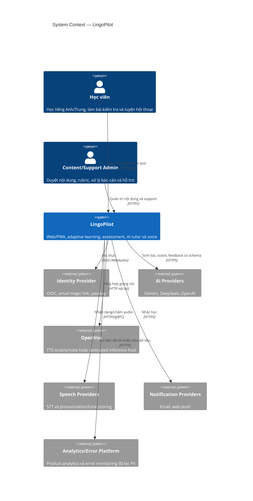
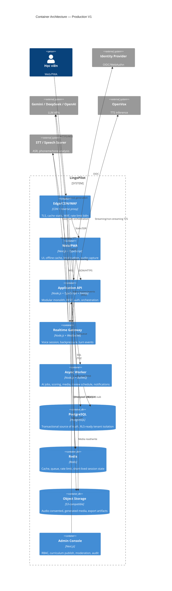
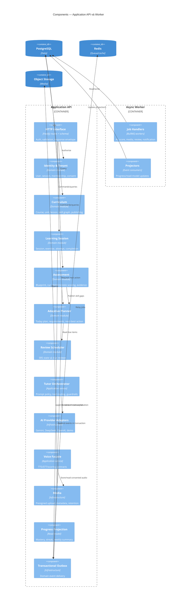
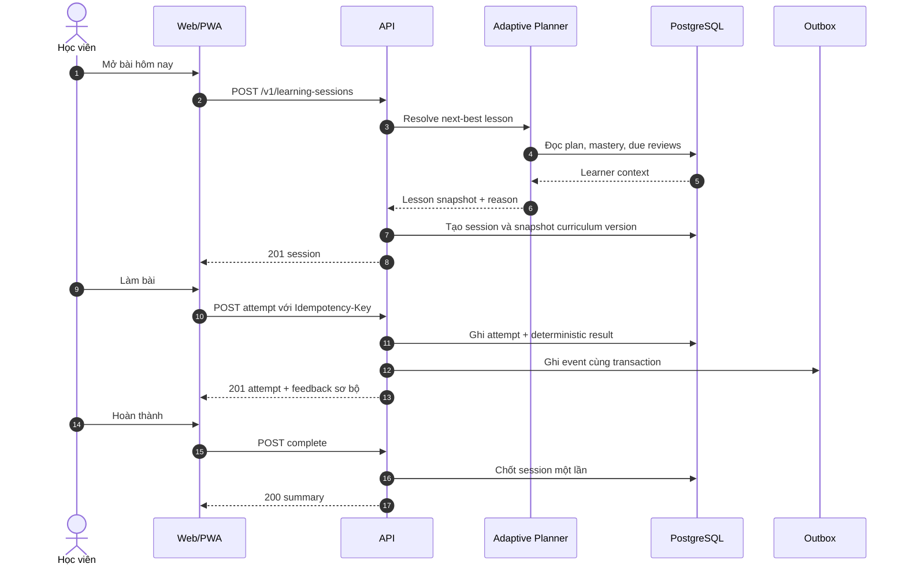
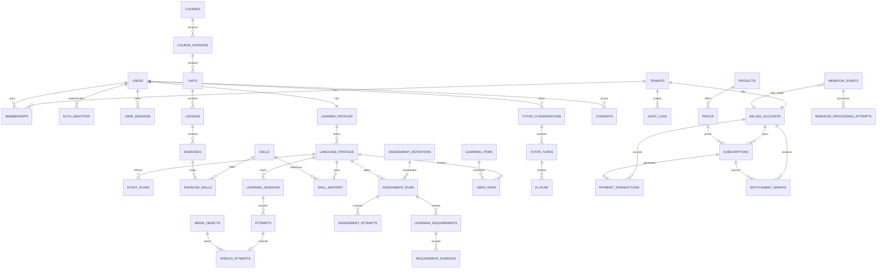
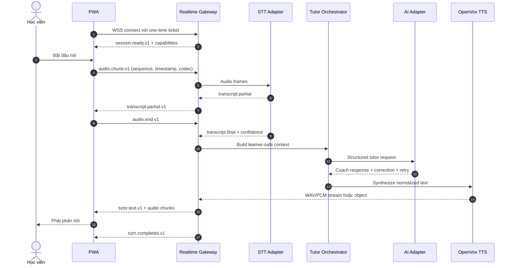
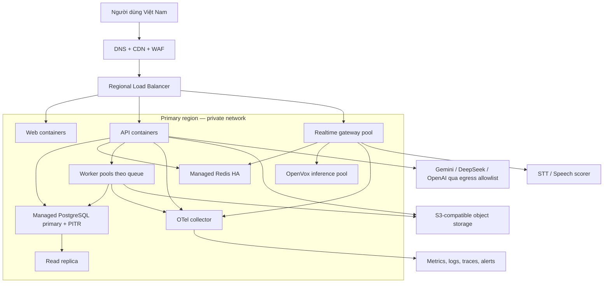

# LingoPilot — Kiến trúc kỹ thuật production

> Phiên bản: 1.0 · Chủ sở hữu: Engineering Lead · Loại: Technical production specification  
> Trạng thái: kiến trúc đích cho Production V1  
> Ngày hiệu lực/cập nhật: 2026-08-15  
> Ngôn ngữ tài liệu: tiếng Việt  
> Phạm vi: web/PWA học tiếng Anh và tiếng Trung, lộ trình 90 ngày, đánh giá đầu vào/định kỳ, AI tutor và voice  
> Nguồn hiện trạng đã đối chiếu: `server.mjs`, `app.js`, `index.html`, `curriculum.json`, `.env.example`, `Dockerfile`, `docker-compose.yml`, `test/*`, `docs/design-goal.md`, `docs/full-product-design.md`

## 1. Mục đích và nguyên tắc kiến trúc

Tài liệu này là đặc tả kỹ thuật để đội phát triển xây LingoPilot từ prototype thành sản phẩm có tài khoản, dữ liệu bền vững, đồng bộ đa thiết bị, AI đa nhà cung cấp và hội thoại giọng nói an toàn. Tài liệu mô tả kiến trúc đích; mọi mục ghi **Hiện tại** phản ánh code trong repo tại thời điểm lập tài liệu.

Các nguyên tắc bắt buộc:

1. **Learning evidence là nguồn sự thật:** level, mastery và quyền mở khóa chỉ thay đổi từ bằng chứng được scoring engine chấp nhận; LLM không tự quyết định điểm.
2. **Modular monolith trước, tách service theo tải sau:** giữ transaction và vận hành đơn giản ở V1, nhưng ranh giới module, event và ownership phải rõ ngay từ đầu.
3. **Provider-agnostic:** Gemini, DeepSeek, OpenAI, OpenVox, STT và pronunciation scorer nằm sau adapter; domain không phụ thuộc payload riêng của provider.
4. **Privacy by default:** không lưu raw audio nếu chưa có consent; secret chỉ tồn tại phía server; log không chứa prompt/audio/token hoặc dữ liệu cá nhân thô.
5. **Offline-tolerant:** bài đã tải có thể học khi mất mạng; mutation được đưa vào outbox và đồng bộ idempotent.
6. **Graceful degradation:** AI hoặc OpenVox lỗi không làm mất bài làm; deterministic fallback vẫn trả bài/feedback tối thiểu an toàn.
7. **Observability là yêu cầu chức năng:** mọi request, job, AI run và voice turn có correlation ID, metric và trạng thái cuối.
8. **Version everything:** API, curriculum, assessment blueprint, rubric, prompt, model policy và event schema đều có version.

### 1.1 Các giả định sản phẩm

- Người dùng chính là cá nhân, có thể học cả `en` và `zh-CN` trong cùng một tài khoản.
- LingoPilot Level 1–7 là thang nội bộ; không được trình bày như chứng chỉ CEFR/HSK nếu chưa có nghiên cứu đối chuẩn.
- Mục tiêu 90 ngày là kế hoạch học thích ứng, không phải cam kết mọi người đạt Level 7.
- V1 hỗ trợ web/PWA; native mobile có thể dùng cùng API sau này.
- V1 ưu tiên một vùng triển khai gần người dùng Việt Nam; thiết kế dữ liệu cho phép mở rộng đa vùng nhưng chưa active-active.
- B2C là mặc định. B2B/trường học là khả năng tương lai và được chuẩn bị bằng `tenant_id`, không đưa logic tổ chức vào mọi màn hình V1.

## 2. System context



## 3. Container architecture



### 3.1 Lựa chọn triển khai V1

`Application API`, `Realtime Gateway` và `Async Worker` dùng chung domain packages nhưng chạy thành process/container riêng. Điều này cho phép scale voice độc lập mà không biến domain thành microservices. PostgreSQL là source of truth; Redis không được dùng làm kho dữ liệu duy nhất cho tiến độ hoặc điểm.

## 4. Component architecture



## 5. Target stack

| Layer | Công nghệ đích | Quy tắc lựa chọn |
|---|---|---|
| Web/PWA | Next.js, React, TypeScript strict | Pin exact versions trong lockfile; App Router; server/client boundary rõ |
| UI | CSS variables + accessible component primitives | WCAG 2.2 AA; không bắt buộc framework UI |
| API | Node.js Active LTS được pin trong toolchain, Fastify, TypeScript | JSON Schema/OpenAPI từ cùng schema; modular monolith |
| Realtime | WebSocket gateway; WebRTC chỉ khi cần media transport nâng cao | WSS là baseline dễ vận hành; protocol event version hóa |
| Validation | TypeBox — **Proposed, TADR-011**; Zod là phương án đối chứng | Schema là nguồn chung cho runtime validation, TypeScript types và OpenAPI; chốt sau spike |
| Database | PostgreSQL 16+ | UUIDv7/ULID, UTC timestamps, JSONB chỉ cho payload biến thiên |
| ORM/query | Drizzle ORM — **Proposed, TADR-012**; Kysely là phương án đối chứng | SQL minh bạch; migration review được; domain không phụ thuộc ORM/query builder |
| Queue/cache | Redis + BullMQ | At-least-once; handler idempotent; DLQ |
| Object storage | S3-compatible | SSE, lifecycle policy, presigned URLs |
| Auth | OIDC/WebAuthn-capable auth layer | Opaque server session, secure cookie; không lưu access token trong localStorage |
| AI | Adapter Gemini/DeepSeek/OpenAI | Structured output, timeout, retry budget, circuit breaker |
| Voice | OpenVox TTS + pluggable STT/scorer — selection **Proposed, TADR-013** | OpenVox không được coi là STT/scorer nếu API triển khai chỉ hỗ trợ TTS; speech provider phải qua capability/eval gate |
| Observability | OpenTelemetry + Prometheus-compatible metrics + structured logs | Trace xuyên API/job/provider; scrub PII |
| Testing | Node test runner/Vitest, Playwright, contract tests, load tests | Unit, integration DB, E2E, provider mock, golden assessment |
| Delivery | Docker multi-stage, CI, IaC | Immutable image; SBOM; signed artifact; rollback |

Không hardcode “latest”. CI chỉ nâng phiên bản qua pull request có changelog, test và security scan.

## 6. Service và module boundaries

### 6.1 Quy tắc boundary

- Mỗi module sở hữu bảng và invariant của mình; module khác truy cập qua application interface, không query chéo tùy ý.
- Transaction đồng bộ chỉ nằm trong một modular monolith database. Side effect bên ngoài đi qua transactional outbox.
- Không đặt logic level/mastery trong route handler hoặc prompt.
- API provider chỉ xuất hiện trong `infrastructure/adapters`; domain dùng contract nội bộ.
- Read model có thể denormalize nhưng luôn tái tạo được từ source tables/events.

### 6.2 Danh mục module

| Module | Sở hữu | Public commands/queries | Không sở hữu |
|---|---|---|---|
| Identity & Tenant | users, identities, sessions, tenants, memberships, consents | sign-in callback, revoke session, update consent | curriculum, learning score |
| Learner Profile | learner/language profiles, goals, study plans | update profile, set allocation, get plan | auth credential |
| Curriculum | courses, versions, units, lessons, exercises, skills | publish version, resolve lesson | attempt/progress |
| Learning Session | sessions, attempts, speech attempts | start, submit attempt, complete | level promotion policy |
| Assessment | definitions, items, runs, results, evidence | start, submit, score, finalize | free-form LLM score |
| Adaptive Planner | requirements, daily plans, planner decisions | generate today, accept evidence | raw exercise content |
| Review | learning items, user item states | due list, record grade, reschedule | curriculum publication |
| Tutor | conversations, turns, AI runs, prompt policy | create conversation, respond, close | canonical score |
| Voice & Media | voice sessions, media objects, transcripts, analysis | upload, transcribe, synthesize, analyze | consent decision |
| Progress | mastery ledger, daily aggregates, checkpoints | weekly/skills/evidence views | source attempts |
| Notification | preferences, deliveries | schedule/cancel/send | learning policy |
| Admin & Governance | content review, reports, audit entries | approve/publish/report resolve | learner private raw data mặc định |

### 6.3 Cấu trúc source đề xuất

```text
apps/
  web/
  api/
  realtime/
  worker/
  admin/
packages/
  contracts/          # API/event schemas, generated clients
  domain/
    identity/
    curriculum/
    learning/
    assessment/
    adaptive/
    review/
    tutor/
    voice/
    progress/
  infrastructure/
    db/
    queue/
    object-storage/
    ai-providers/
    speech-providers/
  observability/
  test-fixtures/
```

## 7. Luồng đồng bộ và bất đồng bộ

### 7.1 Luồng đồng bộ: bắt đầu và hoàn thành bài



### 7.2 Luồng bất đồng bộ: hậu xử lý attempt nói

```mermaid
sequenceDiagram
  autonumber
  participant A as API
  participant D as PostgreSQL
  participant Q as Queue
  participant W as Speech Worker
  participant S as Speech Scorer
  participant P as Projector

  A->>D: Commit speech_attempt(status=uploaded) + outbox
  A-->>Q: Relay speech.analyze.requested.v1
  Q->>W: Deliver job (at-least-once)
  W->>D: Claim job by idempotency key
  W->>S: Transcribe/analyze audio
  S-->>W: Transcript + confidence + dimensions
  W->>D: Save analysis; append scored event
  W-->>Q: Ack
  Q->>P: speech.attempt.scored.v1
  P->>D: Update mastery/read models
```

### 7.3 Khi nào sync, khi nào async

| Tác vụ | Kiểu | Lý do/SLA |
|---|---|---|
| Auth, lấy Today plan, start session | Sync | Người dùng đang chờ; p95 API nội bộ < 300 ms, không tính provider |
| Choice/reading deterministic score | Sync | Kết quả tức thì, không cần external AI |
| Tutor text turn | Sync streaming hoặc request dài | Time-to-first-token quan trọng; timeout và fallback |
| TTS câu ngắn | Sync stream | Phát audio ngay; cache theo normalized input |
| Pronunciation/tone score | Async mặc định | Có thể mất nhiều giây; UI hiển thị processing |
| Progress projection, analytics | Async | Không chặn learning transaction |
| Review reschedule cho một item | Sync | Cần due date tức thì |
| Daily plan precompute, report, notification | Async scheduled | Batch, retry được |

## 8. Authentication, authorization và session

### 8.1 Auth flows

- Hỗ trợ email magic link/OTP và OIDC; passkey là lựa chọn ưu tiên sau khi tài khoản được tạo.
- OAuth dùng Authorization Code + PKCE, `state` và `nonce`.
- Sau callback, server tạo session opaque; browser chỉ nhận cookie `HttpOnly`, `Secure`, `SameSite=Lax`, path `/`.
- Không lưu access token, refresh token hoặc provider API key trong `localStorage`, IndexedDB hay client bundle.
- Mutation dùng CSRF token double-submit hoặc origin-bound token ngoài SameSite; kiểm tra `Origin`/`Sec-Fetch-Site`.

### 8.2 Session model

- Session ID ngẫu nhiên tối thiểu 256 bit, chỉ lưu hash trong DB.
- Idle timeout mặc định 14 ngày; absolute timeout 90 ngày; rotate khi đăng nhập, đổi quyền hoặc sau thời gian cấu hình.
- Revoke theo thiết bị và revoke-all; credential/password/passkey change vô hiệu hóa session liên quan.
- Redis có thể cache session tối đa 5 phút; DB là nguồn sự thật. Revocation phát event xóa cache.
- Realtime gateway nhận short-lived connection ticket (TTL 60 giây, one-time use), không nhận session cookie trực tiếp từ client không cùng origin.

### 8.3 Authorization

Canonical RBAC có tám role dưới đây. Guest là trạng thái chưa xác thực; Free/Pro là entitlement, không phải role. Tên hiển thị là hợp đồng product; giá trị enum API/DB dùng `snake_case` và được version hóa.

| Canonical role | Enum | Quyền chính | Giới hạn bắt buộc |
|---|---|---|---|
| Learner | `learner` | Đọc/sửa hồ sơ, consent, kế hoạch và dữ liệu học của chính mình; bắt đầu lesson, assessment, tutor; quản lý subscription của chính tenant cá nhân | Không xem người học khác, không publish content, không tự cấp entitlement |
| Content Editor | `content_editor` | Tạo/sửa draft curriculum, lesson, item, rubric và prompt candidate; gửi review | Không tự publish/approve nội dung mình tạo; không xem payment/raw audio |
| Learning Reviewer | `learning_reviewer` | Review chuyên môn, yêu cầu sửa và publish version đã được gán | Không sửa draft thay tác giả; không tự review nội dung do chính mình tạo; publish cần assignment + audit |
| Support | `support` | Xem metadata tài khoản, trạng thái job/provider và thực hiện action hỗ trợ allowlist | Không xem raw audio/transcript mặc định; không refund, đổi role hoặc cấp entitlement thủ công |
| Moderator | `moderator` | Xử lý content report, quarantine nội dung/user-generated artifact, áp dụng moderation policy | Không sửa curriculum, billing hoặc canonical score; nội dung nhạy cảm chỉ qua just-in-time access |
| Billing Admin | `billing_admin` | Xem billing account, payment/subscription/webhook status; refund/cancel theo policy; tạo entitlement adjustment có lý do | Không xem learning content/audio; không sửa giá hoặc ledger đã ghi; mọi mutation audit |
| Auditor | `auditor` | Read-only audit log, decision/version, billing ledger metadata và evidence cần kiểm toán | Không mutation; payload PII/secret được redact; export có approval và expiry |
| Admin | `admin` | Quản lý membership/policy/provider configuration trong scope được cấp; break-glass có thể xử lý incident | Không mặc định đọc raw learner content/audio; break-glass có TTL, reason, approval và post-review |

Permission canonical tối thiểu:

| Permission | Learner | Content Editor | Learning Reviewer | Support | Moderator | Billing Admin | Auditor | Admin |
|---|:---:|:---:|:---:|:---:|:---:|:---:|:---:|:---:|
| `learning.self.read_write` | ✓ | — | — | — | — | — | read audit only | scoped override |
| `content.draft.write` | — | ✓ | review/comment | — | — | — | read | emergency only |
| `content.publish.approve` | — | submit only | ✓, four-eyes | — | — | — | read | emergency rollback |
| `support.case.act` | — | — | — | ✓ | — | — | read | ✓ |
| `moderation.case.act` | — | — | — | — | ✓ | — | read | ✓ |
| `billing.read` | own | — | — | status only | — | ✓ | redacted | ✓ |
| `billing.mutate` | own checkout/cancel | — | — | — | — | ✓ | — | emergency only |
| `entitlement.adjust` | — | — | — | — | — | ✓, reason required | read | emergency only |
| `audit.read` | own events | own actions | own actions | own actions | own actions | own actions | ✓ | ✓ |
| `membership.manage` | — | — | — | — | — | — | — | ✓ |

Quan hệ guardian/minor là policy + relationship record, không phải canonical staff role. Separation of duties bắt buộc: người tạo content không tự approve; người tạo refund/entitlement adjustment không tự duyệt khi vượt ngưỡng; Auditor luôn read-only.

Mọi query người dùng phải ràng buộc `tenant_id` và `user_id` từ auth context, không nhận hai giá trị này làm quyền hạn từ body. Authorization thực thi ở route policy và repository; UI ẩn nút không được coi là kiểm soát quyền.

## 9. Multi-tenancy

### 9.1 Giả định

- Tenant cá nhân được tạo tự động cho mỗi tài khoản B2C.
- Tenant tổ chức có nhiều membership và policy; chưa có cross-tenant sharing ở V1.
- Một user có thể thuộc nhiều tenant nhưng mỗi request có đúng một `active_tenant_id` được xác thực từ membership.

### 9.2 Isolation

- Shared database/shared schema ở V1; bảng dữ liệu tenant có `tenant_id NOT NULL` và index bắt đầu bằng `tenant_id` khi phù hợp.
- Repository bắt buộc nhận `TenantContext`; integration test chứng minh không đọc/ghi chéo tenant.
- Bật PostgreSQL Row-Level Security như lớp phòng thủ thứ hai trước public B2B; application authorization vẫn bắt buộc.
- Object key có prefix ngẫu nhiên theo tenant, không dùng email/user name; presigned URL ngắn hạn.
- Encryption key per environment ở V1; enterprise tier có thể dùng per-tenant envelope key sau này.

## 10. Logical data model



### 10.1 Quy ước dữ liệu

- Primary key: UUIDv7 hoặc ULID; public ID không tuần tự.
- Mọi timestamp là `timestamptz` UTC; timezone người dùng lưu riêng dạng IANA.
- Soft delete chỉ cho đối tượng cần khôi phục/audit; dữ liệu retention-expired phải hard-delete/anonymize bằng job.
- `created_at`, `updated_at`, `row_version` có ở aggregate mutable.
- Enum nghiệp vụ dùng database enum chỉ khi cực kỳ ổn định; nếu không dùng text + check constraint.
- JSONB dùng cho snapshot/schema versioned, không thay thế cột thường xuyên query.
- Tiền/chi phí dùng integer minor units; duration dùng milliseconds hoặc seconds với suffix rõ.

## 11. Data dictionary chi tiết

### 11.1 Identity, tenant và consent

| Bảng | Trường chính | Kiểu/constraint | Ý nghĩa |
|---|---|---|---|
| `tenants` | `id`, `kind`, `name`, `status`, timestamps | `kind in (personal, organization)`; name không dùng làm key | Boundary dữ liệu/billing |
| `users` | `id`, `primary_email`, `email_verified_at`, `locale`, `timezone`, `status` | email normalize + unique theo policy; timezone IANA | Principal đăng nhập |
| `auth_identities` | `id`, `user_id`, `provider`, `subject`, `credential_meta` | unique `(provider, subject)`; không lưu provider token plaintext | Liên kết IdP/passkey |
| `memberships` | `tenant_id`, `user_id`, `role`, `status` | PK `(tenant_id,user_id)` | Quyền trong tenant |
| `user_sessions` | `id`, `user_id`, `tenant_id`, `token_hash`, `expires_at`, `last_seen_at`, `revoked_at`, `device_meta` | token hash unique; device_meta tối thiểu hóa | Phiên server-side |
| `consents` | `id`, `tenant_id`, `user_id`, `type`, `policy_version`, `granted`, `decided_at` | unique active consent theo type/version | Bằng chứng consent audio/analytics/AI |
| `audit_logs` | `id`, `tenant_id`, `actor_id`, `action`, `resource_type`, `resource_id`, `metadata`, `created_at` | append-only; metadata scrub PII | Dấu vết bảo mật/quản trị |

### 11.2 Hồ sơ và kế hoạch học

| Bảng | Trường chính | Kiểu/constraint | Ý nghĩa |
|---|---|---|---|
| `learner_profiles` | `user_id`, `daily_minutes`, `correction_style`, `privacy_mode`, `accessibility_prefs` | `daily_minutes between 5 and 240` | Cài đặt học chung |
| `language_profiles` | `id`, `tenant_id`, `user_id`, `language`, `current_level`, `target_level`, `allocation_pct`, `baseline_status` | unique `(tenant_id,user_id,language)`; level 1..7 | Trạng thái theo ngôn ngữ |
| `learner_goals` | `id`, `language_profile_id`, `goal_type`, `description`, `target_date`, `status` | description giới hạn chiều dài | Mục tiêu người học |
| `study_plans` | `id`, `language_profile_id`, `course_version_id`, `start_date`, `target_date`, `weekly_minutes`, `status`, `plan_version` | một active plan/profile | Kế hoạch 90 ngày |
| `daily_plans` | `id`, `language_profile_id`, `local_date`, `items_json`, `decision_ref`, `generated_at` | unique `(profile,local_date,plan_version)` | Snapshot việc hôm nay |

### 11.3 Curriculum và nội dung

| Bảng | Trường chính | Kiểu/constraint | Ý nghĩa |
|---|---|---|---|
| `courses` | `id`, `language`, `code`, `status` | code unique | Dòng curriculum |
| `course_versions` | `id`, `course_id`, `version`, `status`, `published_at`, `content_hash` | unique `(course_id,version)`; published immutable | Snapshot phát hành |
| `units` | `id`, `course_version_id`, `sequence`, `level`, `outcomes_json` | unique version/sequence | Chặng/unit |
| `lessons` | `id`, `unit_id`, `sequence`, `type`, `estimated_minutes`, `schema_version`, `content_json` | published lesson immutable | Bài học |
| `exercises` | `id`, `lesson_id`, `sequence`, `type`, `prompt_json`, `answer_key_ref`, `rubric_id` | answer key không trả client | Bài tập |
| `skills` | `id`, `language`, `code`, `modality`, `parent_id`, `prerequisite_json` | unique `(language,code)` | Skill graph |
| `exercise_skills` | `exercise_id`, `skill_id`, `weight` | weight 0..1 | Mapping evidence |
| `rubrics` | `id`, `code`, `version`, `dimensions_json`, `status` | published immutable | Quy tắc chấm |
| `content_versions` | `id`, `content_id`, `version`, `created_by`, `submitted_by`, `status`, `content_hash`, `created_at` | unique `(content_id,version)`; `created_by` immutable | Version draft/review/published có actor nguồn |
| `content_review_assignments` | `id`, `content_version_id`, `reviewer_id`, `assigned_by`, `status`, `assigned_at`, `closed_at` | reviewer khác `content_versions.created_by`; một active assignment/version | Four-eyes assignment authoritative |
| `content_review_decisions` | `id`, `assignment_id`, `reviewer_id`, `decision`, `comment`, `decided_at`, `consumed_at` | append-only; reviewer khớp assignment; `decision in (approved,changes_requested,rejected)` | Ledger quyết định dùng để publish |

Publish transaction khóa content version + assignment + decision, yêu cầu `approved`, cùng version, `reviewer_id != created_by`, decision chưa consumed; sau publish ghi `published_by`, `published_at`, consume decision và audit event trong cùng transaction. Same-actor, stale-version hoặc replay phải trả `409` và có policy/contract test.

### 11.4 Learning, speech và progress

| Bảng | Trường chính | Kiểu/constraint | Ý nghĩa |
|---|---|---|---|
| `learning_sessions` | `id`, `tenant_id`, `language_profile_id`, `lesson_id`, `lesson_snapshot`, `status`, `started_at`, `completed_at`, `meaningful_seconds` | state machine; complete một lần | Một phiên học |
| `attempts` | `id`, `session_id`, `exercise_id`, `client_attempt_id`, `response_json`, `score_json`, `status`, `submitted_at` | unique `(session_id,client_attempt_id)` | Lần trả lời idempotent |
| `speech_attempts` | `attempt_id`, `media_object_id`, `transcript`, `asr_confidence`, `analysis_json`, `analysis_version`, `status` | transcript có nhãn confidence/source | Phần mở rộng bài nói |
| `media_objects` | `id`, `tenant_id`, `owner_user_id`, `purpose`, `storage_key`, `mime_type`, `bytes`, `sha256`, `retention_class`, `expires_at`, `status` | storage_key opaque unique | Metadata object; không chứa public URL |
| `skill_evidence` | `id`, `language_profile_id`, `skill_id`, `source_type`, `source_id`, `measure`, `weight`, `occurred_at`, `policy_version` | source unique theo policy | Ledger bằng chứng append-only |
| `skill_mastery` | `language_profile_id`, `skill_id`, `recognition`, `comprehension`, `production`, `retention`, `confidence`, `updated_at` | 0..1; projection tái tạo được | Read model mastery |
| `daily_progress` | `language_profile_id`, `local_date`, `meaningful_seconds`, `sessions_completed`, `goal_met` | unique profile/date | Aggregate dashboard |
| `progress_snapshots` | `id`, `language_profile_id`, `level`, `dimensions_json`, `evidence_cutoff`, `policy_version` | immutable | Lịch sử level có giải thích |

### 11.5 Assessment, requirement và review

| Bảng | Trường chính | Kiểu/constraint | Ý nghĩa |
|---|---|---|---|
| `assessment_definitions` | `id`, `language`, `kind`, `blueprint_version`, `rubric_version`, `status` | published immutable | Đề/blueprint logic |
| `assessment_items` | `id`, `definition_id`, `skill_id`, `modality`, `difficulty`, `content_json`, `answer_key_ref` | key server-only | Item bank |
| `assessment_runs` | `id`, `tenant_id`, `language_profile_id`, `definition_id`, `status`, `started_at`, `submitted_at`, `result_json`, `result_version` | submit/finalize một lần | Lượt kiểm tra |
| `assessment_attempts` | `id`, `run_id`, `item_id`, `client_attempt_id`, `response_json`, `deterministic_score`, `feedback_json` | unique run/client_attempt | Câu trả lời test |
| `learning_requirements` | `id`, `language_profile_id`, `source_run_id`, `skill_id`, `reason_code`, `task_json`, `target_json`, `status`, `due_at` | tối đa 3 active priority items theo planner policy | Yêu cầu giáo viên |
| `requirement_evidence` | `id`, `requirement_id`, `skill_evidence_id`, `accepted_at`, `decision_json` | unique requirement/evidence | Chứng minh hoàn thành |
| `learning_items` | `id`, `language`, `type`, `canonical_text`, `context_json`, `content_hash` | de-duplicate bằng hash có kiểm soát | Từ/cụm/lỗi cần ôn |
| `user_items` | `language_profile_id`, `item_id`, `state`, `stability`, `difficulty`, `due_at`, `last_grade`, `revision` | unique profile/item | Trạng thái SRS |
| `review_attempts` | `id`, `language_profile_id`, `item_id`, `grade`, `occurred_at`, `algorithm_version` | append-only | Input tái tính SRS |

### 11.6 Tutor, AI và vận hành

| Bảng | Trường chính | Kiểu/constraint | Ý nghĩa |
|---|---|---|---|
| `tutor_conversations` | `id`, `tenant_id`, `user_id`, `language_profile_id`, `mode`, `status`, `started_at`, `ended_at`, `summary_ref` | không lưu memory vô hạn | Phiên tutor |
| `tutor_turns` | `id`, `conversation_id`, `sequence`, `role`, `content_ref`, `safety_json`, `created_at` | sequence unique/conversation | Turn có thể trỏ encrypted content |
| `ai_runs` | `id`, `tenant_id`, `purpose`, `provider`, `model`, `prompt_version`, `schema_version`, `input_hash`, `status`, `latency_ms`, `token_usage_json`, `cost_minor`, `error_code` | không lưu secret/raw prompt mặc định | Quan sát AI |
| `prompt_versions` | `id`, `purpose`, `version`, `template_ref`, `schema_ref`, `status`, `approved_by` | published immutable; two-person review | Prompt governance |
| `outbox_events` | `id`, `tenant_id`, `topic`, `schema_version`, `aggregate_id`, `payload`, `occurred_at`, `published_at` | append trong cùng transaction | Reliable event relay |
| `job_runs` | `id`, `job_type`, `dedupe_key`, `status`, `attempt`, `scheduled_at`, `started_at`, `finished_at`, `error_code` | dedupe key unique theo window | Theo dõi job |
| `content_reports` | `id`, `tenant_id`, `reporter_id`, `resource_type`, `resource_id`, `reason`, `status`, `resolved_at` | audit mọi transition | Moderation |

### 11.7 Payment, subscription, entitlement và webhook ledger

Billing model dùng provider-agnostic IDs; provider là hệ thống thu tiền, PostgreSQL là source of truth cho trạng thái sản phẩm đã chuẩn hóa. Tiền luôn dùng integer minor units + ISO 4217 currency. Không lưu PAN/CVV hoặc payment credential thô.

| Bảng | Trường chính | Kiểu/constraint | Ý nghĩa |
|---|---|---|---|
| `billing_accounts` | `id`, `tenant_id`, `provider`, `provider_customer_ref`, `billing_email_ref`, `tax_profile_ref`, `status`, timestamps | unique `(provider,provider_customer_ref)`; một active account/tenant/provider | Boundary thanh toán của tenant |
| `products` | `id`, `code`, `name`, `status`, `metadata_json` | `code` unique; không chứa provider logic | Sản phẩm thương mại canonical |
| `prices` | `id`, `product_id`, `code`, `currency`, `amount_minor`, `interval`, `interval_count`, `provider_price_ref`, `status`, `effective_from`, `effective_to` | amount ≥0; unique provider ref; version bất biến khi active | Giá/version thương mại |
| `subscriptions` | `id`, `billing_account_id`, `price_id`, `provider`, `provider_subscription_ref`, `status`, `current_period_start`, `current_period_end`, `cancel_at`, `ended_at`, `row_version` | unique provider subscription; state machine canonical | Vòng đời subscription |
| `payment_transactions` | `id`, `billing_account_id`, `subscription_id`, `kind`, `provider`, `provider_transaction_ref`, `amount_minor`, `currency`, `status`, `occurred_at`, `metadata_json` | append-only; unique provider transaction; refund liên kết original transaction | Ledger charge/refund/credit/dispute |
| `entitlement_grants` | `id`, `tenant_id`, `subject_type`, `subject_id`, `capability`, `source_type`, `source_id`, `quantity`, `starts_at`, `ends_at`, `revoked_at`, `reason_code`, `created_by` | append-only grant/revoke; source unique theo capability/window | Quyền dùng tính năng có truy nguyên |
| `entitlement_snapshots` | `tenant_id`, `subject_type`, `subject_id`, `capability`, `effective_value`, `source_cutoff`, `computed_at`, `policy_version` | projection tái tạo được từ grants | Read model kiểm tra quyền nhanh |
| `webhook_events` | `id`, `provider`, `provider_event_id`, `event_type`, `payload_hash`, `payload_ref`, `signature_status`, `received_at`, `processing_status`, `processed_at`, `error_code` | append-only inbox; unique `(provider,provider_event_id)` | Canonical inbound webhook ledger chống replay |
| `webhook_processing_attempts` | `id`, `webhook_event_id`, `attempt`, `handler_version`, `started_at`, `finished_at`, `status`, `error_code`, `result_hash` | unique event/attempt; không sửa attempt cũ | Lịch sử xử lý/retry/DLQ |

Quy tắc nhất quán:

- Webhook phải verify signature trên raw bytes, kiểm tra timestamp/replay, persist ledger trước khi acknowledge và xử lý idempotent.
- Thứ tự webhook không được tin cậy; state transition dùng provider event time, local row version và fetch-reconcile khi cần.
- Client redirect “payment success” không cấp quyền. Entitlement chỉ thay đổi từ event/provider reconciliation đã xác thực hoặc adjustment có quyền + reason.
- `entitlement_snapshots` là projection; `entitlement_grants` và payment/webhook ledgers là audit source. Rebuild snapshot phải deterministic.
- Refund, dispute, cancellation và grace period có policy version; không hard-delete financial ledger, chỉ redact PII theo retention/legal policy.
- Support không được cấp entitlement; Billing Admin/Admin adjustment phải có idempotency key, actor, ticket/reason và audit event.

## 12. Data retention và xóa dữ liệu

Thời hạn dưới đây là **Proposed — TADR-014**; legal/privacy owner phải phê duyệt trước public launch. Canonical proposal là raw audio transient tối đa 24 giờ nếu không opt-in và 30 ngày nếu người học chủ động bật “lưu lịch sử”; từng purpose có consent/retention class riêng và người học được xóa sớm.

| Nhóm dữ liệu | Mặc định | Cơ sở/ghi chú | Hành động hết hạn |
|---|---:|---|---|
| Raw audio không consent lưu | Chỉ trong xử lý, tối đa 24 giờ | Upload tạm để STT/scoring | Hard-delete object và temp metadata |
| Raw audio có consent “lưu lịch sử” | 30 ngày | Cho replay và khiếu nại điểm; người dùng có thể xóa sớm | Lifecycle delete; giữ score không thể đảo ngược khi hợp lệ |
| Transcript tutor/speech | 90 ngày | Cá nhân hóa ngắn hạn; có privacy mode không lưu | Xóa/anonymize content, giữ metric aggregate |
| Tutor conversation summary | 180 ngày hoặc đến khi user xóa | Chỉ summary đã lọc, không raw prompt | Hard-delete/anonymize |
| Attempts, evidence, progress | Vòng đời tài khoản + 30 ngày grace | Cần lịch sử học và export | Cascade/anonymize sau account deletion |
| Assessment results/rubric evidence | Vòng đời tài khoản + 30 ngày grace | Giải thích level | Cascade/anonymize |
| AI run metadata không nội dung | 180 ngày | Chi phí, chất lượng, incident | Aggregate rồi delete |
| Security audit log | 365 ngày | Điều tra truy cập/quyền | Delete hoặc archive bảo mật theo policy |
| Application logs | 30 ngày hot, tối đa 90 ngày archive | Không PII/raw content | Lifecycle delete |
| Analytics pseudonymous | 13 tháng tối đa | Chỉ nếu consent/policy cho phép | Aggregate/delete identifier |
| Backup | 35 ngày rolling | Không xóa từng row trong immutable backup | Hết hạn tự động; restore phải replay deletion ledger |

Yêu cầu xóa tài khoản tạo `deletion_request`; khóa đăng nhập ngay, cho grace 30 ngày nếu policy cho phép, sau đó xóa/anonymize theo graph. `deletion_ledger` chỉ lưu ID băm, thời điểm và kết quả để tránh tái xuất hiện sau restore. Export dữ liệu phải là job có signed URL TTL ngắn.

## 13. API conventions

### 13.1 Base, versioning và content type

- Public API: `/v1/...`; health nội bộ: `/health/live`, `/health/ready`.
- Breaking change tạo `/v2`; additive field không breaking. Client phải bỏ qua field chưa biết.
- Header `Content-Type: application/json`; UTF-8; thời gian RFC 3339 UTC.
- OpenAPI là contract nguồn, sinh client types và contract tests.
- Deprecation dùng `Deprecation`, `Sunset`, tài liệu migration và tối thiểu một chu kỳ release đã công bố.

### 13.2 Naming và envelope

- JSON dùng `camelCase`; database dùng `snake_case`.
- Resource trả trực tiếp trong `data`; metadata phân trang ở `meta`; trace ở header `traceparent` và `X-Request-Id`.
- Không trả `null` tùy tiện: optional field bị bỏ; nullable chỉ khi domain phân biệt “chưa có”.
- ETag/`If-Match` cho update dễ xung đột như profile/study plan; `409` hoặc `412` khi version cũ.

```json
{
  "data": {
    "id": "01J...",
    "status": "inProgress",
    "revision": 3
  },
  "meta": {
    "requestId": "req_01J..."
  }
}
```

### 13.3 Error contract

Dùng `application/problem+json` theo Problem Details:

```json
{
  "type": "https://docs.lingopilot.app/problems/validation-error",
  "title": "Dữ liệu không hợp lệ",
  "status": 422,
  "code": "VALIDATION_ERROR",
  "detail": "Có 1 trường không hợp lệ.",
  "instance": "/v1/assessment-runs/01J.../submit",
  "requestId": "req_01J...",
  "errors": [
    {"field": "answers[0].itemId", "code": "REQUIRED"}
  ]
}
```

Mã chuẩn: `400` malformed, `401` chưa xác thực, `403` không quyền, `404` không tồn tại trong tenant, `409` conflict/state, `412` precondition, `413` quá kích thước, `422` validation/domain rule, `429` rate limit, `503` dependency unavailable. Không trả stack trace hoặc error provider thô.

### 13.4 Idempotency

- Bắt buộc `Idempotency-Key` cho create/submit/complete, presigned upload finalize và mọi endpoint có side effect khó đảo ngược.
- Scope key theo `(tenant_id, user_id, method, route, key)`; lưu request hash, response status/body tối thiểu 24 giờ.
- Cùng key + khác payload trả `409 IDEMPOTENCY_CONFLICT`; đang xử lý trả `409 REQUEST_IN_PROGRESS` kèm `Retry-After`.
- Client offline dùng UUID ổn định làm `clientAttemptId`; retry không tạo attempt/score/event thứ hai.

### 13.5 Pagination, filter và sort

- Cursor pagination mặc định: `?limit=20&after=<opaque>`; `limit` 1–100.
- Cursor ký/opaque, chứa stable sort key; không cho client sửa.
- Response:

```json
{
  "data": [{"id": "01J..."}],
  "meta": {"nextCursor": "eyJ...", "hasMore": true}
}
```

- Filter allowlist, ví dụ `?language=en&status=active`; sort allowlist `?sort=-occurredAt,id`.
- Offset chỉ dùng admin dataset nhỏ; không expose tùy ý trên bảng lớn.

### 13.6 Rate limit và request limits

- Auth: theo IP + identity; tutor/AI: theo user/tenant/budget; voice: theo concurrent session và audio seconds.
- Trả `RateLimit-Limit`, `RateLimit-Remaining`, `RateLimit-Reset`, `Retry-After`.
- JSON mặc định tối đa 256 KiB; upload audio đi thẳng object storage qua presigned URL, không base64 trong JSON.
- Timeout budget: API 10 giây thường, AI text 30 giây, TTS first-byte 3 giây, async job cho tác vụ dài.

### 13.7 Cross-field validation

JSON Schema kiểm tra type/range; application validator bắt buộc thực thi rule có `x-validation-rule-id`. Rule `allocation-sum-100-v1` yêu cầu `languageAllocation.en + languageAllocation["zh-CN"] === 100` bằng số nguyên trước khi preview hoặc lưu study plan. Contract test phải chạy đủ boundary `0/100`, `50/50`, `100/0` và reject `99`, `101`, số âm, số thực, thiếu/thừa key. Không implementation nào được bỏ qua custom rule vì runtime schema library còn `Proposed`.

## 14. Endpoint catalog

### 14.1 Identity và profile

| Method | Endpoint | Mục đích |
|---|---|---|
| `GET` | `/v1/me` | User, active tenant, permissions |
| `PATCH` | `/v1/me/profile` | Locale, timezone, preference; `If-Match` |
| `GET` | `/v1/me/sessions` | Thiết bị/phiên đăng nhập |
| `DELETE` | `/v1/me/sessions/{sessionId}` | Thu hồi phiên |
| `GET` | `/v1/me/consents` | Đọc consent ledger hiện tại |
| `PUT` | `/v1/me/consents` | Ghi quyết định consent versioned |
| `DELETE` | `/v1/me` | Tạo yêu cầu xóa tài khoản |
| `POST` | `/v1/me/exports` | Tạo data export job |

### 14.2 Planning và curriculum

| Method | Endpoint | Mục đích |
|---|---|---|
| `POST` | `/v1/onboarding` | Tạo language profile và goal |
| `GET` | `/v1/study-plans/{language}` | Kế hoạch active |
| `PUT` | `/v1/study-plans/{language}` | Đổi phút/mục tiêu/phân bổ |
| `GET` | `/v1/today?language=en` | Daily plan + lý do ưu tiên |
| `GET` | `/v1/courses/{language}/path` | Course path theo version |
| `GET` | `/v1/lessons/{lessonId}` | Lesson snapshot được phép học |

### 14.3 Learning và review

| Method | Endpoint | Mục đích |
|---|---|---|
| `POST` | `/v1/learning-sessions` | Bắt đầu/resume session |
| `GET` | `/v1/learning-sessions/{id}` | Snapshot + trạng thái |
| `POST` | `/v1/learning-sessions/{id}/attempts` | Nộp bài thường/speech metadata |
| `POST` | `/v1/learning-sessions/{id}/complete` | Chốt phiên một lần |
| `GET` | `/v1/reviews/due` | Danh sách SRS đến hạn |
| `POST` | `/v1/reviews/{itemId}/attempts` | Ghi grade và lịch mới |
| `GET` | `/v1/mistakes` | Error notebook |

### 14.4 Assessment và requirements

| Method | Endpoint | Mục đích |
|---|---|---|
| `POST` | `/v1/assessment-runs` | Start placement/weekly/phase |
| `GET` | `/v1/assessment-runs/{id}` | Run và items an toàn, không answer key |
| `POST` | `/v1/assessment-runs/{id}/attempts` | Lưu từng câu idempotent |
| `POST` | `/v1/assessment-runs/{id}/submit` | Chốt và score |
| `GET` | `/v1/assessment-runs/{id}/result` | Score, evidence, caveat |
| `GET` | `/v1/learning-requirements?status=active` | Tối đa ba ưu tiên |
| `POST` | `/v1/learning-requirements/{id}/evidence` | Liên kết evidence |

### 14.5 Tutor và AI

| Method | Endpoint | Mục đích |
|---|---|---|
| `GET` | `/v1/ai/status` | Capability công khai, không lộ key/model nội bộ nhạy cảm |
| `POST` | `/v1/tutor/conversations` | Tạo phiên theo mode/goal |
| `POST` | `/v1/tutor/conversations/{id}/turns` | Gửi turn, stream SSE tùy `Accept` |
| `POST` | `/v1/tutor/conversations/{id}/complete` | Chốt summary/evidence |
| `POST` | `/v1/generated-lessons` | Tạo lesson async có kiểm duyệt schema |
| `GET` | `/v1/generated-lessons/{id}` | Poll trạng thái/kết quả |

### 14.6 Voice và media

| Method | Endpoint | Mục đích |
|---|---|---|
| `GET` | `/v1/voice/capabilities?language=zh-CN` | STT/TTS/scoring availability |
| `POST` | `/v1/voice/synthesis` | TTS ngắn hoặc trả media URL |
| `POST` | `/v1/media/uploads` | Presigned upload có purpose/retention |
| `POST` | `/v1/media/uploads/{id}/complete` | Verify checksum và finalize |
| `POST` | `/v1/speech-analyses` | Tạo job STT/pronunciation/tone |
| `GET` | `/v1/speech-analyses/{id}` | Kết quả async |
| `POST` | `/v1/realtime/sessions` | One-time WSS ticket |

### 14.7 Progress và notification

| Method | Endpoint | Mục đích |
|---|---|---|
| `GET` | `/v1/progress/summary?language=en&period=week` | Dashboard |
| `GET` | `/v1/progress/skills?language=en` | Mastery dimensions |
| `GET` | `/v1/progress/evidence/{id}` | Giải thích bằng chứng |
| `GET` | `/v1/checkpoints?language=en` | Lịch và kết quả |
| `GET` | `/v1/notification-preferences` | Cấu hình nhắc học |
| `PUT` | `/v1/notification-preferences` | Cập nhật preference |

### 14.8 Billing, entitlement và staff operations

| Method | Endpoint | Permission | Mục đích |
|---|---|---|---|
| `GET` | `/v1/billing/account` | `billing.read` own | Billing account, subscription và invoice summary |
| `POST` | `/v1/billing/checkout-sessions` | learner own/admin policy | Tạo checkout session idempotent |
| `POST` | `/v1/billing/portal-sessions` | learner own | Mở provider portal bằng one-time URL |
| `POST` | `/v1/billing/subscriptions/{id}/cancel` | learner own hoặc `billing.mutate` | Cancel at period end/immediate theo policy |
| `GET` | `/v1/entitlements` | own/scoped staff | Effective capabilities + source/version |
| `POST` | `/v1/admin/entitlement-adjustments` | `entitlement.adjust` | Grant/revoke thủ công có reason + approval policy |
| `POST` | `/v1/webhooks/billing/{provider}` | provider signature | Nhận webhook raw-body; không dùng browser auth |
| `GET` | `/v1/admin/webhook-events` | Billing Admin/Auditor/Admin | Tra cứu ledger đã redact |
| `POST` | `/v1/admin/webhook-events/{id}/replay` | Billing Admin/Admin | Replay handler idempotent, không tạo event mới |
| `GET` | `/v1/admin/audit-logs` | Auditor/Admin | Audit query/export có scope |
| `GET` | `/v1/admin/content` | Content Editor/Admin | Content work queue |
| `GET` | `/v1/admin/moderation-cases` | Moderator/Admin | Moderation queue |

### 14.9 Route → API mapping

Route web là UX contract, không thay thế authorization API. Route guard dùng permissions từ `/v1/me`; API vẫn kiểm tra lại mọi request.

| Web route | API chính | Role/permission |
|---|---|---|
| `/today` | `GET /v1/today`, `POST /v1/learning-sessions`, `GET /v1/reviews/due` | Learner |
| `/path` | `GET /v1/courses/{language}/path`, `GET /v1/study-plans/{language}` | Learner |
| `/practice` | learning session/review/mistake APIs | Learner |
| `/coach` | tutor conversation APIs, realtime ticket, voice capabilities | Learner |
| `/library` | course/lesson APIs và generated lesson status | Learner |
| `/progress` | progress/skills/evidence/checkpoint APIs | Learner |
| `/assessments/:id` | assessment run/attempt/submit/result APIs | Learner |
| `/settings` | `/v1/me/profile`, consents, sessions, export/delete | Learner |
| `/settings/billing` | billing account, checkout/portal/cancel, entitlements | Learner own billing |
| `/admin/content` | content work queue/publish commands | Content Editor/Admin; approve tách người tạo |
| `/admin/support` | support case/read-only health APIs | Support/Admin |
| `/admin/moderation` | moderation case/report APIs | Moderator/Admin |
| `/admin/billing` | billing, entitlement adjustment, webhook ledger | Billing Admin/Admin |
| `/admin/audit` | audit logs và version/evidence views | Auditor/Admin |

## 15. Request/response examples

### 15.1 Bắt đầu learning session

```http
POST /v1/learning-sessions HTTP/1.1
Cookie: __Host-lp_session=<opaque-session-id>
X-CSRF-Token: <origin-bound-token>
Idempotency-Key: 8c6437a1-9bd8-4f27-9ec5-a6c04565bdf4
Content-Type: application/json

{
  "language": "en",
  "source": "todayPlan",
  "planItemId": "01JPLAN...",
  "clientSessionId": "01JCLIENT...",
  "offlineCreatedAt": "2026-08-15T02:10:00Z"
}
```

```json
{
  "data": {
    "id": "01JSESSION...",
    "status": "inProgress",
    "language": "en",
    "lesson": {
      "id": "01JLESSON...",
      "version": 4,
      "title": "Small talk, big confidence",
      "estimatedMinutes": 12,
      "exercises": [
        {
          "id": "01JEXERCISE...",
          "type": "listeningChoice",
          "prompt": {"audioRef": "media_01J...", "text": null},
          "choices": ["...", "...", "..."]
        }
      ]
    },
    "reason": {"code": "WEAK_SKILL", "skill": "listening.detail"},
    "revision": 1
  }
}
```

### 15.2 Nộp attempt

```http
POST /v1/learning-sessions/01JSESSION.../attempts HTTP/1.1
Idempotency-Key: 5cd334bf-2ba8-497d-a4d5-a5d47a068c58
Content-Type: application/json

{
  "clientAttemptId": "01JCLIENTATTEMPT...",
  "exerciseId": "01JEXERCISE...",
  "response": {"choiceIndex": 1},
  "occurredAt": "2026-08-15T02:11:12Z"
}
```

```json
{
  "data": {
    "id": "01JATTEMPT...",
    "status": "scored",
    "result": {
      "correct": true,
      "score": 1,
      "feedback": "Đúng. Cuộc họp chuyển sang chiều thứ Tư."
    },
    "evidenceStatus": "accepted"
  }
}
```

### 15.3 Tạo assessment run

```http
POST /v1/assessment-runs HTTP/1.1
Idempotency-Key: 41e0ea7d-e423-4b10-80f4-1b62dc18e937
Content-Type: application/json

{
  "language": "zh-CN",
  "kind": "placement",
  "goalId": "01JGOAL..."
}
```

```json
{
  "data": {
    "id": "01JRUN...",
    "kind": "placement",
    "language": "zh-CN",
    "status": "inProgress",
    "blueprintVersion": "zh-placement-v2",
    "durationMinutes": 8,
    "items": [
      {
        "id": "01JITEM...",
        "modality": "listening",
        "prompt": "Nghe và chọn thông tin đúng.",
        "audioRef": "media_01J...",
        "choices": ["Hôm nay lúc 3 giờ", "Ngày mai lúc 3 giờ chiều", "Ngày mai lúc 3 giờ sáng"]
      }
    ]
  }
}
```

`answerKey`, scoring rule và item exposure metadata không bao giờ xuất hiện trong response.

### 15.4 Submit assessment

```http
POST /v1/assessment-runs/01JRUN.../submit HTTP/1.1
Idempotency-Key: 55e47583-dcf1-4118-a95f-687093b195fd
Content-Type: application/json

{"expectedRevision": 7}
```

```json
{
  "data": {
    "runId": "01JRUN...",
    "status": "finalized",
    "result": {
      "overall": 63,
      "level": null,
      "estimatedLevel": 4,
      "dimensions": {"listening": 55, "reading": 72, "speaking": 60},
      "speakingEvidence": "preliminaryTranscriptOnly",
      "policyVersion": "level-policy-v1"
    },
    "requirements": [
      {
        "id": "01JREQ...",
        "skill": "listening.detail",
        "minutes": 12,
        "successCriterion": ">= 80% trong 2 lượt liên tiếp"
      }
    ]
  }
}
```

### 15.5 Tutor turn có structured feedback

```http
POST /v1/tutor/conversations/01JCONV.../turns HTTP/1.1
Idempotency-Key: c3d898ab-bfcf-4df0-8e6a-4f859ca86466
Accept: text/event-stream
Content-Type: application/json

{
  "clientTurnId": "01JTURNCLIENT...",
  "input": {"type": "text", "text": "Yesterday I go to work late."}
}
```

Structured event cuối:

```json
{
  "type": "turn.completed.v1",
  "data": {
    "turnId": "01JTURN...",
    "feedback": {
      "positive": "Bạn đã diễn đạt đầy đủ ý và dùng đúng từ chỉ thời gian.",
      "priorityError": {"span": "go", "replacement": "went", "reasonVi": "Sự việc đã xảy ra hôm qua nên dùng quá khứ đơn."},
      "model": "Yesterday I went to work late.",
      "retryPrompt": "Hãy nói lại câu đúng một lần."
    },
    "providerDisclosure": "aiGenerated",
    "evidenceStatus": "notScored"
  }
}
```

### 15.6 Tạo upload audio và speech analysis

```http
POST /v1/media/uploads HTTP/1.1
Idempotency-Key: 99a68908-32e9-4fd1-a512-a79ba837c37f
Content-Type: application/json

{
  "purpose": "speechAttempt",
  "mimeType": "audio/webm;codecs=opus",
  "bytes": 184223,
  "sha256": "fb4d...",
  "retentionClass": "transient24h"
}
```

```json
{
  "data": {
    "uploadId": "01JUPLOAD...",
    "method": "PUT",
    "url": "https://storage.example/signed-path",
    "requiredHeaders": {"Content-Type": "audio/webm;codecs=opus"},
    "expiresAt": "2026-08-15T02:20:00Z"
  }
}
```

Sau finalize:

```http
POST /v1/speech-analyses HTTP/1.1
Idempotency-Key: 109329f9-86d3-4c65-9031-b429c8d132c8
Content-Type: application/json

{
  "mediaObjectId": "01JMEDIA...",
  "language": "zh-CN",
  "analysisTypes": ["transcription", "tone", "intelligibility"],
  "referenceText": "我明天下午三点去图书馆。"
}
```

```json
{
  "data": {
    "id": "01JANALYSIS...",
    "status": "queued",
    "pollAfterMs": 1000
  }
}
```

## 16. Realtime voice pipeline và OpenVox

### 16.1 Phân tách capability

| Capability | Contract | Provider mặc định | Ghi chú |
|---|---|---|---|
| Capture/VAD | Browser AudioWorklet/MediaRecorder | Client | 16/24 kHz mono PCM hoặc Opus; không upload khi chưa consent |
| Streaming STT | `SpeechToTextAdapter` | Chưa chốt | Partial/final transcript + confidence |
| Tutor reasoning | `TutorModelAdapter` | Policy router | Dùng context tối thiểu và structured output |
| Pronunciation EN | `SpeechScoringAdapter` | Chưa chốt | Phoneme, stress, intelligibility; không suy từ transcript |
| Tone ZH | `SpeechScoringAdapter` | Chưa chốt | Syllable/tone confidence và comprehensibility |
| TTS | `TextToSpeechAdapter` | OpenVox | Code hiện tại gọi `/models`, load model, languages, voices, `/audio/speech` |
| Playback | Web Audio | Client | Jitter buffer, cancel/barge-in |

### 16.2 Voice session protocol



### 16.3 Realtime event contract

Mọi frame JSON có `type`, `version`, `sessionId`, `turnId`, `sequence`, `timestamp`. Binary audio frame liên kết bằng stream ID. Event tối thiểu:

- Client → server: `audio.start.v1`, `audio.chunk.v1`, `audio.end.v1`, `playback.cancel.v1`, `session.close.v1`.
- Server → client: `session.ready.v1`, `transcript.partial.v1`, `transcript.final.v1`, `tutor.text.delta.v1`, `tts.audio.v1`, `turn.completed.v1`, `error.v1`.
- `sequence` tăng đơn điệu; duplicate được bỏ; gap yêu cầu resend nếu buffer còn.
- Backpressure: server gửi `flow.pause.v1`; client giữ tối đa 5 giây audio rồi dừng capture có thông báo.
- Barge-in: khi user nói trong lúc TTS phát, client dừng playback, gửi `playback.cancel`, gateway hủy synthesis nếu provider hỗ trợ.

### 16.4 OpenVox adapter

Contract nội bộ:

```ts
interface TextToSpeechAdapter {
  capabilities(language: "en" | "zh-CN"): Promise<TtsCapabilities>;
  synthesize(input: {
    text: string;
    language: "en" | "zh-CN";
    voicePreference?: string;
    format: "wav" | "pcm";
    requestId: string;
  }): Promise<TtsResult>;
}
```

Quy tắc OpenVox:

- Discovery model/language/voice được cache 5 phút; không load model ở mọi request như prototype.
- Warmup chạy readiness job khi deploy; `/health/ready` chỉ ready cho voice nếu model bắt buộc đã load.
- TTS cache key = hash của normalized text + language + voice + model revision + speed + format; không cache nội dung nhạy cảm theo mặc định.
- OpenVox local trên máy cá nhân phù hợp dev. Production dùng inference host private cùng region; `127.0.0.1` không phải topology production trừ khi sidecar.
- Timeout connect 500 ms, first byte budget 2.5 giây, total 15 giây cho câu ngắn; circuit breaker mở khi lỗi vượt ngưỡng.
- Fallback theo policy: OpenVox secondary deployment → browser speech synthesis (chỉ practice không chấm) → text-only. UI phải nói rõ fallback.
- Header model/voice chỉ expose ở debug/admin; public response dùng capability ID ổn định để tránh fingerprint/hạ tầng leak.

### 16.5 Latency và chất lượng

| Mốc | Mục tiêu p95 |
|---|---:|
| WSS connect đến ready | < 800 ms |
| Audio chunk đến partial transcript | < 500 ms |
| End-of-speech đến final transcript | < 900 ms |
| Final transcript đến text reply đầu tiên | < 1.5 giây |
| Text reply đến audio đầu tiên | < 1.2 giây |
| Tổng turn ngắn | < 4 giây |

Nếu ASR confidence dưới policy threshold hoặc audio quality thấp, hệ thống không trừ điểm phát âm; yêu cầu nói lại hoặc chuyển sang transcript xác nhận.

## 17. AI adapter: Gemini, DeepSeek và OpenAI

### 17.1 Contract nội bộ

```ts
type AiPurpose =
  | "tutorTurn"
  | "lessonGeneration"
  | "assessmentExplanation"
  | "requirementGeneration"
  | "conversationSummary";

interface AiProviderAdapter {
  generate<T>(request: {
    purpose: AiPurpose;
    systemPolicy: string;
    messages: Array<{ role: "user" | "assistant"; content: string }>;
    outputSchema: JsonSchema<T>;
    timeoutMs: number;
    traceId: string;
  }): Promise<{
    value: T;
    provider: "gemini" | "deepseek" | "openai";
    model: string;
    usage?: TokenUsage;
    finishReason: string;
  }>;
}
```

### 17.2 Router policy

- Cấu hình theo purpose, language, privacy mode, latency class, cost budget và provider health—not chỉ thứ tự key có sẵn.
- Default policy có thể ưu tiên Gemini → DeepSeek → OpenAI để tương thích prototype, nhưng phải cấu hình được và không được xem là chất lượng tuyệt đối.
- Chỉ failover khi lỗi retryable (`timeout`, `429`, `5xx`, schema invalid sau một repair). Không failover vô hạn.
- Tổng retry budget tối đa 2 lần/provider và tối đa 2 provider/request; exponential backoff + jitter; tôn trọng `Retry-After`.
- Circuit breaker theo provider/model/region; half-open bằng probe ít tải.
- Request có `purpose`, `promptVersion`, `schemaVersion`, `learnerContextVersion`; output validate trước khi vào domain.
- Provider response không được trực tiếp ghi mastery/level. Scoring deterministic ghi trước; AI chỉ diễn giải hoặc tạo đề xuất qua Goal Controller validation.

### 17.3 Prompt và safety governance

- System policy bất biến trong một prompt version: đúng ngôn ngữ/level, một điểm tốt, một lỗi ưu tiên, mẫu đúng, lý giải ngắn, yêu cầu retry.
- Learner text được phân định rõ là untrusted data; chống prompt injection bằng context boundaries và tool allowlist.
- Không gửi email, tên đầy đủ, token, raw tenant metadata hoặc dữ liệu không cần thiết.
- Structured outputs bắt buộc cho lesson/requirement/assessment explanation; schema cấm unknown fields khi publish.
- Safety classifier trước/sau model cho nội dung nhạy cảm; minor mode có policy riêng.
- Golden set cho English/Chinese kiểm tra correctness, level fit, hallucination, tone, schema, refusal và prompt injection.
- Prompt publish cần reviewer thứ hai; rollback prompt độc lập với deploy code.

### 17.4 Deterministic fallback

Fallback không gọi LLM, lấy từ curriculum/rule templates đã version hóa:

- Tutor: câu mẫu + correction pattern phổ biến + retry prompt.
- Lesson: approved micro-lesson theo skill/level.
- Assessment: scoring và tối đa ba requirement từ gap rule.
- Không giả danh AI provider; response ghi `generationMode: deterministicFallback`.

### 17.5 Secret và cost control

- Key lấy từ secret manager/runtime injection, không build vào image và không in ra status/log.
- Mỗi tenant/user có daily token/audio budget; request bị chặn trước provider khi hết budget.
- Theo dõi usage/cost theo purpose/provider/model, không theo prompt content.
- Kill switch theo provider và purpose; hỗ trợ “local-only mode” khi chính sách tenant yêu cầu.

## 18. Queues và jobs

### 18.1 Queue catalog

| Queue/job | Trigger | Dedupe key | Retry/DLQ | Kết quả |
|---|---|---|---|---|
| `speech.transcribe` | Media finalized | analysis ID | 3 exponential; DLQ | Transcript/confidence |
| `speech.score` | Transcript + audio ready | analysis ID + scorer version | 2; DLQ + manual retry | Phoneme/tone dimensions |
| `ai.lesson.generate` | User/admin request | request hash + prompt version | 2 providers; DLQ | Draft lesson |
| `ai.requirements.generate` | Assessment finalized | run ID + policy version | 2 + deterministic fallback | Requirements |
| `progress.project` | Evidence event | event ID | 10; poison DLQ | Mastery/read model |
| `review.reschedule` | Review attempt | attempt ID | 10 | New due state |
| `daily-plan.generate` | Local midnight/window | profile + local date + plan version | 3 | Daily plan snapshot |
| `notification.send` | Schedule due | delivery ID | provider policy | Delivery status |
| `media.retention.sweep` | Hourly | object ID + expiry | 10 + alert | Object deleted |
| `user.export` | User request | export request ID | 3 | Encrypted archive URL |
| `user.delete` | Grace elapsed | deletion request ID | Stepwise resumable | Purged/anonymized data |
| `outbox.relay` | Continuous | event ID | Until published + alert | Queue/event delivery |

### 18.2 Semantics

- BullMQ/Redis cung cấp at-least-once; mọi handler phải idempotent.
- Job payload chỉ chứa IDs và version, không chứa raw audio/prompt lớn.
- Worker claim bằng unique `dedupe_key`; checkpoint từng bước cho job dài.
- DLQ có dashboard, reason code, replay có audit và không replay mù hàng loạt.
- Outbox relay dùng `FOR UPDATE SKIP LOCKED`; event chỉ đánh dấu published sau broker acknowledgement.
- Scheduled jobs dùng distributed lease; timezone calculation dựa trên IANA zone và DST-safe library.

## 19. Caching

| Dữ liệu | Cache | TTL/invalidation | Ghi chú |
|---|---|---|---|
| Static assets/course media | CDN | Content-hash, immutable 1 năm | Purge không cần khi versioned |
| Published curriculum/lesson | Redis + CDN | 15 phút; key có course version | Published immutable |
| AI/voice capabilities | Redis | 1–5 phút | Invalidate khi health/config đổi |
| OpenVox discovery | Process/Redis | 5 phút | Warmup chủ động |
| TTS public lesson phrase | Object/CDN | Theo model revision | Không cache learner-private text |
| Today plan | Redis optional | Đến local day boundary; event invalidation | DB daily_plans vẫn source |
| Progress summary | Redis/read model | 1 phút; invalidate evidence event | Cho phép eventual consistency có nhãn |
| Session/auth | Redis read-through | ≤5 phút | DB authoritative; revoke event |
| Rate limit | Redis | Sliding window/token bucket | Fail-closed cho AI abuse, policy riêng khi Redis lỗi |

Không cache response chứa answer key, raw provider error, presigned URL đã hết hạn hoặc cross-tenant data. Cache key luôn gồm tenant/user/curriculum version khi dữ liệu không public.

## 20. Offline, PWA và đồng bộ

### 20.1 PWA scope

- App shell, fonts self-hosted, published lesson assets và Today plan đã tải được cache qua service worker.
- IndexedDB lưu lesson snapshot, local attempts/outbox và sync cursor; không lưu auth token hoặc raw audio sau khi upload xong.
- Không cho offline assessment placement/phase có ảnh hưởng level ở V1; practice và review có thể offline.
- Tutor realtime/AI và TTS server yêu cầu mạng; UI chuyển sang approved local lesson/audio đã cache.

### 20.2 Client outbox

Mỗi mutation offline có:

```json
{
  "operationId": "uuid",
  "type": "attempt.submit.v1",
  "resourceId": "client-generated-id",
  "baseRevision": 2,
  "occurredAt": "2026-08-15T02:11:12Z",
  "payload": {},
  "status": "pending"
}
```

Sync tuần tự theo session, song song giữa session độc lập. Server idempotency + `clientAttemptId` chống duplicate.

### 20.3 Conflict policy

| Dữ liệu | Chính sách |
|---|---|
| Attempt/evidence | Append-only; union theo unique client ID |
| Session complete | First valid completion wins; retry trả cùng result |
| Review state | Server recompute theo ordered review attempts, không last-write-wins state |
| Profile/preferences | Optimistic concurrency với `If-Match`; UI merge/retry |
| Study plan | Server validates latest revision; conflict yêu cầu user xác nhận |
| Daily plan | Server version thắng; attempt đã làm vẫn được gắn evidence |
| Streak | Server tính từ meaningful activity + timezone policy, client không tự tăng |

Service worker update dùng safe activation; không xóa outbox khi nâng schema. IndexedDB migration phải rollback-safe và có telemetry `offline_sync_failed` không chứa payload.

## 21. Observability, SLO và incident readiness

### 21.1 Telemetry

- OpenTelemetry trace từ edge → API/realtime → DB/queue → worker → provider.
- Structured JSON log: timestamp, level, service, environment, requestId, traceId, tenantHash, userHash, route, status, latency, errorCode. Không log body mặc định.
- Metrics RED cho services; USE cho hạ tầng; business/learning metrics tách khỏi operational metrics.
- AI metrics: success, fallback, schema invalid, TTFT, latency, token/cost, safety flag theo purpose/provider/model version.
- Voice metrics: concurrent sessions, dropped chunks, jitter, STT partial/final latency, TTS first-byte, barge-in, audio quality failure.
- Queue metrics: depth, oldest age, retries, DLQ, processing duration.

### 21.2 SLO đề xuất cho public V1

| SLI | SLO 30 ngày |
|---|---:|
| API authenticated availability | 99.9% |
| Start/submit learning session success | 99.9% |
| Assessment answers durable sau 2xx | 99.99% |
| API latency không provider p95 | < 400 ms |
| Today endpoint p95 | < 600 ms |
| Voice session setup success khi capability declared available | 99.0% |
| Outbox event publish lag p95 | < 10 giây |
| Progress projection lag p95 | < 60 giây |
| AI orchestration attempts có schema-valid payload sau retry/fallback | ≥ 99.9% |
| AI response tới client: schema-valid hoặc explicit fail-closed envelope | 100% |
| Canonical tutor success: text hữu ích hoặc deterministic fallback | ≥ 99.5% |
| Canonical Tier 1 regional restore | RPO ≤ 5 phút; RTO ≤ 60 phút |

`AI orchestration attempt` là một request nghiệp vụ sau toàn bộ retry/fallback được phép. `100% client responses valid/fail-closed` là invariant: payload AI chưa validate không bao giờ rời server; khi không thể tạo payload hợp lệ, API trả Problem Details/typed degraded response, không trả output provider thô. Tutor success 99.5% chỉ tính khi người học nhận được turn đúng schema, đúng safety và có nội dung hữu ích hoặc deterministic fallback; HTTP 2xx rỗng không được tính success.

Error budget breach tự động dừng release không thiết yếu; provider outage không tính là LingoPilot success nếu app không fallback đúng.

### 21.3 Alerts và runbooks

Alert theo symptom, không chỉ CPU:

- 5xx/error rate burn-rate nhanh/chậm.
- Assessment submit 2xx nhưng thiếu finalized event.
- Outbox lag, queue oldest age, DLQ tăng.
- AI fallback rate/schema invalid/cost spike.
- Voice setup/TTS first-byte vượt SLO.
- Cross-tenant authorization denial anomaly.
- Backup/restore verification thất bại, media retention sweep thất bại.

Mỗi alert có runbook: impact, dashboard, dependency check, safe mitigation, rollback, evidence phục hồi và post-incident owner.

## 22. Security và privacy controls

- TLS 1.2+ ở edge và TLS nội bộ khi qua network; HSTS sau khi domain ổn định.
- CSP strict, nonce/hash script, `frame-ancestors 'none'`, `Referrer-Policy`, `Permissions-Policy` hạn chế mic.
- CORS allowlist exact origin; credential requests không dùng wildcard.
- Validation schema ở mọi boundary; parameterized SQL; output encoding; upload MIME sniff + checksum + malware policy.
- SSRF defense cho mọi URL/provider adapter; egress allowlist tới AI/notification/object endpoints.
- Secret manager, rotation, least privilege IAM, không mount `.env` vào image production.
- Dependency/SAST/secret/container scan trong CI; SBOM và image signing.
- Audit admin/support access; break-glass role có TTL và review.
- Data encryption at rest; trường đặc biệt nhạy cảm có envelope encryption nếu được lưu.
- Threat model bắt buộc cho auth, multi-tenancy, upload, prompt injection, websocket và account deletion.
- Không dùng transcript-only để tuyên bố pronunciation/tone score; luôn hiển thị confidence/caveat.

## 23. Scalability và capacity planning

### 23.1 Baseline planning assumptions

Con số dưới đây là sizing target để thiết kế/kiểm thử, không phải dự báo kinh doanh:

- 10.000 MAU, 2.000 DAU.
- 300 concurrent web sessions ở peak.
- 50 RPS API sustained, 200 RPS burst 1 phút.
- 40 concurrent realtime voice sessions.
- 20.000 learning attempts/ngày; 2.000 speech analyses/ngày.
- Audio trung bình 45 giây, Opus khoảng 24–32 kbps; raw audio retention 30 ngày chỉ khi consent.
- 100.000 AI calls/tháng ở mix tutor/lesson/assessment explanation.

### 23.2 Scale strategy

- Web/CDN scale edge; API/realtime/worker stateless và horizontal scale.
- API autoscale theo RPS/latency; realtime theo active connections/CPU/network; worker theo queue age, không chỉ queue depth.
- PostgreSQL primary + PITR; connection pooler; read replica chỉ cho report/read-heavy không yêu cầu read-after-write.
- Partition theo tháng cho `attempts`, `skill_evidence`, `ai_runs`, `audit_logs` khi volume chứng minh cần; không partition sớm nếu chưa có lợi.
- Redis HA; queue và cache namespace tách; memory eviction không được làm mất job durable policy—cấu hình persistence phù hợp.
- OpenVox scale theo GPU/CPU worker và voice model; admission control giới hạn concurrent synthesis.
- Object storage/CDN phục vụ audio tĩnh; API không proxy file lớn.

### 23.3 Load và chaos gates

- Load test 2× peak target trong 30 phút, không vượt SLO hoặc error budget test.
- Soak 8 giờ cho realtime để phát hiện leak/socket zombie.
- Kill một API/worker instance không mất accepted attempt/job.
- Redis restart: API core learning degraded có kiểm soát; queue phục hồi; không double-score.
- AI provider timeout: fallback đúng budget; không retry storm.
- OpenVox unavailable: capability chuyển degraded và UI text/browser fallback.

## 24. Database migrations và compatibility

### 24.1 Quy trình

1. Migration file bất biến, có ID tăng và checksum; chạy bằng deploy job duy nhất.
2. CI tạo DB trống, migrate lên head, chạy integration; đồng thời restore snapshot schema cũ và migrate.
3. Production backup/PITR verified trước migration rủi ro.
4. Dùng expand/contract: thêm nullable/new table → dual read/write nếu cần → backfill resumable → chuyển read → enforce constraint → xóa cột ở release sau.
5. Index lớn dùng online/concurrent strategy; constraint mới validate tách bước.
6. Backfill có batch, checkpoint, rate limit, metric và khả năng resume.
7. Rollback app phải tương thích ít nhất một schema version trước; migration mất dữ liệu không có down migration giả.

### 24.2 Curriculum và policy migrations

- Published course/rubric/prompt immutable; tạo version mới thay vì update in place.
- Learning session snapshot giữ lesson/course version để replay đúng.
- Mastery policy đổi phải tạo projection version mới, shadow compute và so sánh trước cutover.
- Assessment result đã finalize không bị đổi âm thầm; re-score tạo result revision, reason và audit.

## 25. Environments và configuration

### 25.1 Environments

| Environment | Mục đích | Dữ liệu | Provider |
|---|---|---|---|
| `local` | Dev trên máy, kết nối OpenVox local | Seed/fake | Demo hoặc key developer riêng |
| `test` | Unit/integration ephemeral | Generated | Provider mock |
| `preview` | Mỗi PR nếu cần | Synthetic | Mock/sandbox, không production secret |
| `staging` | Release candidate/load/UAT | Synthetic hoặc anonymized approved | Sandbox/limited budget |
| `production` | Người dùng thật | Production | Secret manager + budget/circuit breaker |

Không sao chép production DB thô về local/staging. Nếu cần debug, dùng export đã redaction và phê duyệt.

### 25.2 Config classes

- **Build-time public:** app version, public base URL, analytics disabled/enabled—not secret.
- **Runtime non-secret:** port, log level, feature flags endpoint, provider routing policy IDs.
- **Runtime secret:** DB URL, Redis credentials, session keys, Gemini/DeepSeek/OpenAI keys, object storage keys.
- **Dynamic policy:** model selection, budgets, retention, prompt/curriculum version; thay đổi qua admin/config service có audit.

Startup phải validate toàn bộ config và fail fast nếu production thiếu bắt buộc. Status endpoint chỉ trả capability boolean/degraded reason code; không trả key, secret path hoặc raw upstream URL.

Biến khái niệm:

```text
APP_ENV, APP_VERSION, PORT, PUBLIC_BASE_URL
DATABASE_URL, REDIS_URL, OBJECT_STORAGE_*
SESSION_SIGNING_KEY, CSRF_SIGNING_KEY
AI_ROUTING_POLICY, GEMINI_API_KEY, DEEPSEEK_API_KEY, OPENAI_API_KEY
OPENVOX_API, OPENVOX_MODEL_POLICY
STT_PROVIDER, SPEECH_SCORER_PROVIDER
OTEL_EXPORTER_OTLP_ENDPOINT, LOG_LEVEL
```

## 26. Deployment topology



### 26.1 Release strategy

- Build một lần, promote cùng immutable image digest qua staging → production.
- Rolling hoặc blue/green; readiness tách liveness; preStop drain websocket/job.
- Database migration chạy trước app khi additive; contract cleanup chỉ sau khi toàn fleet mới.
- Feature flag cho voice, provider, assessment policy; rollout 1% → 10% → 50% → 100% theo SLO/learning guardrail.
- Rollback app tự động khi error burn-rate; prompt/model/curriculum có rollback riêng.
- Production minimum: hai API replicas, hai realtime replicas, worker replicas theo queue criticality; OpenVox có fallback hoặc degraded mode.

### 26.2 Backup và disaster recovery

- **Canonical Tier 1 — learning/billing source of truth:** PostgreSQL PITR và daily snapshot; RPO ≤ 5 phút, RTO ≤ 60 phút cho regional restore V1. Đây là giá trị dùng trong SLO, runbook, vendor/IaC acceptance và restore drill; tài liệu khác nếu khác phải tham chiếu hoặc supersede bằng TADR.
- **Tier 2 — derived/cache/analytics:** Redis/cache có thể mất và rebuild; analytics chưa phục vụ quyền/điểm có RPO ≤24 giờ, RTO ≤24 giờ. Không được xếp payment, subscription, entitlement, webhook, consent, attempt, evidence hoặc audit ledger vào Tier 2.
- Object versioning/lifecycle phù hợp retention; Redis không được là nguồn duy nhất của dữ liệu người dùng.
- Restore drill ít nhất mỗi quý, chứng minh login, lesson, attempt, assessment, payment/subscription/entitlement/webhook và deletion ledger hoạt động trong RTO; đo data-loss window thực tế để chứng minh RPO.
- Runbook failover DNS/dependency; status page và communication template.

## 27. Prototype hiện tại và khoảng cách production

### 27.1 Những gì code hiện có chứng minh

- Node HTTP server đơn file phục vụ static assets và endpoint `/api/*`.
- Dashboard/practice/assessment chạy trên HTML/CSS/JS; progress và kết quả gần nhất ở `localStorage`.
- Curriculum JSON định nghĩa 90 ngày, 35 phút/ngày và ba phase.
- Assessment bank nằm trong memory process; start loại answer key khỏi response; submit tính điểm deterministic rồi nhờ AI diễn đạt requirement.
- AI adapter hiện có Gemini, DeepSeek, OpenAI và deterministic demo fallback; key đọc từ server environment.
- OpenVox adapter hiện có model discovery, model load, language/voice selection và WAV TTS; browser Speech Synthesis là fallback.
- Docker chạy non-root, có healthcheck; integration test kiểm tra static, curriculum, health, AI demo, assessment và coach/lesson. OpenVox integration test bỏ qua khi local API không có.

### 27.2 Gap matrix

| Năng lực | Prototype | Production target | Việc bắt buộc |
|---|---|---|---|
| Frontend | Static DOM, hardcoded content | Next.js PWA, typed API, accessible, offline | Tách feature, state/query layer, service worker, E2E |
| Auth | Không có | OIDC/passkey, session server-side, RBAC | Identity schema, cookie/CSRF, session revoke |
| Multi-tenancy | Không có | Tenant context + isolation tests + RLS-ready | `tenant_id`, membership, repository guard |
| Database | Không có | PostgreSQL source of truth | Schema, migrations, repositories, PITR |
| Progress | localStorage cho phiên/phút; không tự tính Level | Evidence ledger + versioned mastery policy | Thêm projector/reconciliation và Level từ evidence server-side |
| Assessment | 6 item/language hardcoded | Item bank/blueprint/rubric versioned | DB model, adaptive routing, golden set, audio scorer |
| AI | Fetch trực tiếp, model defaults, basic retry loop | Typed adapters, policy router, schema, budget, circuit breaker | Adapter package, prompt registry, observability |
| Voice | TTS request-response; browser recognition | Realtime gateway, STT/scoring, barge-in, confidence | Protocol, media pipeline, provider selection |
| OpenVox | Discover/load mỗi request | Warm pool, cached discovery, readiness, capacity | Dedicated inference topology và fallback |
| Queue | Không có | Redis/BullMQ, outbox, DLQ | Worker app, handlers idempotent |
| Cache | Không có | CDN/Redis/object TTS cache | Key/invalidation/privacy rules |
| Offline | localStorage progress | IndexedDB outbox + conflict policy | PWA manifest/SW, sync protocol, migrations |
| API | Unversioned, ad-hoc errors | `/v1`, OpenAPI, Problem Details, pagination/idempotency | Contract-first refactor |
| Security | Secret server-side nhưng không auth/rate limit/body limit | Defense-in-depth controls | Threat model, headers, limits, scans, audit |
| Observability | Console start log | OTel/log/metric/trace/SLO/alerts | Instrumentation và runbooks |
| Deployment | Một container/Compose, HTTP | HA regional, TLS/WAF, managed data, rollback | IaC, CI/CD, secrets, backups, drills |
| Tests | Syntax + narrow integration | Unit/DB/contract/E2E/load/security/chaos | Test pyramid và release gates |

### 27.3 Migration path không big-bang

1. **Foundation:** đưa schema contract/type/test vào repo; dựng PostgreSQL, migrations, auth/session và tenant context; vẫn giữ UI hiện tại.
2. **Persistence:** chuyển profile, assessment và progress sang API v1; localStorage chỉ còn cache/outbox; backfill không cần vì prototype dữ liệu local không authoritative.
3. **Learning core:** đưa curriculum versioned, session/attempt/evidence/mastery và SRS vào domain modules; level không còn tính từ số session.
4. **AI governance:** thay direct fetch bằng provider adapters/router, schema registry, prompt versions, budgets và metrics.
5. **Voice:** media upload, async STT/scorer, OpenVox warm pool; sau đó realtime gateway.
6. **PWA/scale:** offline sync, worker/outbox, CDN/cache, HA deploy, SLO và load/restore drills.

Mỗi bước phải giữ prototype runnable hoặc có migration flag; không rewrite toàn bộ trước khi có test contract.

## 28. Architecture decisions

### TADR-001 — Modular monolith + worker trước microservices

- **Trạng thái:** Accepted

- **Quyết định:** Domain modules trong một API codebase/database; realtime và worker là process riêng dùng shared packages.
- **Lý do:** Team nhỏ, transaction learning/assessment chặt, vận hành đơn giản.
- **Hệ quả:** Cần lint/dependency rules để giữ boundary; tách service chỉ khi profile tải/ownership chứng minh.

### TADR-002 — PostgreSQL là source of truth

- **Trạng thái:** Accepted

- **Quyết định:** Progress, assessment, session, consent và audit ở PostgreSQL; Redis chỉ cache/queue.
- **Lý do:** Cần transaction, constraint, audit và recovery.
- **Hệ quả:** Phải quản lý migration, connection pool và PITR.

### TADR-003 — Evidence ledger quyết định mastery/level

- **Trạng thái:** Accepted

- **Quyết định:** `skill_evidence` append-only; `skill_mastery` là projection versioned.
- **Lý do:** Giải thích được vì sao tăng level và tái tính khi policy đổi.
- **Hệ quả:** Eventual consistency nhỏ; cần projector/reconciliation.

### TADR-004 — REST v1 + WebSocket voice

- **Trạng thái:** Accepted

- **Quyết định:** REST cho resource/commands; WSS event protocol cho voice. SSE dùng cho text tutor streaming khi phù hợp.
- **Lý do:** Contract dễ debug cho core; voice cần song công và barge-in.
- **Hệ quả:** Hai transport phải dùng chung auth ticket, trace và schema registry.

### TADR-005 — Provider adapters và policy router

- **Trạng thái:** Accepted

- **Quyết định:** Gemini/DeepSeek/OpenAI/OpenVox/STT/scorer sau internal interface.
- **Lý do:** Tránh lock-in, hỗ trợ cost/latency/privacy/failover.
- **Hệ quả:** Phải duy trì contract test và normalize capability khác nhau.

### TADR-006 — AI không phải scoring authority

- **Trạng thái:** Accepted

- **Quyết định:** Answer key/rubric/scoring engine tạo canonical score; AI chỉ feedback/đề xuất.
- **Lý do:** Tính nhất quán, audit, chống prompt injection/hallucination.
- **Hệ quả:** Cần human-calibrated rubric và scorer riêng cho audio.

### TADR-007 — Raw audio opt-in và retention ngắn

- **Trạng thái:** Proposed; privacy/legal owner phải phê duyệt cùng TADR-014 trước Beta

- **Quyết định:** Raw audio là opt-in, purpose-bound và được tối thiểu hóa; thời hạn cụ thể được chốt riêng tại TADR-014.
- **Lý do:** Giảm rủi ro dữ liệu sinh trắc/giọng nói.
- **Hệ quả:** Một số lịch sử replay/debug không tồn tại; phải giữ metadata/score đủ giải thích.

### TADR-008 — Offline outbox, không offline level-changing assessment

- **Trạng thái:** Accepted

- **Quyết định:** Practice/review offline; placement/phase checkpoint authoritative cần online ở V1.
- **Lý do:** Đơn giản hóa integrity và anti-tamper trong khi vẫn hỗ trợ học mạng yếu.
- **Hệ quả:** UI phải báo trước yêu cầu mạng cho checkpoint.

### TADR-009 — Published content/prompt/rubric immutable

- **Trạng thái:** Accepted

- **Quyết định:** Sửa bằng version mới, session giữ snapshot/version.
- **Lý do:** Reproducibility, audit và rollback.
- **Hệ quả:** Cần lifecycle/archive và tooling so sánh version.

### TADR-010 — Shared-schema multi-tenancy với defense in depth

- **Trạng thái:** Accepted

- **Quyết định:** `tenant_id` + repository guard + isolation tests + RLS-ready.
- **Lý do:** Chi phí/vận hành phù hợp V1, vẫn chuẩn bị B2B.
- **Hệ quả:** Mọi query/index/cache/event phải tenant-aware; dedicated DB có thể cần cho enterprise sau này.

### TADR-011 — Runtime schema: TypeBox hoặc Zod

- **Trạng thái:** Proposed
- **Đề xuất:** Chọn TypeBox làm canonical schema source cho Fastify runtime validation, TypeScript và OpenAPI; Zod là đối chứng trong spike.
- **Tiêu chí chốt:** JSON Schema/OpenAPI fidelity, unknown-field rejection, error mapping, compile/runtime performance, developer ergonomics và client type generation.
- **Acceptance:** Cùng fixture request/response phải pass contract suite; không duy trì hai schema source sau quyết định.

### TADR-012 — Data access: Drizzle ORM hoặc Kysely

- **Trạng thái:** Proposed
- **Đề xuất:** Chọn Drizzle ORM + SQL migrations được review; Kysely là đối chứng nếu query phức tạp/type fidelity tốt hơn rõ rệt.
- **Tiêu chí chốt:** migration control, transaction/locking, PostgreSQL feature access, explainability của SQL, repository testability và bundle/runtime cost.
- **Acceptance:** Spike bao phủ tenant-scoped query, append-only ledger, optimistic lock, JSONB, partial index và transaction outbox; domain không import type của lựa chọn.

### TADR-013 — Speech provider cho STT và pronunciation/tone scoring

- **Trạng thái:** Proposed
- **Đề xuất:** Giữ OpenVox là TTS local; chọn STT và scorer qua benchmark, có thể là provider riêng cho English pronunciation và Chinese tone. Không mặc định một vendor làm đủ ba capability.
- **Tiêu chí chốt:** accuracy/calibration theo English/Chinese và accent Việt, phoneme/tone evidence, confidence/abstention, latency, streaming, privacy/residency, cost, SLA và export/delete.
- **Acceptance:** Golden audio set + noise/device slices đạt learning gate; adapter contract/fallback pass; transcript-only không tạo pronunciation/tone score.

### TADR-014 — Raw-audio retention

- **Trạng thái:** Proposed; cần Privacy/Legal/Product phê duyệt trước public V1
- **Đề xuất:** Không opt-in: transient và hard-delete tối đa 24 giờ sau xử lý; opt-in “lưu lịch sử”: 30 ngày; người học được xóa sớm. Enterprise/legal hold là policy riêng, không áp ngầm cho B2C.
- **Tiêu chí chốt:** learning/support value, biometric/privacy classification theo thị trường, provider retention, deletion propagation, backup behavior và storage cost.
- **Acceptance:** Lifecycle + deletion tests chứng minh object, cache, derived preview và provider copy hết hạn; score/evidence còn lại không cho phép phục hồi raw audio.

## 29. Quality và acceptance gates

Không được tuyên bố “production-ready” nếu thiếu bất kỳ gate bắt buộc nào.

### 29.1 Architecture gate

- [ ] Context/container/component diagrams khớp code deploy thực tế.
- [ ] Module dependency rules chạy trong CI và không có import ngược boundary.
- [ ] OpenAPI và realtime event schemas versioned, generated client compile.
- [ ] ADR quan trọng được chấp thuận; exception có owner/expiry.

### 29.2 Functional/learning gate

- [ ] Onboarding tạo profile cho English/Chinese và study plan.
- [ ] Placement, weekly, phase checkpoint không lộ answer key.
- [ ] Submit retry không tạo run/attempt/result duplicate.
- [ ] Level chỉ đổi từ evidence/rubric policy; test chứng minh LLM không thể nâng level.
- [ ] Sau assessment luôn có tối đa ba requirement đo được, kể cả mọi AI provider lỗi.
- [ ] Speech transcript-only được gắn `preliminary`; pronunciation/tone chỉ có khi audio scorer đủ confidence.
- [ ] Offline attempts sync đúng và streak được server tái tính.

### 29.3 Security/privacy gate

- [ ] Auth/session/CSRF/CORS/CSP/rate limit/request limit được penetration test.
- [ ] Automated cross-tenant tests cho mọi repository/API; không có IDOR.
- [ ] Secret scan chứng minh key không nằm trong Git, image, client bundle, log/status.
- [ ] Consent, export, revoke và account deletion chạy E2E.
- [ ] Raw audio hết hạn đúng lifecycle; restore backup không làm dữ liệu đã xóa tái xuất hiện ngoài deletion process.
- [ ] Threat model và remediation cho upload, AI prompt injection, WSS và admin access hoàn tất.

### 29.4 Reliability/performance gate

- [ ] SLO dashboard, alert và runbook tồn tại trước traffic thật.
- [ ] Load test đạt 2× baseline peak; realtime soak 8 giờ không leak đáng kể.
- [ ] Provider/OpenVox/Redis failure tests chứng minh fallback và không mất accepted work.
- [ ] Queue DLQ/replay và outbox reconciliation được diễn tập.
- [ ] PostgreSQL restore drill đạt RPO/RTO; checksums và critical journeys pass sau restore.
- [ ] Rolling deploy/rollback không làm hỏng active learning hoặc voice sessions ngoài drain policy.

### 29.5 Data/migration gate

- [ ] Schema constraints, tenant indexes và query plans cho hot paths được review.
- [ ] Migrate empty DB và previous-release snapshot thành công trong CI/staging.
- [ ] Expand/contract compatibility được test giữa app N và schema N/N+1.
- [ ] Curriculum/rubric/prompt version pinning tái tạo đúng một session cũ.
- [ ] Retention sweep, export và deletion jobs idempotent, resumable, có audit.

### 29.6 AI/voice quality gate

- [ ] Golden set English/Chinese đạt ngưỡng do learning team phê duyệt.
- [ ] Mỗi AI orchestration attempt đạt schema-valid output sau retry/fallback ≥99.9% cho Public V1.
- [ ] 100% response trả client là schema-valid hoặc explicit fail-closed typed error/degraded envelope; không raw provider output.
- [ ] Canonical tutor success đạt ≥99.5% theo định nghĩa SLO, không tính 2xx rỗng/sai safety là success.
- [ ] Không provider nào có thể ghi canonical score/level trực tiếp.
- [ ] AI cost caps, kill switch, circuit breaker và provider fallback được test.
- [ ] Voice capability probe phản ánh đúng trạng thái; OpenVox unavailable không làm app crash.
- [ ] Latency p95 voice đạt ngân sách hoặc UI chuyển degraded mode rõ ràng.
- [ ] Human rater calibration hoàn tất trước khi pronunciation/tone ảnh hưởng level.

### 29.7 Release gate

- [ ] CI xanh: lint, typecheck, unit, integration, contract, E2E, accessibility, security scan.
- [ ] Immutable image có SBOM/signature; staging chạy đúng production topology thu nhỏ.
- [ ] Migration, deploy, rollback và feature-flag plan được duyệt.
- [ ] Privacy policy/data retention/support escalation/status page sẵn sàng.
- [ ] Product, learning, security và operations cùng ký public-launch checklist.

## 30. Definition of done cho Production V1

Production V1 hoàn tất khi một học viên mới có thể đăng nhập an toàn, chọn English/Chinese, làm placement, nhận kế hoạch 90 ngày, học nghe–đọc–nói, luyện AI tutor/voice, hoàn thành checkpoint và thấy progress đồng bộ trên hai thiết bị; mọi điểm/level truy nguyên được về evidence và policy version; AI/OpenVox lỗi có fallback; dữ liệu có consent/retention/xóa; hệ thống đạt các SLO, security, restore, migration, load và acceptance gates ở mục 29.

Prototype hiện tại là bằng chứng UX/vertical slice, chưa phải production system. Thứ tự ưu tiên kỹ thuật là: **auth + tenant + PostgreSQL + API contracts → learning evidence/assessment → AI governance → speech/voice → offline/scale/operations**.
