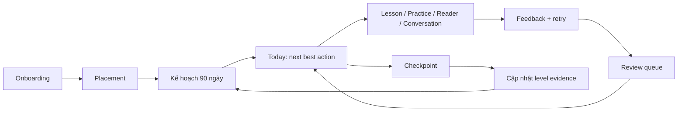

# LingoPilot — UX Design System

> Phiên bản: 1.0  
> Trạng thái: Production specification  
> Chủ sở hữu: Product Design Lead · Loại: UX/UI production specification · Ngày hiệu lực/cập nhật: 2026-08-15  
> Ngôn ngữ tài liệu: Tiếng Việt  
> Phạm vi: Web/PWA học tiếng Anh và tiếng Trung cho người Việt  
> Nguồn chuẩn liên quan: `docs/design-goal.md`, `docs/full-product-design.md`, UI prototype hiện tại

## 1. Mục đích và nguyên tắc sử dụng tài liệu

Tài liệu này là hợp đồng UX/UI giữa Product, Design, Content, Engineering, QA và Data. Nó chuyển tầm nhìn LingoPilot thành quy tắc có thể thiết kế, xây dựng và nghiệm thu. Khi có xung đột:

1. An toàn, riêng tư và khả năng tiếp cận được ưu tiên cao nhất.
2. Kết quả học tập và bằng chứng năng lực được ưu tiên hơn engagement thuần túy.
3. Luồng và quy tắc trong tài liệu này là chuẩn cho trải nghiệm; `docs/README.md` xác định thứ tự ưu tiên, còn `technical-architecture.md` và `learning-ai-spec.md` là chuẩn cho data/AI.
4. Prototype hiện tại là tham chiếu thẩm mỹ, không phải giới hạn chức năng hay accessibility.

### 1.1 Phạm vi sản phẩm

LingoPilot cung cấp lộ trình 90 ngày, phiên học khoảng 35 phút/ngày và AI giáo viên cá nhân hóa. Vòng lặp cốt lõi:

**Nghe → đọc → nói → nhận feedback → thử lại → ôn đúng lúc.**

English và 中文 dùng chung kiến trúc trải nghiệm nhưng có rubric, nội dung, voice và cách hiển thị riêng. “Level 7” là thang nội bộ dựa trên bằng chứng, không phải chứng chỉ hay cam kết kết quả đồng đều.

### 1.2 Đối tượng sử dụng tài liệu

- Product Manager: xác định scope, priority và acceptance criteria.
- Product Designer: dựng flow, wireframe, prototype và component variants.
- Content/Learning Designer: viết can-do outcome, bài tập, rubric và feedback.
- Frontend: triển khai layout, states, interaction, accessibility và telemetry.
- Backend/AI: cung cấp dữ liệu, trạng thái, schema và fallback đúng hợp đồng UX.
- QA: kiểm thử theo checklist chức năng, responsive, accessibility và degraded mode.
- Data: theo dõi funnel học tập mà không thao túng hành vi.

## 2. Triết lý và design principles

### 2.1 Luôn chỉ rõ “việc tốt nhất tiếp theo”

Mỗi màn hình học tập phải có một primary action rõ nhất. Today không được biến thành backlog. Hệ thống đề xuất tối đa ba nhiệm vụ chính và giải thích ngắn gọn vì sao nhiệm vụ đầu tiên phù hợp.

**Kiểm chứng:** trong usability test 5 giây, người dùng xác định được việc nên làm tiếp theo mà không cần mở menu.

### 2.2 Tiến bộ phải dựa trên bằng chứng

Level, skill mastery và nhận xét phải liên kết tới attempt, checkpoint hoặc artifact cụ thể. Không hiển thị điểm giả chính xác khi dữ liệu ít. Phải phân biệt:

- Đã hoàn thành hoạt động.
- Đã thể hiện đúng một lần.
- Đã ghi nhớ và dùng lại được.
- Đủ bằng chứng để tăng level.

### 2.3 Feedback ít, đúng và có thể hành động

Mỗi lượt feedback ưu tiên một lỗi ảnh hưởng giao tiếp nhất, theo cấu trúc: điều làm tốt → lỗi ưu tiên → phiên bản tốt hơn → lý do → thử lại. Không tô đỏ toàn bộ câu, không dùng ngôn ngữ làm người học xấu hổ.

### 2.4 Output trước, lý thuyết sau

Mỗi phiên phải tạo ra ít nhất một hành vi quan sát được: chọn ý chính, hoàn thành dictation, nói một câu, sửa một lỗi hoặc tóm tắt. Giải thích ngữ pháp xuất hiện đúng lúc và có thể thu gọn.

### 2.5 Hai ngôn ngữ, một mô hình tinh thần

Người dùng không phải học lại cách dùng app khi đổi ngôn ngữ. Navigation, vị trí CTA và trạng thái nhất quán; nội dung chuyên biệt:

- English: phoneme, stress, linking, rhythm, intelligibility.
- Chinese: pinyin, initial/final, tone, tone pair, sandhi, Hanzi.

### 2.6 AI minh bạch, có giới hạn và sửa được

AI phải cho biết đang đề xuất hay đang chấm theo rubric. Người dùng có thể xem transcript, sửa nhận dạng sai, report feedback và yêu cầu cách giải thích khác. LLM không tự nâng level, sửa điểm xác định hoặc đưa tuyên bố chứng nhận.

### 2.7 Riêng tư theo mặc định

Không mặc định lưu audio. Xin quyền microphone đúng thời điểm, nói rõ mục đích và cung cấp đường thay thế bằng text. API key chỉ ở backend. Memory của AI phải xem, xóa và export được.

### 2.8 Khuyến khích bền vững, không trừng phạt

Streak là tín hiệu duy trì thói quen, không phải công cụ gây tội lỗi. Ngày bỏ lỡ được reschedule tự động; không tạo backlog vô hạn, countdown gây áp lực hoặc dark pattern thanh toán.

### 2.9 Tiếp cận được trong mọi điều kiện

Không phụ thuộc duy nhất vào màu, âm thanh, hover, gesture hoặc giọng nói. Mọi chức năng cốt lõi có thể vận hành bằng bàn phím và có fallback khi microphone, AI, voice hoặc mạng không sẵn sàng.

### 2.10 Thiết kế cho tập trung

Trong lesson, assessment và conversation, chrome ứng dụng được giảm tối đa. Chỉ hiển thị mục tiêu, tiến độ, nội dung hiện tại, trợ giúp cần thiết và đường thoát an toàn.

## 3. Experience model

### 3.1 Vòng đời người học



### 3.2 Cấu trúc một phiên học

1. **Orient:** mục tiêu can-do và thời lượng.
2. **Input:** nghe/đọc mẫu ở độ khó vừa sức.
3. **Notice:** nhận biết pattern quan trọng.
4. **Practice:** thực hành có kiểm soát.
5. **Produce:** tạo câu trả lời nói hoặc viết.
6. **Feedback:** một điểm tốt, một lỗi ưu tiên, cách sửa.
7. **Retry:** thử lại ngay.
8. **Exit ticket:** chứng minh kết quả và lưu item cần ôn.

### 3.3 Trạng thái học tập chuẩn

`not_started → in_progress → attempted → feedback_ready → retry_due → completed → review_due → mastered`

- `completed` không đồng nghĩa `mastered`.
- `mastered` chỉ đạt khi scheduler/rubric có đủ evidence qua thời gian.
- Nếu phiên bị ngắt, trạng thái là `in_progress` cùng checkpoint gần nhất; không tự ghi completed.

## 4. Information architecture và site map

### 4.1 Navigation theo vai trò

**Learner — cấp chính:**

1. Today
2. Path
3. Practice
4. Coach
5. Library
6. Progress

**Learner — menu tài khoản:**

- Notifications
- Settings
- Plan & Billing
- Help & Report issue
- Sign out

**Admin — không xuất hiện trong learner navigation:**

- Overview
- Users
- Curriculum
- Content QA
- Assessments & Rubrics
- AI Runs
- Reports & Moderation
- Billing Operations
- Feature Flags
- Audit Log

### 4.2 Site map và route contract

```text
/
├── /welcome
│   ├── /onboarding/languages
│   ├── /onboarding/goals
│   ├── /onboarding/schedule
│   ├── /onboarding/self-assessment
│   ├── /onboarding/device-check
│   └── /onboarding/plan-preview
├── /assessment/:language/:kind
│   ├── /instructions
│   ├── /session/:sessionId
│   └── /result/:resultId
├── /today
├── /path/:language
│   └── /unit/:unitId
├── /lesson/:sessionId
├── /practice
│   ├── /quick-review
│   ├── /mistakes
│   ├── /listening
│   ├── /speaking
│   ├── /reading
│   ├── /vocabulary
│   └── /checkpoint-prep
├── /coach
│   ├── /new
│   ├── /session/:sessionId
│   └── /report/:sessionId
├── /library
│   ├── /reader/:contentId
│   ├── /saved
│   └── /import
├── /review
│   ├── /due
│   ├── /mistakes
│   ├── /difficult
│   └── /mastered
├── /progress
│   ├── /skills
│   ├── /checkpoints
│   ├── /evidence/:evidenceId
│   └── /weekly-report/:weekId
├── /settings
│   ├── /profile
│   ├── /learning
│   ├── /audio
│   ├── /notifications
│   ├── /accessibility
│   ├── /privacy
│   └── /data
├── /billing
│   ├── /plans
│   ├── /checkout
│   └── /history
└── /admin/*
```

### 4.3 Navigation behavior

- Desktop ≥ 1200 px: sidebar 256 px cố định; content có max-width 1440 px.
- Tablet 768–1199 px: sidebar thu gọn 72 px hoặc drawer; tooltip cho icon-only.
- Mobile < 768 px: bottom navigation gồm Today, Path, Practice, Coach, More. Không ẩn toàn bộ navigation như prototype.
- Deep link phải phục hồi đúng route sau sign-in.
- Back của trình duyệt quay về trạng thái trước, không tự thoát lesson đang làm; khi có dữ liệu chưa lưu phải hiển thị xác nhận.
- Route admin yêu cầu role check ở server và client; không chỉ ẩn link.

### 4.4 Global utilities

- Language switcher: EN / 中文; tùy chọn “Cả hai” chỉ ở Today/Progress tổng hợp.
- Search/command palette: tìm lesson, phrase, error, story và settings.
- Notification center: checkpoint, review due, báo cáo tuần; không gửi thông báo guilt-based.
- Connection/voice status: chỉ hiện khi degraded hoặc trong màn dùng voice.
- Help/report: luôn truy cập được từ account menu và lesson overflow.

## 5. Luồng chi tiết

Mỗi flow dùng cùng quy ước: **Mục tiêu → Điểm vào → Luồng chính → Nhánh/phục hồi → Kết quả → Telemetry**.

### 5.1 Onboarding

**Mục tiêu:** tạo kế hoạch tuần đầu trong dưới 4 phút trước placement; cho phép lưu và tiếp tục.

**Điểm vào:** người dùng mới, invitation link hoặc người dùng chưa hoàn tất profile.

**Luồng chính:**

1. Welcome nêu rõ lợi ích, thời lượng và cách dùng dữ liệu; CTA “Thiết lập kế hoạch”.
2. Chọn English, Chinese hoặc cả hai. Với cả hai, chọn ngôn ngữ ưu tiên.
3. Chọn tối đa hai mục tiêu: giao tiếp, công việc, du lịch, thi, đọc/xem nội dung.
4. Chọn 15/25/35/50 phút mỗi ngày và số ngày/tuần; mặc định đề xuất 35 phút, 6 ngày.
5. Chọn giờ nhắc học; có “Để sau”, không xin quyền notification trước khi người dùng chọn bật.
6. Self-assessment bằng can-do statements; luôn ghi rõ đây chỉ là ước lượng.
7. Device check: loa, mic, browser support; xin microphone sau thao tác “Kiểm tra mic”.
8. Nếu học hai ngôn ngữ, chọn tỷ lệ thời gian; tổng luôn bằng 100%.
9. Hiển thị kế hoạch tuần đầu, ngày mục tiêu 90 ngày, thời lượng thực tế và CTA “Làm test đầu vào”.

**Nhánh/phục hồi:**

- Skip placement: tạo level tạm thời có nhãn “Chưa xác minh”, nhắc lại sau tối đa ba phiên.
- Mic denied: giải thích cách bật lại, cho chọn typing/self-record; không chặn onboarding.
- Quay lại bước trước giữ nguyên dữ liệu.
- Refresh/offline lưu draft cục bộ; sync sau đăng nhập.
- Mục tiêu 90 ngày không khả thi theo lịch chọn: nêu trade-off và đề xuất tăng thời lượng hoặc điều chỉnh target, không hứa hẹn quá mức.

**Kết quả:** `learning_profile`, `language_profiles`, `study_plan_draft`, consent state và next route.

**Telemetry:** `onboarding_started`, `onboarding_step_viewed`, `device_check_result`, `onboarding_completed`, `placement_skipped`; không ghi raw voice.

### 5.2 Placement test và checkpoint trong giai đoạn

**Mục tiêu:** đo baseline hoặc tiến bộ bằng listening, reading, speaking; tạo level evidence và yêu cầu học tiếp theo.

**Điểm vào:** cuối onboarding, Assessment, checkpoint trên Today/Path hoặc yêu cầu của AI giáo viên.

**Luồng chính:**

1. Instructions: mục đích, kỹ năng, thời lượng 5–12 phút, điều kiện audio/mic và quyền riêng tư.
2. Device check ngắn; người dùng chọn caption theo quy tắc của test.
3. Tạo server-side assessment session có blueprint/rubric version; không gửi answer key xuống client.
4. Hiển thị một item mỗi màn; progress là “Câu x/y” và thời gian ước tính, không có countdown trừ task yêu cầu.
5. Listening: tối đa số lần nghe theo rubric; button cập nhật “Đã nghe 1/2”.
6. Reading: hỗ trợ zoom text; từ điển bị khóa nếu blueprint yêu cầu và phải giải thích trước.
7. Speaking: record → waveform/elapsed time → preview → submit; cho thu lại theo giới hạn rubric.
8. Autosave sau mỗi item. Khi submit cuối, khóa attempt và hiển thị trạng thái chấm.
9. Result tách điểm kỹ năng, khoảng tin cậy, evidence và “việc cần làm tiếp theo”; AI diễn giải nhưng deterministic scorer quyết định điểm/level.
10. Người dùng có thể nghe lại artifact của mình, report lỗi nhận dạng và bắt đầu nhiệm vụ được giao.

**Nhánh/phục hồi:**

- Mạng mất: giữ item đã tải và attempt local; không tải item bảo mật mới; resume khi online.
- ASR confidence thấp: cho xác nhận/sửa transcript trước phần đánh giá nội dung; pronunciation/tone vẫn dựa audio riêng.
- Audio clipping/noise: không chấm; yêu cầu thu lại và chỉ rõ lỗi kỹ thuật.
- AI unavailable: vẫn trả score, rubric result và kế hoạch fallback theo rule.
- Thoát giữa chừng: dialog “Lưu và tiếp tục sau” / “Ở lại”; không có “bỏ bài” làm primary.
- Checkpoint không đạt: giữ level, tạo repair plan; ngôn ngữ trung tính, không gọi là thất bại.

**Kết quả:** `assessment_session`, `attempts`, `score_by_skill`, `level_evidence`, tối đa ba `teacher_requirements` có thời lượng và tiêu chí đạt.

**Telemetry:** start/resume/complete, item response latency, retry reason, device failure, report; tuyệt đối không gửi answer content vào analytics chung.

### 5.3 Today

**Mục tiêu:** người dùng bắt đầu next-best action trong tối đa hai tương tác.

**Điểm vào:** login, app launch, hoàn tất lesson hoặc notification hợp lệ.

**Luồng chính:**

1. Header hiển thị ngày, ngôn ngữ đang học và trạng thái sync.
2. Hero hiển thị Day x/90, can-do outcome, skill focus, thời lượng và CTA “Tiếp tục bài tốt nhất”.
3. Today stack có tối đa ba task: Core lesson, Review due, Output practice/checkpoint.
4. “Vì sao bài này?” mở popover giải thích bằng skill gap, due review hoặc mục tiêu.
5. Momentum hiển thị meaningful minutes, streak và evidence; XP nếu có là secondary.
6. Sau completion, Today tái tính kế hoạch nhưng không thay toàn bộ stack đột ngột; item vừa xong có trạng thái hoàn thành.

**Nhánh/phục hồi:**

- Không có plan: CTA quay lại onboarding/plan repair.
- Bỏ lỡ ngày: banner “Kế hoạch đã được điều chỉnh”; không tạo nợ bài.
- Chỉ có 5 phút: “Phiên nhanh” tạo review ngắn, không giả là hoàn thành mục tiêu 35 phút.
- Offline: đề xuất content đã tải; AI actions disabled kèm lý do và retry.

**Kết quả:** session được tạo hoặc kế hoạch được cập nhật.

**Telemetry:** `today_viewed`, `next_action_started`, `recommendation_explained`, `quick_session_selected`.

### 5.4 Path

**Mục tiêu:** giúp người học hiểu mình đang ở đâu, đang xây năng lực gì và điều kiện mở khóa tiếp theo.

**Luồng chính:**

1. Chọn ngôn ngữ; hiển thị phase → unit → lesson → checkpoint.
2. Phase header nêu can-do outcome và tiến độ evidence, không chỉ phần trăm lesson.
3. Unit card hiển thị outcome, thời lượng, skill mix và trạng thái.
4. Node states: locked, available, in progress, review due, completed, mastered.
5. Chọn node mở detail drawer; CTA theo state: Bắt đầu, Tiếp tục, Ôn lại, Xem bằng chứng.
6. Placement có thể skip lesson phù hợp nhưng checkpoint bắt buộc; giải thích vì sao node bị khóa.

**Nhánh/phục hồi:**

- Curriculum version đổi: giữ history; banner giải thích bài được cập nhật.
- Người dùng chọn bài vượt level: cho preview hoặc challenge có cảnh báo, không làm thay đổi path chính nếu không đủ evidence.
- Empty mới: skeleton path rồi error retry nếu tải thất bại.

**Kết quả:** mở lesson/session hoặc evidence detail.

**Telemetry:** `path_viewed`, `unit_expanded`, `locked_reason_viewed`, `path_node_started`.

### 5.5 Lesson player

**Mục tiêu:** hoàn thành một can-do outcome trong 10–15 phút với input, output, feedback và retry.

**Luồng chính:**

1. Outcome card + thời lượng + yêu cầu mic/headphone; CTA “Bắt đầu”.
2. Input có audio, transcript theo rule, tốc độ và replay.
3. Meaning check; feedback tức thì không tiết lộ đáp án trước attempt.
4. Notice card highlight pattern; có “Giải thích thêm”.
5. Controlled practice bằng select/arrange/dictation.
6. Listening không transcript; transcript reveal sau attempt nếu rubric cho phép.
7. Spoken output: record, transcript confirmation, feedback, retry.
8. Exit ticket đo can-do; hiển thị kết quả và item được thêm vào review.
9. Summary: điều làm tốt, một focus, meaningful minutes, CTA “Về Today” hoặc “Ôn lỗi này”.

**Điều khiển:** Back/Next cố định; Next disabled có lý do bằng text; menu gồm Report, Accessibility, Save & exit. Không dùng swipe là cách duy nhất.

**Nhánh/phục hồi:** autosave mỗi step; refresh resume đúng step; AI timeout cho retry và feedback rule-based; TTS lỗi dùng fallback; mic lỗi chuyển text; user sửa transcript không làm thay đổi score phát âm.

**Kết quả:** attempts, session completion, mastery evidence, review items và teacher requirement progress.

**Telemetry:** exercise viewed/attempted/retried/completed, hint used, speech quality technical flags, lesson completed/abandoned.

### 5.6 Practice Hub

**Mục tiêu:** cung cấp luyện tập tự chọn mà vẫn ưu tiên điểm yếu có tác động cao.

**Luồng chính:**

1. Recommendation card đứng đầu: lane, lý do, thời lượng, expected outcome.
2. Filter theo language, skill và duration; filter được lưu cho phiên hiện tại.
3. Lanes: Quick Review, Mistakes, Listening, Speaking, Reading, Vocabulary, Checkpoint prep.
4. Mỗi card hiển thị level, modality, due count, offline availability và CTA.
5. Chọn card tạo session; hoàn tất quay lại Hub với updated counts.

**Nhánh/phục hồi:** lane rỗng hiển thị thành tựu + action sang lane khác; filter không có kết quả có “Xóa bộ lọc”; content unavailable không biến mất im lặng; practice tự chọn không tự nâng level nếu thiếu rubric evidence.

**Kết quả:** practice session và mastery signal.

**Telemetry:** lane viewed/selected, filter applied, recommendation accepted/ignored, completion.

### 5.7 AI Conversation

**Mục tiêu:** luyện phản xạ giao tiếp an toàn qua Guided, Roleplay, Free talk, Challenge hoặc Replay.

**Luồng chính:**

1. Chọn mode, chủ đề, thời lượng 3/5/10 phút và độ hỗ trợ.
2. Preview mục tiêu, target phrases, dữ liệu sẽ xử lý; mic/caption check.
3. Push-to-talk mặc định cho beginner; hands-free chỉ sau consent và capability check.
4. Mỗi turn hiển thị trạng thái Listening → Processing → Speaking; luôn có Stop và text fallback.
5. Transcript của người học hiển thị với confidence; confidence thấp yêu cầu xác nhận.
6. Hint có ba mức: phrase, structure, sample answer; việc dùng hint được lưu nhưng không làm xấu hổ.
7. Kết thúc theo thời gian hoặc người dùng; không kéo dài để tăng engagement.
8. Report gồm transcript, điều làm tốt, hai lỗi ưu tiên, better phrasing và một retry.
9. Người dùng chọn item lưu vào Review và chọn có lưu/xóa audio theo consent.

**Nhánh/phục hồi:** latency > 3.5 giây hiển thị tiến trình và cho chuyển text; mất mạng lưu transcript local; safety refusal giải thích ngắn và đề xuất chủ đề an toàn; model/provider đổi không làm đổi persona giữa phiên; cuộc gọi gián đoạn có Resume/End & review.

**Kết quả:** conversation transcript, attempts, feedback, review items, consent-compliant audio lifecycle.

**Telemetry:** mode/start/end, turn latency, hint, fallback, interruption; không gửi nội dung hội thoại sang product analytics.

### 5.8 Reader & Listener

**Mục tiêu:** học qua comprehensible input và khai thác phrase trong ngữ cảnh.

**Luồng chính:**

1. Content detail hiển thị chủ đề, level, độ dài, unknown-word estimate, audio và attribution.
2. Reader có play/pause, skip câu, tốc độ 0.75×/1×/1.15×, loop sentence và timeline.
3. Transcript đồng bộ theo câu, không highlight từng từ bằng animation gây nhiễu.
4. Tap/click phrase mở popover: nghĩa VI, pronunciation/pinyin, audio, ví dụ và “Lưu để ôn”.
5. Chinese: Hanzi chính; pinyin/segmentation toggle; translation reveal theo câu.
6. English: phrase stress/connected speech hint khi có dữ liệu.
7. Cuối nội dung: gist question, detail question và optional spoken summary.

**Nhánh/phục hồi:** audio lỗi vẫn đọc được text; offline chỉ mở item đã tải và ghi rõ trạng thái; imported content thiếu quyền/attribution bị từ chối với hướng dẫn; từ điển lỗi cho phép lưu phrase chưa enrich.

**Kết quả:** reading/listening attempt, saved phrases, comprehension evidence.

**Telemetry:** content opened/completed, playback speed, sentence loop, phrase saved, translation/pinyin toggled.

### 5.9 Review và Error Notebook

**Mục tiêu:** ôn đúng lúc theo recognition + production và sửa pattern lặp lại.

**Luồng chính:**

1. Tabs: Due, Mistakes, Difficult, New, Mastered; default là Due.
2. Session setup cho biết số item và ước tính thời gian; quick mode 3–5 phút.
3. Mỗi item đi từ recall trước reveal; cho “Chưa nhớ” không mang tính phán xét.
4. Self-rating kết hợp kết quả deterministic để scheduler tính due date.
5. Mistake card chứa context, error type, câu cũ, bản sửa và một prompt dùng lại.
6. Session summary: retained, needs work, next due; không chỉ điểm phần trăm.
7. Người dùng có thể archive/report item; xóa khỏi queue cần confirm và không xóa evidence lịch sử nếu policy yêu cầu giữ.

**Nhánh/phục hồi:** không có item due hiển thị trạng thái hoàn tất và practice recommendation; sync conflict dùng server timestamp + attempt ID chống trùng; offline queue sync idempotent.

**Kết quả:** cập nhật stability, difficulty, due date, mistake status và mastery evidence.

**Telemetry:** review start/result/reveal/self-rating/complete; tránh gửi phrase riêng tư do người dùng tự tạo.

### 5.10 Progress

**Mục tiêu:** giải thích tiến bộ đáng tin cậy và chỉ ra focus tiếp theo.

**Luồng chính:**

1. Overview theo từng language; không cộng level EN và ZH thành một chỉ số vô nghĩa.
2. Skill map: listening, reading, speaking, vocabulary, pronunciation/tone với confidence band.
3. Meaningful minutes theo tuần; phân biệt planned và completed.
4. Checkpoint history: level, rubric version, kỹ năng, evidence artifact và teacher requirements.
5. Error trend: xuất hiện → sửa đúng → tái phạm; cho drill liên quan.
6. Weekly report: win, blocker, next focus và thay đổi kế hoạch.
7. Export report accessible PDF/CSV theo quyền dữ liệu.

**Nhánh/phục hồi:** thiếu dữ liệu dùng “Chưa đủ bằng chứng” và CTA rõ; chart luôn có table/text equivalent; pending scoring hiển thị timestamp và refresh; score bị điều chỉnh có audit explanation.

**Kết quả:** người dùng hiểu level confidence và bắt đầu next focus.

**Telemetry:** progress viewed, evidence opened, report exported, next focus started.

### 5.11 Settings

**Mục tiêu:** cho người dùng kiểm soát profile, kế hoạch, âm thanh, accessibility, privacy và dữ liệu.

**Nhóm cài đặt:**

- Profile: tên hiển thị, locale, timezone.
- Learning: ngôn ngữ, tỷ lệ EN/ZH, target, daily minutes, correction style.
- Audio: input/output device, TTS voice, auto-play, speech speed, captions.
- Notifications: loại, ngày/giờ quiet hours; permission status.
- Accessibility: text size, reduced motion, high contrast, caption mặc định, keyboard hints.
- Privacy: audio retention, AI memory, analytics consent, model/provider data notice.
- Data: view/export/delete learning data và account.

**Interaction:** autosave chỉ dùng cho preference ít rủi ro và có status “Đã lưu”; thay đổi kế hoạch, privacy, xóa dữ liệu dùng explicit Save/Confirm. Unsaved changes có guard. Dangerous actions tách vùng, không dùng màu là tín hiệu duy nhất.

**Xóa account:** re-authenticate → nêu dữ liệu, thời gian xử lý và phần bắt buộc giữ theo pháp lý → nhập xác nhận → email receipt. Không dùng nút xóa ngay.

**Telemetry:** chỉ ghi loại setting thay đổi, không ghi giá trị nhạy cảm.

### 5.12 Billing

**Mục tiêu:** nâng cấp, quản lý gói và hủy minh bạch, không dark pattern.

**Luồng chính:**

1. Plans so sánh Free/Pro bằng cùng đơn vị giá và chu kỳ; nêu rõ VAT nếu có.
2. Feature gating xuất hiện đúng ngữ cảnh nhưng luôn có “Để sau”; không khóa learning evidence, export dữ liệu hoặc privacy controls.
3. Checkout: gói, chu kỳ, giá, ngày charge, trial và renewal rõ trước payment.
4. Payment xử lý qua provider; app không lưu card raw.
5. Success page + receipt + ngày renewal; quyền lợi cập nhật idempotent.
6. Manage plan: đổi chu kỳ, payment method, invoice, cancel.
7. Cancel flow hỏi lý do optional, nêu ngày hết quyền lợi, một bước xác nhận; không tạo mê cung giữ chân.

**Nhánh/phục hồi:** payment pending không cấp/thu hồi lặp; failed cho retry/change method; webhook chậm hiển thị pending; double submit disabled và idempotency key; downgrade không xóa dữ liệu học; refund/contact support rõ.

**Telemetry:** paywall viewed, checkout started/completed/failed, subscription changed/cancelled; không ghi payment details.

### 5.13 Admin

**Mục tiêu:** vận hành curriculum, AI, moderation và support có kiểm soát, audit được.

**Luồng và quyền:**

1. Admin login bắt buộc MFA; role: Support, Content Editor, Learning QA, Billing Ops, Super Admin.
2. Overview chỉ hiển thị health, queue, incidents và release status; không mặc định phơi dữ liệu learner.
3. Users: tìm theo ID/email có lý do truy cập; PII che mặc định; impersonation nếu có phải read-only, banner rõ và audit.
4. Curriculum: draft → review → approved → scheduled → published → retired; version immutable sau publish.
5. Content QA: preview EN/ZH/VI, voice, rubric, accessibility; compare diff; four-eyes approval cho publish.
6. Assessments: blueprint/rubric versioning; answer key không nằm trong client preview payload.
7. AI Runs: filter theo purpose/model/status/latency; prompt/output nhạy cảm được redact; replay chỉ trên dữ liệu synthetic.
8. Reports: triage → assign → resolve → notify; lưu audit trail.
9. Billing Ops: refund/credit cần permission và confirmation; hiển thị impact trước submit.
10. Feature flags: scope, owner, expiry, rollout %, kill switch; thay đổi production cần audit.

**Nhánh/phục hồi:** permission denied nêu hành động không được phép, không hé dữ liệu; optimistic edit conflict yêu cầu reload/compare; publish fail không đổi bản live; bulk action có preview count và downloadable result; destructive action yêu cầu nhập tên/ID và re-auth tùy rủi ro.

**Kết quả:** thay đổi version hóa, audit event gồm actor/action/target/time/reason trước-sau đã redact.

**Telemetry:** admin audit là security log riêng, không trộn product analytics.

## 6. Interaction states và behavior contract

### 6.1 Trạng thái component chuẩn

Mọi interactive component phải đặc tả tối thiểu:

- Rest
- Hover (thiết bị có hover)
- Focus-visible
- Active/pressed
- Selected/current
- Disabled kèm lý do khi cần
- Loading/busy
- Success
- Error/invalid
- Read-only

Hover không được là cách duy nhất tiết lộ action. Disabled control không dùng tooltip duy nhất; lý do phải hiện bằng helper text hoặc status gần đó.

### 6.2 Buttons

- Primary: một per action region; dùng cho bước tiếp theo.
- Secondary: hành động ngang cấp thấp hơn.
- Tertiary/text: tùy chọn nhẹ.
- Destructive: chỉ cho hành động khó phục hồi; luôn có label, không chỉ icon/màu.
- Icon button: target tối thiểu 44×44 CSS px; có accessible name.
- Loading button giữ nguyên width, dùng spinner + label “Đang lưu…”; `aria-busy=true`; chống submit lặp.

### 6.3 Forms

- Label luôn hiển thị; placeholder chỉ là ví dụ.
- Required/optional được ghi bằng text; không chỉ dấu `*`.
- Validate khi blur hoặc submit; không báo lỗi khi người dùng mới focus.
- Error đặt sát field, mô tả cách sửa, liên kết bằng `aria-describedby`.
- Submit lỗi focus tới error summary; mỗi lỗi là link tới field.
- Dữ liệu đã nhập được giữ lại sau lỗi mạng/server.

### 6.4 Dialog, drawer và popover

- Dialog có title, mục đích, close button và focus trap.
- Khi mở, focus vào heading hoặc field đầu tiên theo ngữ cảnh; khi đóng trả focus về trigger.
- `Escape` đóng dialog không destructive; nếu có dữ liệu chưa lưu thì mở confirmation.
- Drawer dùng cho detail phụ; không nhét flow dài nhiều bước vào drawer trên mobile.
- Popover đóng khi Escape/click ngoài; nội dung quan trọng không chỉ tồn tại trong tooltip.

### 6.5 Audio và recording

- Nút Play chuyển thành Pause, công bố trạng thái cho screen reader.
- Waveform là trang trí; elapsed/remaining time có text.
- Recording có indicator hình + text + timer, không chỉ chấm đỏ.
- Stop luôn khả dụng. Browser tab hidden không tự tiếp tục ghi âm ngoài ý muốn.
- Trước upload nêu retention/consent; sau submit cho biết có lưu hay xóa audio.

### 6.6 Feedback và score

- Correct: icon + “Đúng” + giải thích khi cần.
- Incorrect: “Chưa đúng” + hint/cách sửa; tránh rung mạnh hoặc âm thanh phạt.
- Partial: chỉ rõ phần đạt và phần cần sửa.
- AI-generated: label “Gợi ý của AI”; cho Report/Explain differently.
- Low confidence: “Hệ thống chưa nghe rõ” thay vì chấm thấp.

### 6.7 Autosave và sync

- `Saving… → Saved at HH:mm → Offline, waiting to sync → Sync failed, Retry`.
- Optimistic UI chỉ dùng khi thao tác idempotent/reversible.
- Conflict không silently overwrite; cho xem bản trên thiết bị và server nếu nội dung có giá trị.

## 7. Responsive layout

### 7.1 Breakpoints

| Token | Khoảng | Mục tiêu |
|---|---:|---|
| `compact` | 320–479 px | Điện thoại nhỏ, một cột |
| `mobile` | 480–767 px | Điện thoại lớn, một cột |
| `tablet` | 768–1023 px | Tablet, 8 cột, nav thu gọn |
| `desktop` | 1024–1439 px | Desktop, 12 cột |
| `wide` | ≥1440 px | Content max-width, không kéo dòng quá dài |

Breakpoints dựa trên nội dung, không dựa tên thiết bị. Hỗ trợ zoom 200% ở viewport desktop mà không mất chức năng hoặc buộc scroll hai chiều, ngoại trừ bảng dữ liệu cần thiết.

### 7.2 Grid và container

- Compact/mobile: 4 cột, gutter 16 px, margin 16 px.
- Tablet: 8 cột, gutter 20 px, margin 24 px.
- Desktop: 12 cột, gutter 24 px, margin 32–64 px.
- Content reading max-width 720 px; form max-width 640 px; dashboard max-width 1440 px.
- Touch target tối thiểu 44×44 px; khoảng cách giữa target tối thiểu 8 px.

### 7.3 Adaptation rules

- Sidebar → icon rail → bottom navigation.
- Two-column dashboard stack thành một cột theo thứ tự primary task trước.
- Table admin chuyển sang horizontal container có sticky first column hoặc card view; không ẩn field quan trọng.
- Dialog desktop thành bottom sheet/full-screen trên mobile nếu flow dài.
- Lesson actions sticky bottom nhưng không che input, caption hoặc browser safe area.
- Charts đổi sang vertical và luôn có text/table equivalent.
- Reader giữ line length 45–80 ký tự Latin; Chinese khoảng 20–35 Hanzi/dòng tùy cỡ chữ.

### 7.4 Orientation và safe areas

- Hỗ trợ portrait/landscape; không khóa orientation.
- Dùng `env(safe-area-inset-*)` cho bottom nav và recording controls.
- Khi bàn phím ảo mở, focused input và error text vẫn nhìn thấy; CTA không che field.

## 8. Accessibility — WCAG 2.2 AA intent

Accessibility target tham chiếu [Web Content Accessibility Guidelines (WCAG) 2.2](https://www.w3.org/TR/WCAG22/). Đây là mục tiêu thiết kế và test; chỉ công bố conformance sau audit toàn bộ page/flow trong release tương ứng.

“Intent” nghĩa là mọi thiết kế và implementation nhắm đạt WCAG 2.2 mức AA; release chỉ được tuyên bố conformant sau audit trên sản phẩm chạy thật.

### 8.1 Perceivable

- Text thường contrast tối thiểu 4.5:1; text lớn tối thiểu 3:1; UI component/focus indicator tối thiểu 3:1 với màu kề.
- Không dùng màu làm tín hiệu duy nhất cho đúng/sai, level, trạng thái hoặc chart.
- Alt text mô tả mục đích; illustration trang trí dùng alt rỗng.
- Video có caption đồng bộ; audio lesson có transcript; task nghe dùng accommodation mode phù hợp nhưng không làm sai mục đích assessment.
- Audio tự phát tối đa 3 giây hoặc có Pause/Stop dễ thấy; mặc định không autoplay voice dài.
- Reflow ở 320 CSS px và zoom 400% cho nội dung tương đương mobile.
- Text spacing tùy biến không làm mất nội dung/chức năng.

### 8.2 Operable

- Toàn bộ thao tác dùng được bằng bàn phím, không keyboard trap.
- Skip link tới main content; landmarks `header`, `nav`, `main`, `aside`, `footer` hợp lý.
- Focus không bị sticky header/footer che; dùng `scroll-margin`.
- Focus indicator ít nhất tương đương viền 2 CSS px với contrast 3:1 và không bị clip.
- Drag/sort có button “Di chuyển trái/phải” hoặc lựa chọn thay thế.
- Không bắt gesture nhiều điểm hoặc path-based; có control đơn giản tương đương.
- Target size tối thiểu theo WCAG 2.2 là 24×24 px; chuẩn sản phẩm là 44×44 px trừ inline text link.
- Không có flashing trên 3 lần/giây.
- Timeout assessment/conversation phải cảnh báo và cho gia hạn nếu không phải timing thiết yếu.

### 8.3 Understandable

- `lang="vi"` cho app shell; đoạn English `lang="en"`; Chinese `lang="zh-Hans"`.
- Navigation và label nhất quán giữa các màn hình.
- Help/Contact luôn ở vị trí nhất quán.
- Error prevention cho legal, financial, delete và publish: review → confirm → receipt/undo nếu có thể.
- Không thay context ngay khi focus hoặc chọn option nếu chưa được báo trước.

### 8.4 Robust

- Dùng semantic HTML trước ARIA; control custom phải có name, role, value và state.
- Status async dùng `role=status`/`aria-live=polite`; lỗi nghiêm trọng dùng `role=alert` tiết chế.
- Progress có label và `aria-valuenow/min/max` hoặc text tương đương.
- Tabs theo ARIA Authoring Practices; arrow keys đổi tab, Tab đi vào panel.
- Virtualized list phải giữ reading order và thông báo số item hợp lý.

### 8.5 Hỗ trợ nhận thức và ngôn ngữ

- Câu ngắn, một chỉ dẫn mỗi bước, ví dụ cạnh nhiệm vụ.
- Cho phép pause, replay, giảm tốc và ẩn motion.
- Không giới hạn thời gian trừ khi kỹ năng đo cần tốc độ; giải thích trước.
- Giữ target phrase và instruction phân biệt thị giác, không trộn ba ngôn ngữ trong một câu nếu không phục vụ học tập.

### 8.6 Ma trận kiểm thử accessibility

- Keyboard-only trên Chrome, Safari và Firefox desktop.
- VoiceOver + Safari macOS/iOS.
- NVDA + Firefox hoặc Chrome Windows.
- TalkBack + Chrome Android.
- 200% zoom desktop; 400% reflow; text spacing override.
- Forced Colors/High Contrast; prefers-reduced-motion; color vision simulation.
- Automated axe không có critical/serious; manual audit bắt buộc cho learning interactions.

## 9. Keyboard và focus specification

### 9.1 Global shortcuts

| Phím | Hành động | Điều kiện |
|---|---|---|
| `Tab` / `Shift+Tab` | Di chuyển focus | Luôn |
| `Enter` / `Space` | Kích hoạt control | Theo semantic control |
| `Esc` | Đóng popover/dialog hoặc hủy recording sau confirm | Không làm mất dữ liệu im lặng |
| `Cmd/Ctrl+K` | Mở command palette | Ngoài text editor |
| `?` | Mở keyboard help | Ngoài input |
| `Space` | Play/Pause audio | Khi focus ở player, không cướp khi đang nhập |
| `R` | Start/Stop recording | Khi lesson cho phép và không ở input |
| `←/→` | Seek audio hoặc chuyển tab | Chỉ trong widget đang focus |

Shortcut một ký tự phải có thể tắt/remap hoặc chỉ hoạt động khi widget focus để phù hợp WCAG 2.1.4.

### 9.2 Focus order

- Theo reading order và visual order; không dùng positive `tabindex`.
- Sau route change, focus tới `<h1>` hoặc main container có thông báo route.
- Sau validation, focus error summary; sau retry feedback, focus heading feedback.
- Khi thêm item vào Review, focus giữ ở trigger và status live thông báo thành công.
- Khi xóa item, focus chuyển tới item kế tiếp hoặc heading danh sách nếu rỗng.
- Modal đóng trả focus đúng trigger, kể cả trigger trong list được rerender.

### 9.3 Lesson/assessment focus

- Không tự focus Next trước khi người dùng đọc feedback.
- Answer option dùng radio semantics; arrow keys chọn, Space xác nhận nếu tách submit.
- Arrange chunks có keyboard reorder controls và live announcement.
- Transcript token không tạo hàng trăm tab stops; dùng roving tabindex hoặc phrase-level controls.

## 10. Localization EN/ZH/VI

### 10.1 Phân biệt ba lớp ngôn ngữ

- **UI locale:** VI mặc định; EN và ZH là lựa chọn giao diện tương lai/production.
- **Target language:** English hoặc Simplified Chinese.
- **Support language:** tiếng Việt mặc định cho giải thích/feedback; có thể đổi theo profile.

Không suy target language từ UI locale. Mọi content record có `language`, `locale`, `script` và version.

### 10.2 Quy tắc chuỗi

- Không hardcode string trong component.
- Dùng ICU MessageFormat cho plural, select và variable.
- Không nối chuỗi theo thứ tự cố định; translator phải thấy context.
- Variable dùng tên nghĩa rõ: `{learnerName}`, `{minutes}`, `{dueCount}`.
- Cho phép text expansion 30–50%; không khóa chiều cao button/card theo một dòng.
- Date/time/number/currency dùng `Intl`, theo locale và timezone người dùng.

### 10.3 Quy tắc VI

- Dùng tiếng Việt tự nhiên, dấu đầy đủ: “Cài đặt”, “Kiểm tra đầu vào”, “Tiếp tục”.
- Xưng hô mặc định “bạn”; tránh giới tính và giọng phán xét.
- Thuật ngữ cần nhất quán: “bài học”, “phiên luyện tập”, “bằng chứng”, “lỗi cần sửa”, “ôn tập”.

### 10.4 Quy tắc EN

- UI sentence case; can-do outcome bắt đầu bằng động từ: “Ask for directions”.
- Phân biệt transcript, translation, explanation và target phrase bằng label/typography.
- IPA chỉ hiển thị khi người học bật hoặc bài yêu cầu; luôn có audio/text alternative.

### 10.5 Quy tắc ZH

- Mặc định `zh-Hans`; Traditional là locale riêng, không convert tùy tiện.
- Hanzi là nội dung chính. Pinyin đặt trên/dưới theo component nhưng không chen trong cùng dòng gây khó đọc.
- Tone mark ưu tiên dạng dấu (`nǐ hǎo`); số tone dùng trong nội dung kỹ thuật khi cần.
- Word segmentation và pinyin là preference, có thể bị assessment khóa với giải thích trước.
- Font fallback phải hỗ trợ glyph CJK; không dùng faux bold/italic cho Hanzi.

### 10.6 Pseudo-localization và QA

- Chạy pseudo-locale mở rộng 40%, ký tự có dấu và chuỗi dài.
- QA truncation ở tất cả breakpoint, đặc biệt nav, button, chart label và billing.
- Screen reader pronunciation test với nested `lang` attributes.
- Content học tập được bilingual reviewer kiểm tra, không chỉ machine translation.

## 11. Design tokens

Token dùng semantic naming; component không gọi trực tiếp primitive color trừ illustration/data visualization được quản trị.

### 11.1 Color primitives

| Token | Giá trị | Mục đích |
|---|---|---|
| `violet-50` | `#F4F2FF` | nền subtle |
| `violet-100` | `#E8E4FF` | selected subtle |
| `violet-500` | `#6457E8` | brand/action |
| `violet-600` | `#5143D5` | hover/action emphasis |
| `violet-700` | `#4034B3` | pressed/text on light |
| `navy-950` | `#1D2533` | text chính |
| `slate-700` | `#465064` | text phụ đậm |
| `slate-600` | `#5F697A` | text phụ đạt contrast |
| `slate-300` | `#CBD2DC` | border mạnh |
| `slate-200` | `#E4E8EE` | border mặc định |
| `slate-50` | `#F7F9FC` | app background |
| `white` | `#FFFFFF` | surface |
| `green-600` | `#247A57` | success text/icon |
| `green-50` | `#EBF8F2` | success surface |
| `amber-700` | `#87530B` | warning text/icon |
| `amber-50` | `#FFF6E8` | warning surface |
| `red-600` | `#B4232C` | error/destructive |
| `red-50` | `#FFF0F1` | error surface |
| `blue-600` | `#2468B4` | information/listening |
| `orange-600` | `#B85E2F` | Chinese accent khi cần |

Mọi cặp foreground/background phải được kiểm tra contrast thực tế. Màu prototype như muted text rất nhạt không được dùng cho text nhỏ nếu không đạt 4.5:1.

### 11.2 Semantic colors

```text
color.bg.canvas          = slate-50
color.bg.surface         = white
color.bg.subtle          = violet-50
color.text.primary       = navy-950
color.text.secondary     = slate-700
color.text.muted         = slate-600
color.border.default     = slate-200
color.border.strong      = slate-300
color.action.primary     = violet-500
color.action.hover       = violet-600
color.action.pressed     = violet-700
color.focus              = blue-600
color.status.success.*   = green-600 / green-50
color.status.warning.*   = amber-700 / amber-50
color.status.error.*     = red-600 / red-50
```

Dark theme chưa là release requirement; semantic token phải cho phép thêm mà không đổi API component.

### 11.3 Typography

- UI/body Latin: `DM Sans`, fallback `Inter, system-ui, sans-serif`.
- Display: `Playfair Display` chỉ cho hero/editorial heading; không dùng trong dense UI hoặc Chinese.
- Chinese: `Noto Sans SC, PingFang SC, Microsoft YaHei, sans-serif`.
- Monospace cho code/phonetic technical data: `ui-monospace`.

| Token | Size/line-height | Weight | Dùng cho |
|---|---|---:|---|
| `display-lg` | 48/56 | 700 | marketing/hero desktop |
| `display-md` | 40/48 | 700 | dashboard greeting |
| `heading-xl` | 32/40 | 700 | page title |
| `heading-lg` | 24/32 | 700 | section/dialog |
| `heading-md` | 20/28 | 600 | card heading |
| `body-lg` | 18/28 | 400 | reader |
| `body-md` | 16/24 | 400 | mặc định |
| `body-sm` | 14/20 | 400 | metadata/helper |
| `label-md` | 14/20 | 600 | button/form label |
| `caption` | 12/16 | 500 | caption phụ, không dùng dưới 12 px |

Người dùng có thể tăng text lên ít nhất 200% mà không mất chức năng.

### 11.4 Spacing, radius, elevation và layout

```text
space-0  = 0
space-1  = 4px
space-2  = 8px
space-3  = 12px
space-4  = 16px
space-5  = 20px
space-6  = 24px
space-8  = 32px
space-10 = 40px
space-12 = 48px
space-16 = 64px

radius-sm   = 6px
radius-md   = 10px
radius-lg   = 16px
radius-xl   = 24px
radius-pill = 999px

shadow-1 = 0 1px 2px rgba(29,37,51,.08)
shadow-2 = 0 8px 24px rgba(29,37,51,.10)
shadow-3 = 0 20px 56px rgba(29,37,51,.16)
```

Elevation không thay cho border/contrast. Không dùng shadow để biểu đạt trạng thái duy nhất.

### 11.5 Motion tokens

```text
duration-instant = 80ms
duration-fast    = 160ms
duration-normal  = 240ms
duration-slow    = 360ms
ease-standard    = cubic-bezier(.2, 0, 0, 1)
ease-enter       = cubic-bezier(0, 0, 0, 1)
ease-exit        = cubic-bezier(.3, 0, 1, 1)
```

### 11.6 Iconography và illustration

- Icon 20/24 px, stroke nhất quán; luôn đi với label khi ý nghĩa không phổ quát.
- Không dùng ký tự Unicode như `⌂`, `◒`, `•••` làm icon production vì rendering/accessibility không ổn định.
- Illustration mang tinh thần bình tĩnh, tiến bộ, đa văn hóa; không dùng stereotype quốc gia.
- Cờ quốc gia không đại diện cho ngôn ngữ; dùng EN/中文 hoặc tên ngôn ngữ.

## 12. Component system

Mỗi component trong design library phải có anatomy, variants, size, states, behavior, content rules, responsive rules, accessibility annotations và event contract.

### 12.1 Foundations

- `AppShell`: sidebar/rail/bottom nav, skip link, main landmark.
- `PageHeader`: title, description, language context, actions.
- `Stack`, `Inline`, `Grid`, `Container`: layout primitives, không nhúng business logic.
- `Divider`, `Surface`, `ScrollableRegion`.

### 12.2 Actions

- `Button`: primary, secondary, tertiary, destructive; sm/md/lg; leading/trailing icon.
- `IconButton`: tooltip + accessible name.
- `SplitButton`: chỉ admin/advanced action; keyboard menu đầy đủ.
- `Link`: inline, standalone, external indicator.
- `FloatingAction`: hạn chế; không dùng nếu che nội dung/keyboard.

### 12.3 Navigation

- `SideNav`, `NavRail`, `BottomNav`.
- `Breadcrumbs` cho admin/deep content; mobile collapse có accessible name.
- `Tabs` cho peer content; không dùng thay navigation nhiều cấp.
- `Pagination` cho admin; learner feeds ưu tiên load predictable, không infinite scroll vô hạn.
- `CommandPalette` có search, recent, keyboard instruction.

### 12.4 Inputs

- `TextField`, `TextArea`, `SearchField`, `Select`, `Combobox`.
- `Checkbox`, `RadioGroup`, `Switch` (chỉ binary immediate setting).
- `Slider` có numeric input thay thế; dùng cho tốc độ/volume.
- `SegmentedControl` cho 2–4 lựa chọn ngắn.
- `Date/TimePicker` locale-aware; có text input accessible.
- `FileUpload` hỗ trợ button, drag-drop và progress/cancel.

### 12.5 Feedback và overlays

- `InlineAlert`, `Banner`, `Toast`, `ProgressBar`, `Spinner`, `Skeleton`.
- `Dialog`, `AlertDialog`, `Drawer`, `Popover`, `Tooltip`.
- Toast không dùng cho lỗi cần hành động hoặc thông tin phải lưu; timeout tối thiểu 5 giây và pause on hover/focus.

### 12.6 Learning components

- `OutcomeCard`: can-do, skill, duration, prerequisite.
- `LessonStepper`: step hiện tại, tổng, trạng thái; không cho skip ngoài rule.
- `PromptCard`: instruction, target language, optional translation.
- `AudioPlayer`: play/pause, seek, speed, loop, transcript toggle.
- `Recorder`: permission, record, timer, waveform decorative, preview, retry, submit.
- `Transcript`: sentence/phrase segmentation, confidence, editable confirmation.
- `AnswerChoice`, `ChunkBuilder`, `DictationInput`, `MeaningCheck`.
- `PronunciationFeedback`: target/current, phoneme/stress/rhythm; evidence source.
- `ToneFeedback`: syllable, expected/observed tone contour; không suy từ transcript.
- `Hint`: phrase/structure/example levels.
- `FeedbackCard`: praise, priority fix, better version, why, retry.
- `ExitTicket`: can-do assessment và result.

### 12.7 Planning và progress components

- `NextBestActionCard`: lý do, outcome, duration, CTA.
- `TaskStack`: tối đa ba task.
- `PathMap`, `UnitCard`, `PathNode`, `CheckpointNode`.
- `Streak`, `MeaningfulMinutes`, `LevelEvidenceMeter`.
- `SkillMap`: chart + accessible table.
- `EvidenceCard`, `WeeklyReport`, `TeacherRequirementCard`.
- `ReviewQueue`, `MistakeCard`, `MasteryBadge`.

### 12.8 AI và voice components

- `TutorPresence`: tên/persona, provider status không quảng cáo model không cần thiết.
- `ConversationTurn`: speaker, transcript, audio, timestamp, report.
- `TurnStatus`: listening/processing/speaking/interrupted.
- `AIContentLabel`: “Gợi ý của AI”, info và report.
- `ConfidenceNotice`: xác nhận transcript hoặc insufficient evidence.
- `VoiceFallbackBanner`: lý do, action thử lại/chuyển text.
- `MemoryConsentCard`: dữ liệu, mục đích, retention, toggle và quản lý.

### 12.9 Commerce và admin components

- `PlanCard`, `FeatureComparison`, `PriceSummary`, `PaymentStatus`, `InvoiceRow`.
- `DataTable`, `FilterBar`, `BulkActionBar`, `StatusBadge`, `AuditTimeline`.
- `VersionDiff`, `ApprovalPanel`, `RoleGate`, `PIIRedaction`, `FeatureFlagControl`.
- Admin components không tái dùng learner motivational copy.

### 12.10 Component naming và API

- Tên theo chức năng, không theo màu/vị trí: `Button variant="primary"`, không `PurpleButton`.
- Boolean state có tên dương và rõ: `isLoading`, `isSelected`, `isInvalid`.
- Content do caller truyền; component không tự nối/transliterate chuỗi học tập.
- Event phân biệt intent và result: `onSubmitIntent`, backend event `attempt_submitted`.
- Mọi breaking change token/component cần migration note và visual regression.

## 13. Content design, voice và tone

### 13.1 Brand voice

LingoPilot là giáo viên **ấm áp, rõ ràng, có căn cứ và thực tế**. Không quá trẻ con, không sáo rỗng, không giả vờ chắc chắn khi AI thiếu dữ liệu.

### 13.2 Voice theo tình huống

| Tình huống | Giọng | Ví dụ nên dùng |
|---|---|---|
| Bắt đầu | Ngắn, hướng đích | “Hôm nay bạn luyện cách hỏi đường trong 12 phút.” |
| Đúng | Cụ thể | “Bạn đã dùng đúng cụm ‘Could you…?’.” |
| Chưa đúng | Trung tính, hành động được | “Ý đã rõ. Hãy đặt trọng âm vào ‘station’ và thử lại.” |
| AI không chắc | Minh bạch | “Tôi chưa nghe rõ âm cuối. Bạn có thể thu lại hoặc sửa transcript.” |
| Bỏ lỡ ngày | Không phán xét | “Kế hoạch đã được dời để hôm nay bạn bắt đầu nhẹ nhàng hơn.” |
| Checkpoint chưa đạt | Dựa evidence | “Bạn cần thêm bằng chứng ở kỹ năng nghe chi tiết trước khi mở Level 4.” |
| Lỗi hệ thống | Nhận trách nhiệm | “Chúng tôi chưa lưu được lượt này. Bản ghi vẫn còn trên thiết bị.” |
| Billing | Rõ ràng | “Bạn sẽ bị tính 1.990.000 ₫ vào ngày 15/09/2026.” |

### 13.3 Quy tắc microcopy

- CTA bắt đầu bằng động từ: Bắt đầu, Tiếp tục, Nghe lại, Thu lại, Lưu để ôn.
- Tránh “OK”, “Submit”, “Có lỗi xảy ra”, “Bạn sai rồi”.
- Nút đóng destructive dialog không ghi mơ hồ; dùng “Giữ tài khoản” / “Xóa tài khoản”.
- Hiển thị thời lượng bằng số thực tế; không dùng “chỉ vài phút” nếu có thể lâu hơn.
- Không gọi AI là người thật; dùng “AI giáo viên”, “gợi ý của AI”.
- Không dùng “thành thạo” nếu chỉ completed một lesson.

### 13.4 Feedback contract

```text
Điều bạn làm tốt: [một bằng chứng cụ thể]
Cần sửa trước: [một lỗi ảnh hưởng giao tiếp]
Cách nói tự nhiên hơn: [target language]
Vì sao: [giải thích ngắn bằng support language]
Thử lại: [một prompt cụ thể]
```

### 13.5 Error message formula

**Điều gì xảy ra + ảnh hưởng + việc người dùng có thể làm + trạng thái dữ liệu.**

Ví dụ: “Kết nối bị gián đoạn nên chưa gửi được câu trả lời. Bản ghi vẫn ở thiết bị này. Hãy thử lại khi có mạng.”

## 14. Motion và sound

### 14.1 Nguyên tắc motion

- Motion giải thích quan hệ không gian, state change hoặc feedback; không để trang trí liên tục.
- Chuyển trang 160–240 ms; dialog 160–240 ms; micro-feedback ≤160 ms.
- Không animate layout lớn khi learner đang đọc transcript.
- Correct feedback có thể dùng fade/scale nhẹ; incorrect không rung mạnh.
- Skeleton shimmer tối đa tinh tế, tránh pulse gây mất tập trung.

### 14.2 Reduced motion

Với `prefers-reduced-motion: reduce` hoặc setting trong app:

- Tắt parallax, confetti, auto-scroll animation và waveform giả.
- Duration về 0–80 ms; giữ state change tức thời.
- Không dựa animation để giải thích tiến độ; dùng text/icon.

### 14.3 Sound

- Sound effect mặc định tắt hoặc rất tiết chế; tách volume feedback khỏi lesson audio.
- Không dùng âm thanh duy nhất để báo đúng/sai/hoàn thành.
- TTS không tự phát khi route load trừ khi người dùng đã bật autoplay rõ ràng.
- Nút mute/stop luôn truy cập được trong conversation.

## 15. Error, empty, loading và offline states

### 15.1 Error taxonomy

| Loại | UX response |
|---|---|
| Field validation | Inline, giữ input, hướng dẫn sửa |
| Authentication | Giữ destination, cho sign-in lại |
| Permission mic/notification | Giải thích cách bật và fallback |
| Network transient | Retry, giữ draft, status sync |
| AI timeout/provider | Rule-based fallback hoặc text mode |
| TTS/OpenVox | Browser TTS/text; không chặn lesson |
| ASR low confidence | Confirm transcript/record again; không chấm oan |
| Content invalid | Dừng item, report ID, chuyển item an toàn |
| Payment | Không double charge; trạng thái pending rõ |
| Server unexpected | Error ID, support path, dữ liệu đã/ chưa lưu |

### 15.2 Empty states

Empty state gồm: lý do hoặc ý nghĩa → trạng thái tích cực/trung tính → một CTA liên quan.

- Review rỗng: “Bạn đã ôn hết mục đến hạn” + “Luyện nói 5 phút”.
- Progress thiếu dữ liệu: “Cần thêm 2 phiên để ước lượng kỹ năng nói” + “Bắt đầu phiên”.
- Search không có kết quả: hiển thị query, xóa filter và gợi ý.
- Library saved rỗng: giải thích cách tap phrase để lưu.
- Admin queue rỗng: xác nhận filter và timestamp, không chỉ màn trắng.

### 15.3 Loading

- <300 ms: không spinner để tránh flicker.
- 300 ms–2 s: skeleton theo cấu trúc thật.
- >2 s: status text; >8 s: giải thích và Cancel/Retry.
- Không skeleton cho text answer đã có; giữ stale data với nhãn refresh khi an toàn.
- Assessment submit dùng determinate step nếu biết; không giả phần trăm.
- Screen reader nhận một thông báo bắt đầu và hoàn tất, không spam từng skeleton.

### 15.4 Offline/degraded

- Global compact banner: “Đang ngoại tuyến”; không che content/CTA.
- Tài liệu đã tải, review queue và draft attempt vẫn dùng được.
- Hành động cần server được disabled với lý do và “Thử lại”.
- Queue local dùng idempotency key; sync theo thứ tự; thông báo khi hoàn tất.
- AI conversation realtime không giả đang online; cho scripted practice hoặc text draft.
- OpenVox local có thể hoạt động dù internet mất; trạng thái voice và internet được biểu diễn riêng.

### 15.5 Recovery priority

1. Bảo toàn câu trả lời/audio draft.
2. Nói rõ phần nào đã lưu.
3. Cho retry an toàn, không tạo attempt/payment trùng.
4. Cung cấp fallback không làm sai mục tiêu học.
5. Cho report với correlation ID đã redact.

## 16. Privacy, safety và trust UX

- Consent theo mục đích, không gộp audio retention, analytics và AI memory.
- Just-in-time notice trước microphone/upload/import.
- Privacy center cho xem: dữ liệu gì, vì sao, lưu bao lâu, provider nào xử lý.
- Người dùng có thể xóa từng conversation memory mà không phải xóa account.
- Sensitive learner facts không được lặp lại trong UI chung hoặc notification lock screen.
- Report AI output có reason taxonomy và free text optional; receipt có report ID.
- Safety response không tranh luận; cho đường chuyển chủ đề và support nếu phù hợp.
- Trẻ vị thành niên cần age gate/guardian policy trước public launch; không suy tuổi từ nội dung hội thoại.

## 17. Analytics và experimentation UX guardrails

- Event đo hành vi học tập, không ghi raw audio/transcript, answer key, payment data hoặc API key.
- Mỗi event có `event_version`, anonymous/user ID thích hợp, language, level band, session ID và timestamp.
- Funnel cốt lõi: onboarding → placement → first lesson → first retry → day 7 → checkpoint.
- Experiment không được hạ chuẩn feedback, accessibility, privacy, scoring integrity hoặc làm khó hủy gói.
- Không A/B test wording gây xấu hổ, fake urgency hoặc claim kết quả không chứng minh.
- Learning experiment cần guardrail về retention và skill outcome, không chỉ click-through.

## 18. UX acceptance checklist

### 18.1 Product và IA

- [ ] Người mới hoàn tất onboarding và thấy kế hoạch đầu tiên trong dưới 4 phút, chưa tính placement.
- [ ] Người dùng bắt đầu next-best action từ Today trong tối đa hai tương tác.
- [ ] Learner và Admin navigation tách quyền rõ ràng.
- [ ] Deep links phục hồi sau auth và browser Back hoạt động đúng.
- [ ] EN và ZH có profile, level và progress riêng.

### 18.2 Learning flows

- [ ] Placement/checkpoint đo nghe, đọc, nói theo blueprint version hóa.
- [ ] Answer key và deterministic scoring không bị gửi xuống client.
- [ ] LLM không tự sửa score/nâng level; result liên kết evidence.
- [ ] Lesson đủ orient, input, practice, output, feedback, retry và exit ticket.
- [ ] Practice, Conversation, Reader và Review có completion state và dữ liệu đầu ra.
- [ ] Chinese tone được đánh giá độc lập transcript; English pronunciation ưu tiên intelligibility.
- [ ] Bỏ lỡ ngày không tạo backlog vô hạn.

### 18.3 Resilience

- [ ] Draft/attempt sống qua refresh và lỗi mạng theo policy.
- [ ] AI, ASR, TTS/OpenVox và microphone đều có degraded state/fallback rõ.
- [ ] Retry idempotent, không tạo session/payment trùng.
- [ ] Offline content nêu rõ khả năng và sync status.
- [ ] Error cho biết dữ liệu đã lưu hay chưa.

### 18.4 Accessibility

- [ ] Không có critical/serious issue trong axe ở route chính; manual audit đã hoàn tất.
- [ ] Keyboard-only hoàn tất onboarding, placement, lesson, review, checkout và admin publish.
- [ ] Focus order, focus trap/return và route focus đúng đặc tả.
- [ ] Contrast đạt AA; không dùng màu/âm thanh/motion làm tín hiệu duy nhất.
- [ ] Touch target chuẩn sản phẩm 44×44 px.
- [ ] Reflow 320 CSS px, zoom 200%/400% và text spacing không mất chức năng.
- [ ] Caption/transcript/alt text và chart alternative có đầy đủ.
- [ ] VoiceOver, NVDA và TalkBack smoke test đạt.

### 18.5 Responsive và localization

- [ ] Kiểm thử từ 320 px đến ≥1440 px, portrait/landscape và keyboard ảo.
- [ ] Bottom navigation mobile không che CTA hoặc safe area.
- [ ] VI/EN/ZH không truncation với pseudo-localization +40%.
- [ ] `lang` đúng cho UI và target-language spans.
- [ ] Date, time, number, currency và plural theo locale.
- [ ] Hanzi/pinyin/segmentation hoạt động đúng setting và assessment rules.

### 18.6 Trust, privacy và billing

- [ ] Consent microphone/audio/memory/analytics tách biệt và có thể thu hồi.
- [ ] Audio retention và provider processing được giải thích trước upload.
- [ ] Export/delete data và delete account có review/confirmation/receipt.
- [ ] Pricing, trial, renewal và cancel date rõ; không dark pattern.
- [ ] Admin access, publish, refund, flag và PII view có audit trail.

### 18.7 Content và visual quality

- [ ] CTA dùng động từ, feedback cụ thể và không phán xét.
- [ ] Không có text UI nhỏ hơn 12 px; body mặc định 16 px.
- [ ] Token semantic được dùng, không hardcode màu/spacing trong feature UI.
- [ ] Component có đủ states và visual regression coverage.
- [ ] Reduced motion và high contrast được kiểm thử.

## 19. Handoff specifications

### 19.1 Deliverable bắt buộc từ Design

Mỗi epic/flow phải có:

1. User goal, entry points, preconditions và permission.
2. Flow diagram gồm happy path, error, empty, loading, offline và cancellation.
3. Wireframe cho compact/mobile/tablet/desktop; wide khi cần.
4. High-fidelity screen dùng library component và semantic token.
5. Prototype cho interaction quan trọng: recording, feedback, dialog, keyboard.
6. Content matrix VI/EN/ZH và trạng thái text dài.
7. Accessibility annotations: heading, landmark, label, reading/focus order, live region.
8. Data dependency và source-of-truth cho từng field.
9. Analytics events và privacy classification.
10. Acceptance criteria và test fixtures.

### 19.2 Screen annotation template

```text
Screen/route:
User role:
Primary goal:
Primary CTA:
Entry/exit:
Data required:
Permissions:
Responsive behavior:
Keyboard/focus:
Screen reader announcements:
Loading/empty/error/offline:
Analytics:
Privacy classification:
Open questions:
```

### 19.3 Component handoff template

```text
Component name/version:
Purpose/non-purpose:
Anatomy/slots:
Variants/sizes:
States:
Props/defaults:
Content constraints:
Responsive behavior:
Keyboard behavior:
ARIA/semantic HTML:
Motion/reduced motion:
Events:
Test IDs only when semantic selector is insufficient:
```

### 19.4 Design-to-code conventions

- Component và token names trong design file khớp code package.
- Design dùng auto-layout, constraints và variable modes; không detach component để sửa cục bộ.
- Asset SVG có viewBox, title policy và optimized path; decorative asset được đánh dấu.
- Không xuất text thành image.
- Spacing/color/font phải map token; ngoại lệ có comment và owner.
- Breakpoint behavior được mô tả bằng rule, không chỉ ảnh tĩnh.
- AI/async UI dùng state machine diagram khi có trên năm trạng thái.

### 19.5 Engineering Definition of Done

- Storybook/component playground có variants và states.
- Unit test cho state/format; integration test cho flow; visual regression ở breakpoint chính.
- Accessibility lint + axe + manual keyboard/screen reader cho interaction mới.
- Network failure, slow 3G, denied permission và provider timeout được test.
- Analytics schema validate; payload không chứa dữ liệu cấm.
- Localization key không orphan/hardcode; pseudo-locale screenshot pass.
- Performance budget không bị vượt do asset/motion/component mới.

### 19.6 UX QA và sign-off

1. Designer kiểm tra bản build, không chỉ screenshot.
2. Content/Learning QA xác nhận target language, rubric và can-do outcome.
3. Accessibility reviewer kiểm tra interaction mới.
4. Product xác nhận scope/metrics và fallback.
5. Engineering cung cấp build SHA, feature flag và test evidence.
6. Mọi deviation được ghi owner, mức độ, deadline; P0/P1 accessibility, privacy, scoring integrity chặn release.

### 19.7 Severity rubric

- **P0:** lộ dữ liệu/secret, charge sai, chấm/nâng level sai hệ thống, không thể hoàn tất flow cho đa số.
- **P1:** mất attempt, keyboard/screen reader không thể hoàn tất core flow, không có fallback voice/network.
- **P2:** flow khó hiểu, responsive lỗi đáng kể, localization truncation, feedback không rõ.
- **P3:** polish, spacing, motion hoặc copy nhỏ không cản nhiệm vụ.

## 20. Mapping từ prototype hiện tại tới production

Prototype hiện tại đã có nền tảng thị giác và một số interaction: sidebar, Today dashboard, momentum cards, assessment card/modal, lesson modal nghe–đọc–nói, AI Coach, roadmap, OpenVox/browser fallback và progress local. Khi nâng cấp:

- Giữ brand violet, nền sáng, card mềm và giọng điệu bình tĩnh.
- Thay font-size 8–11 px trong UI chức năng bằng scale tối thiểu 12/14/16 px phù hợp.
- Thay Unicode icon bằng icon system có accessible name.
- Bổ sung focus-visible, semantic dialog, focus trap/return và keyboard controls.
- Mobile phải có bottom navigation; không ẩn navigation chính.
- Tách modal lesson thành route player production để resume/deep-link tốt hơn.
- Tách assessment khỏi một modal sáu câu thành session route có autosave và security boundary.
- Không dùng localStorage làm nguồn chuẩn multi-device; UI phải thể hiện sync states.
- Mọi màu muted, selected, success/error phải qua contrast audit.

## 21. Governance và versioning

- Tài liệu dùng semantic version: major khi đổi model/flow nền tảng; minor khi thêm pattern/component; patch khi làm rõ.
- Component/token có owner, trạng thái `draft`, `beta`, `stable`, `deprecated` và migration deadline.
- Design review hàng tháng đối chiếu component dùng thực tế, accessibility debt và duplicate pattern.
- Product exception phải ghi lý do, phạm vi, owner, ngày hết hạn; không tạo pattern song song vĩnh viễn.
- Mỗi release public phải đính kèm UX acceptance evidence, accessibility audit summary và danh sách known limitations.

## 22. Definition of UX success

Hệ thống UX được xem là thành công khi người học luôn biết phải làm gì tiếp theo, có thể hoàn thành vòng học bằng thiết bị và khả năng khác nhau, hiểu vì sao nhận feedback/level, phục hồi được khi AI hoặc mạng lỗi, và kiểm soát được dữ liệu lẫn thanh toán. Thành công không chỉ là giao diện đẹp hay số phút sử dụng; nó là sự kết hợp của **tiến bộ có bằng chứng, cảm giác tự chủ, khả năng tiếp cận và niềm tin dài hạn**.
