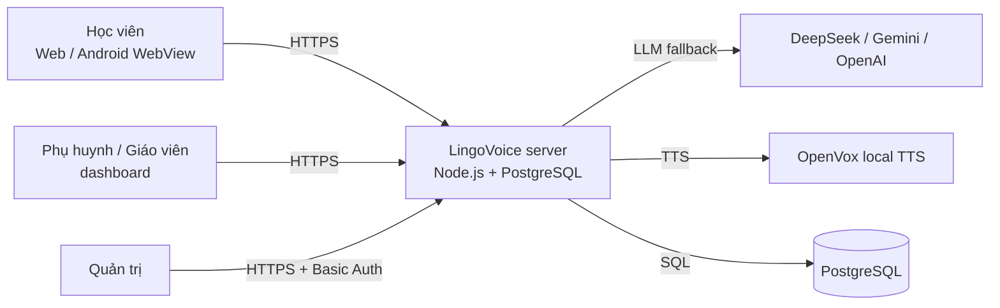
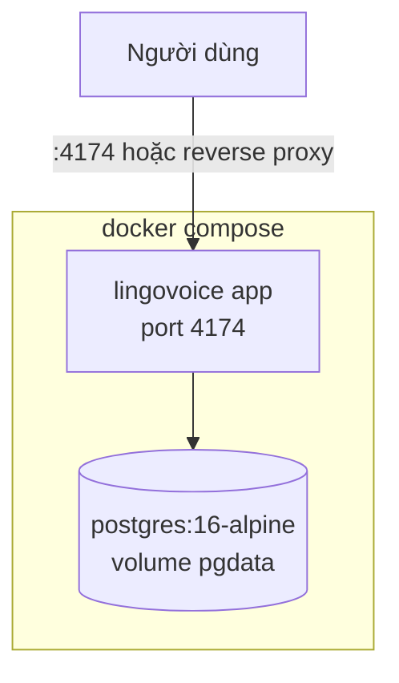

# Kiến trúc LingoVoice

> Trạng thái: thiết kế nền tảng lại 2026-08. Cập nhật khi có thay đổi kiến trúc (kèm ADR).

## 1. Bối cảnh hệ thống (C4 level 1)

**LingoVoice** phục vụ người học tiếng Anh + tiếng Trung người Việt 3–25 tuổi, qua web
(và Android WebView). Giáo viên AI "Cô Linh" dạy bằng giọng nói; hệ thống có trí nhớ
dài hạn về từng học viên.



## 2. Container (C4 level 2)

| Container | Công nghệ | Trách nhiệm |
|---|---|---|
| **Web app** | Vanilla JS SPA (`public/`) | 8 tab học, Web Speech API STT, phát audio, sync dữ liệu học |
| **API server** | Node.js `node:http` (`server.mjs`, zero framework) | Static + API: voice, placement, vocab, writing, roleplay, teacher chat, memory, auth, sync |
| **AI adapter** | `ai.mjs` | Fallback DeepSeek → Gemini → OpenAI; prompt giáo viên; JSON schema validator |
| **Voice client** | `voice.mjs` | OpenVox TTS, cache WAV SHA-256, manifest, pregen pipeline |
| **An toàn manifest** | `voice.mjs` | persist manifest luôn đọc-merge từ đĩa trước khi ghi + refresh theo mtime khi đọc → chạy `npm run pregen` lúc server đang sống không còn đè mất entry của nhau (cả hai phía ghi thêm entry của mình, không ai mất dữ liệu) |
| **Data layer** | `db/` (PostgreSQL + `pg`) | Migration, store interface, auth/session, đồng bộ học tập |
| **Admin dashboard** | `public/admin/` | Job queue, audit vocab, thống kê hệ thống |
| **Android wrapper** | `android/` (Java thuần) | WebView + SpeechRecognizer native (STT) |

## 3. Luồng dữ liệu chính

### 3.1 Học từ vựng (SRS)
```
Client: học thẻ → chấm Again/Hard/Good/Easy
  → srs-core.cjs tính trạng thái SM-2-lite (interval 1 phút/1 ngày/3 ngày/10 ngày)
  → lưu localStorage lv-srs (offline-first)
  → nền sync: POST /api/sync/push (upsert lên PG), đăng nhập máy mới: GET /api/sync/pull
```

### 3.2 Trí nhớ giáo viên dài hạn
```
Mọi prompt LLM ← buildMemoryPrompt(memory)  (mục tiêu, level, điểm yếu, lỗi sai gần đây)
Server: PG learner_profiles + memory_notes (trước đây: learner-memory.json)
```

### 3.3 Giọng nói
```
Learner audio (content có sẵn): POST /api/voice/prepared → chỉ trả WAV từ manifest pregen
                              (404 AUDIO_NOT_PREPARED → client dùng giọng máy)
Giáo viên nói (động): POST /api/voice/teacher → speakWithCache (cache đĩa trước, OpenVox sau)
STT: 100% phía client (Android SpeechRecognizer / Web Speech API)
```

### 3.4 Đăng nhập + đồng bộ (mới)
```
POST /api/auth/register|login → session cookie HMAC HttpOnly
Client giữ offline-first trong localStorage; khi có mạng + đăng nhập: push/pull qua /api/sync/*
Import 1 lần dữ liệu cũ: POST /api/sync/import-local (payload localStorage kiểu cũ)
```

## 4. Ràng buộc kiến trúc

1. **Ít dependency** — node:http/node:crypto trước, package sau (ADR-001 ghi nhận `pg`).
2. **Placement định tuyến 100%** — LLM không chấm placement (ADR không cho phép đổi).
3. **Audio learner = prepared-only** — server không tổng hợp TTS live cho nội dung learner; fallback giọng máy phía client.
4. **Offline-first phía client** — localStorage là store chính khi học; PG là bản chân lý đám mây khi đã đăng nhập (chiến lược merge last-write-wins theo trường, xem `data-model.md`).
5. **Secret chỉ trong `.env`** — admin API không bao giờ trả secret.
6. **Bảo mật tối thiểu** — scrypt hash password, session HMAC, Basic Auth cho admin; HTTPS do reverse proxy/tunnel đảm nhiệm khi deploy.

## 5. Deployment



- `docker compose up -d` dựng cả app + PostgreSQL; `npm run migrate` chạy trong app container khi khởi động (bật bằng `MIGRATE_ON_START=1`).
- Không có PG → app vẫn chạy với tính năng trí nhớ/sync tắt (`DB_AVAILABLE=false`), trả 503 `DB_UNAVAILABLE` cho các route DB.
- Deploy VPS công khai: rsync kèm `cache/` (audio pregen) và mount `./cache:/app/cache` (`.dockerignore` loại cache khỏi image; owner `1000:1000` để user `node` ghi manifest). PostgreSQL chỉ map `127.0.0.1:5432`. Đặt `APP_ACCESS_PASSWORD` trong `.env` để bật Basic Auth cho toàn app (mặc định user `student`); admin không đặt mật khẩu thì chỉ truy cập được từ loopback VPS (tunnel `ssh -L`).
- Trên macOS (colima): bind `./cache` không thấy dữ liệu vì colima không mount `/Volumes` vào VM — `docker-compose.override.yml` thay bằng named volume `audio_cache`, nạp một lần bằng `tar -C cache -c audio | docker run -i --rm -v lingovoice_audio_cache:/data alpine sh -c 'tar -x -C /data && chown -R 1000:1000 /data'` rồi restart app container. File override chỉ dùng trên Mac, không rsync lên VPS.

## 6. Sơ đồ module backend

```
server.mjs ── static + routing + auth gate
  ├── ai.mjs        → LLM (fallback chain, structured JSON)
  ├── voice.mjs     → OpenVox + cache WAV + manifest
  ├── placement.mjs → ngân hàng câu hỏi + scorer
  ├── admin.mjs     → job queue (PG jobs, fallback in-memory)
  ├── db/store.mjs  → toàn bộ SQL (interface có thể inject/mock)
  ├── db/auth.mjs   → register/login/session (scrypt + HMAC)
  └── memory.mjs    → build memory prompt (đọc qua store)
```
