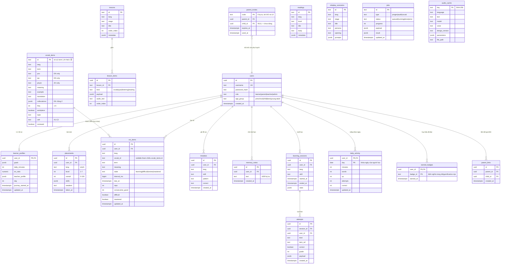

# Mô hình dữ liệu LingoVoice (PostgreSQL)

> Đơn vị lưu trữ chính: PostgreSQL (`DATABASE_URL`). Client offline dùng localStorage (`lv-*`)
> và đồng bộ qua API sync. Chi tiết bảng nằm trong `db/migrations/`.

## 1. Sơ đồ ERD



## 2. Hợp đồng đồng bộ (sync contract)

Client đăng nhập đồng bộ 4 nhóm dữ liệu học. **Offline-first**: localStorage luôn là nguồn ghi
trước; server là bản chân lý đám mây. Merge theo **last-write-wins từng item** (so `updated_at`).

### POST /api/sync/push
```json
{
  "srs": [{ "lang": "en", "term": "deadline", "meaning": "hạn chót", "vocabId": null,
            "state": "review", "intervalMs": 86400000, "dueAt": "2026-09-01T00:00:00Z",
            "reps": 3, "consecutiveGood": 2, "difficult": false, "mastered": false,
            "updatedAt": "2026-08-31T02:00:00Z" }],
  "mistakes": [{ "lang": "en", "skill": "writing", "pattern": "I am agree",
                 "correct": "I agree", "createdAt": "..." }],
  "progress": { "en": { "learned": 42, "due": 5, "mistakes": 7 },
                "zh": { "learned": 0, "due": 0, "mistakes": 0 } },
  "profile": { "goals": ["cong-viec"], "dailyMinutes": 15, "enRatio": 0.7,
               "ageGroup": "young-adult", "day": 12 },
  "teacherProfile": { "personality": "warm", "voices": { "en": "F4" }, "speed": 0.9 }
}
```
→ `200 { "accepted": { "srs": 12, "mistakes": 3 } }` (số item upsert thành công)

### GET /api/sync/pull
→ trả cùng shape (không có field thì rỗng). Client merge vào localStorage theo `updatedAt`.

### POST /api/sync/import-local (1 lần/máy)
Payload đúng **bản đồ key localStorage cũ**: `lv-srs`, `lv-mistakes`, `lv-profile`,
`lv-custom-vocab`, `lv-mined`, `lv-days`, `lingovoice-progress`, `lv-teacher-profile`.
Server map sang schema sync trên. Idempotent — gọi lại không nhân đôi.

## 3. Từ điển dữ liệu chuẩn

| Khái niệm | Kiểu | Ghi chú |
|---|---|---|
| `lang` | `en` \| `zh` | không có giá trị khác |
| `stage` tuổi | `preschool`(3–6) `child`(7–12) `teen`(13–17) `young-adult`(18–25) | đổi stage không reset dữ liệu |
| SRS state | `learning` `difficult` `review` `mastered` | master khi 3 lần liên tiếp Good+ |
| SRS interval | 1 phút / 1 ngày / 3 ngày / 10 ngày | SM-2-lite, xem `public/srs-core.cjs` |
| Placement level | 1–7 | overall 0–100, kèm skills con |
| teacherProfile.personality | `warm` \| `strict` \| `energetic` | speed 0.75–1.15 |
| vocab id | `en-{cefr}-{term}` \| `zh-{topic}-{term}` | khớp `docs/data-preparation.md` |
| attempt kind | `vocab` \| `listening` \| `writing` \| `speaking` \| `reading` \| `quiz` | nguồn gamification (XP: đúng +10, sai +2) |
| activity day | `YYYY-MM-DD` | múi giờ người học; lệch UTC tối đa +1 ngày |
| badge id | `first-day` `words-10` `words-50` `streak-7` `streak-30` `correct-50` `xp-500` `master-10` | test điều kiện là code thuần |

## 4. Chính sách dữ liệu

- Xóa account → xóa cascade toàn bộ dữ liệu learner (FK ON DELETE CASCADE).
- Dữ liệu trẻ em: chỉ lưu phục vụ học tập, không PII beyond username/display name.
- `audio_cache` có thể truncate lại bất cứ lúc nào (regenerate từ manifest).
- Phụ huynh chỉ thấy số liệu tiến độ (activity/SRS/mistakes tổng hợp) — không thấy mật khẩu,
  session, nội dung chat; liên kết do CON chủ động nhập mã.
